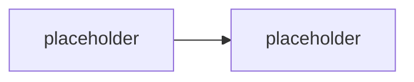

# <Název modulu>

> Typ: povinný | volitelný · Den: <N> · Odhad: <min> min
> Tenant: `cloudedu.cz` · Režim: hands-on, vlastní web | hands-on, celý tenant | jen lokálně | instruktorské demo
> Prostředí: [`../../environment.md`](../../environment.md) · Názvosloví: [`../../GLOSSARY.md`](../../GLOSSARY.md)

<nepovinný odstavec: kam blok patří v oblouku týdne a na co navazuje>

## Cíle

- <co student po bloku umí — začínej slovesem, ne „seznámit se s">

## Výklad

<text; názvy proti GLOSSARY.md; žádné tvrzení bez odkazu nebo měření>

## Klíčové rozlišení

- **<A> vs. <B>** — <čím se liší a proč na tom záleží>

## Naše prostředí

<co pro tenhle blok platí na kurzovním tenantu a učebním stroji; odkaz na go/no-go
položku v environment.md, pokud existuje>

## Lab

Viz [`lab-<slug>.md`](lab-<slug>.md).

## Nosná linka

<co řešení vltava-portal v tomto bloku získalo a co se tím změnilo — viz
[`../../scenario-vltava-portal.md`](../../scenario-vltava-portal.md)>

## Zdroje (Microsoft)

- [<název stránky>](https://learn.microsoft.com/...)

## Stav produktu / delta

> [!WARNING] Ověřit k datu běhu — stav k <RRRR-MM>.
> <co ověřit: verze SPFx, chování toolchainu, název v UI>
