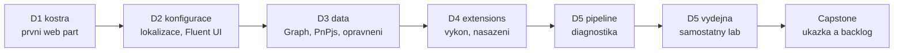

# Agenda — pořadí bloků

Jediný zdroj pravdy o pořadí modulů. Složky jsou slugy; pořadí drží tato tabulka. Změna
pořadí = úprava tohoto souboru, ne přejmenování složek.

Denní briefingy: [`day-1`](./day-1/README.md) · [`day-2`](./day-2/README.md) ·
[`day-3`](./day-3/README.md) · [`day-4`](./day-4/README.md) · [`day-5`](./day-5/README.md).

**5 dní · 18 povinných bloků + 2 volitelné.** P = povinný, V = volitelný / samostudium.

> [!IMPORTANT] Osnova je restrukturalizovaná proti webu
> Katalogová osnova má 15 bloků po 2–2,5 h a bonus (součet ~37 h). Tato agenda drží stav
> produktu k 2026-10 a opravuje věcné chyby katalogu: toolchain je od SPFx 1.22 **Heft, ne
> gulp**; „polyfill strategie" je pro SharePoint Online bezpředmětná (IE 11 je blokovaný,
> viz [`self-study.md`](./self-study.md)) a mění se na runtime baseline. Lokalizace je sloučená k property pane
> (samostatných 2,5 h je vata), telemetrie s hardeningem do jednoho bloku. Mapování na
> katalog a vyřazená témata jsou v [`self-study.md`](./self-study.md).

> [!WARNING] Timing — publikovaná čísla jsou nominální
> Pracovní kapacita plánu je **~310 min odučeného obsahu denně**, den 5 končí v 15:00
> (~270 min). Celkem **1 425 min povinných ≈ 23,75 h**. Skutečné timingy žijí
> v `instructor-notes.md` jednotlivých modulů a po prvním běhu se sem vrátí naměřené.

> [!WARNING] Ověřit k datu běhu — stav k 2026-10.
> Laby stojí na **SPFx 1.23.2** (npm `latest` k 2026-10-16). SPFx **1.24** byla k témuž dni
> ve stavu release candidate (`1.24.0-rc.0`) s GA ohlášenou na říjen 2026 — může vyjít během
> kurzu. Kurz na RC nepřechází; 1.24 je delta v bloku `spfx-whats-next`.

## Den 1 — Platforma, nástroje, první web part

Motiv: **z holého stroje k vlastnímu web partu na vlastním webu v jednom dni.**

| # | Blok | Slug | Typ | min |
|---|---|---|---|---|
| 1 | SPFx v Microsoft 365 — pozice, hranice tenantu | `platform-positioning` | P | 45 |
| 2 | Vývojové prostředí od nuly | `dev-environment` | P | 105 |
| 3 | Anatomie projektu | `project-anatomy` | P | 60 |
| 4 | První web part — workbench a moderní stránka | `first-webpart` | P | 90 |
| — | TypeScript pro SPFx — jazyk a konfigurace (samostudium) | `opt-typescript` | V | 60 |

Celkem **300 min** povinných, + 60 volitelných (samostudium).

> [!NOTE] Instalace je obsah, ne předehra
> Učební stroje mají jen VS Code a PowerShell 7. Instalace Node.js, fnm, gitu a globálních
> balíčků je proto plnohodnotný blok s checkpointy, ne „připravte si prostředí". `npm install`
> projektu běží v bloku 3 **souběžně s výkladem** — student čte soubory projektu, zatímco se
> stahuje `node_modules`.

## Den 2 — Konfigurace a UI

| # | Blok | Slug | Typ | min |
|---|---|---|---|---|
| 1 | Property pane a dynamická konfigurace | `property-pane` | P | 90 |
| 2 | Lokalizace a více jazyků | `localization` | P | 45 |
| 3 | React a Fluent UI | `react-fluent-ui` | P | 120 |
| — | KendoReact — komerční UI knihovna v SPFx | `opt-kendo-react` | V | 60 |

Celkem **255 min** povinných + 60 volitelných.

## Den 3 — Data a oprávnění

| # | Blok | Slug | Typ | min |
|---|---|---|---|---|
| 1 | SPHttpClient, MSGraphClientFactory, AadHttpClient | `data-access-clients` | P | 75 |
| 2 | API oprávnění, admin consent a fallback | `permissions-consent` | P | 75 |
| 3 | PnPjs — CRUD, projekce, batching, chyby | `pnpjs` | P | 90 |
| 4 | Výkon I — měřený baseline balíčku | `bundle-baseline` | P | 60 |

Celkem **300 min**.

> [!NOTE] První nasazení je na dni 3, ne na dni 4
> Žádosti o API oprávnění (`webApiPermissionRequests`) vznikají až **nasazením `.sppkg` do
> App Catalogu** ([Connect to Entra ID-secured APIs](https://learn.microsoft.com/en-us/sharepoint/dev/spfx/use-aadhttpclient));
> v kurzu do tenantového. Blok `permissions-consent` proto potřebuje první nasazení dřív,
> než ho den 4 zformalizuje v `packaging-deployment`. Den 3 nasazuje „nutné minimum", den 4
> řeší verzování, upgrade a tenant vs. site.

## Den 4 — Rozšíření, výkon, nasazení

| # | Blok | Slug | Typ | min |
|---|---|---|---|---|
| 1 | Extensions — Application Customizer, Command Set, Field Customizer | `extensions` | P | 120 |
| 2 | Výkon II — code splitting, lazy loading, cache | `performance-caching` | P | 90 |
| 3 | Balení a App Catalog — verze, upgrade, tenant vs. site | `packaging-deployment` | P | 90 |

Celkem **300 min**.

## Den 5 — Kvalita a provoz

Den končí v 15:00.

| # | Blok | Slug | Typ | min |
|---|---|---|---|---|
| 1 | CI/CD a quality gates | `ci-cd-quality` | P | 45 |
| 2 | Diagnostika a hardening | `diagnostics-hardening` | P | 45 |
| 3 | Výdejna vybavení — samostatný lab | `equipment-desk` | P | 120 |
| 4 | Co přináší SPFx 1.24 a 1.25 | `spfx-whats-next` | P | 20 |
| 5 | Capstone — ukázka výsledku a backlog | `capstone` | P | 40 |

Celkem **270 min**.

> [!NOTE] Den 5 stojí na samostatném labu
> Nejdelší blok dne je `equipment-desk`: student **sám** podle kroků postaví full-page
> aplikaci Výdejna vybavení (druhý seznam s lookupem, Pivot, Panel formuláře, výdej a vrácení).
> Pipeline a diagnostika jsou proto zhuštěné — co jde ukázat, ukáže lektor. Capstone je
> ukázka výsledku labu a backlog, ne code review ve dvojicích.

## Kompresní ventily — v tomto pořadí

Škrtá se odshora. Nic povinného ani capstone nezávisí na tom, co je v seznamu.

**Den 1** — 1. historie v `platform-positioning` jen jako tabulka zlomů (−10);
2. pohled do `.sppkg` a ověření bez gulp v `project-anatomy` jako demo lektora (−10);
3. styl a reaktivní property pane v `first-webpart` vynechat, ladění ve VS Code jen zmínkou
   (−15).
**Nekrátit** `dev-environment` — bez funkčního prostředí neběží zbytek týdne — ani test na
moderní stránce v `first-webpart` (jediná cesta k testování extensions ve čtvrtek).

**Den 2** — 1. `opt-kendo-react` **vypadává celý** (−60);
2. kroky 9 a 11 v `property-pane` (srovnání reaktivního a nereaktivního režimu) vynechat (−10);
3. toolbox na české stránce v `localization` (krok 5) jako demo (−5);
4. motiv sekce a `escape()` v `react-fluent-ui` (kroky 7–8) jako demo (−10).
**Nekrátit** `react-fluent-ui` — struktura komponent z tohoto bloku nese dny 3–5.

**Den 3** — 1. porovnání požadavků v Network (`data-access-clients`, krok 13) jako demo (−10);
2. ověření chybějícího seznamu v `pnpjs` (krok 17) jako demo (−10);
3. pohled do dependency auditu v `bundle-baseline` (krok 5) jako demo (−5).
**Nekrátit** `permissions-consent` (bez schválených oprávnění nefunguje Graph) ani
`bundle-baseline` (den 4 nemá s čím srovnávat).

**Den 4** — 1. JSON formátování v `extensions` (krok 12) jako demo (−10);
2. experiment s lazy loadingem v `performance-caching` (krok 3) jako demo s čísly z README (−15).
**Nekrátit** `packaging-deployment` — capstone stojí na nasazeném řešení.

**Den 5** — 1. kontrola výstupu buildu v `diagnostics-hardening` jen jako demo s referenčními
nálezy (−5); 2. `spfx-whats-next` jen výklad (−10); 3. bonusové kroky `equipment-desk` nejsou
povinné — rychlí je dělají, ostatní je přeskočí.
**Nekrátit** jádro `equipment-desk` — na jeho výsledku stojí capstone.

> [!IMPORTANT] Volitelné moduly jsou vždy leaf
> `opt-kendo-react` ani `opt-typescript` nesmí být předpokladem žádného povinného bloku ani capstonu. Kdo je
> neviděl, nesmí být znevýhodněn.

## Nosná linka — jedno řešení celý týden

Kurz nebuduje sérii nesouvisejících cvičení, ale **jedno SPFx řešení** `vltava-portal`, kterému
každý blok něco přidá. Scénář: [`scenario-vltava-portal.md`](./scenario-vltava-portal.md).

## Nitě napříč kurzem

- **Měřicí nit** — `project-anatomy` (D1, čas instalace) → `bundle-baseline` (D3, první
  změřená velikost balíčku) → `performance-caching` (D4, totéž po optimalizaci) →
  `ci-cd-quality` (D5, limit velikosti v pipeline) → `equipment-desk` (D5, kolik stojí
  Pivot a Panel) → `capstone` (D5, obhajoba čísel).
- **Tenantová nit** — `platform-positioning` (D1, kód běží jako uživatel v jeho tenantu) →
  `permissions-consent` (D3, schválení platí pro celý tenant) → `packaging-deployment`
  (D4, tenant vs. site) → `diagnostics-hardening` (D5, co smí opustit tenant). Pokaždé
  „kam data tečou a kdo to schválil".
- **Nit toolchainu** — `dev-environment` (D1) → `project-anatomy` (D1, rig) →
  `performance-caching` (D4, analýza balíčku) → `ci-cd-quality` (D5, stejný build v pipeline)
  → `spfx-whats-next` (D5, SPFx CLI, Node 24).
