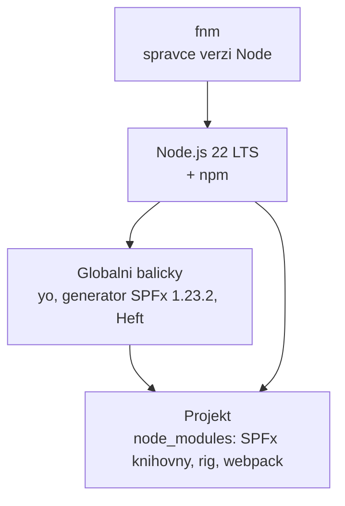

# Vývojové prostředí od nuly

> Typ: povinný · Den: 1 · Odhad: 105 min
> Tenant: `cloudedu.cz` · Režim: hands-on, lokální stroj + založení vlastního webu
> Prostředí: [`../../environment.md`](../../environment.md) · Názvosloví: [`../../GLOSSARY.md`](../../GLOSSARY.md)

Učební stroj má jen VS Code a PowerShell 7. Na konci bloku má toolchain pro SPFx 1.23.2,
vlastní web na tenantu a kontrolní skript, který to potvrdí.

## Cíle

- Nainstalovat Node.js přes správce verzí a vysvětlit, proč ne instalátorem.
- Nainstalovat globální nástroje SPFx v **přesné** verzi, kterou kurz používá.
- Nastavit `SPFX_SERVE_TENANT_DOMAIN`, aby se workbench otevíral na vlastním webu.
- Ověřit prostředí skriptem, ne pocitem.

## Výklad

### Co se kam instaluje



- **Globálně** jsou jen nástroje, které spouštíš z příkazové řádky: Yeoman (`yo`), generátor
  SPFx a Heft CLI. Dokumentace je doporučuje instalovat globálně, i když Heft technicky
  nutný globálně není.
- **V projektu** (`node_modules`) je všechno ostatní — SPFx knihovny, rig s konfigurací buildu,
  webpack, TypeScript. Každý projekt má vlastní kopii ve verzi, se kterou byl vygenerovaný.

Zdroj: [Set up your SharePoint Framework development environment](https://learn.microsoft.com/en-us/sharepoint/dev/spfx/set-up-your-development-environment)
(updated 2026-08-27).

### Proč Node.js přes fnm

SPFx podporuje jen konkrétní **LTS** verzi Node.js a ta se mění s verzí SPFx:

| SPFx | Node.js |
|---|---|
| 1.18.x | 16, 18 |
| 1.19 – 1.20 | 18 |
| 1.21 – 1.23.2 | **22** |

Zdroj: [SPFx compatibility](https://learn.microsoft.com/en-us/sharepoint/dev/spfx/compatibility).

Kdo udržuje řešení z různých let, potřebuje na jednom stroji víc verzí Node.js. Správce verzí
(fnm, nvm-windows) je přepíná per terminál, bez admin práv a bez odinstalace. Instalátor
`.msi` z nodejs.org umí jen jednu verzi a potřebuje admina.

> [!IMPORTANT] Globální balíčky patří ke konkrétní verzi Node.js
> fnm drží každou verzi Node.js v samostatné složce **včetně jejích globálních balíčků**.
> Po `fnm use 20` „zmizí" `yo` i generátor — jsou nainstalované u Node.js 22. Nejde
> o chybu, ale o izolaci. Po přepnutí verze se globální nástroje instalují znovu.

### Proč přesná verze generátoru

Generátor SPFx vygeneruje projekt **ve své verzi**. `npm install @microsoft/generator-sharepoint
--global` bez verze nainstaluje `latest` — a ta se může změnit během kurzu (SPFx 1.24 byla
k 2026-10-16 ve stavu RC s GA ohlášenou na říjen). Proto v kurzu vždy `@1.23.2`.

### `SPFX_SERVE_TENANT_DOMAIN`

Vygenerovaný `config/serve.json` neobsahuje adresu tenantu, ale zástupný symbol:

```json
"initialPage": "https://{tenantDomain}/_layouts/workbench.aspx"
```

Toolchain ho při `heft start` nahradí hodnotou proměnné prostředí `SPFX_SERVE_TENANT_DOMAIN`.
Proměnná smí obsahovat i cestu k webu — v kurzu ji proto nastavíme na vlastní web studenta
a workbench se otevře rovnou tam. Adresa tenantu tak není v kódu ani v gitu.

Zdroj: [Set up your development environment](https://learn.microsoft.com/en-us/sharepoint/dev/spfx/set-up-your-development-environment),
sekce *Set the SPFX_SERVE_TENANT_DOMAIN environment variable*.

### Co se **neinstaluje**

- **gulp-cli** — legacy toolchain SPFx 1.0–1.21.1. Projekt SPFx 1.23 ho nepoužívá.
- **Jiný správce balíčků** (pnpm, yarn) — v kurzu jen npm, aby všichni měli stejné chování.
- **Novější npm** — zůstává verze, kterou přinese Node.js 22.

## Klíčové rozlišení

- **Globální nástroj vs. závislost projektu** — `heft` v terminálu je CLI; build ale řídí
  Heft a rig ve verzích z `node_modules` projektu.
- **Node.js LTS vs. Current** — SPFx podporuje jen LTS. Nejnovější Node.js není správná
  odpověď.

## Naše prostředí

- Stroj: VS Code + PowerShell 7, ostatní se instaluje do profilu uživatele.
- Tenant: `cloudedu.cz`, student je Global Administrator a zakládá si vlastní web
  `/sites/spodev-<iniciály>`.
- Adresu SharePointu tenantu (`<tenant>.sharepoint.com`) sdělí lektor.
- Otevřené položky go/no-go (síť učebny, winget) v [`../../environment.md`](../../environment.md).

## Lab

Viz [`lab-instalace-prostredi.md`](lab-instalace-prostredi.md).

## Nosná linka

Řešení zatím neexistuje. Vzniká **web**, na kterém bude celý týden žít — testovací stránka,
seznam vybavení i site collection App Catalog.

## Zdroje (Microsoft)

- [Set up your SharePoint Framework development environment](https://learn.microsoft.com/en-us/sharepoint/dev/spfx/set-up-your-development-environment)
- [SPFx compatibility](https://learn.microsoft.com/en-us/sharepoint/dev/spfx/compatibility)
- [Heft-based toolchain](https://learn.microsoft.com/en-us/sharepoint/dev/spfx/toolchain/sharepoint-framework-toolchain-rushstack-heft)

## Zdroje (třetí strana — fnm)

> [!IMPORTANT] Proč odkaz mimo Learn
> Microsoft Learn správce verzí Node.js nepopisuje. Odkaz dokládá jen instalaci a příkazy fnm.

- [fnm — Fast Node Manager](https://github.com/Schniz/fnm)

## Stav produktu / delta

> [!WARNING] Ověřit k datu běhu — stav k 2026-10.
> Verze generátoru `@microsoft/generator-sharepoint` (`latest` = 1.23.2 k 2026-10-16) a podpora
> Node.js. SPFx 1.24 má přinést Node.js 24/26 — pokud vyjde GA během kurzu, kurz zůstává
> na 1.23.2 a Node.js 22.
