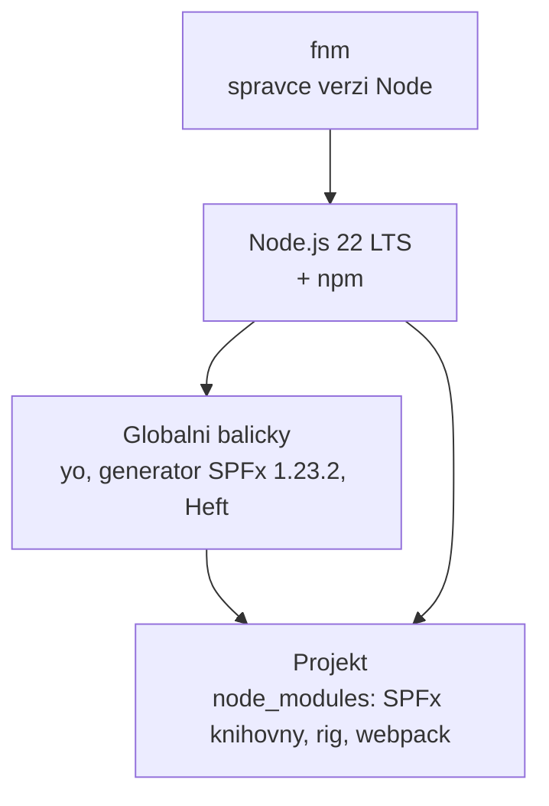
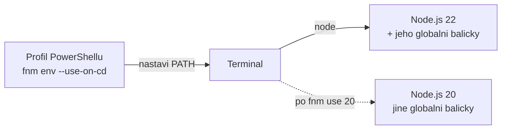
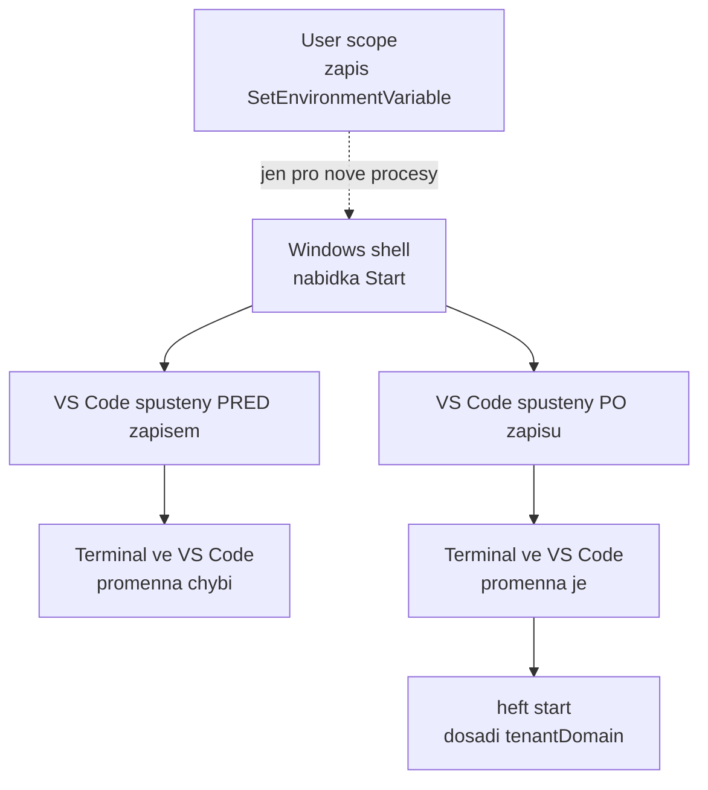

# Vývojové prostředí od nuly

> Typ: povinný · Den: 1 · Odhad: 105 min
> Tenant: `cloudedu.cz` · Režim: hands-on, lokální stroj + založení vlastního webu
> Prostředí: [`../../environment.md`](../../environment.md) · Názvosloví: [`../../GLOSSARY.md`](../../GLOSSARY.md)

Učební stroj má jen VS Code a PowerShell 7. Na konci bloku má toolchain pro SPFx 1.23.2,
vlastní web na tenantu a kontrolní skript, který to potvrdí.

## Cíle

- Nainstalovat Node.js přes správce verzí a vysvětlit, proč ne instalátorem.
- Nainstalovat globální nástroje SPFx v **přesné** verzi, kterou kurz používá.
- Nastavit `SPFX_SERVE_TENANT_DOMAIN`, aby se workbench otevíral na vlastním webu.
- Ověřit prostředí skriptem, ne pocitem.

## Výklad

### Co se kam instaluje



- **Globálně** jsou jen nástroje, které spouštíš z příkazové řádky: Yeoman (`yo`), generátor
  SPFx a Heft CLI. Dokumentace je doporučuje instalovat globálně, i když Heft technicky
  nutný globálně není.
- **V projektu** (`node_modules`) je všechno ostatní — SPFx knihovny, rig s konfigurací buildu,
  webpack, TypeScript. Každý projekt má vlastní kopii ve verzi, se kterou byl vygenerovaný.

Zdroj: [Set up your SharePoint Framework development environment](https://learn.microsoft.com/en-us/sharepoint/dev/spfx/set-up-your-development-environment)
(updated 2026-08-27).

### Proč Node.js přes fnm

SPFx podporuje jen konkrétní **LTS** verzi Node.js a ta se mění s verzí SPFx:

| SPFx | Node.js |
|---|---|
| 1.18.x | 16, 18 |
| 1.19 – 1.20 | 18 |
| 1.21 – 1.23.2 | **22** |

Zdroj: [SPFx compatibility](https://learn.microsoft.com/en-us/sharepoint/dev/spfx/compatibility).

Kdo udržuje řešení z různých let, potřebuje na jednom stroji víc verzí Node.js. Správce verzí
(fnm, nvm-windows) je přepíná per terminál, bez admin práv a bez odinstalace. Instalátor
`.msi` z nodejs.org umí jen jednu verzi a potřebuje admina.

> [!IMPORTANT] Globální balíčky patří ke konkrétní verzi Node.js
> fnm drží každou verzi Node.js v samostatné složce **včetně jejích globálních balíčků**.
> Po `fnm use 20` „zmizí" `yo` i generátor — jsou nainstalované u Node.js 22. Nejde
> o chybu, ale o izolaci. Po přepnutí verze se globální nástroje instalují znovu.

### Proč přesná verze generátoru

Generátor SPFx vygeneruje projekt **ve své verzi**. `npm install @microsoft/generator-sharepoint
--global` bez verze nainstaluje `latest` — a ta se může změnit během kurzu (SPFx 1.24 byla
k 2026-10-16 ve stavu RC s GA ohlášenou na říjen). Proto v kurzu vždy `@1.23.2`.

### `SPFX_SERVE_TENANT_DOMAIN`

Vygenerovaný `config/serve.json` neobsahuje adresu tenantu, ale zástupný symbol:

```json
"initialPage": "https://{tenantDomain}/_layouts/workbench.aspx"
```

Toolchain ho při `heft start` nahradí hodnotou proměnné prostředí `SPFX_SERVE_TENANT_DOMAIN`.
Proměnná smí obsahovat i cestu k webu — v kurzu ji proto nastavíme na vlastní web studenta
a workbench se otevře rovnou tam. Adresa tenantu tak není v kódu ani v gitu.

Zdroj: [Set up your development environment](https://learn.microsoft.com/en-us/sharepoint/dev/spfx/set-up-your-development-environment),
sekce *Set the SPFX_SERVE_TENANT_DOMAIN environment variable*.

### Jak fnm přepíná verzi: všechno je `PATH`

Když napíšeš `node`, PowerShell nehledá „nainstalovaný Node.js", ale první spustitelný soubor
toho jména ve složkách vyjmenovaných v proměnné `PATH`
([about_Environment_Variables](https://learn.microsoft.com/en-us/powershell/module/microsoft.powershell.core/about/about_environment_variables),
sekce *Path information*). Správce verzí nedělá nic jiného, než že tuhle proměnnou
nastaví pro aktuální terminál:

- `fnm env` vypíše sadu příkazů pro shell, které se mají vyhodnotit a připravit prostředí
  pro fnm. Proto řádek v profilu končí `| Out-String | Invoke-Expression` — výstup se
  hned spustí.
- `--use-on-cd` přidá skript, který při změně adresáře přepne verzi Node.js; verzi čte
  ze souborů `.node-version` nebo `.nvmrc`.
- `fnm default 22` nastaví výchozí verzi, `fnm use 22` změní verzi Node.js. Lab volá obojí,
  aby nový terminál i ten aktuální měly Node.js 22 (jak přesně se výchozí verze uplatní
  v nově otevřeném terminálu, dokumentace příkazů nepopisuje — neověřeno).

Zdroj syntaxe: [fnm — commands](https://github.com/Schniz/fnm/blob/master/docs/commands.md),
[fnm README](https://github.com/Schniz/fnm).



Kontrola, kterou verzi terminál opravdu používá, je jeden příkaz: `Get-Command node`
ukáže cestu k souboru, který se spustí. Když cesta nevede do složky fnm, profil se nenačetl.

> [!NOTE] `engines` v `package.json` přepnutí nezařídí
> Vygenerovaný projekt deklaruje `"engines": { "node": ">=22.14.0 < 23.0.0" }`. fnm umí toto
> pole číst jen s volbou `--resolve-engines` a jen tam, kde chybí `.node-version` / `.nvmrc`
> ([fnm — commands](https://github.com/Schniz/fnm/blob/master/docs/commands.md)). V kurzu ji
> nepoužíváme — verzi drží `fnm default 22`.

### Proměnné prostředí se dědí při startu procesu

Proč musí student po nastavení `SPFX_SERVE_TENANT_DOMAIN` zavřít **celé** VS Code? Protože
každý proces dostane proměnné prostředí od svého rodiče ve chvíli, kdy startuje. Dokumentace
PowerShellu popisuje tři úrovně ve Windows — *Machine*, *User* a *Process* — a úroveň
*Process* se skládá z *Machine* a *User* a dědí od rodičovského procesu
([about_Environment_Variables](https://learn.microsoft.com/en-us/powershell/module/microsoft.powershell.core/about/about_environment_variables)).



Lab proto v kroku 8 dělá dvě věci najednou:

```powershell
[Environment]::SetEnvironmentVariable('SPFX_SERVE_TENANT_DOMAIN', $domain, 'User') # persists for new processes
$env:SPFX_SERVE_TENANT_DOMAIN = $domain                                           # current session only
```

Zápis přes `$env:` platí jen v aktuální relaci; trvalou změnu na úrovni *User* zapisuje
metoda třídy `System.Environment`
([about_Environment_Variables](https://learn.microsoft.com/en-us/powershell/module/microsoft.powershell.core/about/about_environment_variables)).
Druhý řádek tedy jen ušetří restart terminálu, ve kterém student zrovna pracuje.

### Který profil PowerShellu se načte kde

Řádek s `fnm env` musí běžet v **každém** terminálu, ve kterém spouštíš `node`. PowerShell 7
má pro aktuálního uživatele dva profily a VS Code přidává vlastní
([about_Profiles](https://learn.microsoft.com/en-us/powershell/module/microsoft.powershell.core/about/about_profiles)):

| Profil | Soubor (Windows) | Načte se v |
|---|---|---|
| `$PROFILE.CurrentUserAllHosts` | `$HOME\Documents\PowerShell\Profile.ps1` | každém hostiteli PowerShellu 7 |
| `$PROFILE` (= `CurrentUserCurrentHost`) v konzoli | `$HOME\Documents\PowerShell\Microsoft.PowerShell_profile.ps1` | jen v konzolovém hostiteli |
| `CurrentUserCurrentHost` ve VS Code | `$HOME\Documents\PowerShell\Microsoft.VSCode_profile.ps1` | jen v hostiteli PowerShellu ve VS Code |

Dokumentace doporučuje věci společné všem hostitelům dávat do `CurrentUserAllHosts` (tamtéž,
sekce *How to choose a profile*). Proto lab zapisuje tam — a proto „fnm funguje ve Windows
Terminalu, ale ne ve VS Code" je skoro vždy zápis do `$PROFILE` místo
`$PROFILE.CurrentUserAllHosts`.

> [!NOTE] Profil v OneDrivu
> Dokumentace nedoporučuje mít složku `Documents` přesměrovanou do OneDrivu nebo na síťový
> disk — moduly a profil pak mohou selhávat (tamtéž). Na učebním stroji neověřeno, zda je
> `Documents` přesměrovaný.

### Typické chyby a jak je poznat

| Příznak | Příčina | Ověření |
|---|---|---|
| `node` není rozpoznaný příkaz | profil se nenačetl nebo v něm chybí `fnm env` | `Get-Content $PROFILE.CurrentUserAllHosts` |
| `node --version` vypíše jinou verzi než 22 | v `PATH` je dřív jiný Node.js (např. z `.msi`) | `Get-Command node` — cesta mimo fnm |
| Po přepnutí verze chybí `yo` | globální balíčky patří ke konkrétní verzi Node.js | `node --version`, pak `npm ls --global --depth=0` |
| Workbench se otevře s `{tenantDomain}` v adrese | proces nezdědil `SPFX_SERVE_TENANT_DOMAIN` | `$env:SPFX_SERVE_TENANT_DOMAIN` v tom terminálu, kde běží `npm start` |
| Příkazy SPFx fungují v jednom terminálu, v jiném ne | dva různé hostitele a profil jen pro jeden | `$PROFILE.CurrentUserAllHosts` a `$PROFILE` vypsat v obou |

### Co se **neinstaluje**

- **gulp-cli** — legacy toolchain SPFx 1.0–1.21.1. Projekt SPFx 1.23 ho nepoužívá.
- **Jiný správce balíčků** (pnpm, yarn) — v kurzu jen npm, aby všichni měli stejné chování.
- **Novější npm** — zůstává verze, kterou přinese Node.js 22.

## Klíčové rozlišení

- **Globální nástroj vs. závislost projektu** — `heft` v terminálu je CLI; build ale řídí
  Heft a rig ve verzích z `node_modules` projektu.
- **Node.js LTS vs. Current** — SPFx podporuje jen LTS. Nejnovější Node.js není správná
  odpověď.
- **`$env:X = ...` vs. `[Environment]::SetEnvironmentVariable(..., 'User')`** — první platí
  jen v aktuální relaci, druhé trvale, ale jen pro procesy spuštěné **po** zápisu.
- **`$PROFILE` vs. `$PROFILE.CurrentUserAllHosts`** — první je profil jednoho hostitele
  (konzole, nebo VS Code), druhý se načte ve všech hostitelích PowerShellu 7.
- **`fnm default` vs. `fnm use`** — nastavení výchozí verze vs. změna verze; lab volá obojí.

## Naše prostředí

- Stroj: VS Code + PowerShell 7, ostatní se instaluje do profilu uživatele.
- Tenant: `cloudedu.cz`, student je Global Administrator a zakládá si vlastní web
  `/sites/spodev-<iniciály>`.
- Adresu SharePointu tenantu (`<tenant>.sharepoint.com`) sdělí lektor.
- Otevřené položky go/no-go (síť učebny, winget) v [`../../environment.md`](../../environment.md).

## Lab

Viz [`lab-instalace-prostredi.md`](lab-instalace-prostredi.md).

## Nosná linka

Řešení zatím neexistuje. Vzniká **web**, na kterém bude celý týden žít — testovací stránka,
seznam vybavení i site collection App Catalog.

## Zdroje (Microsoft)

- [Set up your SharePoint Framework development environment](https://learn.microsoft.com/en-us/sharepoint/dev/spfx/set-up-your-development-environment)
- [SPFx compatibility](https://learn.microsoft.com/en-us/sharepoint/dev/spfx/compatibility)
- [Heft-based toolchain](https://learn.microsoft.com/en-us/sharepoint/dev/spfx/toolchain/sharepoint-framework-toolchain-rushstack-heft)
- [about_Environment_Variables](https://learn.microsoft.com/en-us/powershell/module/microsoft.powershell.core/about/about_environment_variables)
- [about_Profiles](https://learn.microsoft.com/en-us/powershell/module/microsoft.powershell.core/about/about_profiles)

## Zdroje (třetí strana — fnm)

> [!IMPORTANT] Proč odkaz mimo Learn
> Microsoft Learn správce verzí Node.js nepopisuje. Odkaz dokládá jen instalaci a příkazy fnm.

- [fnm — Fast Node Manager](https://github.com/Schniz/fnm)
- [fnm — commands](https://github.com/Schniz/fnm/blob/master/docs/commands.md)

## Stav produktu / delta

> [!WARNING] Ověřit k datu běhu — stav k 2026-10.
> Verze generátoru `@microsoft/generator-sharepoint` (`latest` = 1.23.2 k 2026-10-16) a podpora
> Node.js. SPFx 1.24 má přinést Node.js 24/26 — pokud vyjde GA během kurzu, kurz zůstává
> na 1.23.2 a Node.js 22.
