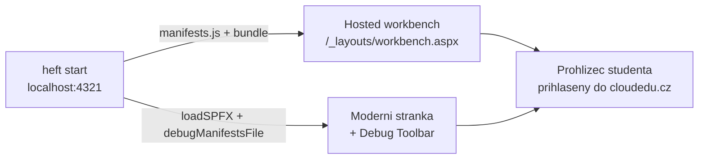

# První web part — workbench a moderní stránka

> Typ: povinný · Den: 1 · Odhad: 90 min
> Tenant: `cloudedu.cz` · Režim: hands-on, vlastní web
> Prostředí: [`../../environment.md`](../../environment.md) · Názvosloví: [`../../GLOSSARY.md`](../../GLOSSARY.md)

Web part `Portal` se poprvé spustí — nejdřív v hosted workbenchi, pak na skutečné stránce
vlastního webu. Na konci dne z něj je kostra **Rozcestníku** Vltava Servis.

## Cíle

- Spustit vývojovou smyčku: `npm start`, změna kódu, nová kompilace, obnovení stránky.
- Otestovat web part v hosted workbenchi **i** na moderní stránce s Debug Toolbarem.
- Popsat životní cyklus web partu (`onInit`, `render`, `onThemeChanged`, `onDispose`)
  a kde se v něm napojuje React.
- Přidat lokalizovaný text a vysvětlit, proč ho TypeScript nehlídá celý.

## Výklad

### Kde web part běží při vývoji



`npm start` (`heft start`) nezkopíruje nic do SharePointu. Spustí lokální HTTPS server
a stránka v tenantu si z něj **v prohlížeči** stáhne manifesty a JavaScript. Proto:

- prohlížeč musí důvěřovat vývojovému certifikátu (`heft trust-dev-cert`),
- prohlížeč musí stránce tenantu dovolit přístup na `localhost` (viz níže),
- kód běží jen pro toho, kdo má puštěný `npm start` — kolegovi u vedlejšího stroje se
  web part nenačte.

> [!WARNING] Ověřit k datu běhu — stav k 2026-10.
> **Hosted workbench je deprecated od 2026-05-13 a retiruje se 2026-12-01.** Doporučenou
> náhradou je testování na moderní stránce s **Debug Toolbarem**. V říjnu 2026 workbench ještě
> funguje a vygenerovaný `serve.json` ho pořád otevírá — kurz ukazuje obojí, ale za „správnou"
> cestu bere moderní stránku. Zdroj:
> [Build your first web part](https://learn.microsoft.com/en-us/sharepoint/dev/spfx/web-parts/get-started/build-a-hello-world-web-part)
> (updated 2026-05-21), [Debug Toolbar](https://learn.microsoft.com/en-us/sharepoint/dev/spfx/debug-toolbar).

Druhá věc, která se při prvním spuštění spolehlivě pokazí:

> [!IMPORTANT] Edge a Chrome od verze 142 se ptají na přístup do lokální sítě
> Při načtení debug skriptů prohlížeč zobrazí dotaz *„Allow this site to access devices on your
> local network?"*. Bez **Allow** se manifesty z `localhost:4321` nenačtou a web part se
> nezobrazí — bez srozumitelné chyby. Zdroj:
> [Debug on modern pages](https://learn.microsoft.com/en-us/sharepoint/dev/spfx/debug-modern-pages).

### Životní cyklus web partu

Třída `PortalWebPart` dědí z `BaseClientSideWebPart` a SharePoint volá její metody v tomto
pořadí:

| Metoda | Kdy | Co v ní dělá vygenerovaný kód |
|---|---|---|
| `onInit()` | jednou, před prvním `render` | zjistí prostředí (SharePoint / Teams / Outlook) |
| `onThemeChanged()` | při načtení a změně motivu | nastaví CSS proměnné `--bodyText`, `--link` |
| `render()` | po inicializaci a po každé změně vlastností | `ReactDom.render(<Portal …/>, this.domElement)` |
| `getPropertyPaneConfiguration()` | při otevření property pane | jedno textové pole `description` |
| `onDispose()` | při odebrání web partu | `ReactDom.unmountComponentAtNode` |

React je v SPFx **knihovna, kterou web part volá**, ne framework, který řídí stránku. Hranice
je `this.domElement`: mimo něj web part nesahá.

### Lokalizované texty

Texty web partu nejsou v kódu, ale v `loc/en-us.js` (AMD modul) a jejich tvar popisuje
`loc/mystrings.d.ts`. Kód je importuje jako modul:

```typescript
import * as strings from 'PortalWebPartStrings';
```

TypeScript kontroluje jen **deklaraci** v `.d.ts`. Jestli klíč opravdu existuje v `en-us.js`,
nekontroluje nikdo — chybějící klíč se projeví až za běhu jako `undefined`. V labu si to
ověříš. Plná lokalizace (čeština, fallback, přepnutí jazyka) je úterní
[`../../day-2/localization/`](../../day-2/localization/).

## Klíčové rozlišení

- **Hosted workbench vs. moderní stránka** — workbench je vývojové plátno bez okolní stránky
  a bez extensions; moderní stránka je skutečné prostředí s motivem webu, šířkou sekcí
  a ostatními web party.
- **`npm start` vs. nasazení** — při `npm start` existuje web part jen ve tvém prohlížeči;
  po publikování stránky s ním ho nikdo jiný neuvidí.
- **`.d.ts` vs. `.js` v `loc/`** — typová kontrola vs. skutečný obsah; nehlídají se navzájem.

## Naše prostředí

- Testovací stránka i workbench na vlastním webu `/sites/spodev-<ini>`.
- Workbench se otevře podle `SPFX_SERVE_TENANT_DOMAIN` z
  [`../dev-environment/`](../dev-environment/).
- Prohlížeč: profil Edge `cloudedu` — `npm start` ale otevírá **výchozí** prohlížeč, proto
  v labu spouštíme bez automatického otevření a adresu otevíráme ručně.

## Lab

Viz [`lab-prvni-webpart.md`](lab-prvni-webpart.md).

## Nosná linka

Web part `Portal` dostane identitu **Rozcestníku Vltava Servis**: název a popis v toolboxu,
uvítání a tři odkazy na firemní systémy. Odkazy jsou zatím **natvrdo v kódu** — schválně.
V úterý je přesune do property pane, aby si je oddělení nastavila sama.

Stav po dni 1: [`solution/vltava-portal/`](solution/vltava-portal/).

## Zdroje (Microsoft)

- [Build your first SharePoint client-side web part](https://learn.microsoft.com/en-us/sharepoint/dev/spfx/web-parts/get-started/build-a-hello-world-web-part)
- [Debug SharePoint Framework solutions on modern SharePoint pages](https://learn.microsoft.com/en-us/sharepoint/dev/spfx/debug-modern-pages)
- [SharePoint Framework Debug Toolbar](https://learn.microsoft.com/en-us/sharepoint/dev/spfx/debug-toolbar)
- [Set up your development environment — trusting the developer certificate](https://learn.microsoft.com/en-us/sharepoint/dev/spfx/set-up-your-development-environment)

## Stav produktu / delta

> [!WARNING] Ověřit k datu běhu — stav k 2026-10.
> Hosted workbench funguje do 2026-12-01. Po tomto datu přestane fungovat krok labu
> s workbenchem a `initialPage` ve vygenerovaném `serve.json` povede na nefunkční adresu —
> pro další běhy kurzu přepsat lab jen na moderní stránku.
