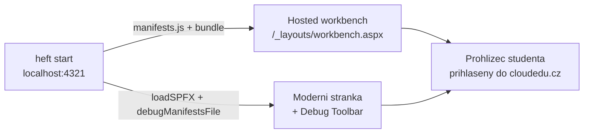
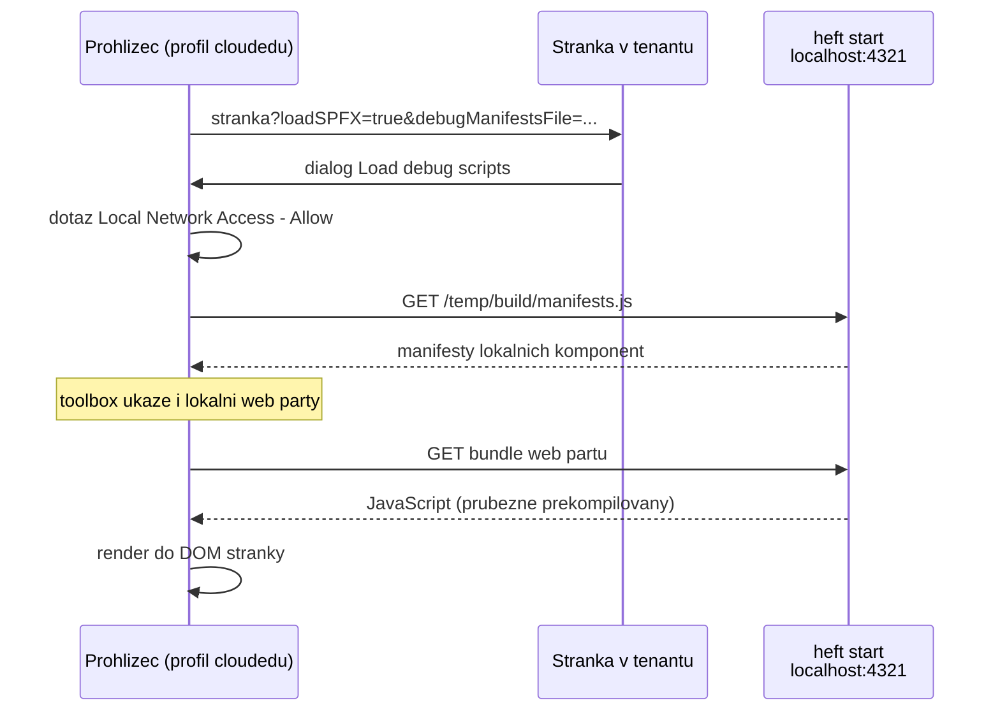

# První web part — workbench a moderní stránka

> Typ: povinný · Den: 1 · Odhad: 90 min
> Tenant: `cloudedu.cz` · Režim: hands-on, vlastní web
> Prostředí: [`../../environment.md`](../../environment.md) · Názvosloví: [`../../GLOSSARY.md`](../../GLOSSARY.md)

Web part `Portal` se poprvé spustí — nejdřív v hosted workbenchi, pak na skutečné stránce
vlastního webu. Na konci dne z něj je kostra **Rozcestníku** Vltava Servis.

## Cíle

- Spustit vývojovou smyčku: `npm start`, změna kódu, nová kompilace, obnovení stránky.
- Otestovat web part v hosted workbenchi **i** na moderní stránce s Debug Toolbarem.
- Popsat životní cyklus web partu (`onInit`, `render`, `onThemeChanged`, `onDispose`)
  a kde se v něm napojuje React.
- Přidat lokalizovaný text a vysvětlit, proč ho TypeScript nehlídá celý.

## Výklad

### Kde web part běží při vývoji



`npm start` (`heft start`) nezkopíruje nic do SharePointu. Spustí lokální HTTPS server
a stránka v tenantu si z něj **v prohlížeči** stáhne manifesty a JavaScript. Proto:

- prohlížeč musí důvěřovat vývojovému certifikátu (`heft trust-dev-cert`),
- prohlížeč musí stránce tenantu dovolit přístup na `localhost` (viz níže),
- kód běží jen pro toho, kdo má puštěný `npm start` — kolegovi u vedlejšího stroje se
  web part nenačte.

> [!WARNING] Ověřit k datu běhu — stav k 2026-10.
> **Hosted workbench je deprecated od 2026-05-13 a retiruje se 2026-12-01.** Doporučenou
> náhradou je testování na moderní stránce s **Debug Toolbarem**. V říjnu 2026 workbench ještě
> funguje a vygenerovaný `serve.json` ho pořád otevírá — kurz ukazuje obojí, ale za „správnou"
> cestu bere moderní stránku. Zdroj:
> [Build your first web part](https://learn.microsoft.com/en-us/sharepoint/dev/spfx/web-parts/get-started/build-a-hello-world-web-part)
> (updated 2026-05-21), [Debug Toolbar](https://learn.microsoft.com/en-us/sharepoint/dev/spfx/debug-toolbar).

Druhá věc, která se při prvním spuštění spolehlivě pokazí:

> [!IMPORTANT] Edge a Chrome od verze 142 se ptají na přístup do lokální sítě
> Při načtení debug skriptů prohlížeč zobrazí dotaz *„Allow this site to access devices on your
> local network?"*. Bez **Allow** se manifesty z `localhost:4321` nenačtou a web part se
> nezobrazí — bez srozumitelné chyby. Zdroj:
> [Debug on modern pages](https://learn.microsoft.com/en-us/sharepoint/dev/spfx/debug-modern-pages).

### Jak stránka najde tvůj lokální kód

Normálně loader SPFx hledá komponenty jen na dvou místech: v App Catalogu (nasazená řešení)
a na manifest serveru SharePointu (systémové knihovny). Lokální `localhost:4321` mezi nimi
není. Dva parametry v adrese stránky to mění
([Debug on modern pages](https://learn.microsoft.com/en-us/sharepoint/dev/spfx/debug-modern-pages)):

| Parametr | Co dělá |
|---|---|
| `loadSPFX=true` | vynutí načtení SharePoint Frameworku na stránce; z výkonových důvodů se jinak nenačte, pokud na ní není registrovaná aspoň jedna extension |
| `debugManifestsFile=https://localhost:4321/temp/build/manifests.js` | řekne loaderu, ať vezme i komponenty servírované lokálně |



Co z mechanismu plyne pro praxi:

- **Povolení platí pro celou relaci prohlížeče.** Jednou potvrzené debug skripty se na
  dalších stránkách načítají dál; vypne je parametr `reset=true` (tamtéž, sekce *Disabling
  debug scripts*).
- **`heft start` vypisuje vlastní řetězec** `?debugManifestsFile=...&debug=true&noredir=true`
  — dokumentace ho ukazuje u spuštění hosted workbenche
  ([Build your first web part](https://learn.microsoft.com/en-us/sharepoint/dev/spfx/web-parts/get-started/build-a-hello-world-web-part))
  a lab ho připojuje k adrese workbenche (krok 3). Pro moderní stránku lab používá tvar
  s `loadSPFX=true` z dokumentace debugování (krok 9).
- **Ladění na produkčním tenantu je technicky možné, ale riskantní** — spouštíš kód, který
  neprošel kontrolou organizace, nad skutečnými daty (tamtéž, upozornění na začátku stránky).
  V kurzu proto jen vlastní web a nepublikovaná stránka.

> [!WARNING] Balíček bez `--production` ukazuje na `localhost`
> Když se balíček sestaví **bez** `--production` (`heft build` + `heft package-solution`),
> odkazuje na kód na `https://localhost:4321` a po nasazení funguje jen tomu, kdo má puštěný
> lokální server ([Debug on modern pages](https://learn.microsoft.com/en-us/sharepoint/dev/spfx/debug-modern-pages),
> sekce *an alternative approach*). `npm run build` přepínač `--production` obsahuje — do
> App Catalogu nahrávej jen jeho výstup.

#### Když se web part nenačte

| Příznak | Pravděpodobná příčina | Kde ověřit |
|---|---|---|
| Žádný dialog *Load debug scripts* | chybí nebo je překlepnutý `loadSPFX=true`, nebo parametry začínají `?` za adresou, která už `?` obsahuje | adresní řádek |
| Dialog ano, web part v toolboxu ne | odmítnutý přístup do lokální sítě nebo nedůvěryhodný certifikát | otevřít `https://localhost:4321/temp/build/manifests.js` v tomtéž profilu — musí ukázat JavaScript |
| Web part v toolboxu, ale chyba při vykreslení | chyba v kódu za běhu | konzole vývojářských nástrojů prohlížeče (F12) |
| Kolega web part na tvé stránce nevidí | kód existuje jen na tvém stroji | očekávané chování, viz krok 10 labu |
| Po zastavení serveru stránka pořád „chce" localhost | povolení debug skriptů trvá celou relaci | `reset=true` v adrese, nebo zavřít celý prohlížeč |

### Životní cyklus web partu

Třída `PortalWebPart` dědí z `BaseClientSideWebPart` a SharePoint volá její metody v tomto
pořadí:

| Metoda | Kdy | Co v ní dělá vygenerovaný kód |
|---|---|---|
| `onInit()` | jednou, před prvním `render` | zjistí prostředí (SharePoint / Teams / Outlook) |
| `onThemeChanged()` | při načtení a změně motivu | nastaví CSS proměnné `--bodyText`, `--link` |
| `render()` | po inicializaci a po každé změně vlastností | `ReactDom.render(<Portal …/>, this.domElement)` |
| `getPropertyPaneConfiguration()` | při otevření property pane | jedno textové pole `description` |
| `onDispose()` | na konci života web partu na stránce — odebrání, přechod na jinou stránku | `ReactDom.unmountComponentAtNode` |

React je v SPFx **knihovna, kterou web part volá**, ne framework, který řídí stránku. Hranice
je `this.domElement`: mimo něj web part nesahá.

Tři pravidla, na kterých se v praxi chybuje nejčastěji
([BaseWebPart](https://learn.microsoft.com/en-us/javascript/api/sp-webpart-base/basewebpart),
[BaseClientSideWebPart](https://learn.microsoft.com/en-us/javascript/api/sp-webpart-base/baseclientsidewebpart)):

1. **`this.context` a `this.properties` nejsou k dispozici před `onInit()`** — inicializace
   patří do `onInit()`, ne do konstruktoru.
2. **`render()` se volá opakovaně** — v reaktivním režimu po každé změně v property pane.
   Načítání dat do `render()` nepatří.
3. **V `onThemeChanged()` nevolat `render()`** — přepočet zařídí základní třída.

Sekvenční diagram, výňatky z `PortalWebPart.ts`, původ hodnot v `this.properties`
(manifest vs. uložená data stránky) a `dataVersion` jsou v
[`explainer-webpart-lifecycle.md`](explainer-webpart-lifecycle.md).

### Lokalizované texty

Texty web partu nejsou v kódu, ale v `loc/en-us.js` (AMD modul) a jejich tvar popisuje
`loc/mystrings.d.ts`. Kód je importuje jako modul:

```typescript
import * as strings from 'PortalWebPartStrings';
```

TypeScript kontroluje jen **deklaraci** v `.d.ts`. Jestli klíč opravdu existuje v `en-us.js`,
nekontroluje nikdo — chybějící klíč se projeví až za běhu jako `undefined`. V labu si to
ověříš. Dokumentace proto výslovně žádá hlídat, aby každý klíč z `.d.ts` měl překlad ve
všech `.js` souborech
([Localize web parts](https://learn.microsoft.com/en-us/sharepoint/dev/spfx/web-parts/guidance/localize-web-parts)).

Jak se za běhu vybere soubor: `config/config.json` mapuje název modulu na soubory
s jazykovým kódem,

```json
"localizedResources": {
  "PortalWebPartStrings": "lib/webparts/portal/loc/{locale}.js"
}
```

a v produkčním buildu má manifest web partu pro modul `PortalWebPartStrings` seznam cest
podle jazyka (`"type": "localizedPath"`) plus `defaultPath` — v Heft buildu ověřeno na
referenčním projektu ve stavu po dni 5 (2026-10-23, lektorský stroj). SharePoint načte soubor odpovídající jazyku webu; když
žádný neodpovídá, použije `defaultPath` — výchozí je en-US, změnit ho jde souborem
`default.js` (tamtéž, sekce *Localization in different build types*). Načte se tak jen
jeden jazyk, ne všechny. Plná lokalizace (čeština, fallback, přepnutí jazyka) je úterní
[`../../day-2/localization/`](../../day-2/localization/).

## Klíčové rozlišení

- **Hosted workbench vs. moderní stránka** — workbench je vývojové plátno bez okolní stránky
  a bez extensions; moderní stránka je skutečné prostředí s motivem webu, šířkou sekcí
  a ostatními web party.
- **`npm start` vs. nasazení** — při `npm start` existuje web part jen ve tvém prohlížeči;
  po publikování stránky s ním ho nikdo jiný neuvidí.
- **`.d.ts` vs. `.js` v `loc/`** — typová kontrola vs. skutečný obsah; nehlídají se navzájem.
- **`loadSPFX=true` vs. `debugManifestsFile`** — první vůbec načte SharePoint Framework na
  stránce, druhý přidá do hledání komponent `localhost`. Bez obou se lokální web part na
  moderní stránce neobjeví.
- **Konstruktor vs. `onInit()`** — v konstruktoru ještě neexistuje `this.context`;
  `onInit()` běží jednou, s indikátorem načítání, před prvním `render()`.
- **Výchozí hodnoty v manifestu vs. uložené vlastnosti** — `preconfiguredEntries.properties`
  platí při přidání web partu na stránku; existující instance má svá uložená data.

## Naše prostředí

- Testovací stránka i workbench na vlastním webu `/sites/spodev-<ini>`.
- Workbench se otevře podle `SPFX_SERVE_TENANT_DOMAIN` z
  [`../dev-environment/`](../dev-environment/).
- Prohlížeč: profil Edge `cloudedu` — `npm start` ale otevírá **výchozí** prohlížeč, proto
  v labu spouštíme bez automatického otevření a adresu otevíráme ručně.

## Lab

Viz [`lab-prvni-webpart.md`](lab-prvni-webpart.md).

## Nosná linka

Web part `Portal` dostane identitu **Rozcestníku Vltava Servis**: název a popis v toolboxu,
uvítání a tři odkazy na firemní systémy. Odkazy jsou zatím **natvrdo v kódu** — schválně.
V úterý je přesune do property pane, aby si je oddělení nastavila sama.

Stav po dni 1: [`solution/vltava-portal/`](solution/vltava-portal/).

## Zdroje (Microsoft)

- [Build your first SharePoint client-side web part](https://learn.microsoft.com/en-us/sharepoint/dev/spfx/web-parts/get-started/build-a-hello-world-web-part)
- [Debug SharePoint Framework solutions on modern SharePoint pages](https://learn.microsoft.com/en-us/sharepoint/dev/spfx/debug-modern-pages)
- [SharePoint Framework Debug Toolbar](https://learn.microsoft.com/en-us/sharepoint/dev/spfx/debug-toolbar)
- [Set up your development environment — trusting the developer certificate](https://learn.microsoft.com/en-us/sharepoint/dev/spfx/set-up-your-development-environment)
- [BaseClientSideWebPart class](https://learn.microsoft.com/en-us/javascript/api/sp-webpart-base/baseclientsidewebpart)
- [BaseWebPart class](https://learn.microsoft.com/en-us/javascript/api/sp-webpart-base/basewebpart)
- [Localize SharePoint Framework client-side web parts](https://learn.microsoft.com/en-us/sharepoint/dev/spfx/web-parts/guidance/localize-web-parts)
- [Simplify adding web parts with preconfigured entries](https://learn.microsoft.com/en-us/sharepoint/dev/spfx/web-parts/guidance/simplify-adding-web-parts-with-preconfigured-entries)

## Stav produktu / delta

> [!WARNING] Ověřit k datu běhu — stav k 2026-10.
> Hosted workbench funguje do 2026-12-01. Po tomto datu přestane fungovat krok labu
> s workbenchem a `initialPage` ve vygenerovaném `serve.json` povede na nefunkční adresu —
> pro další běhy kurzu přepsat lab jen na moderní stránku.
