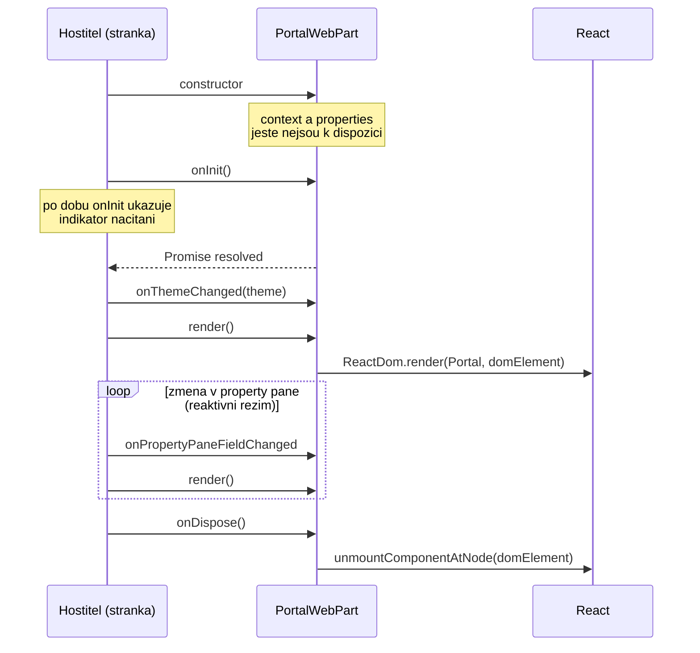

# Životní cyklus web partu do hloubky

Deep-dive k [`README.md`](README.md), sekce *Životní cyklus web partu*. Všechny výňatky jsou
z [`solution/vltava-portal/src/webparts/portal/PortalWebPart.ts`](solution/vltava-portal/src/webparts/portal/PortalWebPart.ts)
(stav po dni 1). Popis metod je z API reference
[BaseClientSideWebPart](https://learn.microsoft.com/en-us/javascript/api/sp-webpart-base/baseclientsidewebpart)
a [BaseWebPart](https://learn.microsoft.com/en-us/javascript/api/sp-webpart-base/basewebpart).

## Princip: web part nevolá sám sebe

Web part je třída, jejíž metody volá **hostitel** — stránka SharePointu, workbench nebo
Teams. Ty jen přepisuješ metody, které tě zajímají. Jediná povinná je `render()`; ostatní
mají základní implementaci v předkovi
([BaseClientSideWebPart](https://learn.microsoft.com/en-us/javascript/api/sp-webpart-base/baseclientsidewebpart),
sekce *Remarks*).



Diagram ukazuje pořadí, které dokumentace popisuje: konstruktor, `onInit`, první `render`,
opakované `render` po změnách, `onDispose` na konci. Kde přesně vůči prvnímu `render` padne
první `onThemeChanged`, API reference neuvádí — **neověřeno**.

## Metoda po metodě

### Konstruktor a `onInit()` — kde začít pracovat

Dokumentace doporučuje inicializaci dělat v `onInit()`, protože `this.context`
a `this.properties` nejsou před ním k dispozici. `onInit()` vrací `Promise`, hostitel po
dobu jeho běhu ukazuje indikátor načítání a volá ho **jen jednou** za život web partu
([BaseWebPart.onInit](https://learn.microsoft.com/en-us/javascript/api/sp-webpart-base/basewebpart)).

Vygenerovaný kód v něm čeká na zjištění hostitele (SharePoint, Teams, Outlook):

```typescript
protected onInit(): Promise<void> {
  return this._getEnvironmentMessage().then(message => {
    this._environmentMessage = message;
  });
}
```

Teprve když se `Promise` vyřeší, přijde první `render()`. Web party ze dne 3 (Adresář
zaměstnanců, Evidence vybavení) mají `onInit` vlastní — připravují v něm přístup k datům.

**Typická chyba:** práce s `this.context` v konstruktoru nebo v inicializátoru pole třídy.
Projeví se chybou za běhu (`undefined`), ne při kompilaci.

### `render()` — volá se opakovaně

`render()` nemá základní implementaci — web part ho musí přepsat
([BaseClientSideWebPart.render](https://learn.microsoft.com/en-us/javascript/api/sp-webpart-base/baseclientsidewebpart)).
Hostitel ho nevolá jednou, ale znovu po každé změně, kterou potřebuje promítnout: změna
v reaktivním property pane, změna režimu zobrazení (výchozí `onDisplayModeChanged` volá
`render`; na stránce SharePointu se ale web part při změně režimu inicializuje znovu
a `onDisplayModeChanged` se nevolá —
[BaseWebPart](https://learn.microsoft.com/en-us/javascript/api/sp-webpart-base/basewebpart)).

```typescript
public render(): void {
  const element: React.ReactElement<IPortalProps> = React.createElement(Portal, {
    description: this.properties.description,
    isDarkTheme: this._isDarkTheme,
    environmentMessage: this._environmentMessage,
    userDisplayName: this.context.pageContext.user.displayName
  });
  ReactDom.render(element, this.domElement);
}
```

Opakované `ReactDom.render` do stejného `this.domElement` React nepřekreslí od nuly, ale
aktualizuje DOM jen tam, kde je potřeba, a kde struktura stromu sedí, zachová stav komponent
([React 18 docs — render](https://18.react.dev/reference/react-dom/render)). V Reactu 18 je
`render` nahrazený `createRoot`; SPFx 1.23.2 ale generuje React 17.0.1, kde je `render`
správné API.

**Typická chyba:** načítání dat v `render()`. Každé písmeno napsané v reaktivním property
pane pak znamená nový požadavek na server. Data patří do `onInit()` (nebo do React
komponenty s vlastním stavem — den 2).

### `onThemeChanged()` — motiv bez vlastního `render`

Hostitel ji volá při inicializaci a při změně motivu stránky nebo sekce. Dokumentace
výslovně říká **nevolat v ní `render`** — přepočet zařídí základní třída, když je potřeba
([BaseClientSideWebPart.onThemeChanged](https://learn.microsoft.com/en-us/javascript/api/sp-webpart-base/baseclientsidewebpart)).
Vygenerovaný kód proto jen zapíše barvy do CSS proměnných na svém kořenovém elementu:

```typescript
this.domElement.style.setProperty('--bodyText', semanticColors.bodyText || null);
this.domElement.style.setProperty('--link', semanticColors.link || null);
```

Styl v `Portal.module.scss` pak používá `color: var(--bodyText)` a `color: var(--link)` —
barvy převezme prohlížeč přes CSS proměnné, React kvůli nim nic znovu vykreslovat nemusí.

### Property pane: reaktivní vs. nereaktivní

Výchozí režim je **reaktivní**: změna v property pane se do web partu přenese okamžitě
a po zápisu nové hodnoty do `this.properties` se volá `onPropertyPaneFieldChanged`.
Přepsáním `disableReactivePropertyChanges` na `true` přepneš do **nereaktivního** režimu —
změny se přenesou až po tlačítku *Apply* a pak se volá `onAfterPropertyPaneChangesApplied`
([BaseWebPart](https://learn.microsoft.com/en-us/javascript/api/sp-webpart-base/basewebpart)).
Krok 8 labu ukazuje reaktivní režim; přepnutí je úterní
[`../../day-2/property-pane/`](../../day-2/property-pane/).

### Vlastnosti: odkud se berou a kam se ukládají

`this.properties` je *property bag* web partu
([BaseWebPart.properties](https://learn.microsoft.com/en-us/javascript/api/sp-webpart-base/basewebpart)).
Jeho hodnoty mají dva zdroje:

1. **Při přidání na stránku** — výchozí hodnoty z `preconfiguredEntries[].properties`
   v manifestu
   ([Preconfigured entries](https://learn.microsoft.com/en-us/sharepoint/dev/spfx/web-parts/guidance/simplify-adding-web-parts-with-preconfigured-entries)):

   ```json
   "properties": {
     "description": "Portal"
   }
   ```

2. **Při každém dalším načtení** — uložená (serializovaná) data instance na stránce.
   `renderedFromPersistedData` rozliší, který případ nastal; při prvním přidání
   z toolboxu je `false`
   ([BaseClientSideWebPart](https://learn.microsoft.com/en-us/javascript/api/sp-webpart-base/baseclientsidewebpart)).

Do serializovaných dat se ukládá i `dataVersion` (výchozí `1.0`) a `onAfterDeserialize`
dostane verzi uložených dat — to je místo, kde nová verze web partu opraví vlastnosti
uložené starou verzí
([BaseWebPart](https://learn.microsoft.com/en-us/javascript/api/sp-webpart-base/basewebpart)).

**Typická chyba:** změna výchozí hodnoty v manifestu a údiv, že se na existující stránce
nic nezměnilo. Výchozí hodnoty platí pro **nově přidanou** instanci; existující instance má
svá uložená data.

### `onDispose()` — úklid

Volá se na konci života web partu na stránce, například při přechodu na jinou stránku,
a slouží k uvolnění držených zdrojů, typicky DOM elementů
([BaseWebPart.onDispose](https://learn.microsoft.com/en-us/javascript/api/sp-webpart-base/basewebpart),
sekce *Remarks*). Vygenerovaný kód odpojí React strom:

```typescript
protected onDispose(): void {
  ReactDom.unmountComponentAtNode(this.domElement);
}
```

> [!NOTE] Jednořádkový popis `onDispose` v API referenci
> Souhrnná tabulka v API referenci u `onDispose` uvádí „refresh the contents of the
> PropertyPane". To odporuje sekci *Remarks* téže stránky — platí *Remarks* (úklid na konci
> životního cyklu).

**Typická chyba:** smazání `onDispose` při úklidu „nepotřebného" kódu. Nic nespadne hned —
React strom ale zůstane připojený i ve chvíli, kdy hostitel web part zahazuje, a s ním vše,
co komponenty drží (časovače, posluchače událostí).

## Shrnutí: co kam patří

| Potřebuju… | Metoda |
|---|---|
| načíst data nebo zjistit prostředí před prvním vykreslením | `onInit()` |
| vykreslit UI z `this.properties` | `render()` |
| reagovat na barvy motivu | `onThemeChanged()` — bez volání `render` |
| reagovat na jedno konkrétní pole v property pane | `onPropertyPaneFieldChanged()` |
| opravit vlastnosti uložené starší verzí | `dataVersion` + `onAfterDeserialize()` |
| uklidit po sobě | `onDispose()` |

## Zdroje (Microsoft)

- [BaseClientSideWebPart class](https://learn.microsoft.com/en-us/javascript/api/sp-webpart-base/baseclientsidewebpart)
- [BaseWebPart class](https://learn.microsoft.com/en-us/javascript/api/sp-webpart-base/basewebpart)
- [Simplify adding web parts with preconfigured entries](https://learn.microsoft.com/en-us/sharepoint/dev/spfx/web-parts/guidance/simplify-adding-web-parts-with-preconfigured-entries)

## Zdroje (třetí strana — React)

- [React 18 docs — render](https://18.react.dev/reference/react-dom/render) — chování
  opakovaného `render` do stejného elementu (výjimka `react.dev` podle CONVENTIONS.md)
