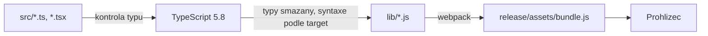

# TypeScript pro SPFx — jazyk a konfigurace

> Typ: volitelný, **samostudium** · Den: 1 (kdykoli během týdne) · Odhad: 60 min čtení + cvičení
> Tenant: — · Režim: samostudium nad vlastním projektem `vltava-portal-<ini>`
> Prostředí: [`../../environment.md`](../../environment.md) · Názvosloví: [`../../GLOSSARY.md`](../../GLOSSARY.md)

Kurz předpokládá JavaScript, ne TypeScript. Tento modul vysvětluje TypeScript **v rozsahu,
který kód kurzu skutečně používá**, a co znamená konfigurace `tsconfig.json` a verze
ECMAScriptu v projektu SPFx. Je to samostudium — žádný povinný blok na něm nestojí; nejvíc
se vyplatí přečíst po [`project-anatomy`](../project-anatomy/) a před dnem 2.

## Cíle

- Číst a psát typy, rozhraní a union typy, jak je používá `vltava-portal`.
- Rozlišit, co hlídá překladač (typy) a co prohlížeč (běh) — a proč typ není kontrola dat.
- Vysvětlit `target`, `lib` a `module` v `tsconfig.json` projektu SPFx a poznat chybu,
  kterou způsobují.
- Vědět, které moderní API lze v SPFx 1.23.2 použít bez úprav konfigurace.

## Výklad

### Co TypeScript je a co není

TypeScript = JavaScript + **typy, které existují jen při překladu**. Překladač (`tsc`, v SPFx
spouštěný Heftem) typy zkontroluje a pak je **smaže**. Do prohlížeče jde čistý JavaScript.



Důsledek, na který se v praxi zapomíná: **typ není kontrola dat za běhu.** Když REST vrátí
jiný tvar, než říká `IEquipmentItem`, TypeScript nic nezjistí — rozhraní je jen slib.

```typescript
// The type says Status is one of four values. SharePoint can still return anything.
const item: IEquipmentItem = await list.items.getById(id)<IEquipmentItem>();
```

Proto služby kurzu ověřují to, na čem záleží (`translateError`, `NotAvailableError`), místo
aby spoléhaly na typ.

### Základní typy a odvození

```typescript
const title: string = 'Rozcestnik';        // explicit type
const count = 3;                            // inferred: number
const tags: string[] = ['Laptop', 'Phone'];
const pair: [string, number] = ['a', 1];    // tuple
let unknownValue: unknown;                  // must be narrowed before use
```

- TypeScript typ často **odvodí** sám. Kód kurzu přesto píše typy u proměnných explicitně —
  je to styl převzatý z generátoru SPFx, ne povinnost: profil ESLintu SPFx 1.23.2 má pravidla
  `@typescript-eslint/typedef` a `@rushstack/typedef-var` vypnutá
  (`@microsoft/eslint-config-spfx/lib-commonjs/flat-profiles/default.js`, ověřeno 2026-10-23).
- Návratové typy funkcí ESLint **vyžaduje** (`explicit-function-return-type` z profilu
  Rushstack, varování) — proto `function Portal(props: IPortalProps): JSX.Element`.
- **`any` vypíná kontrolu.** ESLint ho hlásí (`no-explicit-any`). Pro neznámá data patří
  `unknown` a zúžení (viz níže).

### Rozhraní, typové aliasy a union

```typescript
// interface: shape of an object; can be extended
export interface IEquipmentItem {
  Id: number;
  Title: string;
  Status: EquipmentStatus;
  AssignedTo?: { Title: string; EMail: string };   // optional property
}

// type alias: any type, here a union of string literals
export type EquipmentStatus = 'Available' | 'Issued' | 'Repair' | 'Retired';
```

- `?` = vlastnost může chybět (hodnota `undefined`).
- **Union literálů** (`'Available' | 'Issued' | ...`) je nejužitečnější typ kurzu: překlep
  `'Isued'` je chyba překladu, editor nabízí hodnoty a `Record<EquipmentStatus, string>`
  vynutí popisek pro **každý** stav (`STATUS_LABELS` v Evidenci vybavení).
- `interface` vs. `type`: pro tvar objektu je jedno, co použijete; kurz drží konvenci
  generátoru (`I` + `interface` pro props a modely, `type` pro uniony).

### Užitečné pomocné typy

| Zápis | Význam | V kurzu |
|---|---|---|
| `Partial<T>` | všechny vlastnosti nepovinné | data pro `update()` |
| `Omit<T, 'Id'>` | `T` bez vlastnosti `Id` | nová položka bez ID |
| `Record<K, V>` | objekt s klíči `K` a hodnotami `V` | `STATUS_LABELS`, `PresenceMap` |
| `ReturnType<typeof f>` | typ návratové hodnoty funkce | `ReturnType<typeof setTimeout>` v `useDebounce` |
| `Promise<T>` | výsledek asynchronní operace | každá služba |

### Generika

Funkce nebo typ s parametrem typu. Cache kurzu (`utils/sessionCache.ts`) je generická —
stejný kód cachuje uživatele i cokoli jiného a typ výsledku se zachová:

```typescript
export async function cached<T>(key: string, ttlMs: number, load: () => Promise<T>): Promise<T> {
  // ...
}

const users: IEmployee[] = await cached('users:novak', 300000, () => searchGraph('novak'));
```

PnPjs používá generika pro typ odpovědi: `query<IEquipmentItem[]>()`.

### `null`, `undefined` a strict režim

Rig SPFx zapíná `"strict": true` — mimo jiné `strictNullChecks`. Hodnota, která může chybět,
to musí mít v typu, a před použitím se musí ověřit:

```typescript
const row: RowAccessor | undefined = this.context.listView.selectedRows?.[0];
if (!row) {
  return;                       // narrowing: below this line row is RowAccessor
}
```

- `?.` (optional chaining) a `??` (výchozí hodnota jen pro `null`/`undefined`) jsou běžná
  syntaxe; překladač je pro `target es5` přepíše.
- `!` (non-null assertion) říká „věř mi, není to null". Kurz ho nepoužívá — místo toho
  podmínka nebo výchozí hodnota.
- SharePoint vrací prázdné hodnoty jako `null`; ESLint profil Rushstack hlásí nové použití
  `null` v typech (`@rushstack/no-new-null`) — proto `ReturnedOn?: string` v `ILoan`
  s komentářem.

### Zúžení typu (narrowing)

```typescript
function isHttpError(error: unknown): error is HttpRequestError {
  return !!error && (error as HttpRequestError).isHttpRequestError === true;
}

catch (error) {
  if (isHttpError(error) && error.status === 404) {   // error is HttpRequestError here
    throw new ListNotFoundError();
  }
}
```

V `catch` má chyba typ `unknown` — dřív, než na ní zavoláte `.status`, ji musíte zúžit.
`e instanceof Error ? e.message : String(e)` je tentýž princip v jednom řádku.

### `async` / `await` a „plovoucí" Promise

```typescript
public onExecute(event: IListViewCommandSetExecuteEventParameters): void {
  this._issue(id, title).catch((e: unknown) => Log.error(LOG_SOURCE, e as Error));
}
```

- `async` funkce vždy vrací `Promise`. Když ji zavoláte bez `await` a bez `.catch`, chyba se
  ztratí. ESLint SPFx to hlídá jako **chybu** (`@typescript-eslint/no-floating-promises`),
  proto v kódu kurzu `.catch(() => undefined)` tam, kde se výsledek záměrně nečeká.
- `await` jde jen v `async` funkci. Metody SPFx, které vracejí `void` (`render`,
  `onExecute`), proto volají pomocnou `async` metodu.

### Moduly a importy

```typescript
import * as React from 'react';                       // namespace import
import { Panel, PrimaryButton } from '@fluentui/react'; // named import
import type { IEquipmentItem } from '../models';       // type-only: erased, never bundled
import '@pnp/sp/items';                                // side-effect import: augments sp.web.lists
```

- **`import type`** se při překladu smaže celý — jistota, že import typu nepřitáhne kód do
  bundlu. Kurz ho používá u modelů a rozhraní služeb.
- **Import kvůli vedlejšímu efektu** (`'@pnp/sp/items'`) nic nepojmenuje, ale rozšíří typy
  i chování PnPjs (blok [`pnpjs`](../../day-3/pnpjs/)).
- **Barrel** (`index.ts` s re-exporty) je pohodlný, ale importuje **všechno**, co re-exportuje,
  včetně vedlejších efektů — v kurzu změřeno +32 121 B (blok
  [`performance-caching`](../../day-4/performance-caching/)).

### Třídy a modifikátory

Třídy web partů a extensions jsou třídy TypeScriptu:

```typescript
export default class EquipmentWebPart extends BaseClientSideWebPart<IEquipmentWebPartProps> {
  private _service: IEquipmentService | undefined;      // private: only inside the class

  protected async onInit(): Promise<void> { ... }       // protected: overrides a base method
  public render(): void { ... }
}
```

`BaseClientSideWebPart<IEquipmentWebPartProps>` je generická třída — typ vlastností web
partu určuje, co je v `this.properties`.

## Konfigurace: tsconfig a ECMAScript

Podrobně, s měřením na projektu kurzu:
[`explainer-tsconfig-ecmascript.md`](explainer-tsconfig-ecmascript.md). Shrnutí:

- `tsconfig.json` projektu obsahuje jen `extends` na rig
  (`@microsoft/spfx-web-build-rig/profiles/default/tsconfig-base.json`). Skutečná nastavení
  jsou tam.
- **`target: es5`** = jakou **syntaxi** překladač vyrobí z vašeho kódu (žádné `class`, `const`,
  `=>` — vše přepsané, pomocné funkce z `tslib`).
- **`lib`** = jaká **API** smíte v kódu použít bez chyby překladu. Rig dává ES5 + vybrané části
  ES2015 — `Array.prototype.includes`, `Object.entries`, `padStart` nebo `flat` **neprojdou**
  (změřeno 2026-10-23, chyba `TS2550`).
- Pozor: jakmile se do překladu dostane `@types/node` (v kurzu přes test `loc.test.ts` ve
  dni 5), přidá `lib es2020` celému projektu a tytéž řádky projdou.
- Bundle přesto **není** čisté ES5 — knihovny z `node_modules` (PnPjs, Fluent UI) se
  nepřekládají a obsahují moderní syntaxi. SharePoint Online podporuje jen moderní prohlížeče,
  takže to nevadí (viz [`self-study.md`](../../self-study.md)).

## Klíčové rozlišení

- **Typ vs. kontrola dat** — typ hlídá váš kód při překladu, data z REST hlídá jen kód za běhu.
- **`target` vs. `lib`** — `target` říká, jakou syntaxi překladač vyrobí; `lib`, jaká API
  smíte volat. Nesouvisí spolu: ES5 výstup a ES2020 API se nevylučují.
- **`interface` vs. `type`** — pro objekty zaměnitelné; `type` navíc umí union.
- **`import type` vs. `import`** — první se smaže vždy, druhý může přitáhnout kód.

## Naše prostředí

TypeScript ~5.8 (`5.8.3` v referenčním projektu) přichází s projektem SPFx 1.23.2; nic se
neinstaluje globálně. Typovou kontrolu bez buildu spustíte v kořeni projektu:

```powershell
npx tsc --noEmit -p tsconfig.json
```

## Lab

Samostudium: [`lab-typy-v-projektu.md`](lab-typy-v-projektu.md) — pět krátkých cvičení nad
vlastním projektem.

## Nosná linka

Modul řešení nemění. Vysvětluje typy, které `vltava-portal` používá od dne 1 (`IPortalProps`)
po den 5 (`ILoan`, `NotAvailableError`).

## Zdroje

- [TypeScript Handbook](https://www.typescriptlang.org/docs/handbook/intro.html) — referenční
  příručka jazyka (výjimka z pravidla „primárně Learn": jazyk dokumentuje jeho autor).
- [TSConfig Reference](https://www.typescriptlang.org/tsconfig/) — `target`, `lib`, `module`.
- [Heft-based toolchain (SPFx v1.22.0+)](https://learn.microsoft.com/en-us/sharepoint/dev/spfx/toolchain/sharepoint-framework-toolchain-rushstack-heft)
- [SPFx compatibility](https://learn.microsoft.com/en-us/sharepoint/dev/spfx/compatibility) — podporované verze TypeScriptu.

## Stav produktu / delta

> [!WARNING] Ověřit k datu běhu — stav k 2026-10.
> Hodnoty `target` a `lib` jsou z rigu SPFx 1.23.2. Při přechodu na 1.24 znovu přečíst
> `tsconfig-base.json` rigu a zopakovat měření z explaineru.
