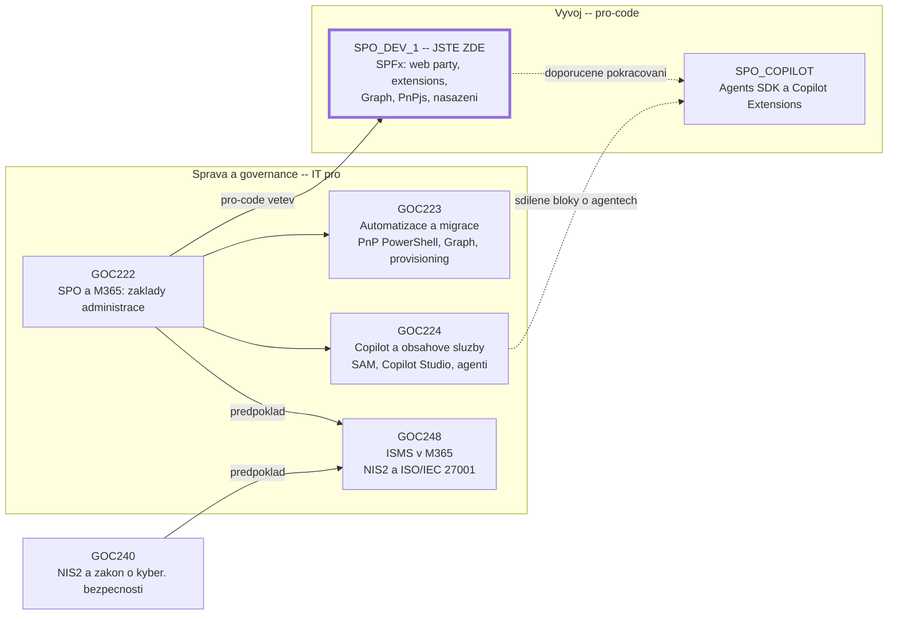
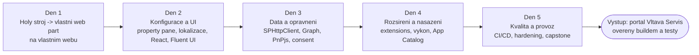
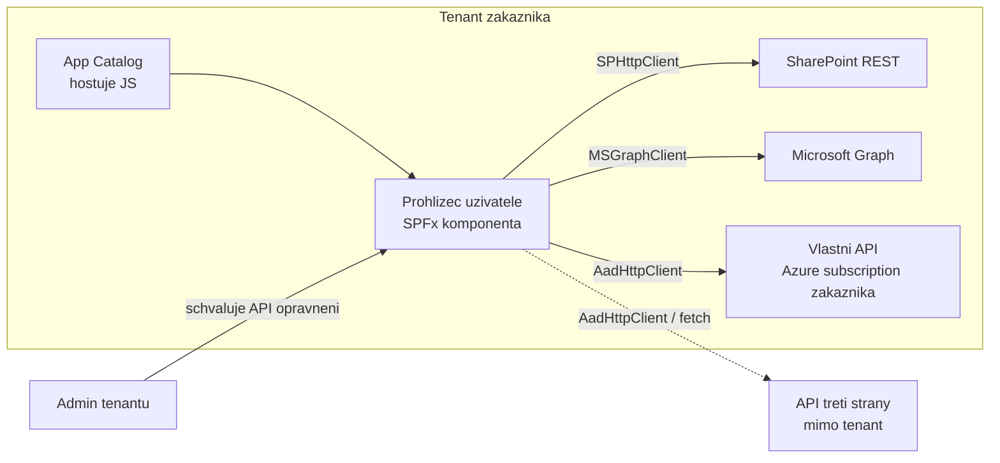

# SPFx v Microsoft 365 — pozice a hranice tenantu

> Typ: povinný · Den: 1 · Odhad: 45 min
> Tenant: `cloudedu.cz` · Režim: výklad + návrhový lab (papír/MD)
> Prostředí: [`../../environment.md`](../../environment.md) · Názvosloví: [`../../GLOSSARY.md`](../../GLOSSARY.md)

Úvodní blok týdne. Než se cokoli nainstaluje, musí být jasné, **kdy** se SPFx vyplatí a kdy je
to zbytečný kód na údržbu — a **kam** tečou data, když SPFx komponenta běží.

## Kde stojíme

- **GOC222** je společný základ správy. Končí rozhodovací osou „low-code až pro-code“ —
  tady začínáme na její pro-code straně.
- **SPO_DEV_1** je vývojářská větev: SharePoint **rozšiřujeme vlastním kódem**. Ostatní kurzy
  ho spravují, automatizují nebo zabezpečují.
- **Vltava Servis** je stejná fiktivní firma jako v GOC222 a GOC248. Kdo prošel GOC222, zná
  její intranet — tady do něj píšeme kód.

Materiály všech kurzů jsou veřejné na [github.com/MalasekPetr](https://github.com/MalasekPetr).

### Co vám kurz dá

Pořadí bloků drží [`agenda.md`](../../agenda.md).

## Cíle

- Vysvětlit, jak SPFx komponenta běží: v prohlížeči, v kontextu přihlášeného uživatele,
  přímo v DOM stránky.
- Rozhodnout pro daný požadavek mezi SPFx, JSON formátováním, Power Platform, Teams aplikací
  a deklarativním agentem — a odůvodnit to.
- Pojmenovat, kdy data opouštějí tenant zákazníka a kdo to musí schválit.

## Výklad

### Co SPFx je

SharePoint Framework je model pro **client-side** komponenty: web party, rozšíření stránek
a seznamů, Adaptive Card Extensions pro Viva Connections a nově Copilot UX components. Podle
dokumentace komponenta:

- běží **v kontextu aktuálního uživatele a jeho připojení v prohlížeči**,
- **nepoužívá iframe** — JavaScript se vkládá přímo do stránky a vykresluje do normálního DOM,
- je hostovaná **automaticky v SharePointu** (App Catalog), bez vlastního serveru.

Zdroj: [Overview of the SharePoint Framework](https://learn.microsoft.com/en-us/sharepoint/dev/spfx/sharepoint-framework-overview).

> [!IMPORTANT] DOM stránky SharePointu není API
> Dokumentace to říká výslovně: na struktuře HTML a CSS stránky nesmíš záviset — mění se bez
> ohlášení. Jediná podporovaná cesta je API, které SPFx nabízí (placeholdery, kontext,
> HTTP klienti). Vrátíme se k tomu ve čtvrtek u extensions.

### Technologické zlomy

| Kdy | Zlom | Co z toho plyne dnes |
|---|---|---|
| 2017-02 | první verze SPFx (jen web party) | základ, na kterém stavíme |
| 2024-11-01 | SharePoint Add-ins přestaly fungovat **na nových tenantech** | tenant `cloudedu.cz` Add-ins nikdy neměl |
| 2026-04-02 | SharePoint Add-ins přestaly fungovat **na všech tenantech** | jediná náhrada pro UI v SharePointu je SPFx |
| SPFx 1.22 | toolchain gulp → **Heft** | návody s `gulp` na internetu jsou pro starý toolchain |
| SPFx 1.24 (preview) | **Copilot UX components** — SPFx komponenty uvnitř Microsoft 365 Copilot | SPFx už není „jen SharePoint" |

Zdroje: [SPFx roadmap](https://learn.microsoft.com/en-us/sharepoint/dev/spfx/roadmap),
[SharePoint Add-In retirement](https://learn.microsoft.com/en-us/sharepoint/dev/sp-add-ins/retirement-announcement-for-add-ins),
[Heft-based toolchain](https://learn.microsoft.com/en-us/sharepoint/dev/spfx/toolchain/sharepoint-framework-toolchain-rushstack-heft).

> [!NOTE] SharePoint Server je jiný svět
> On-premises SharePoint Server Subscription Edition podporuje SPFx jen v1.0–v1.5, SharePoint
> Server 2019 v1.0–v1.4.1 ([compatibility](https://learn.microsoft.com/en-us/sharepoint/dev/spfx/compatibility)).
> Vše v tomto kurzu je pro SharePoint Online.

### Kdy SPFx, a kdy ne

Nejdražší SPFx řešení je to, které nemuselo vzniknout. Rozhodovací osa jde od nejlevnějšího
na údržbu k nejdražšímu:

| Potřeba | První volba | Kód? | Kdo udržuje |
|---|---|---|---|
| jinak zobrazit sloupec nebo zobrazení seznamu | **JSON formátování** | ne | správce webu |
| formulář, schvalování, automatizace nad seznamem | **Power Apps / Power Automate** | low-code | citizen developer |
| odpovídat nad obsahem v přirozeném jazyce | **deklarativní agent** (SharePoint agent) | ne | vlastník obsahu |
| vlastní UI na stránce, data z více zdrojů, logika v prohlížeči | **SPFx web part** | ano | vývojář |
| chování na **každé** stránce nebo v **každém** seznamu (banner, akce, vykreslení sloupce) | **SPFx extension** | ano | vývojář |
| logika, kterou prohlížeč dělat **nesmí nebo nemůže**: tajemství (klíč k API), oprávnění aplikace místo uživatele, běh na pozadí, integrace s externím systémem | **SPFx + vlastní API** — Azure Functions nebo Azure App Service za Entra ID, volané přes `AadHttpClient` | ano | vývojář + provoz Azure u zákazníka |
| aplikace, jejímž hlavním místem je Teams (bot, konverzace, zprávy) | **Teams aplikace** (Microsoft 365 Agents Toolkit) | ano | vývojář + provoz backendu |
| agent v Copilotu má místo textu ukázat **interaktivní UI** (přehled, filtr, akce) | **Copilot UX component** — SPFx komponenta + deklarativní agent v jednom `.sppkg` (preview) | ano | vývojář |
| agent s **vlastní orchestrací nebo modelem**, který jedná i sám od sebe (proaktivně) a integruje externí systémy | **custom engine agent** (Microsoft 365 Agents SDK), hostovaný v Azure | ano | vývojář + provoz Azure u zákazníka |

SPFx + vlastní API není výjimka, ale běžná a Microsoftem dokumentovaná architektura: SPFx
je UI v SharePointu, backend drží tajemství, běží na pozadí a mluví s okolními systémy.
Tutoriál na Learn staví API přímo jako Azure Function. Serverless plán Flex Consumption se
platí za běh, takže API s malou zátěží stojí málo. Ze zkušenosti lektora: v produkci je
tahle dvojice levná a dlouhodobě spolehlivá — SPFx i Azure Functions jsou podporované
platformy s plánovaným životním cyklem, ne vlastní servery na údržbu. Funkční ukázka (Command Set → Azure Function → Graph):
[gopas-jsdays-2026](https://github.com/MalasekPetr/gopas-jsdays-2026).

Zdroje: [Column formatting](https://learn.microsoft.com/en-us/sharepoint/dev/declarative-customization/column-formatting),
[Declarative agents](https://learn.microsoft.com/en-us/microsoft-365-copilot/extensibility/overview-declarative-agent),
[Connect to Entra ID-secured APIs in SPFx](https://learn.microsoft.com/en-us/sharepoint/dev/spfx/use-aadhttpclient),
[Consume enterprise APIs secured with Azure AD in SPFx](https://learn.microsoft.com/en-us/sharepoint/dev/spfx/use-aadhttpclient-enterpriseapi),
[Azure Functions hosting options](https://learn.microsoft.com/en-us/azure/azure-functions/functions-scale),
[Overview of Copilot UX components](https://learn.microsoft.com/en-us/sharepoint/dev/spfx/copilot/overview-copilot-apps),
[Custom engine agents](https://learn.microsoft.com/en-us/microsoft-365-copilot/extensibility/overview-custom-engine-agent),
[SPFx for Teams](https://learn.microsoft.com/en-us/sharepoint/dev/spfx/build-for-teams-overview).

### Hranice tenantu

SPFx komponenta je JavaScript, který si prohlížeč uživatele stáhne z App Catalogu tenantu
a spustí na stránce. Všechno, co komponenta udělá, dělá **jménem přihlášeného uživatele**:

Tři důsledky, které budou celý týden zpátky:

1. **Komponenta nemá vlastní identitu.** Uvidí přesně to, co uživatel — ani víc, ani míň.
   Pro vývojáře to znamená, že „funguje mi to" platí jen pro jeho oprávnění.
2. **Volání Graphu a dalších API vyžaduje oprávnění, které schvaluje admin tenantu** —
   a schválení platí pro **všechna** SPFx řešení v tenantu. Podrobně ve středu
   v [`../../day-3/permissions-consent/`](../../day-3/permissions-consent/).
3. **Data opouštějí tenant jen tam, kde to kód výslovně udělá** — volání externího API,
   načtení skriptu z cizího CDN, telemetrie do vlastní služby. Každé takové místo je
   rozhodnutí, které musí znát zákazník. Vlastní API v **Azure subscription zákazníka**
   (stejný Entra tenant) hranici neopouští — proto je to doporučené místo pro backend.
   API dodavatele nebo třetí strany ji opouští vždy.

## Klíčové rozlišení

- **SPFx vs. SharePoint Add-in** — Add-in běžel mimo stránku (iframe, vlastní hosting nebo app
  web) a v SharePoint Online je retirovaný; SPFx běží na stránce jako uživatel a hostuje ho
  SharePoint.
- **SPFx web part vs. JSON formátování** — formátování mění jen vzhled dat, která seznam už
  má; web part může data kombinovat, počítat a volat API.
- **Komponenta vs. aplikace** — SPFx sám backend nemá. Jakmile řešení potřebuje server,
  přidá se vedle něj vlastní API (Azure Functions, App Service) a SPFx zůstává jeho UI
  v SharePointu. Je to běžná produkční architektura, ne důvod SPFx opustit.

## Naše prostředí

Výklad bez tenantu. Lab je návrhový — student nic neinstaluje ani nemění.

## Lab

Viz [`lab-volba-technologie.md`](lab-volba-technologie.md).

## Nosná linka

Student poprvé čte zadání Vltava Servis
([`../../scenario-vltava-portal.md`](../../scenario-vltava-portal.md)) a u každého ze tří
požadavků rozhoduje, jestli je SPFx správná volba. Podmínka „data zůstávají v tenantu" se tu
překládá do konkrétních míst v kódu, která budeme hlídat celý týden.

## Zdroje (Microsoft)

- [Overview of the SharePoint Framework](https://learn.microsoft.com/en-us/sharepoint/dev/spfx/sharepoint-framework-overview)
- [SharePoint Add-In retirement in Microsoft 365](https://learn.microsoft.com/en-us/sharepoint/dev/sp-add-ins/retirement-announcement-for-add-ins)
- [SharePoint Framework roadmap](https://learn.microsoft.com/en-us/sharepoint/dev/spfx/roadmap)
- [SPFx compatibility](https://learn.microsoft.com/en-us/sharepoint/dev/spfx/compatibility)
- [Column formatting](https://learn.microsoft.com/en-us/sharepoint/dev/declarative-customization/column-formatting)
- [Declarative agents for Microsoft 365 Copilot](https://learn.microsoft.com/en-us/microsoft-365-copilot/extensibility/overview-declarative-agent)
- [Overview of Copilot UX components](https://learn.microsoft.com/en-us/sharepoint/dev/spfx/copilot/overview-copilot-apps)

## Stav produktu / delta

> [!WARNING] Ověřit k datu běhu — stav k 2026-10.
> Copilot UX components jsou podle dokumentace (ms.date 2026-09-23) v **preview**, bez nutnosti
> licence Microsoft 365 Copilot během preview; licencování po GA není potvrzené. SPFx 1.24,
> se kterou mají přejít do GA, byla k 2026-10-16 ve stavu RC. Před během ověřit stav
> v [release notes](https://learn.microsoft.com/en-us/sharepoint/dev/spfx/roadmap).
