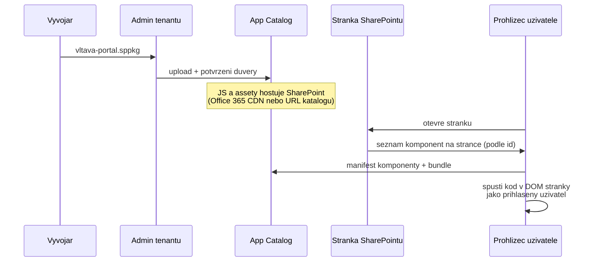
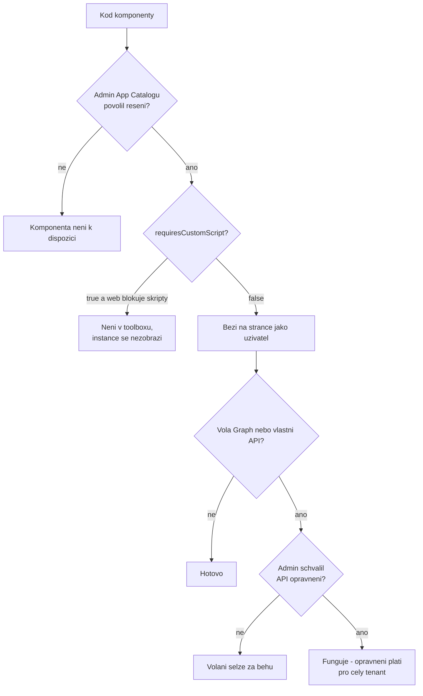

# Jak se SPFx kód dostane do stránky a kdo mu věří

Deep-dive k [`README.md`](README.md), sekce *Kdo komponentě věří*. Cíl: rozumět cestě
JavaScriptu od `.sppkg` až do prohlížeče uživatele — protože právě na této cestě se
rozhoduje o bezpečnosti, o hranici tenantu i o tom, proč „funguje mi to" nestačí.

## Cesta kódu: od balíčku k vykreslení

SPFx komponenta nemá server. Celý její „provoz" je soubor `.sppkg`, který admin nahraje do
App Catalogu, a JavaScript, který si prohlížeč stáhne, když stránka komponentu potřebuje.



Co z dokumentace plyne pro jednotlivé kroky:

1. **Balíček.** `heft package-solution --production` zabalí manifesty, JavaScript, CSS
   a assety do `.sppkg` podle Open Packaging Conventions; JS a assety jsou uvnitř balíčku jen
   s přepínačem `--production`
   ([Deploy your web part, Hello World part 3](https://learn.microsoft.com/en-us/sharepoint/dev/spfx/web-parts/get-started/serve-your-web-part-in-a-sharepoint-page)).
2. **Nasazení a důvěra.** Při nahrání do App Catalogu SharePoint ukáže dialog, protože jde
   o *full trust client-side solution*, a admin musí řešení výslovně povolit (tamtéž).
3. **Hosting.** Po nasazení jsou assety hostované automaticky — z Office 365 CDN (pokud je
   zapnuté), jinak z adresy App Catalogu; řídí to `includeClientSideAssets`
   v `package-solution.json` (tamtéž). Žádný vlastní server, žádná cizí doména.
4. **Načtení.** Loader SPFx hledá komponenty v App Catalogu (vaše řešení) a na *manifest
   serveru* SharePointu (systémové knihovny)
   ([Debug on modern pages](https://learn.microsoft.com/en-us/sharepoint/dev/spfx/debug-modern-pages),
   popis parametru `debugManifestsFile`).
5. **Běh.** Kód běží v kontextu aktuálního uživatele a jeho připojení, bez iframe, přímo
   v DOM stránky
   ([Overview of SPFx](https://learn.microsoft.com/en-us/sharepoint/dev/spfx/sharepoint-framework-overview)).

### Příklad z vltava-portal: co v balíčku opravdu je

V `sharepoint/solution/debug/` zůstává po buildu rozbalený obsah balíčku
([Hello World part 3](https://learn.microsoft.com/en-us/sharepoint/dev/spfx/web-parts/get-started/serve-your-web-part-in-a-sharepoint-page),
sekce *Package contents*). Manifest web partu `Portal` v něm obsahuje `loaderConfig` —
výňatek z referenčního projektu ve stavu **po dni 5** (build 2026-10-23, lektorský stroj,
ID nahrazená zástupnými symboly):

```json
"loaderConfig": {
  "internalModuleBaseUrls": ["HTTPS://SPCLIENTSIDEASSETLIBRARY/"],
  "entryModuleId": "portal-web-part",
  "scriptResources": {
    "portal-web-part": { "type": "path", "path": "portal-web-part_<hash>.js" },
    "react": { "type": "component", "id": "<react-component-id>", "version": "17.0.1" },
    "@microsoft/sp-core-library": { "type": "component", "id": "<id>", "version": "1.23.2" }
  }
}
```

Jak to číst:

- `"type": "path"` je **náš** kód — soubor, který přijde z hostingu App Catalogu.
- `"type": "component"` jsou knihovny, které **nejsou v našem bundlu** — loader je dohledá
  jako komponenty (React, knihovny SPFx). Proto má bundle web partu `Portal` po dni 1 jen
  7 182 B (změřeno 2026-10-16, viz [`../project-anatomy/mereni-instalace.md`](../project-anatomy/mereni-instalace.md)).
- `internalModuleBaseUrls` v balíčku neobsahuje adresu tenantu, jen zástupný řetězec. Kam
  přesně SharePoint po nasazení soubory umístí (CDN nebo knihovna katalogu), dokumentace
  popisuje jen obecně (bod 3 výše) — mechanismus dosazení **neověřeno**.

## Tři úrovně důvěry

Kdo smí rozhodnout, že JavaScript poběží u všech uživatelů? V SharePoint Online jsou to tři
oddělená rozhodnutí — a každé dělá někdo jiný.



### 1. Schválení řešení v App Catalogu

Koncoví uživatelé mohou používat SPFx řešení, která schválili admini tenantu (nebo jejich
delegáti), a to na všech webech
([Overview of SPFx](https://learn.microsoft.com/en-us/sharepoint/dev/spfx/sharepoint-framework-overview)).
Admin tím neschvaluje „web part", ale **veškerý kód v balíčku** — včetně všech npm
závislostí, které webpack do bundlu přibalil.

### 2. Custom script — proč ne Script Editor

Starší cesta „vložím na stránku vlastní JavaScript" vede přes *custom script* (například
Script Editor web part). Pokud je custom script povolený, **každý**, kdo má na webu oprávnění
*Add and Customize Pages*, může přidat libovolný skript; ve výchozím stavu SharePoint
custom script nepovoluje mimo jiné na moderních týmových a komunikačních webech a povolení
na webu se do 24 hodin samo vrátí na zakázáno
([Allow or prevent custom script](https://learn.microsoft.com/en-us/sharepoint/allow-or-prevent-custom-script)).

SPFx tuhle díru obchází tím, že kód schvaluje admin (bod 1), ne vlastník stránky. Manifest
vygenerovaného web partu to deklaruje výslovně:

```json
// If true, the component can only be installed on sites where Custom Script is allowed.
"requiresCustomScript": false,
```

Web part s `requiresCustomScript: true` na webu s blokovaným custom scriptem není ve výběru
web partů a jeho dříve přidané instance se na stránkách nezobrazí (tamtéž). V kurzu proto
zůstává `false` — a kdo by ho přepnul, přijde o všechny moderní weby.

### 3. Oprávnění k API

Třetí rozhodnutí přichází, až kód volá Microsoft Graph nebo vlastní API přes
`AadHttpClient`. Dokumentace
([Connect to Entra ID-secured APIs](https://learn.microsoft.com/en-us/sharepoint/dev/spfx/use-aadhttpclient),
sekce *Considerations*) uvádí čtyři pravidla, která studenti pravidelně čtou obráceně:

| Pravidlo | Co to znamená v praxi |
|---|---|
| Schválené oprávnění platí pro **celý tenant** a může ho využít jakýkoli client-side požadavek v tenantu | Schvaluješ „Graph `User.Read.All` pro všechny skripty v tenantu", ne „pro web part Adresář" |
| Odebrání řešení oprávnění **neodvolá** | Úklid po testech = ruční revokace oprávnění |
| Zamítnutí žádosti **nebrání** nasazení řešení | Kód musí počítat s tím, že oprávnění nemá |
| Odvolání oprávnění **nezneplatní** už vydané tokeny | Změna se projeví až po vypršení tokenů |

Podrobně ve středu v [`../../day-3/permissions-consent/`](../../day-3/permissions-consent/).

## Co z toho plyne pro tajemství a data

Bundle si stáhne každý uživatel, který otevře stránku — je to obyčejný JavaScript v jeho
prohlížeči. Dokumentace řadí SPFx řešení mezi klientské aplikace, které **neumějí uchovat
tajemství**, a proto používají tok OAuth bez klientského tajemství
([Connect to Entra ID-secured APIs](https://learn.microsoft.com/en-us/sharepoint/dev/spfx/use-aadhttpclient),
sekce *Web API permissions overview*). Důsledky:

- **API klíč, heslo nebo connection string v kódu = veřejný údaj** pro každého uživatele
  tenantu. Patří do vlastního API (Azure Function za Entra ID), ne do bundlu.
- **Každá cizí doména v kódu je tok dat ven.** Externí CDN, telemetrie, API dodavatele — to
  jsou místa, kde data opouštějí tenant (viz *Hranice tenantu* v README).

## Jak chybu poznat

| Příznak | Pravděpodobná příčina |
|---|---|
| Web part v toolboxu chybí na jednom webu, jinde je | řešení není na webu nainstalované, nebo `requiresCustomScript: true` na webu s blokovaným custom scriptem |
| Volání Graphu vrací chybu autorizace u všech uživatelů | žádost o oprávnění čeká nebo byla zamítnuta — nasazení přesto prošlo |
| Po smazání testovacího řešení „pořád funguje" volání Graphu z jiného řešení | oprávnění platí pro tenant a odebráním řešení nezmizelo |
| V kódu je řetězec, který vypadá jako klíč nebo heslo | architektonická chyba — přesunout za vlastní API |

## Zdroje (Microsoft)

- [Overview of the SharePoint Framework](https://learn.microsoft.com/en-us/sharepoint/dev/spfx/sharepoint-framework-overview)
- [Deploy your client-side web part to a SharePoint page (Hello World part 3)](https://learn.microsoft.com/en-us/sharepoint/dev/spfx/web-parts/get-started/serve-your-web-part-in-a-sharepoint-page)
- [Debug SharePoint Framework solutions on modern SharePoint pages](https://learn.microsoft.com/en-us/sharepoint/dev/spfx/debug-modern-pages)
- [Allow or prevent custom script](https://learn.microsoft.com/en-us/sharepoint/allow-or-prevent-custom-script)
- [Connect to Entra ID-secured APIs in SharePoint Framework solutions](https://learn.microsoft.com/en-us/sharepoint/dev/spfx/use-aadhttpclient)
