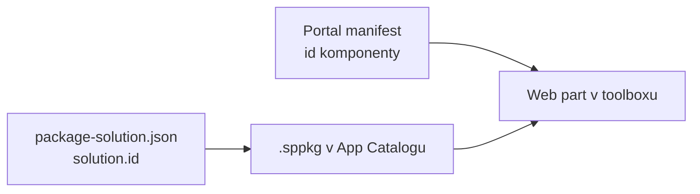

# Anatomie projektu

> Typ: povinný · Den: 1 · Odhad: 60 min
> Tenant: `cloudedu.cz` · Režim: hands-on, jen lokálně
> Prostředí: [`../../environment.md`](../../environment.md) · Názvosloví: [`../../GLOSSARY.md`](../../GLOSSARY.md)

Student vygeneruje řešení `vltava-portal-<ini>`, které ho bude provázet celý týden. Zatímco se
instalují závislosti, čte soubory projektu a hledá v nich odpovědi na otázky z labu.

## Cíle

- Vygenerovat SPFx řešení generátorem 1.23.2 s React šablonou.
- Najít v projektu identitu řešení, identitu komponenty a místo, kde se nastavuje build.
- Vysvětlit, co dělá `npm start` a `npm run build` a jaký soubor je výsledkem.

## Výklad

### Mapa projektu

Projekt vygenerovaný SPFx 1.23.2 (React šablona, komponenta `Portal`):

```text
vltava-portal-<ini>/
├─ package.json            # závislosti, verze SPFx, npm skripty -> heft
├─ .yo-rc.json             # odpovědi generátoru, verze SPFx, ID řešení
├─ tsconfig.json           # jen extends -> rig
├─ eslint.config.js        # ESLint 9 flat config, profil SPFx React
├─ config/
│  ├─ package-solution.json  # identita a metadata řešení (.sppkg)
│  ├─ serve.json             # lokální server, initialPage s {tenantDomain}
│  ├─ config.json            # bundly, entry pointy, lokalizační moduly
│  ├─ rig.json               # odkaz na @microsoft/spfx-web-build-rig
│  ├─ typescript.json, sass.json  # rozšíření konfigurace z rigu
│  └─ write-manifests.json, deploy-azure-storage.json  # CDN mimo SharePoint (v kurzu ne)
├─ src/webparts/portal/
│  ├─ PortalWebPart.ts             # třída web partu: životní cyklus, property pane
│  ├─ PortalWebPart.manifest.json  # identita komponenty, název v toolboxu
│  ├─ components/                  # React komponenty
│  ├─ loc/                         # mystrings.d.ts + en-us.js
│  └─ assets/
└─ teams/                  # ikony pro Teams (pro web part v Teams)
```

### Dvě identity: řešení a komponenta



- **`solution.id`** v `config/package-solution.json` (shodné s `libraryId` v `.yo-rc.json`)
  identifikuje **balíček** v App Catalogu.
- **`id`** v `PortalWebPart.manifest.json` identifikuje **komponentu** — podle něj stránka
  web part najde a načte. Instance web partu na stránce si pamatuje právě toto ID.

Obě ID vygeneroval generátor náhodně. Na sdíleném tenantu je to důvod, proč si každý student
generuje řešení sám — viz [`../../scenario-vltava-portal.md`](../../scenario-vltava-portal.md).

### Build: npm skripty, Heft a rig

`package.json` vygenerovaného projektu:

```json
"scripts": {
  "build": "heft test --clean --production && heft package-solution --production",
  "clean": "heft clean",
  "eject-webpack": "heft eject-webpack",
  "start": "heft start --clean"
}
```

- `npm start` — lokální server na `https://localhost:4321` s průběžnou kompilací.
- `npm run build` — produkční build včetně testů a zabalení do
  `sharepoint/solution/<název>.sppkg`.
- Konfiguraci buildu projekt **nedrží sám**: `config/rig.json` odkazuje na balíček
  `@microsoft/spfx-web-build-rig` a `tsconfig.json`, `typescript.json` i `sass.json` jen
  rozšiřují jeho výchozí profily. Úprava webpacku se dělá Heft pluginem nebo vysunutím
  (`eject-webpack`) — ne úpravou souborů v `node_modules`.

Zdroj: [Heft-based toolchain](https://learn.microsoft.com/en-us/sharepoint/dev/spfx/toolchain/sharepoint-framework-toolchain-rushstack-heft).

### Co je v 1.23 jinak než ve starých návodech

| Starý návod | SPFx 1.23.2 |
|---|---|
| `gulpfile.js` | neexistuje — build řídí Heft a rig |
| `.eslintrc.js` | `eslint.config.js` (ESLint 9) |
| `tsconfig.json` s desítkami voleb | jen `extends` na rig |
| `gulp serve` otevře lokální workbench | `npm start` otevře **hosted** workbench na tenantu |

> [!IMPORTANT] Instalace trvá minuty, build sekundy — změřeno (2026-10-16)
> Lektorský stroj (ne učebna), Node.js 22.22.0, npm 10.9.9, teplá cache: `npm install`
> **192 s**, 1 317 balíčků, 140 456 souborů, 703 MB v `node_modules`. `npm run build` celého
> řešení **7 s**. S prázdnou cache trvalo samotné stahování ~7 min. Data a postup:
> [`mereni-instalace.md`](mereni-instalace.md).
>
> **Instalaci spouštěj hned po vygenerování a čti soubory během ní — čekat na ni je ztracený čas.**

## Klíčové rozlišení

- **`solution.id` vs. `id` komponenty** — jedno řešení, víc komponent; App Catalog pracuje
  s řešením, stránka s komponentou.
- **Konfigurace v projektu vs. v rigu** — `config/*.json` v projektu většinou jen dědí.
  Skutečné výchozí hodnoty jsou v `node_modules/@microsoft/spfx-web-build-rig`.
- **`npm start` vs. `npm run build`** — první je vývojová smyčka bez balíčku, druhý produkční
  `.sppkg` k nasazení.

## Naše prostředí

Jen lokální stroj. Projekt vzniká v `$HOME\spodev\vltava-portal-<ini>`. Na tenantu se v tomto
bloku nic nemění.

## Lab

Viz [`lab-anatomie-projektu.md`](lab-anatomie-projektu.md).

## Nosná linka

Vzniká **řešení `vltava-portal-<ini>`** s web partem `Portal` (Rozcestník) — zatím přesně tak,
jak ho vygeneroval generátor. Jeho `solution.id` je identita, se kterou student ve středu
poprvé nasazuje do tenantového App Catalogu.

## Zdroje (Microsoft)

- [Build your first SharePoint client-side web part](https://learn.microsoft.com/en-us/sharepoint/dev/spfx/web-parts/get-started/build-a-hello-world-web-part)
- [Heft-based toolchain](https://learn.microsoft.com/en-us/sharepoint/dev/spfx/toolchain/sharepoint-framework-toolchain-rushstack-heft)
- [SharePoint Framework v1.23.2 release notes](https://learn.microsoft.com/en-us/sharepoint/dev/spfx/release-1.23.2)

## Stav produktu / delta

> [!WARNING] Ověřit k datu běhu — stav k 2026-10.
> Struktura souborů odpovídá generátoru 1.23.2. SPFx 1.24 má podle roadmapy připravit
> náhradu generátoru (SPFx CLI, GA plánovaná v 1.25) s otevřenými šablonami — struktura
> projektu se tím může změnit.
