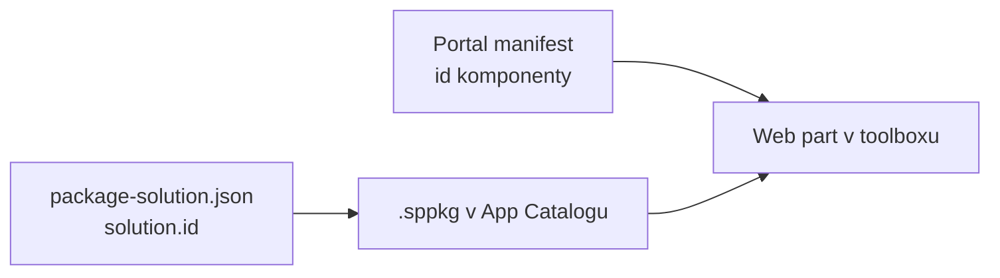
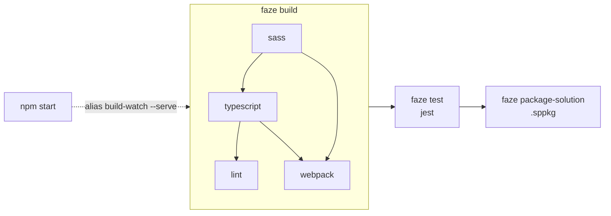

# Anatomie projektu

> Typ: povinný · Den: 1 · Odhad: 60 min
> Tenant: `cloudedu.cz` · Režim: hands-on, jen lokálně
> Prostředí: [`../../environment.md`](../../environment.md) · Názvosloví: [`../../GLOSSARY.md`](../../GLOSSARY.md)

Student vygeneruje řešení `vltava-portal-<ini>`, které ho bude provázet celý týden. Zatímco se
instalují závislosti, čte soubory projektu a hledá v nich odpovědi na otázky z labu.

## Cíle

- Vygenerovat SPFx řešení generátorem 1.23.2 s React šablonou.
- Najít v projektu identitu řešení, identitu komponenty a místo, kde se nastavuje build.
- Vysvětlit, co dělá `npm start` a `npm run build` a jaký soubor je výsledkem.

## Výklad

### Mapa projektu

Projekt vygenerovaný SPFx 1.23.2 (React šablona, komponenta `Portal`):

```text
vltava-portal-<ini>/
├─ package.json            # závislosti, verze SPFx, npm skripty -> heft
├─ .yo-rc.json             # odpovědi generátoru, verze SPFx, ID řešení
├─ tsconfig.json           # jen extends -> rig
├─ eslint.config.js        # ESLint 9 flat config, profil SPFx React
├─ config/
│  ├─ package-solution.json  # identita a metadata řešení (.sppkg)
│  ├─ serve.json             # lokální server, initialPage s {tenantDomain}
│  ├─ config.json            # bundly, entry pointy, lokalizační moduly
│  ├─ rig.json               # odkaz na @microsoft/spfx-web-build-rig
│  ├─ typescript.json, sass.json  # rozšíření konfigurace z rigu
│  └─ write-manifests.json, deploy-azure-storage.json  # CDN mimo SharePoint (v kurzu ne)
├─ src/webparts/portal/
│  ├─ PortalWebPart.ts             # třída web partu: životní cyklus, property pane
│  ├─ PortalWebPart.manifest.json  # identita komponenty, název v toolboxu
│  ├─ components/                  # React komponenty
│  ├─ loc/                         # mystrings.d.ts + en-us.js
│  └─ assets/
└─ teams/                  # ikony pro Teams (pro web part v Teams)
```

### Dvě identity: řešení a komponenta



- **`solution.id`** v `config/package-solution.json` (shodné s `libraryId` v `.yo-rc.json`)
  identifikuje **balíček** v App Catalogu.
- **`id`** v `PortalWebPart.manifest.json` identifikuje **komponentu** — podle něj stránka
  web part najde a načte. Instance web partu na stránce si pamatuje právě toto ID.

Obě ID vygeneroval generátor náhodně. Na sdíleném tenantu je to důvod, proč si každý student
generuje řešení sám — viz [`../../scenario-vltava-portal.md`](../../scenario-vltava-portal.md).

### Build: npm skripty, Heft a rig

`package.json` vygenerovaného projektu:

```json
"scripts": {
  "build": "heft test --clean --production && heft package-solution --production",
  "clean": "heft clean",
  "eject-webpack": "heft eject-webpack",
  "start": "heft start --clean"
}
```

- `npm start` — lokální server na `https://localhost:4321` s průběžnou kompilací.
- `npm run build` — produkční build včetně testů a zabalení do
  `sharepoint/solution/<název>.sppkg`.
- Konfiguraci buildu projekt **nedrží sám**: `config/rig.json` odkazuje na balíček
  `@microsoft/spfx-web-build-rig` a `tsconfig.json`, `typescript.json` i `sass.json` jen
  rozšiřují jeho výchozí profily. Úprava webpacku se dělá Heft pluginem nebo vysunutím
  (`eject-webpack`) — ne úpravou souborů v `node_modules`.

> [!WARNING] `npm run eject-webpack` je jednosměrný
> Vysunutí webpack konfigurace nejde vrátit a takový build toolchain už Microsoft
> nepodporuje — dokumentace ho uvádí jako poslední možnost
> ([Understanding the Heft-based toolchain](https://learn.microsoft.com/en-us/sharepoint/dev/spfx/toolchain/customize-heft-toolchain-overview),
> sekce *Eject the webpack configuration*). Skript je v `package.json` od generátoru,
> v kurzu ho **nespouštíme**.

Zdroj: [Heft-based toolchain](https://learn.microsoft.com/en-us/sharepoint/dev/spfx/toolchain/sharepoint-framework-toolchain-rushstack-heft).

### Co přesně dělá `npm run build`: fáze a úlohy z rigu

Heft pracuje s pojmy *akce* (příkaz z příkazové řádky), *fáze* a *úlohy*. Fáze a úlohy jsou
popsané v `config/heft.json` — a protože ho nový projekt nemá, Heft ho hledá v rigu
odkazovaném z `config/rig.json`. SPFx rig obsahuje jediný profil `default` s fázemi
**build**, **test** a **package-solution**
([Understanding the Heft-based toolchain](https://learn.microsoft.com/en-us/sharepoint/dev/spfx/toolchain/customize-heft-toolchain-overview)).

Kde to je fyzicky: `node_modules/@microsoft/spfx-web-build-rig/profiles/default/config/heft.json`.
Zkrácený výňatek (rig 1.23.2, přečteno 2026-10-23 na lektorském stroji; konfigurace úloh
a další úlohy vynechané):

```jsonc
"aliasesByName": {
  "start": { "actionName": "build-watch", "defaultParameters": ["--serve"] }
},
"phasesByName": {
  "build": { "tasksByName": { "sass": { /* ... */ }, "typescript": { /* ... */ }, "lint": { /* ... */ }, "webpack": { /* ... */ } } },
  "test": { "phaseDependencies": ["build"], "tasksByName": { "jest": { /* ... */ } } },
  "package-solution": { "tasksByName": { "package-solution": { /* ... */ } } }
}
```

Z toho plyne, co se děje za `npm` skripty:



- **`npm start`** = `heft start` = alias akce `build-watch` s `--serve`: fáze build v režimu
  sledování změn a lokální server. Žádné testy, žádný balíček.
- **`npm run build`** = `heft test --production` (fáze test potřebuje build, takže proběhne
  i build) a pak `heft package-solution --production`. Přepínač `--production` nahradil
  `--ship` z gulp toolchainu (tamtéž, tabulka *Heft actions and legacy Gulp tasks*).
- **`--clean`** před během smaže výstupy předchozího buildu — rig mezi nimi vyjmenovává
  mimo jiné `lib`, `lib-commonjs`, `dist` a `release`.

### Kam build zapisuje a co je v `.sppkg`

| Složka | Co v ní je | Patří do gitu? |
|---|---|---|
| `lib/` | výstup TypeScriptu soubor po souboru, včetně zkopírovaných `loc/*.js` | ne (`.gitignore`) |
| `temp/` | mezivýsledky úloh (sass, typescript, webpack statistiky) | ne |
| `sharepoint/solution/debug/` | rozbalený obsah balíčku | ne |
| `sharepoint/solution/*.sppkg` | balíček pro App Catalog | ne — artefakt buildu |

Proč se `loc/*.js` kopírují do `lib/`: `config/typescript.json` ve vygenerovaném projektu
říká `"includeGlobs": ["webparts/*/loc/*.js"]` a `config/config.json` mapuje modul
`PortalWebPartStrings` na `lib/webparts/portal/loc/{locale}.js`. Lokalizační soubory jsou
čistý JavaScript, takže je TypeScript nepřekládá — jen se kopírují.

Balíček `.sppkg` používá Open Packaging Conventions, komponenty balí do SharePoint Feature
a jeho rozbalený obsah najdeš v `sharepoint/solution/debug/`
([Hello World part 3](https://learn.microsoft.com/en-us/sharepoint/dev/spfx/web-parts/get-started/serve-your-web-part-in-a-sharepoint-page),
sekce *Package contents*). V referenčním projektu (stav po dni 5, build 2026-10-23) to
vypadá takto — GUIDy nahrazené zástupnými symboly:

```text
sharepoint/solution/debug/
+-- AppManifest.xml                     # ProductID = solution.id, Version = solution.version
+-- ClientSideAssets/
|   +-- portal-web-part_<hash>.js       # the bundle of the web part
|   +-- PortalWebPartStrings_en-us_<hash>.js
|   +-- PortalWebPartStrings_cs-cz_<hash>.js
+-- <feature-id>/
|   +-- WebPart_<webpart-id>.xml        # component manifest (id, preconfiguredEntries, loaderConfig)
+-- feature_<feature-id>.xml
+-- [Content_Types].xml
+-- _rels/
```

Tady se potkávají obě identity z předchozí sekce: `ProductID` v `AppManifest.xml` je
`solution.id` a název `WebPart_<webpart-id>.xml` nese `id` z manifestu komponenty. Lab to
v kroku 6 ověřuje hledáním ID web partu v rozbaleném balíčku.

Manifest komponenty v balíčku navíc obsahuje `loaderConfig`. Náš kód v něm má
`"type": "path"` (soubor v `ClientSideAssets`), zatímco React a knihovny SPFx mají
`"type": "component"` — nejsou v našem bundlu, loader je dohledá u SharePointu (loader hledá
komponenty v App Catalogu a systémové knihovny na *manifest serveru* SharePointu;
[Debug on modern pages](https://learn.microsoft.com/en-us/sharepoint/dev/spfx/debug-modern-pages)).
Proto má bundle web partu `Portal` po dni 1 jen **7 182 B** a celý `.sppkg` **17 438 B**
(změřeno 2026-10-16, [`mereni-instalace.md`](mereni-instalace.md)), přestože `node_modules`
má 703 MB.

### Typické chyby v projektu a jak je poznat

| Chyba | Jak ji poznat | Co s tím |
|---|---|---|
| `npm audit fix` po instalaci | v `package.json` nebo `package-lock.json` se změnily verze, build začne padat | vrátit změny; npm balíčky slouží jen buildu, `node_modules` se do balíčku nenasazuje a SPFx je testované s konkrétními verzemi ([npm audit v SPFx](https://learn.microsoft.com/en-us/sharepoint/dev/spfx/npm-vulnerabilities)) |
| Úprava souboru v `lib/` nebo `sharepoint/solution/debug/` | změna po dalším buildu zmizí | upravovat jen `src/` a `config/`; výstupní složky smaže `--clean` |
| `.sppkg` hledaný v `solution/` v kořeni | `Test-Path .\solution` vrátí `False` | `paths.zippedPackage` je relativní ke složce `sharepoint/` |
| Kopie cizího projektu včetně `config/package-solution.json` | dvě řešení se stejným `solution.id` v jednom tenantu | ID řešení i komponent musí být vlastní — postup v [`../../scenario-vltava-portal.md`](../../scenario-vltava-portal.md) |
| Úprava souboru v `node_modules/@microsoft/spfx-web-build-rig` | změna zmizí po `npm install` | přepsat konfiguraci souborem v `config/` projektu |

> [!NOTE] Neověřeno: přepis vs. sloučení konfigurace
> Heft hledá konfigurační soubor nejdřív v `config/` projektu a teprve pak v rigu
> ([Rig packages](https://heft.rushstack.io/pages/intro/rig_packages/)). Soubory, které mají
> `extends` (jako vygenerovaný `config/sass.json`), výchozí nastavení rigu dědí a přidávají
> k němu vlastní vlastnosti. Jestli soubor **bez** `extends` výchozí soubor rigu celý
> nahradí, nebo se s ním sloučí, dokumentace výslovně neříká — proto v kurzu vlastní
> konfiguraci vždy píšeme s `extends`.

### Co je v 1.23 jinak než ve starých návodech

| Starý návod | SPFx 1.23.2 |
|---|---|
| `gulpfile.js` | neexistuje — build řídí Heft a rig |
| `.eslintrc.js` | `eslint.config.js` (ESLint 9) |
| `tsconfig.json` s desítkami voleb | jen `extends` na rig |
| `gulp serve` otevře lokální workbench | `npm start` otevře **hosted** workbench na tenantu |

> [!IMPORTANT] Instalace trvá minuty, build sekundy — změřeno (2026-10-16)
> Lektorský stroj (ne učebna), Node.js 22.22.0, npm 10.9.9, teplá cache: `npm install`
> **192 s**, 1 317 balíčků, 140 456 souborů, 703 MB v `node_modules`. `npm run build` celého
> řešení **7 s**. S prázdnou cache trvalo samotné stahování ~7 min. Data a postup:
> [`mereni-instalace.md`](mereni-instalace.md).
>
> **Instalaci spouštěj hned po vygenerování a čti soubory během ní — čekat na ni je ztracený čas.**

### TypeScript a tsconfig — samostudium

`tsconfig.json` projektu obsahuje jen `extends` na rig. Co znamenají `target: es5`, `lib`
a `module`, proč neprojde `[].includes()` a jak se TypeScript v kódu kurzu používá, vysvětluje
volitelný modul [`opt-typescript`](../opt-typescript/) (samostudium, 60 min).

## Klíčové rozlišení

- **`solution.id` vs. `id` komponenty** — jedno řešení, víc komponent; App Catalog pracuje
  s řešením, stránka s komponentou.
- **Konfigurace v projektu vs. v rigu** — `config/*.json` v projektu většinou jen dědí.
  Skutečné výchozí hodnoty jsou v `node_modules/@microsoft/spfx-web-build-rig`.
- **`npm start` vs. `npm run build`** — první je vývojová smyčka bez balíčku, druhý produkční
  `.sppkg` k nasazení.
- **`src/` vs. `lib/` a `sharepoint/solution/`** — zdroj, který se edituje a verzuje, vs.
  výstup buildu, který `--clean` smaže a `.gitignore` vynechává.
- **`"type": "path"` vs. `"type": "component"` v `loaderConfig`** — náš bundle vs. knihovny,
  které dodá SharePoint; proto je bundle v kilobajtech, i když `node_modules` má stovky MB.
- **Plugin / `extends` vs. eject** — podporovaná úprava buildu vs. jednosměrné vysunutí
  webpack konfigurace mimo podporu Microsoftu.

## Naše prostředí

Jen lokální stroj. Projekt vzniká v `$HOME\spodev\vltava-portal-<ini>`. Na tenantu se v tomto
bloku nic nemění.

## Lab

Viz [`lab-anatomie-projektu.md`](lab-anatomie-projektu.md).

## Nosná linka

Vzniká **řešení `vltava-portal-<ini>`** s web partem `Portal` (Rozcestník) — zatím přesně tak,
jak ho vygeneroval generátor. Jeho `solution.id` je identita, se kterou student ve středu
poprvé nasazuje do tenantového App Catalogu.

## Zdroje (Microsoft)

- [Build your first SharePoint client-side web part](https://learn.microsoft.com/en-us/sharepoint/dev/spfx/web-parts/get-started/build-a-hello-world-web-part)
- [Heft-based toolchain](https://learn.microsoft.com/en-us/sharepoint/dev/spfx/toolchain/sharepoint-framework-toolchain-rushstack-heft)
- [SharePoint Framework v1.23.2 release notes](https://learn.microsoft.com/en-us/sharepoint/dev/spfx/release-1.23.2)
- [Understanding the Heft-based toolchain (how it works)](https://learn.microsoft.com/en-us/sharepoint/dev/spfx/toolchain/customize-heft-toolchain-overview)
- [Deploy your client-side web part to a SharePoint page (Hello World part 3)](https://learn.microsoft.com/en-us/sharepoint/dev/spfx/web-parts/get-started/serve-your-web-part-in-a-sharepoint-page)
- [Debug SharePoint Framework solutions on modern SharePoint pages](https://learn.microsoft.com/en-us/sharepoint/dev/spfx/debug-modern-pages)
- [Understanding npm audit vulnerabilities in SPFx projects](https://learn.microsoft.com/en-us/sharepoint/dev/spfx/npm-vulnerabilities)

## Zdroje (třetí strana — Heft)

> [!IMPORTANT] Proč odkaz mimo Learn
> Learn odkazuje na dokumentaci Heftu pro konfiguraci rigů. Odkaz dokládá jen chování
> nástroje, ne tvrzení o SharePointu.

- [Heft — Rig packages](https://heft.rushstack.io/pages/intro/rig_packages/)

## Stav produktu / delta

> [!WARNING] Ověřit k datu běhu — stav k 2026-10.
> Struktura souborů odpovídá generátoru 1.23.2. SPFx 1.24 má podle roadmapy připravit
> náhradu generátoru (SPFx CLI, GA plánovaná v 1.25) s otevřenými šablonami — struktura
> projektu se tím může změnit.
