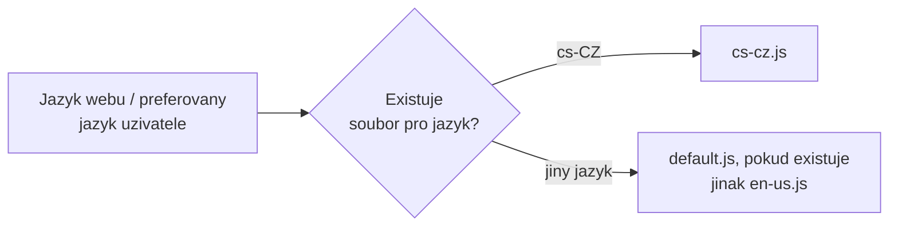
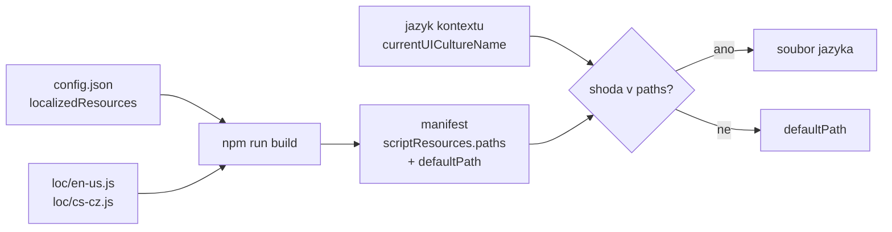

# Lokalizace a více jazyků

> Typ: povinný · Den: 2 · Odhad: 45 min
> Tenant: `cloudedu.cz` · Režim: hands-on, vlastní weby
> Prostředí: [`../../environment.md`](../../environment.md) · Názvosloví: [`../../GLOSSARY.md`](../../GLOSSARY.md)

Rozcestník mluví anglicky. Vltava Servis je česká firma s anglicky mluvícími kolegy —
Rozcestník musí umět obojí a přepnout se sám podle jazyka webu.

## Cíle

- Přidat české texty (`cs-cz.js`) a vysvětlit, jak SPFx vybírá soubor podle jazyka.
- Lokalizovat název a popis web partu v manifestu.
- Ověřit oba jazyky na dvou webech a najít chybějící překlad dřív než uživatel.

## Výklad

### Jak SPFx vybírá jazyk



- Lokalizační soubory jsou v `loc/` pojmenované **malými písmeny** (`cs-cz.js`); v manifestu
  se jazyk píše **`cs-CZ`** — první část malá, druhá velká.
- Jazyk určuje kontext stránky (`pageContext.cultureInfo.currentUICultureName`). Na webu
  s více jazyky (MUI) je to jazyk, který preferuje uživatel.
- Když web part soubor pro jazyk nemá, použije **en-US**. Soubor `default.js` tuto zálohu
  přepíše na jiný jazyk.
- V release buildu je každý jazyk samostatný soubor; stránka stáhne jen ten, který potřebuje.

Zdroj: [Localize SharePoint Framework client-side web parts](https://learn.microsoft.com/en-us/sharepoint/dev/spfx/web-parts/guidance/localize-web-parts)
(updated 2026-02-27).

> [!IMPORTANT] Záloha platí pro celý soubor, ne pro jednotlivý klíč
> Když `cs-cz.js` existuje, ale chybí v něm klíč, SPFx **nesáhne** pro chybějící klíč do
> `en-us.js` — hodnota je `undefined`. Dokumentace proto výslovně žádá ověřit, že všechny klíče
> z `mystrings.d.ts` mají překlad ve **všech** jazykových souborech. TypeScript to nepohlídá
> (viz pondělní lab). V labu to ověříme počtem klíčů a v pátek testem v pipeline.

### Co se lokalizuje a co ne

| Co | Kde | Lokalizuje se |
|---|---|---|
| Texty web partu a property pane | `loc/*.js` | ano, soubor podle jazyka |
| Název, popis, skupina v toolboxu | manifest, `"cs-CZ": "…"` | ano, v manifestu |
| Hodnoty, které zadá editor (odkazy, nadpis) | vlastnosti web partu | **ne** — uložené jak je editor napsal |

Hodnoty vlastností ve více jazycích (pro každý jazyk webu vlastní pole) dokumentace popisuje
jako samostatný vzor — mimo rozsah kurzu.

> [!NOTE] Workbench a lokalizovaný manifest
> Podle dokumentace workbench **nezobrazuje** lokalizované hodnoty z manifestu — vždy použije
> `default`. Lokalizovaný název v toolboxu se ověřuje na moderní stránce.

### Od `config.json` k souboru v prohlížeči

Lokalizace v SPFx není překladová služba, ale **mechanismus načítání modulů**. Texty jsou
obyčejný JavaScriptový modul a SPFx jen rozhodne, *který* soubor pod jedním jménem modulu
stáhne. Řetěz v Rozcestníku má čtyři články:

1. **Jméno modulu** — kód importuje `import * as strings from 'PortalWebPartStrings';`
   a `loc/mystrings.d.ts` deklaruje jeho tvar. TypeScript tak zná klíče, ale soubory `.js`
   nekontroluje.
2. **Mapování v `config/config.json`** — jméno modulu → cesta se zástupným `{locale}`:

   ```json
   "localizedResources": {
     "PortalWebPartStrings": "lib/webparts/portal/loc/{locale}.js"
   }
   ```

   Tak to vygeneroval generátor; co z mapování build udělá, je vidět v manifestu (bod 3).
3. **Manifest po buildu** — v `loaderConfig.scriptResources` je modul typu `localizedPath`
   s mapou `paths` (jazyk → soubor) a `defaultPath`. V release buildu je každý jazyk vlastní
   soubor s hashem v názvu
   ([localize web parts](https://learn.microsoft.com/en-us/sharepoint/dev/spfx/web-parts/guidance/localize-web-parts)).
   Tuhle mapu čte kontrolní příkaz v kroku 3 labu.
4. **Za běhu** — SPFx podle jazyka kontextového webu vybere soubor z `paths`; když shoda
   není, stáhne `defaultPath`. Stránka tak stahuje jen jeden jazyk.



Z toho plynou chyby, které se dobře poznají:

- **Celý web part je anglicky na českém webu** — v `paths` není `cs-CZ`. Buď soubor chybí
  nebo se jmenuje jinak, nebo běží server spuštěný před jeho vytvořením (lab, Fallback).
  Kontrola: výpis `paths` z kroku 3.
- **Jediný text je prázdný nebo `undefined`** — soubor jazyka existuje, ale klíč v něm chybí.
  Záloha je po souborech (`defaultPath`), ne po klíčích.
- **Překlep v klíči** — `strings.Greting` TypeScript odhalí (zná `mystrings.d.ts`), překlep
  v `cs-cz.js` ne. Proto kontrola parity klíčů skriptem.

> [!WARNING] Debug build vs. hosted workbench — ověřit k datu běhu
> Stejná stránka dokumentace říká dvě věci, které je třeba sladit na tenantu: v debug buildu
> manifest nese jen výchozí jazyk (en-US nebo jazyk z `--locales`), a zároveň že hosted
> workbench použije jazyk kontextového webu (`currentUICultureName`). Krok 4 labu staví na
> druhém tvrzení; plán B s `--locales` je v instructor notes.

### Jazyk textů vs. jazyk formátu

Kontext stránky nese **dva** jazyky
([CultureInfo](https://learn.microsoft.com/en-us/javascript/api/sp-page-context/cultureinfo)):

| Vlastnost | K čemu podle reference | Příklad z reference |
|---|---|---|
| `currentUICultureName` | jazyk uživatelského rozhraní — **překlad textů** | `es-MX` → „hola" místo „hello" |
| `currentCultureName` | formát **dat, časů, čísel, měny**, řazení a porovnání textu | `en-AU` → datum 1/8 místo 8/1 |

Lokalizační soubory řídí první. Druhá se týká všeho, co web part **formátuje** — datum
výpůjčky, počet kusů, částku. Obě vlastnosti mohou být podle reference **prázdný řetězec**
(nikdy `undefined`), kód proto potřebuje zálohu.

Na webu s více jazyky (MUI) se rozhraní zobrazí v jazyce, který preferuje uživatel, a SPFx
podle něj načte i soubor s texty; hosted workbench se chová stejně
([localize web parts](https://learn.microsoft.com/en-us/sharepoint/dev/spfx/web-parts/guidance/localize-web-parts)).
Kurzovní weby mají jeden jazyk, takže rozhoduje jazyk webu.

Vzor pro formátování s jazykem z kontextu, ne z prohlížeče:

```typescript
const culture: string = this.context.pageContext.cultureInfo.currentCultureName;
// Empty string means "unknown" -- fall back to the runtime default.
const dateFormat: Intl.DateTimeFormat = new Intl.DateTimeFormat(culture || undefined, {
  year: 'numeric', month: 'numeric', day: 'numeric'
});
const label: string = dateFormat.format(new Date(item.Modified));
```

> [!NOTE] Neověřeno — formát bez jazyka
> Evidence vybavení v pátek formátuje datum voláním `toLocaleDateString()` **bez** jazyka
> ([`../../day-5/equipment-desk/`](../../day-5/equipment-desk/)). Jaký formát pak student
> uvidí na českém webu s anglickým prohlížečem, kurz neměřil. Pokud má formát odpovídat
> nastavení webu, předej `currentCultureName` explicitně jako výše.

### Pseudo-locale: najdi chybu dřív než překladatel

Dokumentace doporučuje testovat s **pseudo-locale** `qps-ploc`: soubor `loc/qps-ploc.js`
obsahuje anglické texty přepsané do znaků s diakritikou, o zhruba 35 % delší a obalené
`[!!! ... !!!]`. Spuštění `npm start -- --nobrowser --locales qps-ploc` pak ukáže tři druhy
chyb najednou
([pseudo-locales](https://learn.microsoft.com/en-us/sharepoint/dev/spfx/web-parts/guidance/localize-web-parts#improve-globalizing-and-localizing-web-parts-by-using-pseudo-locales)):

- **text natvrdo v kódu** — zůstane normální anglicky, bez závorek,
- **text, který se nevejde** — chybí koncové `!!!]`,
- **písmo bez potřebných znaků** — rozbité znaky.

Pro češtinu je to užitečné dvakrát: české texty bývají delší než anglické a diakritika
odhalí písmo nebo kódování souboru, které ji neumí (tripwire „diakritika v manifestu").
Kurz pseudo-locale v labu nepoužívá — kontrola parity klíčů hlídá jinou chybu (chybějící
klíč), pseudo-locale hlídá zapomenutý text natvrdo.

## Klíčové rozlišení

- **`cs-cz.js` vs. `cs-CZ`** — název souboru malými písmeny, klíč v manifestu s velkou
  druhou částí. Záměna je tichá chyba.
- **Záloha souboru vs. záloha klíče** — chybějící soubor → en-US; chybějící klíč →
  `undefined`.
- **Text aplikace vs. obsah od editora** — lokalizační soubory řeší jen text, který napsal
  vývojář.
- **`currentUICultureName` vs. `currentCultureName`** — jazyk textů vs. formát dat a čísel.
  Lokalizační soubory řídí jen první.
- **Jméno modulu vs. soubor** — kód zná jen `PortalWebPartStrings`; který soubor se za ním
  skrývá, rozhodne SPFx za běhu podle `paths` v manifestu.

## Naše prostředí

- Jazyk webu se volí **při založení** a později změnit nejde. Pro test češtiny proto student
  založí druhý web `spodev-<ini>-cs` v češtině.
- Účet studenta má preferovaný jazyk angličtinu; český web se mu přesto zobrazí česky, protože
  web nemá zapnuté další jazyky.

## Lab

Viz [`lab-cestina-a-anglictina.md`](lab-cestina-a-anglictina.md).

## Nosná linka

Rozcestník je **dvojjazyčný**: na českém webu oddělení česky, na anglickém anglicky, z jednoho
řešení. Odkazy zadané editorem zůstávají v jazyce, v jakém je editor napsal.

## Zdroje (Microsoft)

- [Localize SharePoint Framework client-side web parts](https://learn.microsoft.com/en-us/sharepoint/dev/spfx/web-parts/guidance/localize-web-parts)
- [Simplify adding web parts with preconfigured entries](https://learn.microsoft.com/en-us/sharepoint/dev/spfx/web-parts/guidance/simplify-adding-web-parts-with-preconfigured-entries)
- Reference: [CultureInfo](https://learn.microsoft.com/en-us/javascript/api/sp-page-context/cultureinfo)

## Stav produktu / delta

> [!WARNING] Ověřit k datu běhu — stav k 2026-10.
> Chování workbenche u lokalizovaného manifestu (podle dokumentace jen `default`) a výběr jazyka
> v hosted workbenchi podle jazyka webu. Hosted workbench se retiruje 2026-12-01.
