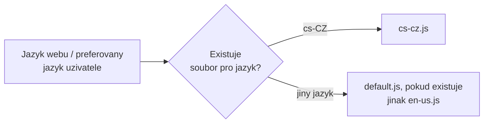

# Lokalizace a více jazyků

> Typ: povinný · Den: 2 · Odhad: 45 min
> Tenant: `cloudedu.cz` · Režim: hands-on, vlastní weby
> Prostředí: [`../../environment.md`](../../environment.md) · Názvosloví: [`../../GLOSSARY.md`](../../GLOSSARY.md)

Rozcestník mluví anglicky. Vltava Servis je česká firma s anglicky mluvícími kolegy —
Rozcestník musí umět obojí a přepnout se sám podle jazyka webu.

## Cíle

- Přidat české texty (`cs-cz.js`) a vysvětlit, jak SPFx vybírá soubor podle jazyka.
- Lokalizovat název a popis web partu v manifestu.
- Ověřit oba jazyky na dvou webech a najít chybějící překlad dřív než uživatel.

## Výklad

### Jak SPFx vybírá jazyk

- Lokalizační soubory jsou v `loc/` pojmenované **malými písmeny** (`cs-cz.js`); v manifestu
  se jazyk píše **`cs-CZ`** — první část malá, druhá velká.
- Jazyk určuje kontext stránky (`pageContext.cultureInfo.currentUICultureName`). Na webu
  s více jazyky (MUI) je to jazyk, který preferuje uživatel.
- Když web part soubor pro jazyk nemá, použije **en-US**. Soubor `default.js` tuto zálohu
  přepíše na jiný jazyk.
- V release buildu je každý jazyk samostatný soubor; stránka stáhne jen ten, který potřebuje.

Zdroj: [Localize SharePoint Framework client-side web parts](https://learn.microsoft.com/en-us/sharepoint/dev/spfx/web-parts/guidance/localize-web-parts)
(updated 2026-02-27).

> [!IMPORTANT] Záloha platí pro celý soubor, ne pro jednotlivý klíč
> Když `cs-cz.js` existuje, ale chybí v něm klíč, SPFx **nesáhne** pro chybějící klíč do
> `en-us.js` — hodnota je `undefined`. Dokumentace proto výslovně žádá ověřit, že všechny klíče
> z `mystrings.d.ts` mají překlad ve **všech** jazykových souborech. TypeScript to nepohlídá
> (viz pondělní lab). V labu to ověříme počtem klíčů a v pátek testem v pipeline.

### Co se lokalizuje a co ne

| Co | Kde | Lokalizuje se |
|---|---|---|
| Texty web partu a property pane | `loc/*.js` | ano, soubor podle jazyka |
| Název, popis, skupina v toolboxu | manifest, `"cs-CZ": "…"` | ano, v manifestu |
| Hodnoty, které zadá editor (odkazy, nadpis) | vlastnosti web partu | **ne** — uložené jak je editor napsal |

Hodnoty vlastností ve více jazycích (pro každý jazyk webu vlastní pole) dokumentace popisuje
jako samostatný vzor — mimo rozsah kurzu.

> [!NOTE] Workbench a lokalizovaný manifest
> Podle dokumentace workbench **nezobrazuje** lokalizované hodnoty z manifestu — vždy použije
> `default`. Lokalizovaný název v toolboxu se ověřuje na moderní stránce.

## Klíčové rozlišení

- **`cs-cz.js` vs. `cs-CZ`** — název souboru malými písmeny, klíč v manifestu s velkou
  druhou částí. Záměna je tichá chyba.
- **Záloha souboru vs. záloha klíče** — chybějící soubor → en-US; chybějící klíč →
  `undefined`.
- **Text aplikace vs. obsah od editora** — lokalizační soubory řeší jen text, který napsal
  vývojář.

## Naše prostředí

- Jazyk webu se volí **při založení** a později změnit nejde. Pro test češtiny proto student
  založí druhý web `spodev-<ini>-cs` v češtině.
- Účet studenta má preferovaný jazyk angličtinu; český web se mu přesto zobrazí česky, protože
  web nemá zapnuté další jazyky.

## Lab

Viz [`lab-cestina-a-anglictina.md`](lab-cestina-a-anglictina.md).

## Nosná linka

Rozcestník je **dvojjazyčný**: na českém webu oddělení česky, na anglickém anglicky, z jednoho
řešení. Odkazy zadané editorem zůstávají v jazyce, v jakém je editor napsal.

## Zdroje (Microsoft)

- [Localize SharePoint Framework client-side web parts](https://learn.microsoft.com/en-us/sharepoint/dev/spfx/web-parts/guidance/localize-web-parts)
- [Simplify adding web parts with preconfigured entries](https://learn.microsoft.com/en-us/sharepoint/dev/spfx/web-parts/guidance/simplify-adding-web-parts-with-preconfigured-entries)

## Stav produktu / delta

> [!WARNING] Ověřit k datu běhu — stav k 2026-10.
> Chování workbenche u lokalizovaného manifestu (podle dokumentace jen `default`) a výběr jazyka
> v hosted workbenchi podle jazyka webu. Hosted workbench se retiruje 2026-12-01.
