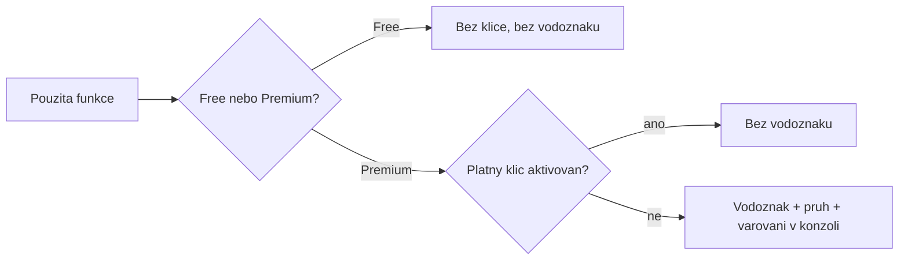

# KendoReact — komerční UI knihovna v SPFx

> Typ: volitelný · Den: 2 · Odhad: 60 min
> Tenant: `cloudedu.cz` · Režim: hands-on, samostatný projekt (neovlivní `vltava-portal`)
> Prostředí: [`../../environment.md`](../../environment.md) · Názvosloví: [`../../GLOSSARY.md`](../../GLOSSARY.md)

Fluent UI nemá datovou mřížku s řazením, filtrem a stránkováním v jednom. Firmy proto sahají po
komerčních knihovnách. Blok ukazuje, co to v SPFx znamená prakticky: verze Reactu, licence,
globální CSS a velikost balíčku.

> [!IMPORTANT] Volitelný blok je leaf
> Lab běží v **samostatném** projektu `kendo-sandbox-<ini>`. Řešení `vltava-portal` se nemění
> a žádný další blok na tomto nezávisí.

## Cíle

- Vybrat verzi KendoReact, která funguje s Reactem 17 v SPFx 1.23 — a zdůvodnit to z
  `peerDependencies`, ne z marketingu.
- Rozlišit komponenty KendoReact Free a Premium a to, co se stane bez licence.
- Zobrazit KendoReact Grid nad daty knihovny *Site Pages* s řazením, filtrem a stránkováním.
- Změřit, kolik Grid a téma přidají do balíčku.

## Výklad

### Verze: nejnovější KendoReact s SPFx 1.23 nejde

> [!IMPORTANT] KendoReact 14+ vyžaduje React 18 — ověřeno na npm (2026-10-16)
> `peerDependencies.react` balíčku `@progress/kendo-react-grid`:
>
> | Verze | Vydáno | React |
> |---|---|---|
> | 13.3.0 | 2026-01-16 | `^16.8.2 \|\| ^17.0.0 \|\| ^18.0.0 \|\| ^19.0.0` |
> | 14.4.1 | 2026-05-04 | `^18.0.0 \|\| ^19.0.0` |
> | 16.2.0 (`latest`) | 2026-10-07 | `^18.0.0 \|\| ^19.0.0` |
>
> SPFx 1.23.2 běží na Reactu **17.0.1**. Proto kurz připíná **KendoReact 13.3.0** a k němu
> téma `@progress/kendo-theme-default@12.3.0` (vydané před KendoReact 13.3.0).
>
> **`npm install` bez verze nainstaluje knihovnu, která tvému Reactu nevyhovuje — vždy čti
> `peerDependencies`.**

Telerik ohlásil ukončení podpory Reactu 16 a 17 od Q1 2026
([roadmap](https://www.telerik.com/support/whats-new/kendo-react-ui/roadmap)). Pro řešení na
SPFx 1.23 to znamená zmrazenou verzi KendoReact až do přechodu SPFx na React 18 (SPFx 1.24).

### Free vs. Premium

KendoReact má bezplatnou sadu (KendoReact Free, 50+ komponent) a placenou (Premium, 120+).
Grid patří do Free se základními funkcemi — řazení podle jednoho sloupce, filtrování,
stránkování, výběr, export do CSV. Seskupování, export do Excelu/PDF, virtualizace řádků
a serverové operace jsou Premium
([free vs. premium](https://www.telerik.com/kendo-react-ui/components/getting-started/free-vs-premium)).

Premium komponenty bez platné licence zobrazují licenční varování a vodoznak. Licence se
aktivuje balíčkem `@progress/kendo-licensing` a souborem s klíčem
([licensing](https://www.telerik.com/kendo-react-ui/components/my-license)). Lab používá jen
funkce Free — licenci nepotřebuje.

### Globální CSS v SPFx

Téma KendoReact je CSS soubor, který se importuje do komponenty a webpack ho přibalí do bundlu.
Jeho třídy (`.k-*`) jsou globální — platí pro celou stránku. Dokumentace SPFx globální CSS
výslovně odrazuje ([Fluent UI in SPFx](https://learn.microsoft.com/en-us/sharepoint/dev/spfx/fluent-ui-integration)):
dva web party s různými verzemi tématu Kendo na jedné stránce se mohou navzájem přepsat.

### Velikost

> [!IMPORTANT] Jeden Grid s tématem má 1,4 MB — 7× víc než celý Rozcestník — změřeno (2026-10-16)
> Samostatný projekt SPFx 1.23.2, jeden web part s `Grid` (řazení, filtr, stránkování),
> `npm run build`, lektorský stroj:
>
> | Varianta | Bundle web partu |
> |---|---|
> | Rozcestník s Fluent UI (pro srovnání) | 206 511 B |
> | KendoReact Grid 13.3.0 bez CSS tématu | 614 128 B |
> | KendoReact Grid 13.3.0 + `kendo-theme-default/dist/all.css` | **1 442 440 B** |
>
> Samotný soubor `all.css` má 713 376 B; v bundlu je jako JavaScriptový řetězec. Build bez
> chyb a bez licenčního varování (jen funkce KendoReact Free), 16 s.
>
> **Komerční knihovna je rozhodnutí o velikosti balíčku stejně jako o licenci — a celé téma
> je dražší než komponenta.**

Rozpad stejného měření (dopočteno z tabulky výše, ne nové měření):

| Část | Bajty | Odkud |
|---|---|---|
| Grid a použité části jeho závislostí (JavaScript) | 614 128 | bundle bez CSS |
| Téma v bundlu | 828 312 | 1 442 440 − 614 128 |
| z toho samotný `all.css` | 713 376 | velikost souboru |
| rozdíl oproti samotnému souboru | 114 936 | 828 312 − 713 376 |

Téma je tedy víc než polovina balíčku a v bundlu zabírá zhruba o šestinu víc než samotný
soubor `all.css`.

### Téma: jeden soubor pro všechny komponenty

Precompiled téma obsahuje styly **všech** komponent KendoReact, ne jen těch, které projekt
používá ([Telerik — themes installation](https://www.telerik.com/design-system/docs/themes/get-started/installation/)).
Ve verzi 12.3.0, kterou kurz připíná, to platí doslova:

> [!IMPORTANT] `all.css` je totéž co `default-main.css` — ověřeno (2026-10-23)
> Referenční sandbox, lektorský stroj: v `node_modules/@progress/kendo-theme-default/dist/`
> mají `all.css` a `default-main.css` stejný hash (713 376 B). Ostatní swatche (`default-blue`,
> `default-ocean-blue`, …) mají 704 848–714 474 B.
>
> **Výběr swatche mění barvy, ne velikost — velikost mění jen výběr komponent.**

Výrobce popisuje druhou cestu: SCSS build, který zahrne jen styly vybraných komponent
(`@use '.../scss/index.scss' as *;` a `@include kendo-grid--styles();`). Mixin
`kendo-grid--styles` ve verzi 12.3.0 existuje (`scss/grid/_index.scss`, ověřeno 2026-10-23).
Otevřené otázky, než se tahle cesta doporučí:

- **Kolik ušetří?** Neměřeno — prázdné místo pro měření: `____ B` (datum, stroj).
- **Projde SCSS přes CSS moduly SPFx?** Soubor `*.module.scss` je CSS modul, který Learn doporučuje
  právě kvůli izolaci tříd; zda by tím nepřejmenoval i třídy `.k-*`, které Grid očekává, je **neověřeno**.

Precompiled CSS ve verzi 12.3.0 obsahuje i CSS proměnné (např. `--kendo-color-primary`,
ověřeno v `all.css` 2026-10-23). Výrobce je uvádí jako způsob, jak změnit barvy bez buildu
nastavením na `:root` — což je ale **další globální CSS**, se stejným rizikem jako téma samo
(viz výše).

**Časté chyby s tématem:**

- **Grid bez stylů** — chybí import tématu nebo je téma jiné řady. Výrobce výslovně žádá,
  aby verze tématu byla kompatibilní s verzí KendoReact
  ([styling](https://www.telerik.com/kendo-react-ui/components/styling)); proto kurz
  připíná dvojici 13.3.0 + 12.3.0.
- **Téma přepisuje okolní web party** — jsou to globální třídy; viz krok 7 labu.
- **Přepsání stylu nefunguje** — výrobce doporučuje načíst téma **před** vlastními styly
  ([instalace témat](https://www.telerik.com/design-system/docs/themes/get-started/installation/)),
  protože při stejné specificitě vyhrává později načtené pravidlo. Stejný princip pořadí
  načtení popisuje i Learn ([Fluent UI in SPFx — CSS specificity](https://learn.microsoft.com/en-us/sharepoint/dev/spfx/fluent-ui-integration#css-specificity)).

### Licence: jak aktivace funguje

Free a Premium nejsou dvě knihovny. Grid je jeden balíček `@progress/kendo-react-grid`
a výrobce v tabulce Free vs. Premium uvádí u téhož balíčku funkce obojího typu —
o licenci rozhoduje, **které funkce použiješ**
([free vs. premium](https://www.telerik.com/kendo-react-ui/components/getting-started/free-vs-premium)).
Pro Free výrobce uvádí, že licenční klíč není potřeba.

Pro Premium funkce podle výrobce
([licensing](https://www.telerik.com/kendo-react-ui/components/my-license)):

1. V projektu je balíček `@progress/kendo-licensing` (kurz ho má v `package.json`).
2. Licenční klíč se aktivuje příkazem `npx kendo-ui-license activate` — ze souboru s klíčem
   (příkaz `refresh` ho podle výrobce ukládá do domovské složky uživatele) nebo z proměnné
   prostředí `TELERIK_LICENSE`; když existuje obojí, použije se proměnná.
3. Pro CI/CD výrobce odkazuje na samostatný návod s klíči pro nasazení.

Bez platné licence Premium komponenty ukazují **vodoznak** a stránka **pruh** s odkazem na
zkušební verzi nebo nákup; zavřený pruh se po obnovení stránky vrátí. Do konzole prohlížeče
se zapíše varování
([license errors and warnings](https://www.telerik.com/kendo-react-ui/components/my-license/license-errors-and-warnings)).

Co z toho plyne pro SPFx:

- **Licenční klíč nikdy do repozitáře.** U veřejného repa (jako tento kurz) i u firemního —
  klíč patří do proměnné prostředí pipeline, ne do souboru vedle kódu.
- **Kdy přesně se licence kontroluje** (při buildu, nebo až v prohlížeči) výrobce na
  citovaných stránkách neuvádí — **neověřeno**. Instructor notes proto mají go/no-go na
  konzoli prohlížeče u Free funkcí.
- **Aktivace licence ≠ právo distribuovat.** Řešení `.sppkg` se nasazuje do tenantu
  zákazníka; podmínky redistribuce jsou otázka smlouvy, ne balíčku (viz delta).

## Klíčové rozlišení

- **KendoReact Free vs. Premium** — stejné balíčky, rozdíl je licence a dostupné funkce.
- **`latest` vs. kompatibilní verze** — `latest` je verze pro nejnovější React, ne pro tvůj.
- **CSS modul vs. téma knihovny** — CSS modul je izolovaný, téma Kendo globální.
- **Swatch vs. výběr komponent** — swatch mění barvy, velikost tématu mění jen to, které
  komponenty se do CSS zahrnou.
- **Aktivace licence vs. licence k distribuci** — aktivace odstraní vodoznak, o tom, zda
  smíš řešení předat zákazníkovi, rozhoduje smlouva.

## Naše prostředí

- Samostatný projekt na učebním stroji; test na hosted workbenchi nebo testovací stránce
  vlastního webu (knihovna *Site Pages* existuje na každém komunikačním webu).
- Bez licence a bez registrace u Teleriku.

## Lab

Viz [`lab-kendo-grid.md`](lab-kendo-grid.md).

## Nosná linka

Žádná změna řešení `vltava-portal` — blok je leaf. Do nosné linky se vrací jen poznatek:
Evidence vybavení ve středu použije `DetailsList` z Fluent UI, který v balíčku už je.

## Zdroje (Microsoft)

- [Using Fluent UI in SharePoint Framework](https://learn.microsoft.com/en-us/sharepoint/dev/spfx/fluent-ui-integration)
- [SPFx compatibility](https://learn.microsoft.com/en-us/sharepoint/dev/spfx/compatibility)

## Zdroje (třetí strana — Progress Telerik KendoReact)

> [!IMPORTANT] Proč odkaz mimo Learn
> KendoReact je komerční produkt třetí strany; licenční podmínky a funkce dokumentuje výrobce.

- [KendoReact — Free vs. Premium](https://www.telerik.com/kendo-react-ui/components/getting-started/free-vs-premium)
- [KendoReact — licence](https://www.telerik.com/kendo-react-ui/components/my-license)
- [KendoReact — roadmap](https://www.telerik.com/support/whats-new/kendo-react-ui/roadmap)
- [KendoReact — licenční chyby a varování](https://www.telerik.com/kendo-react-ui/components/my-license/license-errors-and-warnings)
- [KendoReact — styling](https://www.telerik.com/kendo-react-ui/components/styling)
- [Telerik Design System — instalace témat](https://www.telerik.com/design-system/docs/themes/get-started/installation/)

## Stav produktu / delta

> [!WARNING] Ověřit k datu běhu — stav k 2026-10.
> Verze KendoReact s podporou Reactu 17 (13.3.0) a rozsah KendoReact Free. Až SPFx přejde na
> React 18 (1.24), přejít na aktuální KendoReact a znovu změřit balíček. Před nasazením
> řešení s KendoReact zákazníkovi ověřit licenční podmínky redistribuce v `.sppkg`.
