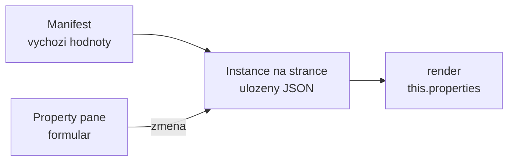
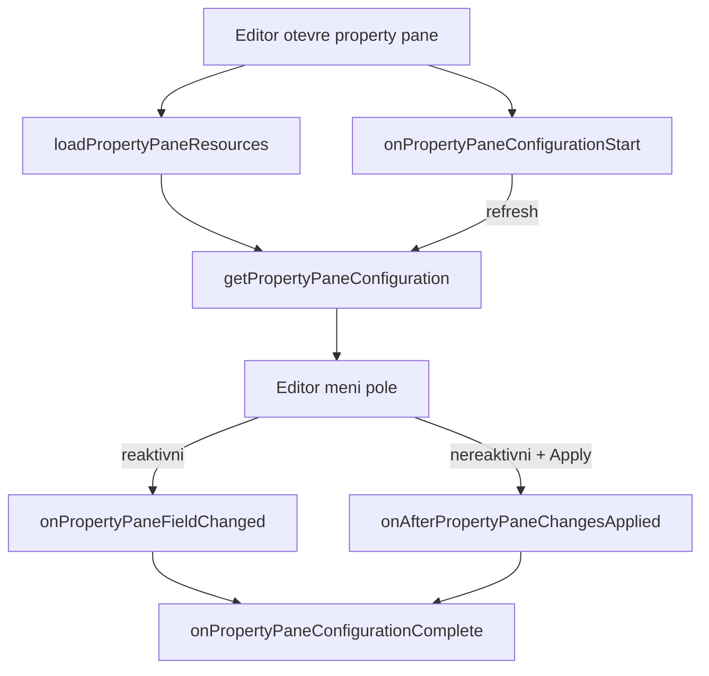

# Property pane a dynamická konfigurace

> Typ: povinný · Den: 2 · Odhad: 90 min
> Tenant: `cloudedu.cz` · Režim: hands-on, vlastní web
> Prostředí: [`../../environment.md`](../../environment.md) · Názvosloví: [`../../GLOSSARY.md`](../../GLOSSARY.md)

V pondělí měl Rozcestník odkazy natvrdo v kódu — každá změna znamenala vývojáře a nové
nasazení. Dnes si je oddělení nastaví samo v property pane, včetně validace a knihovny
dokumentů načtené z webu.

## Cíle

- Navrhnout vlastnosti web partu tak, aby je uměl nastavit editor stránky bez vývojáře.
- Validovat vstup v property pane (`onGetErrorMessage`) a vysvětlit, co se stane s neplatnou
  hodnotou.
- Přepnout property pane do nereaktivního režimu a zdůvodnit, kdy je lepší.
- Načíst volby dropdownu asynchronně z webu a ošetřit čekání i chybu.

## Výklad

### Vlastnosti web partu

Vlastnosti web partu jsou **JSON uložený s instancí web partu na stránce**. Výchozí hodnoty
nese manifest (`preconfiguredEntries[0].properties`), tvar popisuje rozhraní
`IPortalWebPartProps` a property pane je jen formulář nad nimi.



Rozcestník po tomto bloku:

| Vlastnost | Pole | Proč takhle |
|---|---|---|
| `title` | text, max. 60 znaků | prázdný = výchozí lokalizovaný nadpis |
| `links` | víceřádkový text `Název\|https://…` | vestavěná pole nemají „kolekci" — viz níže |
| `libraryUrl` | dropdown načtený z webu | editor vybírá, nepíše URL |
| `showEnvironment` | přepínač | diagnostika jen na požádání |

> [!NOTE] Proč odkazy jako text, ne jako kolekce
> Vestavěná pole property pane (`@microsoft/sp-property-pane`) jsou: tlačítko, checkbox, choice
> group, dropdown, oddělovač, popisek, odkaz, slider, text, víceřádkový text, přepínač
> a vlastní pole ([integrate with property pane](https://learn.microsoft.com/en-us/sharepoint/dev/spfx/web-parts/basics/integrate-with-property-pane)).
> Editor kolekce mezi nimi není. Komunitní balíček PnP property controls ho má, ale přidá
> závislost a velikost balíčku — viz Klíčové rozlišení. Kurz volí vestavěné pole a validaci;
> parser `parseLinks` a validátor `validateLinks` jsou samostatné funkce v `src/utils`, které
> v pátek dostanou unit testy.

### Validace

Pole dostane funkci `onGetErrorMessage`. Vrátí prázdný řetězec = platné, jinak text chyby
(nebo `Promise<string>` pro validaci proti API). Podle dokumentace:

- web part se při neplatné hodnotě vykreslí s **poslední platnou** hodnotou,
- v nereaktivním režimu je při chybě **tlačítko Použít neaktivní**,
- validace se spouští se zpožděním 200 ms, nastavitelné přes `deferredValidationTime`.

Zdroj: [Validate web part property values](https://learn.microsoft.com/en-us/sharepoint/dev/spfx/web-parts/guidance/validate-web-part-property-values)
(updated 2026-01-02).

### Reaktivní vs. nereaktivní režim

Výchozí je **reaktivní**: každá změna pole se hned propíše do web partu. **Nereaktivní**
(`disableReactivePropertyChanges` vrací `true`) mění web part až po tlačítku Použít.

Pro Rozcestník je správně nereaktivní: editor píše víceřádkový seznam odkazů a v reaktivním
režimu by se web part překresloval po každém znaku, včetně rozepsaných neplatných řádků.

### Asynchronní volby

Dropdown s knihovnami webu se plní až při otevření property pane — v
`onPropertyPaneConfigurationStart`. Během načítání zobrazí property pane indikátor
(`showLoadingIndicator`) a po načtení se překreslí voláním `this.context.propertyPane.refresh()`.
Postup odpovídá vzoru z dokumentace
([cascading dropdowns](https://learn.microsoft.com/en-us/sharepoint/dev/spfx/web-parts/guidance/use-cascading-dropdowns-in-web-part-properties));
místo simulovaných dat voláme SharePoint REST přes `SPHttpClient` — podrobně ve středu
v [`../../day-3/data-access-clients/`](../../day-3/data-access-clients/).

### Životní cyklus property pane

Property pane není formulář, který si web part vykreslí sám. Vykresluje ho hostitel stránky
a web part mu jen **odpovídá na dotazy a události**. Metody, které Rozcestník přepisuje, jsou
virtuální metody základní třídy
([BaseWebPart](https://learn.microsoft.com/en-us/javascript/api/sp-webpart-base/basewebpart)):

| Metoda | Kdy ji SPFx volá (podle reference) | Rozcestník |
|---|---|---|
| `loadPropertyPaneResources()` | před všemi ostatními API property pane; dokud se promise nevyřeší, `getPropertyPaneConfiguration()` se nezavolá | nepřepisuje |
| `getPropertyPaneConfiguration()` | když hostitel potřebuje popis formuláře | 3 skupiny polí |
| `onPropertyPaneConfigurationStart()` | při otevření property pane **a** při přepnutí na jiný web part | načte knihovny |
| `onPropertyPaneFieldChanged(path, old, new)` | po zápisu nové hodnoty do `this.properties` v **reaktivním** režimu | nepřepisuje |
| `onAfterPropertyPaneChangesApplied()` | po tlačítku Použít v **nereaktivním** režimu; v reaktivním se nevolá | nepřepisuje |
| `onPropertyPaneConfigurationComplete()` | zavření (X), Použít, přepnutí web partu, nebo 5 s po poslední změně | nepřepisuje |



Diagram ukazuje jen pořadí, které dokumentace výslovně uvádí. Pořadí mezi
`getPropertyPaneConfiguration()` a `onPropertyPaneConfigurationStart()` dokumentované není —
kód proto na něm nesmí stavět.

**Princip: konfigurace je funkce stavu.** `getPropertyPaneConfiguration()` nic neukládá; při
každém zavolání vrátí nový popis formuláře z aktuálních polí třídy. Když se pole změní mimo
událost formuláře (doběhlo načtení knihoven), hostitel o tom neví — proto Rozcestník volá
`this.context.propertyPane.refresh()`, které property pane přinutí si konfiguraci vyžádat znovu
([cascading dropdowns](https://learn.microsoft.com/en-us/sharepoint/dev/spfx/web-parts/guidance/use-cascading-dropdowns-in-web-part-properties)):

```typescript
protected async onPropertyPaneConfigurationStart(): Promise<void> {
  // Called on every open and on every switch between web parts -- guard it.
  if (this._libraryOptions.length > 0 || this._librariesLoading) {
    return;
  }
  this._librariesLoading = true;
  this.context.propertyPane.refresh();   // shows the loading indicator
  // ... await this._loadLibraries() ...
  this._librariesLoading = false;
  this.context.propertyPane.refresh();   // shows the loaded options
}
```

Strážná podmínka na začátku není kosmetika: metoda se volá i při přepnutí mezi web party na
stránce, takže bez ní by každé přepnutí poslalo nový dotaz na `/_api/web/lists`.

**Časté chyby a jak je poznat:**

- **Chybí `refresh()`** — data se načetla, ale dropdown je dál prázdný a neaktivní. Zavření
  a otevření property pane „pomůže", protože vynutí nové `getPropertyPaneConfiguration()`.
- **Indikátor načítání se neukáže** — není to chyba. `showLoadingIndicator` se zobrazí až po
  `loadingIndicatorDelayTime`, výchozí 500 ms; rychlé načtení ho nestihne
  ([IPropertyPaneConfiguration](https://learn.microsoft.com/en-us/javascript/api/sp-property-pane/ipropertypaneconfiguration)).
- **Reset závislé hodnoty na `undefined`** — u kaskádových dropdownů dokumentace výslovně
  říká, že reset vynutí **prázdný řetězec**; `undefined` výběr v poli nevynuluje.
- **Přepsaný `onPropertyPaneFieldChanged` bez `super.onPropertyPaneFieldChanged(...)`** —
  vzor z dokumentace volá základní implementaci, aby se nová hodnota propsala.
- **Reakce na změnu v nereaktivním režimu přes `onPropertyPaneFieldChanged`** — reference
  tuto metodu popisuje pro reaktivní režim; pro „po Použít" je určena
  `onAfterPropertyPaneChangesApplied()`. Zda se `onPropertyPaneFieldChanged` v nereaktivním
  režimu volá také, je **neověřeno** — nestavět na tom.

### Stránky, skupiny a podmíněná pole

Konfigurace má tři úrovně: **stránky** (`pages`) → **skupiny** (`groups`) → **pole**
(`groupFields`); stránka má nepovinné záhlaví
([integrate with property pane](https://learn.microsoft.com/en-us/sharepoint/dev/spfx/web-parts/basics/integrate-with-property-pane)).
Rozcestník má jednu stránku a tři skupiny. Užitečné stabilní volby:

| Volba | Kde | Co dělá |
|---|---|---|
| `displayGroupsAsAccordion` | stránka | skupiny jako akordeon |
| `isCollapsed` | skupina | skupina začne sbalená (výchozí `false`) |
| `isGroupNameHidden` | skupina | skryje název skupiny |
| `currentPage` | konfigurace | která stránka se zobrazí |
| `showLoadingIndicator`, `loadingIndicatorDelayTime` | konfigurace | překryv při čekání, zpoždění 500 ms |

Zdroje: [IPropertyPanePage](https://learn.microsoft.com/en-us/javascript/api/sp-property-pane/ipropertypanepage),
[IPropertyPaneGroup](https://learn.microsoft.com/en-us/javascript/api/sp-property-pane/ipropertypanegroup),
[IPropertyPaneConfiguration](https://learn.microsoft.com/en-us/javascript/api/sp-property-pane/ipropertypaneconfiguration).

> [!WARNING] Preview API nepatří do produkce
> Reference označuje jako preview („Do not use this API in a production environment") mimo
> jiné `title` stránky, `pagesType`, `debounceProperties` a `disableAudiencePicker`. Na
> internetu je najdeš v ukázkách — v kurzu je nepoužíváme.

Protože konfigurace je obyčejný objekt sestavený kódem, **podmíněné pole** je jen podmíněný
prvek pole. Rozcestník tak přidává chybový popisek pod dropdown jen tehdy, když načtení
selhalo:

```typescript
groupFields: [
  PropertyPaneDropdown('libraryUrl', { /* ... */ }),
  // The label exists only when loading failed.
  ...(this._librariesError ? [PropertyPaneLabel('libraryError', { text: this._librariesError })] : [])
]
```

Stejně se dělá skupina, která se ukáže až po zapnutí přepínače. `groupName` má být na
stránce jedinečný — reference to doporučuje kvůli výkonu.

### Uložené vlastnosti a jejich verze

Vlastnosti se ukládají jako JSON **s každou instancí na každé stránce**. Když v labu zmizí
vlastnost `description` a přibude `links`, stránky, kam už někdo starý web part vložil,
**pořád nesou starý JSON** — nasazení nového kódu je nepřepíše. Proto instructor notes
varují, že workbench „pamatuje plátno".

SPFx na to má dva háčky
([BaseWebPart](https://learn.microsoft.com/en-us/javascript/api/sp-webpart-base/basewebpart)):

- `dataVersion` — verze, která se uloží spolu s vlastnostmi (výchozí `1.0`; Rozcestník ji
  vrací explicitně).
- `onAfterDeserialize(deserializedObject, dataVersion)` — volá se po načtení uloženého JSON,
  těsně před naplněním `this.properties`. Reference ho uvádí právě pro upgrade: starší verze
  web partu mohla uložit jiné schéma.

Ilustrace (není v `solution/`) — kdyby Rozcestník přešel na `dataVersion` `2.0` a chtěl
převzít starý `description` jako nadpis:

```typescript
protected get dataVersion(): Version {
  return Version.parse('2.0');
}

// eslint-disable-next-line @typescript-eslint/no-explicit-any
protected onAfterDeserialize(stored: any, dataVersion: Version): IPortalWebPartProps {
  if (dataVersion.major < 2 && stored.description && !stored.title) {
    stored.title = stored.description; // migrate the old property
  }
  return stored as IPortalWebPartProps;
}
```

Opačný směr hlídá `onBeforeSerialize()`: reference upozorňuje, že co web part zapíše do
`this.properties`, to se uloží — **včetně neplatných hodnot**. I proto `parseLinks` v
`render()` neplatné řádky znovu filtruje (viz Klíčové rozlišení).

### Kód jen pro property pane: `loadPropertyPaneResources`

Property pane otevírá jen editor, ale kód formuláře se standardně stahuje každému čtenáři
stránky. `loadPropertyPaneResources()` umožní kód pro property pane vyčlenit do samostatného
chunku přes dynamický `import()` a stáhnout ho až při otevření
([dynamic loading](https://learn.microsoft.com/en-us/sharepoint/dev/spfx/dynamic-loading)):

```typescript
protected loadPropertyPaneResources(): Promise<void> {
  return import(
    /* webpackChunkName: 'portal-property-pane' */
    './PortalPropertyPane'
  ).then(module => {
    this._propertyPane = new module.PortalPropertyPane(this);
  });
}
```

Dvě věci se tu snadno pletou:

- **Načtení kódu** (`loadPropertyPaneResources`) — jednou, před prvním
  `getPropertyPaneConfiguration()`.
- **Načtení dat** (`onPropertyPaneConfigurationStart`) — knihovny webu; to dělá Rozcestník.

Rozcestník `loadPropertyPaneResources` **nepoužívá** a je to správně: jeho property pane jsou
vestavěná pole a dvě validační funkce, není co oddělit. Ve čtvrtek se stejný mechanismus
(`import()` + chunk) měří v [`../../day-4/performance-caching/`](../../day-4/performance-caching/)
a lazy loading tam vychází **hůř** (+9 892 B v hlavním bundlu). Vyplatí se, až property pane
nese velký vlastní ovládací prvek nebo knihovnu — a rozhodnout má měření, ne pravidlo.

> [!NOTE] Vlastní pole property pane
> Když vestavěná pole nestačí, vlastní pole implementuje `IPropertyPaneField` s typem
> `PropertyPaneFieldType.Custom` a samo se vykreslí v `onRender(element)` a uklidí
> v `onDispose(element)` — dokumentace výslovně připomíná `onDispose` kvůli odpojení React
> stromu při zavření property pane
> ([custom property pane controls](https://learn.microsoft.com/en-us/sharepoint/dev/spfx/web-parts/guidance/build-custom-property-pane-controls)).
> Hodnotu do `this.properties` v ukázce z dokumentace nezapisuje SPFx, ale callback
> `onPropertyChange`, který pole dostane od web partu. Na tomto mechanismu stojí i hotové
> ovládací prvky z PnP property controls.

## Klíčové rozlišení

- **Reaktivní vs. nereaktivní** — okamžitá zpětná vazba vs. kontrolované potvrzení. Volba
  podle toho, jestli může být rozepsaná hodnota neplatná.
- **Vestavěná pole vs. PnP property controls** — vestavěná pole nic nepřidají do balíčku;
  PnP controls nabídnou kolekce, výběr lidí či termů, ale jsou to další závislost, kterou
  musíš aktualizovat spolu se SPFx.
- **Validace v property pane vs. v kódu web partu** — property pane chrání editora, ne data.
  Vlastnosti lze nastavit i jinak (šablona stránky, API), proto `parseLinks` neplatné řádky
  znovu odfiltruje.
- **`onPropertyPaneFieldChanged` vs. `onAfterPropertyPaneChangesApplied`** — první je
  dokumentovaný pro reaktivní režim (každá změna pole), druhý pro nereaktivní (po Použít).
- **Načtení kódu vs. načtení dat** — `loadPropertyPaneResources` stahuje kód formuláře,
  `onPropertyPaneConfigurationStart` data pro jeho pole.
- **Výchozí hodnoty z manifestu vs. uložená instance** — manifest platí jen pro nově vloženou
  instanci; existující instance mění až migrace v `onAfterDeserialize`.

## Naše prostředí

- Vlastní web `/sites/spodev-<ini>`; knihovna *Documents* existuje na každém komunikačním
  webu, pro dropdown stačí.
- Volání SharePoint REST běží jako přihlášený student — žádné další oprávnění.

## Lab

Viz [`lab-konfigurace-rozcestniku.md`](lab-konfigurace-rozcestniku.md).

## Nosná linka

Rozcestník přestává být kód a stává se **konfigurací**: oddělení IT, HR i servis mají vlastní
nadpis, vlastní odkazy a odkaz na svou knihovnu dokumentů — z jednoho nasazeného řešení.
Vzniká `src/models` a `src/utils`, sdílené s web party, které přibudou ve středu.

Stav po bloku: [`solution/vltava-portal/`](solution/vltava-portal/).

## Zdroje (Microsoft)

- [Make your web part configurable](https://learn.microsoft.com/en-us/sharepoint/dev/spfx/web-parts/basics/integrate-with-property-pane)
- [Validate web part property values](https://learn.microsoft.com/en-us/sharepoint/dev/spfx/web-parts/guidance/validate-web-part-property-values)
- [Use cascading dropdowns in web part properties](https://learn.microsoft.com/en-us/sharepoint/dev/spfx/web-parts/guidance/use-cascading-dropdowns-in-web-part-properties)
- [Build custom controls for the property pane](https://learn.microsoft.com/en-us/sharepoint/dev/spfx/web-parts/guidance/build-custom-property-pane-controls)
- [Dynamic loading of packages](https://learn.microsoft.com/en-us/sharepoint/dev/spfx/dynamic-loading)
- [Simplify adding web parts with preconfigured entries](https://learn.microsoft.com/en-us/sharepoint/dev/spfx/web-parts/guidance/simplify-adding-web-parts-with-preconfigured-entries)
- Reference: [BaseWebPart](https://learn.microsoft.com/en-us/javascript/api/sp-webpart-base/basewebpart),
  [IPropertyPaneConfiguration](https://learn.microsoft.com/en-us/javascript/api/sp-property-pane/ipropertypaneconfiguration)

## Zdroje (třetí strana — PnP property controls)

> [!IMPORTANT] Proč odkaz mimo Learn
> Komunitní knihovna; Learn ji nedokumentuje. Odkaz jen pro přehled dostupných polí.

- [PnP SPFx Property Controls](https://pnp.github.io/sp-dev-fx-property-controls/)

## Stav produktu / delta

> [!WARNING] Ověřit k datu běhu — stav k 2026-10.
> Seznam vestavěných polí pochází ze stránky aktualizované 2022-06 — ověřit, jestli SPFx 1.23
> nepřidala další. Před použitím PnP property controls ověřit, že vydaná verze podporuje
> SPFx 1.23.
