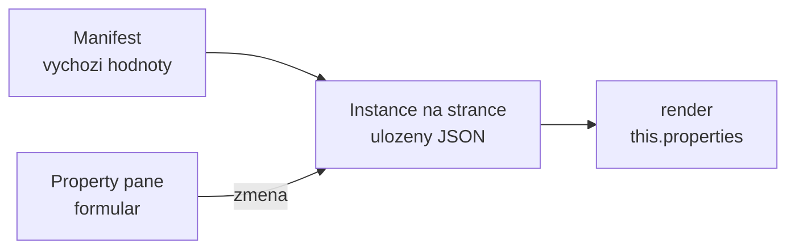

# Property pane a dynamická konfigurace

> Typ: povinný · Den: 2 · Odhad: 90 min
> Tenant: `cloudedu.cz` · Režim: hands-on, vlastní web
> Prostředí: [`../../environment.md`](../../environment.md) · Názvosloví: [`../../GLOSSARY.md`](../../GLOSSARY.md)

V pondělí měl Rozcestník odkazy natvrdo v kódu — každá změna znamenala vývojáře a nové
nasazení. Dnes si je oddělení nastaví samo v property pane, včetně validace a knihovny
dokumentů načtené z webu.

## Cíle

- Navrhnout vlastnosti web partu tak, aby je uměl nastavit editor stránky bez vývojáře.
- Validovat vstup v property pane (`onGetErrorMessage`) a vysvětlit, co se stane s neplatnou
  hodnotou.
- Přepnout property pane do nereaktivního režimu a zdůvodnit, kdy je lepší.
- Načíst volby dropdownu asynchronně z webu a ošetřit čekání i chybu.

## Výklad

### Vlastnosti web partu

Vlastnosti web partu jsou **JSON uložený s instancí web partu na stránce**. Výchozí hodnoty
nese manifest (`preconfiguredEntries[0].properties`), tvar popisuje rozhraní
`IPortalWebPartProps` a property pane je jen formulář nad nimi.

Rozcestník po tomto bloku:

| Vlastnost | Pole | Proč takhle |
|---|---|---|
| `title` | text, max. 60 znaků | prázdný = výchozí lokalizovaný nadpis |
| `links` | víceřádkový text `Název\|https://…` | vestavěná pole nemají „kolekci" — viz níže |
| `libraryUrl` | dropdown načtený z webu | editor vybírá, nepíše URL |
| `showEnvironment` | přepínač | diagnostika jen na požádání |

> [!NOTE] Proč odkazy jako text, ne jako kolekce
> Vestavěná pole property pane (`@microsoft/sp-property-pane`) jsou: tlačítko, checkbox, choice
> group, dropdown, oddělovač, popisek, odkaz, slider, text, víceřádkový text, přepínač
> a vlastní pole ([integrate with property pane](https://learn.microsoft.com/en-us/sharepoint/dev/spfx/web-parts/basics/integrate-with-property-pane)).
> Editor kolekce mezi nimi není. Komunitní balíček PnP property controls ho má, ale přidá
> závislost a velikost balíčku — viz Klíčové rozlišení. Kurz volí vestavěné pole a validaci;
> parser `parseLinks` a validátor `validateLinks` jsou samostatné funkce v `src/utils`, které
> v pátek dostanou unit testy.

### Validace

Pole dostane funkci `onGetErrorMessage`. Vrátí prázdný řetězec = platné, jinak text chyby
(nebo `Promise<string>` pro validaci proti API). Podle dokumentace:

- web part se při neplatné hodnotě vykreslí s **poslední platnou** hodnotou,
- v nereaktivním režimu je při chybě **tlačítko Použít neaktivní**,
- validace se spouští se zpožděním 200 ms, nastavitelné přes `deferredValidationTime`.

Zdroj: [Validate web part property values](https://learn.microsoft.com/en-us/sharepoint/dev/spfx/web-parts/guidance/validate-web-part-property-values)
(updated 2026-01-02).

### Reaktivní vs. nereaktivní režim

Výchozí je **reaktivní**: každá změna pole se hned propíše do web partu. **Nereaktivní**
(`disableReactivePropertyChanges` vrací `true`) mění web part až po tlačítku Použít.

Pro Rozcestník je správně nereaktivní: editor píše víceřádkový seznam odkazů a v reaktivním
režimu by se web part překresloval po každém znaku, včetně rozepsaných neplatných řádků.

### Asynchronní volby

Dropdown s knihovnami webu se plní až při otevření property pane — v
`onPropertyPaneConfigurationStart`. Během načítání zobrazí property pane indikátor
(`showLoadingIndicator`) a po načtení se překreslí voláním `this.context.propertyPane.refresh()`.
Postup odpovídá vzoru z dokumentace
([cascading dropdowns](https://learn.microsoft.com/en-us/sharepoint/dev/spfx/web-parts/guidance/use-cascading-dropdowns-in-web-part-properties));
místo simulovaných dat voláme SharePoint REST přes `SPHttpClient` — podrobně ve středu
v [`../../day-3/data-access-clients/`](../../day-3/data-access-clients/).

## Klíčové rozlišení

- **Reaktivní vs. nereaktivní** — okamžitá zpětná vazba vs. kontrolované potvrzení. Volba
  podle toho, jestli může být rozepsaná hodnota neplatná.
- **Vestavěná pole vs. PnP property controls** — vestavěná pole nic nepřidají do balíčku;
  PnP controls nabídnou kolekce, výběr lidí či termů, ale jsou to další závislost, kterou
  musíš aktualizovat spolu se SPFx.
- **Validace v property pane vs. v kódu web partu** — property pane chrání editora, ne data.
  Vlastnosti lze nastavit i jinak (šablona stránky, API), proto `parseLinks` neplatné řádky
  znovu odfiltruje.

## Naše prostředí

- Vlastní web `/sites/spodev-<ini>`; knihovna *Documents* existuje na každém komunikačním
  webu, pro dropdown stačí.
- Volání SharePoint REST běží jako přihlášený student — žádné další oprávnění.

## Lab

Viz [`lab-konfigurace-rozcestniku.md`](lab-konfigurace-rozcestniku.md).

## Nosná linka

Rozcestník přestává být kód a stává se **konfigurací**: oddělení IT, HR i servis mají vlastní
nadpis, vlastní odkazy a odkaz na svou knihovnu dokumentů — z jednoho nasazeného řešení.
Vzniká `src/models` a `src/utils`, sdílené s web party, které přibudou ve středu.

Stav po bloku: [`solution/vltava-portal/`](solution/vltava-portal/).

## Zdroje (Microsoft)

- [Make your web part configurable](https://learn.microsoft.com/en-us/sharepoint/dev/spfx/web-parts/basics/integrate-with-property-pane)
- [Validate web part property values](https://learn.microsoft.com/en-us/sharepoint/dev/spfx/web-parts/guidance/validate-web-part-property-values)
- [Use cascading dropdowns in web part properties](https://learn.microsoft.com/en-us/sharepoint/dev/spfx/web-parts/guidance/use-cascading-dropdowns-in-web-part-properties)

## Zdroje (třetí strana — PnP property controls)

> [!IMPORTANT] Proč odkaz mimo Learn
> Komunitní knihovna; Learn ji nedokumentuje. Odkaz jen pro přehled dostupných polí.

- [PnP SPFx Property Controls](https://pnp.github.io/sp-dev-fx-property-controls/)

## Stav produktu / delta

> [!WARNING] Ověřit k datu běhu — stav k 2026-10.
> Seznam vestavěných polí pochází ze stránky aktualizované 2022-06 — ověřit, jestli SPFx 1.23
> nepřidala další. Před použitím PnP property controls ověřit, že vydaná verze podporuje
> SPFx 1.23.
