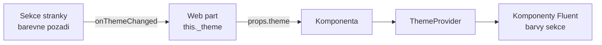

# Fluent UI v SPFx — jak s ním pracovat a proč zatím v8

Studijní text k bloku [`react-fluent-ui`](README.md). Reference komponent:
[Fluent UI React v8](https://developer.microsoft.com/fluentui#/controls/web). Postup
v SPFx: [Using Fluent UI in SharePoint Framework](https://learn.microsoft.com/en-us/sharepoint/dev/spfx/fluent-ui-integration).

## Co Fluent UI je a co z něj používáme

Fluent UI React v8 (`@fluentui/react`) je knihovna komponent, ve které je postavené UI
SharePointu. Pro SPFx řešení dává tři věci:

- **komponenty** — `TextField`, `Dropdown`, `DetailsList`, `Panel`, `MessageBar`, …;
- **motiv** — barvy a typografie stránky, včetně barevného pozadí sekce;
- **styly bez globálního CSS** — každá komponenta si vygeneruje vlastní třídy, nic nepřepíše
  stránku ani jiný web part.

Generátor SPFx 1.18+ zakládá React projekty právě s v8 a Learn doporučuje **používat verzi,
kterou nainstaloval generátor** — je to podle dokumentace jediný oficiálně podporovaný přístup
([Fluent UI React](https://learn.microsoft.com/en-us/sharepoint/dev/spfx/fluent-ui-integration#fluent-ui-react-formerly-office-ui-fabric-react)).

## Jak komponentu zapojit — krok za krokem

Příklad: formulář „Nové vybavení" v postranním panelu (web part Evidence vybavení, den 3).

### 1. Najdi komponentu a její props

V [katalogu v8](https://developer.microsoft.com/fluentui#/controls/web/panel) najdi
**Panel**. Zajímají tě tři věci: povinné props (`isOpen`, `onDismiss`), props pro obsah
(`headerText`, `onRenderFooterContent`) a přístupnost (`closeButtonAriaLabel`).

### 2. Importuj pojmenovaně z balíčku

```tsx
import { DefaultButton, Panel, PrimaryButton, Stack, TextField } from '@fluentui/react';
```

- Jeden pojmenovaný import z `@fluentui/react` stačí. Import přes `@fluentui/react/lib/Panel`
  velikost nezměnil — změřeno v kurzu: 206 511 B vs. 206 532 B
  ([`mereni-bundle-fluent.md`](mereni-bundle-fluent.md)).
- **Nikdy** `import * as Fluent from '@fluentui/react'` ani vlastní barrel, který re-exportuje
  všechno — webpack pak nemůže nepoužité části vynechat.

### 3. Řiď komponentu ze state (controlled component)

Panel nemá vlastní „otevřeno/zavřeno". O tom rozhoduje komponenta, která ho vykresluje:

```tsx
const [panelOpen, setPanelOpen] = React.useState<boolean>(false);
const [draft, setDraft] = React.useState<INewEquipmentItem>(EMPTY_ITEM);

<PrimaryButton text={strings.AddButton} iconProps={{ iconName: 'Add' }} onClick={() => setPanelOpen(true)} />

<Panel
  isOpen={panelOpen}
  headerText={strings.AddPanelTitle}
  onDismiss={() => setPanelOpen(false)}
  closeButtonAriaLabel={strings.Close}
  isFooterAtBottom={true}
  onRenderFooterContent={() => (
    <Stack horizontal tokens={{ childrenGap: 8 }}>
      <PrimaryButton text={strings.Save} onClick={saveDraft} disabled={!draft.Title.trim()} />
      <DefaultButton text={strings.Cancel} onClick={() => setPanelOpen(false)} />
    </Stack>
  )}
>
  <TextField
    label={strings.ColumnTitle}
    required
    value={draft.Title}
    onChange={(_event, value) => setDraft({ ...draft, Title: value || '' })}
  />
</Panel>
```

Stejný vzor mají všechny vstupní komponenty v8: `value` / `selectedKey` jde **dovnitř**,
`onChange(event, newValue)` jde **ven**. Pozor na pořadí argumentů — první je událost, nová
hodnota je druhá.

### 4. Texty z lokalizace, ne natvrdo

`label`, `headerText`, `ariaLabel` berou řetězce z `strings` (blok `localization`). Fluent
komponenty samy nic nepřekládají.

### 5. Rozvržení přes `Stack`, vzhled přes CSS modul

- Mezery a zarovnání: `Stack` s `tokens={{ childrenGap: 8 }}` a `horizontal`.
- Vlastní vzhled: třída z `*.module.scss` přes `className`. Globální selektory
  (`.ms-Button { ... }`) Learn zakazuje — rozbijí stránku nebo je rozbije update SharePointu.
- Jednorázové úpravy jedné komponenty: prop `styles` (např. `styles={{ root: { minWidth: 180 } }}`).

### 6. Motiv: `ThemeProvider` a pozadí sekce



Manifest s `"supportsThemeVariants": true` způsobí, že SPFx zavolá `onThemeChanged` s motivem
sekce. Web part ho uloží a předá komponentě, ta obalí UI do `ThemeProvider`
([Supporting section backgrounds](https://learn.microsoft.com/en-us/sharepoint/dev/spfx/web-parts/guidance/supporting-section-backgrounds)).
Bez toho bude tlačítko na tmavé sekci modré na černé.

### 7. Ikony

`<Icon iconName="Link" />` nebo `iconProps={{ iconName: 'Add' }}` u tlačítek. Názvy ikon jsou
v [katalogu ikon](https://developer.microsoft.com/fluentui#/styles/web/icons). Learn ukazuje
v SPFx právě tento způsob (`Icon` z `@fluentui/react`), ne třídy `ms-Icon--*` v markupu
([Usage of Fluent UI icons](https://learn.microsoft.com/en-us/sharepoint/dev/spfx/fluent-ui-integration#usage-of-fluent-ui-icons-in-spfx-components)).

### 8. Přístupnost

Komponenty v8 řeší klávesnici a fokus samy, ale texty pro čtečku obrazovky dodáváš ty:
`ariaLabel` u `SearchBox`, `closeButtonAriaLabel` u `Panel`, `ariaLabelForSelectionColumn`
u `DetailsList`, `aria-labelledby` u sekce (stabilní ID přes `getId`, protože React 17 nemá
`useId`).

### 9. Změř

Po přidání komponenty `npm run build` a `Measure-BundleSize.ps1`. První komponenta Fluent
UI stojí nejvíc (sdílený runtime stylů a motivu), každá další výrazně méně.

## Časté chyby

- **Nekontrolovaný vstup** — `TextField` bez `value`, jehož hodnota se pak čte z DOM. Ve
  Fluent v8 vždy `value` + `onChange`.
- **`onChange={(value) => ...}`** — první argument je událost, ne hodnota.
- **Chybějící `key` v `Dropdown` options** — `selectedKey` pak nic nevybere.
- **`Selection` vytvořený při každém vykreslení** — `DetailsList` ztrácí výběr. Vytvořit ho
  jednou (`React.useMemo(() => new Selection(...), [])`, vzor Evidence vybavení).
- **Vlastní CSS přes `!important` a globální třídy** místo props `styles` a CSS modulů.

## Proč zatím ne Fluent UI 9

Fluent UI 9 (`@fluentui/react-components`) je nová generace knihovny: jiné API (`Button
appearance="primary"` místo `PrimaryButton`), styly přes Griffel (`makeStyles`), motiv přes
tokeny a povinný obal `FluentProvider`
([Fluent UI React v9](https://react.fluentui.dev)). S Reactem 17 i 18 funguje — `peerDependencies`
verze 9.74.9 jsou `react >=16.14.0 <20.0.0` (`npm view`, 2026-10-23).

### Co jsme změřili

> [!IMPORTANT] Samotná v9 je menší, smíšená v8 + v9 je nejdražší — změřeno (2026-10-23)
>
> | Stejné UI (popisek, pole, tlačítko, motiv) | Bundle |
> |---|---|
> | Fluent UI v8 | 213 195 B |
> | Fluent UI v9 | 95 280 B |
> | v9 + převod motivu SPFx (`createV9Theme`) | 104 201 B |
> | v8 **a** v9 v jednom web partu | 307 135 B |
>
> Data a postup: [`mereni-fluent-v9.md`](mereni-fluent-v9.md).

Velikost tedy **není** důvod v9 odmítat. Důvody, proč s ní v SPFx 1.23 počkat, jsou jinde:

1. **Oficiální podpora.** Learn pro SPFx 1.18+ popisuje jen v8 a jako jediný oficiálně
   podporovaný přístup označuje verzi z generátoru. O v9 stránka (aktualizace 2026-03-31)
   nemluví. Problémy s v9 v SPFx řešíte sami.
2. **Motiv přichází ve tvaru v8.** `onThemeChanged` dává `IReadonlyTheme` (v8). Pro v9 ho
   musíte převést na tokeny (`createV9Theme` z `@fluentui/react-migration-v8-v9`, +8 921 B)
   a sami ověřit všechny varianty pozadí sekce.
3. **Smíšený stav je realita a je nejdražší.** Existující řešení má v8 (Evidence, Adresář,
   formuláře). „Jedna nová komponenta ve v9" = obě knihovny v bundlu, +44 %. I PnP
   `@pnp/spfx-controls-react` 3.25.0 závisí na obou.
4. **Každý web part potřebuje vlastní `FluentProvider`.** Web part nemá společný kořen
   s ostatními, takže provider (a motiv) se nastavuje v každém zvlášť.
5. **Tření s typy Reactu 17.** V měření prošel kód v9 v JSX, ale stejný kód přes
   `React.createElement` skončil chybou `TS2769`.

### Kdy v9 dává smysl

- Nové řešení **bez** v8 závislostí, kde rozhoduje velikost (v9 = 45 % velikosti v8 pro
  stejné UI).
- Až generátor SPFx nebo Learn v9 převezme — sledovat release notes (SPFx 1.24 RC k 2026-10-23
  Fluent UI nemění: `@fluentui/react` ^8.106.4, viz
  [`spfx-whats-next`](../../day-5/spfx-whats-next/)).
- Při migraci po částech: celý web part najednou, ne komponenta po komponentě.
