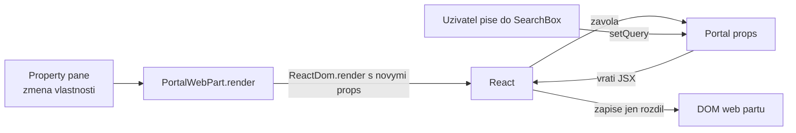

# React v SPFx — pojmy, hooky, třídy a verze

Studijní text k bloku [`react-fluent-ui`](README.md). Příklady jsou z řešení `vltava-portal`.
Reference API: [react.dev](https://react.dev/reference/react).

## Základní pojmy

| Pojem | Co to je | Kde to v kurzu vidíte |
|---|---|---|
| **Komponenta** | Funkce, která z dat (props) vrátí popis UI | `Portal`, `Equipment`, `EquipmentDesk` |
| **JSX** | Zápis UI uvnitř TypeScriptu (`<Text>…</Text>`); překladač z něj udělá volání `React.createElement` | soubory `*.tsx` |
| **Props** | Vstupy komponenty. Komponenta je **nemění** — jen čte | `IPortalProps`, `IEquipmentProps` |
| **State** | Data, která si komponenta pamatuje mezi vykresleními a jejichž změna vyvolá nové vykreslení | text hledání v Rozcestníku |
| **Render** | Zavolání funkce komponenty. React porovná nový výsledek s předchozím a do DOM zapíše **jen rozdíl** | každé psaní do `SearchBox` |
| **`key`** | Stabilní identita položky v seznamu, aby React při změně pořadí nepřepisoval špatné řádky | `<li key={link.url}>` |
| **Hook** | Funkce `use…`, přes kterou funkční komponenta používá state, efekty a další schopnosti Reactu | `useState`, `useFilteredLinks` |

### Jak se z web partu stane React



Web part (třída SPFx) a komponenta (funkce Reactu) mají ostře oddělené role:

- **Web part** zná SPFx: `this.context`, `this.properties`, motiv, služby. Při každé změně
  vlastnosti zavolá `ReactDom.render(...)` **znovu** — React komponentu nevytváří od nuly, jen
  ji vykreslí s novými props a zachová její state.
- **Komponenta** zná jen props. Proto ji jde testovat i předělat bez SharePointu (pravidlo
  kurzu „komponenta nesahá na `this.context`").
- **Úklid:** `onDispose()` volá `ReactDom.unmountComponentAtNode(this.domElement)`. Bez něj
  zůstanou při odebrání web partu ze stránky běžet efekty a posluchače.

### Jednosměrný tok dat

Data tečou **dolů** přes props, změny **nahoru** přes funkce v props. V Evidenci vybavení
komponenta `IssuePanel` nemění seznam sama — zavolá `onIssue(...)`, kterou jí dal rodič
`EquipmentDesk`, a ten po zápisu načte data znovu. Kdo „vlastní" data, ten je mění.

## Základní hooky

### `useState` — paměť komponenty

```tsx
const [query, setQuery] = React.useState<string>('');
// ...
<SearchBox value={query} onChange={(_e, v) => setQuery(v || '')} />
```

- `setQuery` vyvolá nové vykreslení. Hodnota `query` se změní **až v příštím** vykreslení, ne
  hned na dalším řádku.
- Když nová hodnota závisí na staré, použij funkci: `setVersion(v => v + 1)` (hook
  `useEquipment`). Dvě volání `setVersion(version + 1)` po sobě by zvýšila jen o 1.
- Drahý výpočet počáteční hodnoty patří do funkce: `useState(() => getId('portalTitle'))` —
  zavolá se jen jednou.

### `useEffect` — práce mimo vykreslení

Načítání dat, časovače a posluchače nepatří do těla komponenty (to běží při každém
vykreslení), ale do efektu. Vzor z `useEquipment` (den 3):

```tsx
React.useEffect(() => {
  let cancelled = false;
  service.getAll(status).then(found => {
    if (!cancelled) {
      setItems(found);
    }
  });
  return () => {
    cancelled = true;   // cleanup: ignore a response that arrives after a newer request
  };
}, [service, status, version]);
```

- **Pole závislostí** říká, kdy efekt spustit znovu: tady při změně služby, filtru nebo po
  zápisu (`version`). Prázdné pole `[]` = jen po prvním vykreslení.
- **Cleanup** (vrácená funkce) běží před dalším spuštěním a při odebrání komponenty. Bez
  `cancelled` by pomalá odpověď na starý filtr přepsala novější výsledek.
- Chybějící závislost je nejčastější chyba: efekt pak pracuje se starou hodnotou. Hlídá to
  pravidlo `react-hooks/exhaustive-deps` v ESLintu projektu.

### `useMemo` a `useCallback` — nepočítat zbytečně

```tsx
// useFilteredLinks: filter again only when links or query change
return React.useMemo(() => links.filter(...), [links, query]);
```

- `useMemo` si pamatuje **výsledek** výpočtu, `useCallback` si pamatuje **funkci** (např.
  `add` a `setStatus` v `useEquipment`), aby měla mezi vykresleními stejnou identitu.
- Smysl mají u drahých výpočtů a u hodnot, které jsou závislostí jiného efektu nebo jdou do
  komponenty, která se podle identity props rozhoduje. Obalovat vším „pro jistotu" nemá smysl.

### `useRef` a `useContext`

- **`useRef`** drží hodnotu, jejíž změna **nevyvolá** vykreslení (odkaz na DOM prvek,
  časovač). V kurzu ho nepotřebujeme; `useDebounce` si vystačí s cleanupem efektu.
- **`useContext`** čte hodnotu, kterou poskytne předek (`<Provider>`), bez předávání přes
  každou úroveň props. Tak funguje `ThemeProvider` ve Fluent UI: komponenty pod ním si motiv
  přečtou samy.

### Vlastní hook

Vlastní hook je funkce `use…`, která skládá jiné hooky. V kurzu: `useFilteredLinks`,
`useEmployees`, `useEquipment`, `useLoans`, `useDebounce`. Komponenta pak obsahuje jen UI
a logika je znovupoužitelná — `useEmployees` používá Adresář i Výdejna.

### Pravidla hooků

Dvě pravidla ([Rules of Hooks](https://react.dev/reference/rules/rules-of-hooks)):

1. Volat hooky **jen na nejvyšší úrovni** komponenty — ne v podmínce, cyklu, vnořené funkci
   ani za `return`.
2. Volat je **jen z komponent nebo z vlastních hooků**, ne z obyčejných funkcí.

React rozlišuje stav jednotlivých hooků podle **pořadí volání**. Hook v podmínce pořadí
rozbije. Proto `EquipmentDesk` volá `useLoans` vždy a teprve potom se rozhoduje
`if (listMissing) return ...`.

## Třída vs. funkce

React umí komponenty psát jako třídy i jako funkce. Dokumentace doporučuje pro nový kód
funkce; třídy jsou dál podporované
([Component](https://react.dev/reference/react/Component)).

| Třída (`React.Component`) | Funkce s hooky |
|---|---|
| `this.state`, `this.setState({...})` | `useState` |
| `componentDidMount` + `componentDidUpdate` + `componentWillUnmount` | `useEffect` s cleanupem |
| `shouldComponentUpdate`, `PureComponent` | `React.memo`, `useMemo` |
| metody je třeba vázat na `this` (`this.onClick = this.onClick.bind(this)`) | uzávěry, žádné `this` |
| logika se sdílí přes HOC a render props | logika se sdílí vlastním hookem |
| `getDerivedStateFromError`, `componentDidCatch` | **nejde** — error boundary je jen třída |

Proč v kurzu vidíte obojí:

- **Třída web partu** (`PortalWebPart extends BaseClientSideWebPart`) **není komponenta
  Reactu.** Je to třída SPFx s životním cyklem SPFx (`onInit`, `render`, `onDispose`,
  `onThemeChanged`). React je jen jedna z možností, čím vykreslit její `domElement`.
- **Komponenty** (`Portal`, `Equipment`, …) jsou funkce s hooky.
- **`ErrorBoundary`** (den 5) je jediná třída mezi komponentami. Funkcí ji napsat nejde —
  React pro `getDerivedStateFromError` a `componentDidCatch` hook nemá
  ([Component — catching rendering errors](https://react.dev/reference/react/Component#catching-rendering-errors-with-an-error-boundary)).

Ve starších vzorech a projektech (generátor SPFx do verze 1.16) najdete komponenty jako
třídy. Fungují, jen se hůř skládají a testují — při úpravě je není nutné přepisovat.

## Verze Reactu v SPFx a v SharePointu

### React do bundlu nepatří — dodá ho SharePoint

Manifest z `npm run build` (`release/manifests/*.manifest.json`) uvádí React jako
**komponentu SPFx s pevným ID**, ne jako soubor v bundlu:

```text
react      -> type=component version=17.0.1 id=<fixed SPFx component id>
react-dom  -> type=component version=17.0.1 id=<fixed SPFx component id>
```

(výpis `loaderConfig.scriptResources` z manifestu Rozcestníku, 2026-10-23, SPFx 1.23.2.)
Načte ho zavaděč SPFx z SharePointu a sdílí ho všechna řešení na stránce. Proto Rozcestník
s Reactem měl na konci dne 1 jen 11 693 B — React v tom čísle není. Fluent UI naopak
v bundlu je (viz [`mereni-bundle-fluent.md`](mereni-bundle-fluent.md)).

Z toho plyne pravidlo z [Learn — compatibility](https://learn.microsoft.com/en-us/sharepoint/dev/spfx/compatibility):
**přesně** ta verze Reactu, kterou určuje verze SPFx, a instalace s `--save-exact`. Jiná
verze v `package.json` se nemusí projevit při buildu, ale za běhu.

| SPFx | React | Node.js |
|---|---|---|
| 1.18 – 1.23.2 | 17.0.1 | 16/18 → 22 |
| 1.24 (k 2026-10-23 release candidate) | 18.3.1 | 22, 24, 26 |

Zdroj tabulky: [compatibility](https://learn.microsoft.com/en-us/sharepoint/dev/spfx/compatibility)
(stránka aktualizovaná 2026-10-19). npm k 2026-10-23: `latest` = 1.23.2, `next` = 1.24.0-rc.0.

### Co přinese React 18 (SPFx 1.24)

- **`createRoot`** z `react-dom/client` místo `ReactDom.render`. `ReactDom.render` v Reactu 18
  dál funguje, ale vypíše varování a běží „jako React 17"
  ([upgrade guide](https://react.dev/blog/2022/03/08/react-18-upgrade-guide)).
  `unmountComponentAtNode` nahradí `root.unmount()`.
- **Automatické dávkování** — víc `setState` v `then` nebo `setTimeout` vyvolá jedno
  vykreslení, ne několik ([React v18.0](https://react.dev/blog/2022/03/29/react-v18)).
- `useId` pro stabilní ID — v Rozcestníku nahradí `getId` z Fluent UI.

Funkční komponenty s hooky přechod snesou beze změny. Mění se třídy web partů (`render`,
`onDispose`) — podrobně v [`spfx-whats-next`](../../day-5/spfx-whats-next/).

## Časté chyby

- **Mutace state:** `items.push(x); setItems(items)` — stejné pole, React změnu nevidí.
  Správně `setItems([...items, x])`.
- **Index jako `key`** v seznamu, který se filtruje — React pak spojí špatný řádek se špatným
  stavem. Použij stabilní ID (`link.url`, `item.Id`).
- **`async` funkce přímo jako efekt** — `useEffect(async () => ...)` vrací Promise místo
  cleanupu. Asynchronní kód patří **do** efektu (vzor `load()` v `useEmployees`).
- **`this.context` v komponentě** — komponenta pak nejde použít mimo SPFx a test potřebuje
  SharePoint.
