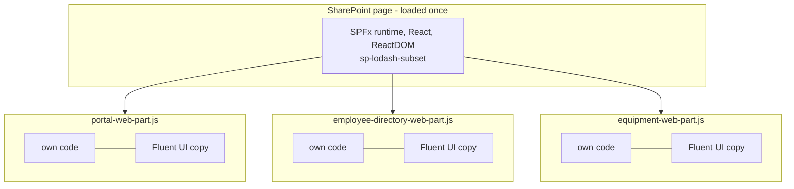

# Výkon I — měřený baseline balíčku

> Typ: povinný · Den: 3 · Odhad: 60 min
> Tenant: `cloudedu.cz` · Režim: hands-on, jen lokálně
> Prostředí: [`../../environment.md`](../../environment.md) · Názvosloví: [`../../GLOSSARY.md`](../../GLOSSARY.md)

Konec dne 3: řešení má tři web party a poprvé se změří, kolik váží. Toto číslo je baseline,
proti kterému se ve čtvrtek obhajuje optimalizace — a přinese první překvapení.

## Cíle

- Změřit velikost každého bundlu (raw a gzip) a uložit ji jako baseline s datem.
- Zapojit analýzu balíčku do Heft buildu a číst její treemapu.
- Najít v balíčku závislost, která tam nemá co dělat, a vysvětlit proč tam je.

## Výklad

### Co se měří

Po `npm run build` jsou v `release/assets/` hotové soubory, které si stáhne prohlížeč:
jeden bundle na web part a jeden soubor na jazyk. Skript
[`Measure-BundleSize.ps1`](../../scripts/Measure-BundleSize.ps1) je změří, spočítá gzip
(odhad přenosu) a uloží JSON — stejný skript ve čtvrtek porovná stav s baseline a v pátek
v pipeline hlídá limit.

Co do bundlu **nejde**: React, ReactDOM a knihovny SPFx (`@microsoft/sp-*`). Ty načítá stránka
SharePointu jednou pro všechny web party; seznam je v
`release/component-dependency-audit/*.json`. Do bundlu jde všechno ostatní — Fluent UI,
PnPjs, vlastní kód.

### Co je bundle a proč jich je víc

Bundling je krok buildu, ve kterém webpack spojí všechny moduly, na které vstupní soubor
komponenty (přímo i nepřímo) odkazuje, do **jednoho JavaScriptového souboru**. Výhody podle
dokumentace: komponenta je jeden soubor, závislost se při nasazení nedá zapomenout a bundle
sám řídí pořadí načtení modulů
([Use existing JavaScript libraries](https://learn.microsoft.com/en-us/sharepoint/dev/spfx/web-parts/guidance/use-existing-javascript-libraries)).

Druhá strana téže mince: knihovna, kterou importují dva web party, je ve **dvou** bundlech
a uživatel si ji stáhne dvakrát — jednou s každou komponentou
([Optimize SharePoint Framework builds for production](https://learn.microsoft.com/en-us/sharepoint/dev/spfx/toolchain/optimize-builds-for-production)).
Pro naše řešení:



Co z toho plyne:

- **Velikost bundlu je cena jednoho web partu**, ne stránky. Stránka s Rozcestníkem
  a Adresářem stáhne oba bundly, každý s vlastní kopií toho, co importuje.
- **`@microsoft/sp-lodash-subset`** se načítá na každé stránce SharePointu automaticky
  a do bundlu nejde — než sáhnete po celém Lodash, ověřte, zda tam funkce není
  ([Optimize builds](https://learn.microsoft.com/en-us/sharepoint/dev/spfx/toolchain/optimize-builds-for-production)).
- **Měří se produkční build.** Release build je minifikovaný a vždy menší než debug build
  ([Optimize builds](https://learn.microsoft.com/en-us/sharepoint/dev/spfx/toolchain/optimize-builds-for-production));
  `npm run build` v řešení spouští `heft test --clean --production`, takže `release/assets/`
  obsahuje produkční výstup. Čísla z `npm start` (debug) se s baseline nesrovnávají.

### Raw vs. gzip: dvě různé ceny

`Measure-BundleSize.ps1` hlásí u každého souboru dvě čísla a každé odpovídá na jinou otázku:

| Číslo | Na co odpovídá | Kdy na něm záleží |
|---|---|---|
| **Raw** | kolik JavaScriptu musí prohlížeč přečíst, zpracovat a spustit | pomalá zařízení, první vykreslení |
| **Gzip** | kolik bajtů zhruba poteče po síti | pomalá síť, mobilní připojení |

Gzip ve skriptu je **odhad** (.NET `GZipStream`, optimální úroveň — viz
[`mereni-baseline.md`](mereni-baseline.md)). Skutečný přenos z CDN SharePointu je otevřená
otázka měření; dokud se nezmění, nepište „web part stahuje 73 KB", ale „gzip odhad 73 108 B
(2026-10-16)".

Pozor na srovnání mezi bundly (měření 2026-10-16, lektorský stroj, viz
[`mereni-baseline.md`](mereni-baseline.md)): Evidence vybavení má raw 452 625 B a gzip 131 228 B, tedy
gzip ≈ 29 % raw; Rozcestník 73 108 / 238 632 ≈ 31 %. Poměr se liší podle obsahu, takže úsporu
v raw nelze automaticky přepočítat na úsporu v přenosu — měří se obojí.

### Analýza balíčku v Heftu

Gulp toolchain měl na úpravu webpacku `gulpfile.js`. Heft toolchain má **Webpack Patch
plugin**: soubor `config/webpack-patch.json` vyjmenuje skripty, které dostanou konfiguraci
webpacku a vrátí ji upravenou. Dokumentace tak přidává Webpack Bundle Analyzer; výsledkem je
`temp/webpack/build.stats.html` — treemapa modulů v každém bundlu.

Zdroj: [Customize webpack with the Heft Webpack Patch plugin](https://learn.microsoft.com/en-us/sharepoint/dev/spfx/toolchain/customize-heft-toolchain-customize-webpack-config).

Patch v řešení je krátký — přidá plugin do konfigurace, kterou Heft předá:

```javascript
// Writes temp/webpack/build.stats.html and build.stats.json on every production build.
module.exports = function (webpackConfig) {
  // ...
  webpackConfig.plugins.push(new BundleAnalyzerPlugin({
    analyzerMode: 'static',
    openAnalyzer: false,
    generateStatsFile: true,
    reportFilename: path.join(webpackStats, 'build.stats.html'),
    statsFilename: path.join(webpackStats, 'build.stats.json'),
    logLevel: 'error'
  }));
  return webpackConfig;
};
```

`analyzerMode: 'static'` znamená soubor HTML místo spuštěného serveru, `openAnalyzer: false`
že se po buildu neotevře prohlížeč.

**Proč analyzátor, když máme `Measure-BundleSize`?** Skript řekne **kolik**, treemapa řekne
**z čeho**. Každý obdélník je modul, plocha odpovídá velikosti, vnoření kopíruje cestu
(`node_modules/<package>/...`). Microsoft uvádí treemapu právě jako způsob, jak ověřit, že bundle
neobsahuje zbytečné skripty, a soubor `stats.json` jako zdroj odpovědi na otázku, **proč**
se skript do bundlu dostal a zda není ve více bundlech
([Optimize builds — Verify the contents of your bundle](https://learn.microsoft.com/en-us/sharepoint/dev/spfx/toolchain/optimize-builds-for-production)).

Při čtení treemapy se ptejte:

1. Je největší obdélník **vlastní kód**, nebo knihovna?
2. Patří každá knihovna do **tohoto** web partu — používá ji jeho kód?
3. Je stejná knihovna ve více bundlech? (Viz předchozí oddíl — to je cena bundlování.)

> [!WARNING] Ověřit k datu běhu — stav k 2026-10.
> Dokumentace (aktualizace 2026-02) popisuje i vestavěnou cestu bez patche:
> `heft build --clean --emit-stats` zapíše stats do `release/webpack-stats/` a HTML se z něj
> vygeneruje příkazem `webpack-bundle-analyzer` zvlášť
> ([Optimize builds](https://learn.microsoft.com/en-us/sharepoint/dev/spfx/toolchain/optimize-builds-for-production)).
> V kurzu **neověřeno** se SPFx 1.23.2; kurz používá Webpack Patch, ověřený buildem 2026-10-16.

### Baseline

> [!IMPORTANT] Rozcestník přibral 32 KB, aniž se v něm změnil řádek — změřeno (2026-10-16)
>
> | Bundle | Raw | Gzip |
> |---|---|---|
> | Rozcestník | 238 632 B | 73 108 B |
> | Adresář zaměstnanců | 234 791 B | 71 218 B |
> | Evidence vybavení | 452 625 B | 131 228 B |
>
> Rozcestník měl na konci dne 2 **206 511 B**. Jeho kód se dnes nezměnil — změnil se barrel
> `src/hooks/index.ts`, který teď exportuje i `useEquipment`, a ten přes službu vtáhne PnPjs.
> S přímým importem `from '../../../hooks/useFilteredLinks'` má Rozcestník zase přesně
> 206 511 B. Data: [`mereni-baseline.md`](mereni-baseline.md).
>
> **Barrel soubor je pohodlný pro import a drahý pro balíček, jakmile některý jeho export
> táhne knihovnu s vedlejšími efekty.**

Proč to tree shaking nevyřeší: `import '@pnp/sp/items'` nic neexportuje — jen rozšíří objekt
`sp`. Pro webpack je to vedlejší efekt, který odstranit nesmí. Čtvrteční `performance-caching`
problém opraví a změří.

### Kontext: kolik je hodně

Baseline není dobré ani špatné číslo — je to výchozí bod. Pro představu ze stejného kurzu:
Rozcestník bez Fluent UI 11 693 B, KendoReact Grid s tématem 1 442 440 B
([`../../day-2/opt-kendo-react/`](../../day-2/opt-kendo-react/)).

### Bundlovat, nebo načítat zvenku (externals)

Knihovnu lze místo bundlování deklarovat jako **external** v `config/config.json`. Do bundlu pak
jde jen její URL a SPFx ji při vykreslení web partu načte zvlášť — na stránce **jednou**, i když
ji používá víc web partů
([Use existing JavaScript libraries](https://learn.microsoft.com/en-us/sharepoint/dev/spfx/web-parts/guidance/use-existing-javascript-libraries)):

```json
"externals": {
  "angular": {
    "path": "https://cdnjs.cloudflare.com/ajax/libs/angular.js/1.5.8/angular.min.js",
    "globalName": "angular"
  }
}
```

(Příklad z dokumentace; řešení kurzu externals nepoužívá.)

| | Bundlovat (výchozí) | External |
|---|---|---|
| Kopií na stránce | jedna na každý web part, který knihovnu importuje | jedna |
| Cache prohlížeče | jen s bundlem | sdílená napříč řešeními i návštěvami, pokud je URL stejná |
| Závislost na síti | žádná navíc | URL musí být dostupná všem uživatelům |
| Riziko | velikost | nedostupná CDN, kolize verzí u skriptů bez modulů |

Dokumentace k tomu dodává tři věci, které se snadno přehlédnou:

- Zmenšení bundlu po přechodu na external **není úspora**: knihovna se stejně stáhne při první
  návštěvě. Skutečný přínos je sdílená cache, když stejnou knihovnu ze stejné URL používá víc
  komponent.
- Některé organizace přístup k veřejným CDN z firemní sítě nepovolují; alternativou je
  vlastní hostované úložiště (i knihovna dokumentů SharePointu).
- **Bundlování dává smysl** u řešení, které má fungovat v libovolném tenantu, kde nevíte, zda
  bude externí URL dostupná. Sdílenou funkčnost víc komponent lze naopak vyčlenit do vlastní
  knihovny a načítat ji jako external.

Volba primární knihovny (a její verze) je proto rozhodnutí **organizace**, ne jednoho projektu
([Optimize builds — Choose your primary client-side library](https://learn.microsoft.com/en-us/sharepoint/dev/spfx/toolchain/optimize-builds-for-production)).

## Klíčové rozlišení

- **Raw vs. gzip** — raw rozhoduje o parsování v prohlížeči, gzip o přenosu po síti.
- **Bundle vs. závislosti stránky** — React a SPFx knihovny platí stránka jednou; bundle platí
  každý web part zvlášť.
- **Export vs. vedlejší efekt** — nepoužitý export tree shaking odstraní, import kvůli
  vedlejšímu efektu ne.
- **Bundlovaná knihovna vs. external** — kopie v každém bundlu vs. jedna sdílená URL; menší
  bundle po přechodu na external není automaticky menší stránka.
- **Kolik (skript) vs. z čeho (treemapa)** — číslo baseline bez treemapy neřekne, co optimalizovat.
- **Debug vs. produkční build** — baseline platí jen pro produkční výstup.

## Naše prostředí

Jen lokální build. Měření z lektorského stroje je v README; studenti měří svůj build a čísla
by se měla shodovat (stejné verze balíčků), pokud se jejich kód neliší.

## Lab

Viz [`lab-baseline-balicku.md`](lab-baseline-balicku.md).

## Nosná linka

Řešení má **změřený baseline** — tři čísla s datem. Středa končí otevřenou otázkou: proč
Rozcestník platí za PnPjs, které nepoužívá? Odpověď a oprava jsou ve čtvrtek.

Stav po dni 3: [`solution/vltava-portal/`](solution/vltava-portal/).

## Zdroje (Microsoft)

- [Customize webpack with the Heft Webpack Patch plugin](https://learn.microsoft.com/en-us/sharepoint/dev/spfx/toolchain/customize-heft-toolchain-customize-webpack-config)
- [Understanding the Heft-based toolchain](https://learn.microsoft.com/en-us/sharepoint/dev/spfx/toolchain/customize-heft-toolchain-overview)
- [Optimize SharePoint Framework builds for production](https://learn.microsoft.com/en-us/sharepoint/dev/spfx/toolchain/optimize-builds-for-production)
- [Use existing JavaScript libraries in SharePoint Framework client-side web parts](https://learn.microsoft.com/en-us/sharepoint/dev/spfx/web-parts/guidance/use-existing-javascript-libraries)

## Stav produktu / delta

> [!WARNING] Ověřit k datu běhu — stav k 2026-10.
> Webpack Bundle Analyzer 4.10.2 s Heft 1.2.17 / SPFx 1.23.2 ověřen buildem 2026-10-16.
> Verze 5.x analyzátoru netestována.
