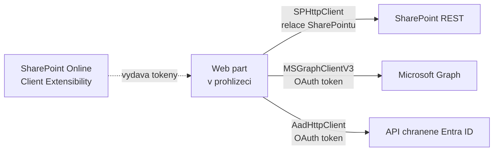

# SPHttpClient, MSGraphClientFactory, AadHttpClient

> Typ: povinný · Den: 3 · Odhad: 75 min
> Tenant: `cloudedu.cz` · Režim: hands-on, vlastní web
> Prostředí: [`../../environment.md`](../../environment.md) · Názvosloví: [`../../GLOSSARY.md`](../../GLOSSARY.md)

Řešení začne číst data mimo vlastní web: web part **Adresář zaměstnanců** hledá kolegy
v Microsoft Graph. Blok srovnává tři HTTP klienty SPFx a vysvětluje, odkud se bere token.

## Cíle

- Vybrat správného HTTP klienta SPFx podle cíle volání.
- Zavolat Microsoft Graph přes `MSGraphClientV3` s výběrem polí a vyhledáváním.
- Oddělit volání API do služby a hooku tak, aby komponenta nesahala na SPFx.
- Ukázat v nástrojích prohlížeče, čím se liší volání SharePointu a Graphu.

## Výklad

### Tři klienti, tři cíle

| Klient | Cíl | Autentizace | Kde v řešení |
|---|---|---|---|
| `SPHttpClient` (`this.context.spHttpClient`) | SharePoint REST `/_api/…` | relace SharePointu přihlášeného uživatele | knihovny v property pane (den 2), Evidence vybavení přes PnPjs |
| `MSGraphClientV3` (`this.context.msGraphClientFactory.getClient('3')`) | Microsoft Graph | OAuth token pro aplikaci *SharePoint Online Client Extensibility* | Adresář zaměstnanců |
| `AadHttpClient` (`this.context.aadHttpClientFactory.getClient(resource)`) | libovolné API chráněné Entra ID | OAuth token pro zadaný `resource` | v kurzu jen ukázka |

Zdroje: [Use the MSGraphClientV3](https://learn.microsoft.com/en-us/sharepoint/dev/spfx/use-msgraph),
[Connect to Entra ID-secured APIs](https://learn.microsoft.com/en-us/sharepoint/dev/spfx/use-aadhttpclient).



Klíčové pro hranici tenantu: oba OAuth klienti získávají token přes **jednu** aplikaci v Entra
ID tenantu — *SharePoint Online Client Extensibility*. Oprávnění, která jí admin schválí,
platí pro všechna SPFx řešení v tenantu. Podrobně v
[`../permissions-consent/`](../permissions-consent/).

> [!WARNING] Ověřit k datu běhu — stav k 2026-10.
> Dokumentace MSGraphClientV3 (aktualizace 2022-08) uvádí, že bez výslovně schválených
> oprávnění dostane řešení token se scope `user_impersonation`, „který lze použít ke čtení
> informací o uživatelích (tj. `User.Read.All`)". Co přesně Adresář na kurzovním tenantu před
> schválením uvidí, se v labu **změří** — ne předpokládá.

### Graph: `$select`, `$search` a hlavička `ConsistencyLevel`

Služba `employeeService` volá:

```text
GET /users?$select=id,displayName,jobTitle,department,mail,businessPhones
          &$search="displayName:<text>"&$orderby=displayName&$count=true&$top=25
ConsistencyLevel: eventual
```

- `$select` — jen pole, která web part zobrazí. Menší odpověď a jasně dané, ke kterým datům
  řešení potřebuje oprávnění.
- `$search` a `$count` jsou tzv. pokročilé dotazy nad adresářem: vyžadují hlavičku
  `ConsistencyLevel: eventual`. Bez ní Graph dotaz odmítne.
- Graph dokumentuje přesně tuto kombinaci (`$search="displayName:wa"&$orderby=displayName&$count=true`)
  v [List users](https://learn.microsoft.com/en-us/graph/api/user-list?view=graph-rest-1.0).

### Služba, hook, komponenta

```text
EmployeeDirectoryWebPart.ts  onInit: getClient('3') -> createEmployeeService(client)
        |
        v  props: service
EmployeeDirectory.tsx        SearchBox -> useDebounce(400 ms) -> useEmployees(service, query)
        |
        v
services/employeeService.ts  search(query), getPresence(ids)
```

Struktura převzatá z learn-spfx-growth (3-Plant). Dva rozdíly proti originálu: Graph se
**neprochází celý** (3-Plant stahoval všechny uživatele stránkováním a filtroval v prohlížeči —
u 240 zaměstnanců to jde, u 24 000 ne) a výsledky starších hledání se zahazují (`cancelled`
v `useEmployees`), aby pomalá odpověď nepřepsala novější.

### AadHttpClient — ukázka

Pro vlastní API chráněné Entra ID (třeba Azure Function) se používá `AadHttpClient`
s identifikátorem API jako `resource`:

```typescript
const client = await this.context.aadHttpClientFactory.getClient('api://<application-id>');
const response = await client.get('https://<api-host>/api/orders', AadHttpClient.configurations.v1);
```

V kurzu vlastní API nestavíme — data by opustila tenant (viz scénář). Mechanismus oprávnění je
ale stejný jako u Graphu.

## Klíčové rozlišení

- **Relace SharePointu vs. OAuth token** — `SPHttpClient` nepotřebuje žádné schválení; Graph
  a vlastní API ano.
- **Klient vs. služba** — klient je technický přístup, služba (`employeeService`) je API
  řešení, které komponenta volá.
- **Hledání v Graphu vs. filtr v prohlížeči** — server vrátí 25 výsledků; prohlížeč by musel
  stáhnout všechny.

## Naše prostředí

- Na tenantu `cloudedu.cz` jsou fiktivní uživatelé s oddělením a telefonem (go/no-go
  v [`../../environment.md`](../../environment.md)).
- Schválená oprávnění z dřívějších kurzů by změnila výsledek labu — lektor je před během
  zkontroluje.

## Lab

Viz [`lab-adresar-zamestnancu.md`](lab-adresar-zamestnancu.md).

## Nosná linka

Řešení má druhý web part — **Adresář zaměstnanců**. Data poprvé přicházejí z Microsoft Graph,
ne ze SharePointu, a poprvé záleží na tom, co schválil admin tenantu.

## Zdroje (Microsoft)

- [Use the MSGraphClientV3 to connect to Microsoft Graph](https://learn.microsoft.com/en-us/sharepoint/dev/spfx/use-msgraph)
- [Connect to Entra ID-secured APIs in SharePoint Framework solutions](https://learn.microsoft.com/en-us/sharepoint/dev/spfx/use-aadhttpclient)
- [List users (Microsoft Graph)](https://learn.microsoft.com/en-us/graph/api/user-list?view=graph-rest-1.0)
- [Advanced query capabilities on directory objects](https://learn.microsoft.com/en-us/graph/aad-advanced-queries)

## Stav produktu / delta

> [!WARNING] Ověřit k datu běhu — stav k 2026-10.
> Výchozí oprávnění tokenu Graphu bez schválení (dokumentace z 2022). Výsledek měření z labu
> zapsat sem s datem.
