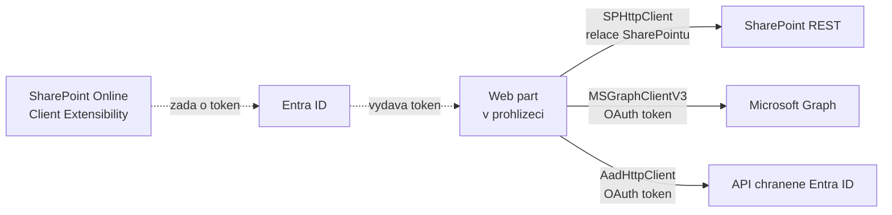
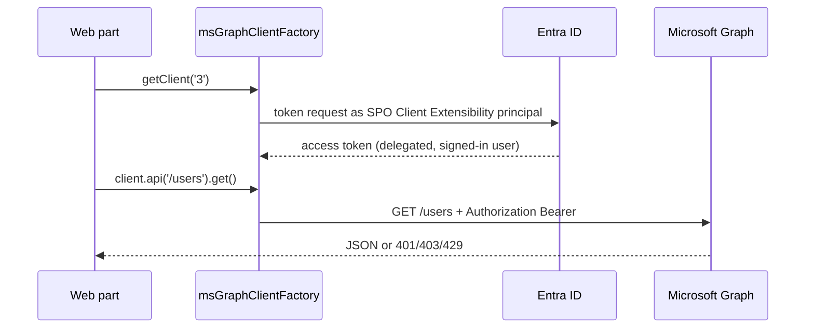

# SPHttpClient, MSGraphClientFactory, AadHttpClient

> Typ: povinný · Den: 3 · Odhad: 75 min
> Tenant: `cloudedu.cz` · Režim: hands-on, vlastní web
> Prostředí: [`../../environment.md`](../../environment.md) · Názvosloví: [`../../GLOSSARY.md`](../../GLOSSARY.md)

Řešení začne číst data mimo vlastní web: web part **Adresář zaměstnanců** hledá kolegy
v Microsoft Graph. Blok srovnává tři HTTP klienty SPFx a vysvětluje, odkud se bere token.

## Cíle

- Vybrat správného HTTP klienta SPFx podle cíle volání.
- Zavolat Microsoft Graph přes `MSGraphClientV3` s výběrem polí a vyhledáváním.
- Oddělit volání API do služby a hooku tak, aby komponenta nesahala na SPFx.
- Ukázat v nástrojích prohlížeče, čím se liší volání SharePointu a Graphu.

## Výklad

### Tři klienti, tři cíle

| Klient | Cíl | Autentizace | Kde v řešení |
|---|---|---|---|
| `SPHttpClient` (`this.context.spHttpClient`) | SharePoint REST `/_api/…` | relace SharePointu přihlášeného uživatele | knihovny v property pane (den 2), Evidence vybavení přes PnPjs |
| `MSGraphClientV3` (`this.context.msGraphClientFactory.getClient('3')`) | Microsoft Graph | OAuth token pro aplikaci *SharePoint Online Client Extensibility* | Adresář zaměstnanců |
| `AadHttpClient` (`this.context.aadHttpClientFactory.getClient(resource)`) | libovolné API chráněné Entra ID | OAuth token pro zadaný `resource` | v kurzu jen ukázka |

Zdroje: [Use the MSGraphClientV3](https://learn.microsoft.com/en-us/sharepoint/dev/spfx/use-msgraph),
[Connect to Entra ID-secured APIs](https://learn.microsoft.com/en-us/sharepoint/dev/spfx/use-aadhttpclient).



Klíčové pro hranici tenantu: oba OAuth klienti získávají token přes **jednu** aplikaci v Entra
ID tenantu — *SharePoint Online Client Extensibility*. Oprávnění, která jí admin schválí,
platí pro všechna SPFx řešení v tenantu. Podrobně v
[`../permissions-consent/`](../permissions-consent/).

> [!WARNING] Ověřit k datu běhu — stav k 2026-10.
> Dokumentace MSGraphClientV3 (aktualizace 2022-08) uvádí, že bez výslovně schválených
> oprávnění dostane řešení token se scope `user_impersonation`, „který lze použít ke čtení
> informací o uživatelích (tj. `User.Read.All`)". Co přesně Adresář na kurzovním tenantu před
> schválením uvidí, se v labu **změří** — ne předpokládá.

### Co za vás udělá `SPHttpClient`

`SPHttpClient` není obecný `fetch`. Referenční dokumentace třídy vyjmenovává, co přidává navíc
([SPHttpClient class](https://learn.microsoft.com/en-us/javascript/api/sp-http-base/sphttpclient)):

- **Autentizační cookies** relace SharePointu. Obyčejný `HttpClient` je neposílá, a proto volání
  SharePoint REST přes něj skončí `401 Unauthorized`
  ([Connect to SharePoint APIs](https://learn.microsoft.com/en-us/sharepoint/dev/spfx/connect-to-sharepoint)).
- **Výchozí hlavičky** `Accept` a `Content-Type`, pokud je nezadáte sami.
- **Request digest pro zápisy.** Zápisové operace do SharePoint REST potřebují hlavičku
  `X-RequestDigest`. `SPHttpClient` ji přidá sám: token si podle potřeby vyžádá
  z `/_api/contextinfo` a uloží do cache. Adresu webu odvodí z URL požadavku podle segmentu
  `_api`; když to nejde, zadá se v `ISPHttpClientOptions.webUrl`.

Druhá věc, kterou je dobré vědět: **`SPHttpClient` ve výchozím stavu mluví OData v4.** Úroveň
metadat se proto řídí direktivou `odata.metadata`, např. `accept: application/json;odata.metadata=none`.
Starší zápis `odata=nometadata` / `odata=verbose` ze starších návodů (OData v3) v režimu
OData v4 skončí chybou *„The HTTP header ACCEPT is missing or its value is invalid"*; funguje jen
s hlavičkou `odata-version` nastavenou na prázdnou hodnotu (přepnutí na OData v3)
([Connect to SharePoint APIs](https://learn.microsoft.com/en-us/sharepoint/dev/spfx/connect-to-sharepoint)).
Podle zvoleného formátu se mění i tvar odpovědi — kód Rozcestníku z dne 2 čte kolekci
z `value`:

```typescript
const response: SPHttpClientResponse = await this.context.spHttpClient.get(url, SPHttpClient.configurations.v1);
if (!response.ok) {
  throw new Error(`${response.status} ${response.statusText}`);
}
const data: { value: ILibraryInfo[] } = await response.json();
```

Řádek s `response.ok` není opatrnost navíc. Promise z `SPHttpClient.fetch()` se chová jako
WHATWG `fetch()`: na stavové kódy 404 nebo 500 se **normálně vyřeší** s `ok === false`
a zamítne se jen při síťové chybě
([SPHttpClient.fetch](https://learn.microsoft.com/en-us/javascript/api/sp-http-base/sphttpclient)).
Kdo `ok` nekontroluje, pošle do `response.json()` chybové tělo a chyba se projeví o tři řádky
dál jako `undefined`. PnPjs (blok [`../pnpjs/`](../pnpjs/)) to řeší opačně — při chybovém
stavu vyhodí výjimku.

### Jak se k web partu dostane token pro Graph

`SPHttpClient` vystačí s cookies relace SharePointu. Microsoft Graph přijímá OAuth 2.0 access
token v hlavičce `Authorization: Bearer ...`
([Best practices for Microsoft Graph](https://learn.microsoft.com/en-us/graph/best-practices-concept)).
Ten musí někdo získat od Entra ID:



Co z dokumentace plyne pro praxi:

- **Token získává framework, ne váš kód.** Klientská aplikace bez možnosti uložit tajemství
  používá OAuth implicit flow a SPFx ho má hotový v `MSGraphClient` a `AadHttpClient`. Přímé
  použití MSAL.js v SPFx podporované **není**
  ([Connect to Entra ID-secured APIs](https://learn.microsoft.com/en-us/sharepoint/dev/spfx/use-aadhttpclient)).
- **Identita klienta je jedna pro celý tenant** — služební objekt *SharePoint Online Client
  Extensibility*, který Microsoft zakládá v každém tenantu. Přístup je delegovaný: autorizovaný
  musí být klient **i** přihlášený uživatel
  ([Permissions and consent overview](https://learn.microsoft.com/en-us/entra/identity-platform/permissions-consent-overview)).
- **Každá instance `AadHttpClient` patří k jednomu `resource`.** Pro dvě různá API potřebujete
  dva klienty.
- **Známé omezení:** token z implicit flow nemusí obsahovat claim `wids` (role uživatele
  v Entra ID). Endpointy Graphu, které role vyžadují (např. reporty využití Office 365), proto
  mohou selhat i s udělenými oprávněními
  ([Use the MSGraphClientV3 — Known issues](https://learn.microsoft.com/en-us/sharepoint/dev/spfx/use-msgraph)).

### Graph: `$select`, `$search` a hlavička `ConsistencyLevel`

Služba `employeeService` volá:

```text
GET /users?$select=id,displayName,jobTitle,department,mail,businessPhones
          &$search="displayName:<text>"&$orderby=displayName&$count=true&$top=25
ConsistencyLevel: eventual
```

- `$select` — jen pole, která web part zobrazí. Menší odpověď a jasně dané, ke kterým datům
  řešení potřebuje oprávnění.
- `$search` a `$count` jsou tzv. pokročilé dotazy nad adresářem: vyžadují hlavičku
  `ConsistencyLevel: eventual`. Bez ní Graph dotaz odmítne.
- Graph dokumentuje přesně tuto kombinaci (`$search="displayName:wa"&$orderby=displayName&$count=true`)
  v [List users](https://learn.microsoft.com/en-us/graph/api/user-list?view=graph-rest-1.0).

Stejný dotaz v kódu služby — `MSGraphClientV3` obaluje Microsoft Graph JavaScript Client
Library v3, takže parametry se skládají metodami, ne ručním psaním URL
([Use the MSGraphClientV3](https://learn.microsoft.com/en-us/sharepoint/dev/spfx/use-msgraph)):

```typescript
let request = client
  .api('/users')
  .header('ConsistencyLevel', 'eventual')
  .count(true)
  .select(SELECT_FIELDS)
  .orderby('displayName')
  .top(PAGE_SIZE);
```

### Stránkování a throttling: dvě věci, které 25 výsledků schová

Adresář si vědomě bere jen **první stránku** (`$top=25`) — hledá se, neprochází se. Kdo by
potřeboval všechno, musí počítat s tím, jak Graph stránkuje
([Paging Microsoft Graph data](https://learn.microsoft.com/en-us/graph/paging)):

- Má-li výsledek další stránku, odpověď obsahuje `@odata.nextLink`. Celou tu URL je nutné
  použít jako neprůhledný řetězec; vytahovat z ní `$skiptoken` do jiného dotazu se nesmí.
- U adresářových objektů (uživatelé, skupiny) se **vlastní hlavičky jako `ConsistencyLevel`
  do dalších stránek samy nepřenesou** — musíte je poslat znovu.
- `@odata.count` přijde jen v **první** stránce.
- Stránka může mít i nula položek a různá API mají různé výchozí a maximální velikosti stránky.

Druhá skrytá věc je **throttling**. Při překročení limitů vrací Graph `429 Too Many Requests`,
SharePoint Online `429` nebo `503`, vždy s hlavičkou `Retry-After` (sekundy). Opakovat dřív
nemá smysl: i odmítnuté požadavky se započítávají do limitů, takže agresivní opakování
throttling prodlužuje
([Graph throttling](https://learn.microsoft.com/en-us/graph/throttling),
[Avoid getting throttled in SharePoint Online](https://learn.microsoft.com/en-us/sharepoint/dev/general-development/how-to-avoid-getting-throttled-or-blocked-in-sharepoint-online)).
Podle téže stránky SharePointu je 99 % případů throttlingu uživatele způsobeno vlastním kódem
— mimo jiné vlastními web party.

Jak to souvisí s Adresářem:

- `useDebounce(400 ms)` v komponentě **je** ochrana proti throttlingu: bez něj by každý
  stisk klávesy v `SearchBox` znamenal jeden požadavek na Graph.
- V JSON batchi Graphu se požadavky hodnotí **jednotlivě**: dávka vrátí `200` a uvnitř může
  být několik `429`. Ty SDK Graphu samo neopakuje
  ([Graph throttling — Throttling and batching](https://learn.microsoft.com/en-us/graph/throttling)).
- Zda `MSGraphClientV3` opakuje `429` mimo dávku automaticky, dokumentace SPFx neuvádí —
  **neověřeno**. Kód Adresáře s tím nepočítá a chybu zobrazí.

### Služba, hook, komponenta

```text
EmployeeDirectoryWebPart.ts  onInit: getClient('3') -> createEmployeeService(client)
        |
        v  props: service
EmployeeDirectory.tsx        SearchBox -> useDebounce(400 ms) -> useEmployees(service, query)
        |
        v
services/employeeService.ts  search(query), getPresence(ids)
```

Struktura převzatá z learn-spfx-growth (3-Plant). Dva rozdíly proti originálu: Graph se
**neprochází celý** (3-Plant stahoval všechny uživatele stránkováním a filtroval v prohlížeči —
u 240 zaměstnanců to jde, u 24 000 ne) a výsledky starších hledání se zahazují (`cancelled`
v `useEmployees`), aby pomalá odpověď nepřepsala novější.

### AadHttpClient — ukázka

Pro vlastní API chráněné Entra ID (třeba Azure Function) se používá `AadHttpClient`
s identifikátorem API jako `resource`:

```typescript
const client = await this.context.aadHttpClientFactory.getClient('api://<application-id>');
const response = await client.get('https://<api-host>/api/orders', AadHttpClient.configurations.v1);
```

V kurzu vlastní API kvůli času nestavíme. Mechanismus oprávnění je stejný jako u Graphu.
Běží-li API v Azure subscription zákazníka, data hranici tenantu neopouštějí — viz
[`platform-positioning`](../../day-1/platform-positioning/README.md). Celý postup včetně
zabezpečení Azure Function: [Consume enterprise APIs secured with Azure AD in SPFx](https://learn.microsoft.com/en-us/sharepoint/dev/spfx/use-aadhttpclient-enterpriseapi).

## Klíčové rozlišení

- **Relace SharePointu vs. OAuth token** — `SPHttpClient` nepotřebuje žádné schválení; Graph
  a vlastní API ano.
- **Klient vs. služba** — klient je technický přístup, služba (`employeeService`) je API
  řešení, které komponenta volá.
- **Hledání v Graphu vs. filtr v prohlížeči** — server vrátí 25 výsledků; prohlížeč by musel
  stáhnout všechny.
- **`response.ok === false` vs. zamítnutý promise** — `SPHttpClient` na 404/500 promise
  vyřeší a chybu musíte poznat sami; zamítne jen při síťové chybě.
- **`odata.metadata=none` vs. `odata=nometadata`** — první je OData v4 (výchozí v SPFx), druhé
  OData v3 a bez prázdné hlavičky `odata-version` skončí chybou.
- **429/503 vs. 404/403** — throttling se opakuje po `Retry-After`; chyba oprávnění nebo
  neexistující zdroj se opakováním nespraví.

## Naše prostředí

- Na tenantu `cloudedu.cz` jsou fiktivní uživatelé s oddělením a telefonem (go/no-go
  v [`../../environment.md`](../../environment.md)).
- Schválená oprávnění z dřívějších kurzů by změnila výsledek labu — lektor je před během
  zkontroluje.

## Lab

Viz [`lab-adresar-zamestnancu.md`](lab-adresar-zamestnancu.md).

## Nosná linka

Řešení má druhý web part — **Adresář zaměstnanců**. Data poprvé přicházejí z Microsoft Graph,
ne ze SharePointu, a poprvé záleží na tom, co schválil admin tenantu.

## Zdroje (Microsoft)

- [Use the MSGraphClientV3 to connect to Microsoft Graph](https://learn.microsoft.com/en-us/sharepoint/dev/spfx/use-msgraph)
- [Connect to Entra ID-secured APIs in SharePoint Framework solutions](https://learn.microsoft.com/en-us/sharepoint/dev/spfx/use-aadhttpclient)
- [List users (Microsoft Graph)](https://learn.microsoft.com/en-us/graph/api/user-list?view=graph-rest-1.0)
- [Advanced query capabilities on directory objects](https://learn.microsoft.com/en-us/graph/aad-advanced-queries)
- [Connect to SharePoint APIs](https://learn.microsoft.com/en-us/sharepoint/dev/spfx/connect-to-sharepoint)
- [SPHttpClient class (API reference)](https://learn.microsoft.com/en-us/javascript/api/sp-http-base/sphttpclient)
- [Paging Microsoft Graph data in your app](https://learn.microsoft.com/en-us/graph/paging)
- [Microsoft Graph throttling guidance](https://learn.microsoft.com/en-us/graph/throttling)
- [Avoid getting throttled or blocked in SharePoint Online](https://learn.microsoft.com/en-us/sharepoint/dev/general-development/how-to-avoid-getting-throttled-or-blocked-in-sharepoint-online)
- [Best practices for working with Microsoft Graph](https://learn.microsoft.com/en-us/graph/best-practices-concept)
- [Overview of permissions and consent in the Microsoft identity platform](https://learn.microsoft.com/en-us/entra/identity-platform/permissions-consent-overview)

## Stav produktu / delta

> [!WARNING] Ověřit k datu běhu — stav k 2026-10.
> Výchozí oprávnění tokenu Graphu bez schválení (dokumentace z 2022). Výsledek měření z labu
> zapsat sem s datem.
