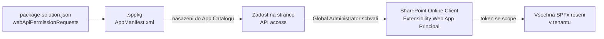
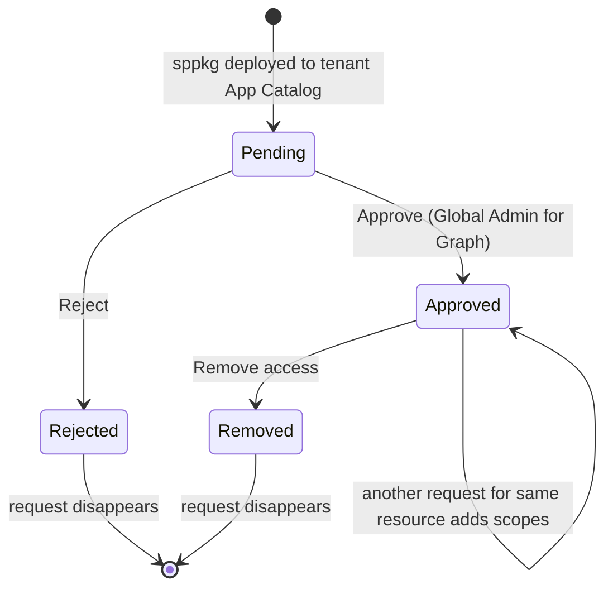

# API oprávnění, admin consent a fallback

> Typ: povinný · Den: 3 · Odhad: 75 min
> Tenant: `cloudedu.cz` · Režim: hands-on, **zásah do celého tenantu** (výslovně označené kroky)
> Prostředí: [`../../environment.md`](../../environment.md) · Názvosloví: [`../../GLOSSARY.md`](../../GLOSSARY.md)

Adresář potřebuje oprávnění k Microsoft Graph, které musí schválit admin tenantu. Blok projde
celou cestu: žádost v balíčku → první nasazení do tenantového App Catalogu → schválení →
a web part, který přežije, když schválení nepřijde.

## Cíle

- Deklarovat oprávnění v `webApiPermissionRequests` a ověřit je v `.sppkg`.
- Nasadit řešení do tenantového App Catalogu a najít žádost na stránce **API access**.
- Vysvětlit, proč schválení platí pro celý tenant a proč ho smazání řešení neodvolá.
- Napsat web part, který s neschváleným oprávněním **degraduje**, ale nespadne.

## Výklad

### Od žádosti ke schválení



Podle dokumentace:

- Žádost vznikne **nasazením balíčku** do App Catalogu; jinak ji nelze podat.
- Schválená oprávnění typu delegated se přidají aplikaci *SharePoint Online Client
  Extensibility Web Application Principal* — **jedné pro celý tenant**.
- *„All permissions are granted to the whole tenant and not to a specific application that
  has requested them."* Schválení využije jakékoli SPFx řešení v tenantu.
- **Smazání řešení oprávnění neodvolá.** Odvolává se zvlášť (*Remove access*).
- Schválit oprávnění k Microsoft Graph smí jen **Global Administrator**.
- Řešení jde nasadit a používat i se **zamítnutou** žádostí — kód s tím musí počítat.

Zdroje: [Connect to Entra ID-secured APIs](https://learn.microsoft.com/en-us/sharepoint/dev/spfx/use-aadhttpclient),
[Manage access to Entra ID-secured APIs](https://learn.microsoft.com/en-us/sharepoint/api-access)
(updated 2026-07-01).

> [!IMPORTANT] Na kurzovním tenantu je Global Administrator každý student
> Každý student by tedy technicky mohl schválit cokoli — pro všechny. V kurzu **schvaluje jen
> lektor**, na projektoru, a jen `User.Read.All`. Žádost o `Presence.Read.All` zůstane
> neschválená celý týden: na ní se ověřuje fallback.

### Delegated vs. application: za koho web part jedná

Microsoft identity platform rozlišuje dva druhy přístupu
([Permissions and consent overview](https://learn.microsoft.com/en-us/entra/identity-platform/permissions-consent-overview)):

| | Delegated (scope) | Application (app role) |
|---|---|---|
| Kdo jedná | aplikace **jménem přihlášeného uživatele** | aplikace sama za sebe, bez uživatele |
| Typická aplikace | web, SPA, mobilní | služba na pozadí, daemon |
| Dosah | nikdy víc, než smí uživatel | všechna data, ke kterým oprávnění vede |
| Kdo schvaluje | uživatel za sebe nebo admin za všechny | jen admin |

Web part běží v prohlížeči přihlášeného uživatele. Schválená oprávnění z API access se
přidávají jako **delegated** aplikaci *SharePoint Online Client Extensibility Web Application
Principal* ([Manage access to Entra ID-secured APIs](https://learn.microsoft.com/en-us/sharepoint/api-access)).
Pro Adresář to znamená:

- `User.Read.All` (delegated) **neznamená**, že web part přečte libovolná data o komkoli.
  Výsledek je průnik: co dovoluje scope **a** co smí přihlášený uživatel. Dokumentace to
  ilustruje na `Files.Read.All` — delegovaná verze čte jen soubory, ke kterým má přístup
  uživatel, aplikační verze všechny soubory v tenantu.
- Aplikační oprávnění do interaktivního řešení nepatří: Microsoft výslovně varuje, že
  aplikační oprávnění v interaktivním scénáři mohou nechtěně **povýšit práva uživatele**
  a obejít politiky nastavené adminem
  ([Best practices for Microsoft Graph](https://learn.microsoft.com/en-us/graph/best-practices-concept)).
  Patří do aplikací bez přihlášeného uživatele — služba na pozadí, daemon.

### Co Adresář žádá a proč

```json
"webApiPermissionRequests": [
  { "resource": "Microsoft Graph", "scope": "User.Read.All" },
  { "resource": "Microsoft Graph", "scope": "Presence.Read.All" }
]
```

| Scope | Pro co | Nejmenší možné? |
|---|---|---|
| `User.Read.All` | oddělení a telefon kolegů | `User.ReadBasic.All` dává jen `displayName`, `givenName`, `id`, `mail`, `photo`, `securityIdentifier`, `surname`, `userPrincipalName` — bez `department` a `businessPhones` ([permissions reference](https://learn.microsoft.com/en-us/graph/permissions-reference)) |
| `Presence.Read.All` | dostupnost (Teams presence) | ano, pro čtení presence jiných uživatelů |

`resource` je **zobrazovaný název** aplikace (`Microsoft Graph`), ne její ID — název je stejný
ve všech tenantech, ID ne. Zadání `objectId` místo názvu skončí chybou při schvalování
([Connect to Entra ID-secured APIs](https://learn.microsoft.com/en-us/sharepoint/dev/spfx/use-aadhttpclient)).

### Životní cyklus žádosti



Co který přechod znamená podle dokumentace
([Manage access](https://learn.microsoft.com/en-us/sharepoint/api-access),
[Connect to Entra ID-secured APIs](https://learn.microsoft.com/en-us/sharepoint/dev/spfx/use-aadhttpclient)):

- **Reject** — žádost zmizí ze stránky; aplikace v App Catalogu zůstane a na webech může
  „nefungovat podle očekávání". Nový pokus = nová žádost se stejným `resource` a `scope`,
  tedy znovu nasadit balíček.
- **Remove access** — totéž pro už schválené oprávnění. Odvolání **nezneplatní tokeny, které
  už byly vydané** — platí do vypršení. Proto po odvolání chvíli trvá, než se změna v web
  partu projeví.
- **Schválení dalšího scope** ke zdroji, který už nějaká oprávnění má, scope **přidá**
  k dříve schváleným.
- **Schválení už schváleného** scope (přes PowerShell / CLI) skončí chybou. SharePoint při
  vzniku žádosti nekontroluje, zda už oprávnění existuje.
- **Žádná z těchto akcí nesahá na App Catalog** ani na nasazená řešení — mění se jen to, zda
  klient dostane token s daným scope.

### Celý tenant znamená celý tenant

Věta *„granted to the whole tenant"* má konkrétní bezpečnostní dopad: jakmile je oprávnění
schválené, může ho využít **jakýkoli požadavek na straně klienta v tenantu** — nejen SPFx
řešení, ale i jiné skripty
([Connect to Entra ID-secured APIs — Considerations](https://learn.microsoft.com/en-us/sharepoint/dev/spfx/use-aadhttpclient)).
Schválit `User.Read.All` „pro Adresář" ve skutečnosti znamená schválit ho pro každý kód, který
v tenantu běží na stránkách SharePointu.

Z toho plynou tři pravidla:

1. **Least privilege** — žádat jen scope, který funkce skutečně potřebuje. Graph to formuluje
   jako první zásadu ([Best practices for Microsoft Graph](https://learn.microsoft.com/en-us/graph/best-practices-concept));
   v Adresáři je to důvod, proč tabulka výše zdůvodňuje, proč nestačí `User.ReadBasic.All`.
2. **Schválení je rozhodnutí admina o tenantu, ne o vašem řešení** — patří k němu záznam, kdo
   a proč schválil, a plán odvolání.
3. **Admin má i hrubou páku**: službu *SharePoint Online Client Extensibility* jde celou
   vypnout (`Disable-SPOTenantServicePrincipal`); pak `MSGraphClient` ani `AadHttpClient`
   token nedostanou. Měnit tento principal ručně v Entra admin centru se nepodporuje —
   spravuje se jen přes API access.

> [!WARNING] Ověřit k datu běhu — stav k 2026-10.
> Cestou k oprávnění „jen pro moje řešení" byly *isolated web parts*
> (`isDomainIsolated: true` v `package-solution.json`): samostatná aplikace v Entra ID pro
> každé řešení a web part v `<iframe>` na vlastní doméně. Funkce je podle dokumentace
> deprecated a podle ohlášení **retirovaná k 2. 4. 2026** — ověřit
> ([Isolated web parts](https://learn.microsoft.com/en-us/sharepoint/dev/spfx/web-parts/isolated-web-parts),
> stránka aktualizovaná 2024-05). V řešení kurzu je `isDomainIsolated: false` a všechna
> oprávnění jsou tenantová.

### Fallback: degradovat, ne spadnout

`useEmployees` volá presence zvlášť a chybu zachytí: Adresář zobrazí lidi a místo barevné
tečky dostupnosti informační pruh *„Dostupnost se nezobrazuje: správce neschválil
oprávnění."* Vzor platí obecně: **každá funkce závislá na volitelném oprávnění má vlastní
cestu bez něj.**

Podstatné je, **kde** je `try/catch`. Hledání lidí a presence mají každé vlastní blok:

```typescript
const found: IEmployee[] = await service.search(query);
// ...
try {
  const map: PresenceMap = await service.getPresence(found.map(e => e.id));
  // ...
} catch {
  // Degrade gracefully: the directory works, presence is just not shown.
  if (!cancelled) {
    setPresenceAvailable(false);
  }
}
```

Kdyby oba dotazy obaloval jeden `try/catch`, neschválená presence by shodila celý Adresář —
přesně ten případ, se kterým dokumentace počítá: řešení jde nasadit a používat i se
zamítnutou žádostí, takže kód nesmí předpokládat, že oprávnění existuje.

Typické chyby a jak je poznat:

- **Celý web part ukáže chybu**, i když chybí jen volitelné oprávnění → jeden společný
  `try/catch` pro povinná i volitelná data.
- **Fallback se neukáže nikdy** → oprávnění je v tenantu schválené (třeba z dřívějška nebo ho
  schválil kolega). Ověřit na stránce API access, ne v kódu.
- **Hláška „správce neschválil" se ukáže, i když schváleno je** → `403` neznamená vždy chybějící
  schválení. Graph upozorňuje, že `403` může přijít i s udělenými oprávněními, když přihlášený
  uživatel k prostředku nemá práva nebo admin nastavil vlastní politiky
  ([Best practices — Handling expected errors](https://learn.microsoft.com/en-us/graph/best-practices-concept)).
  Text pro uživatele proto formulovat opatrně a technický detail logovat.

## Klíčové rozlišení

- **Žádost vs. schválení** — vývojář žádá v balíčku, admin schvaluje v admin centru. Nasazení
  balíčku není schválení.
- **Oprávnění řešení vs. oprávnění tenantu** — neexistuje „oprávnění mého web partu"; je jen
  oprávnění SPFx v tenantu.
- **Odebrání řešení vs. odvolání oprávnění** — dvě různé akce na dvou různých místech.
- **Delegated vs. application** — web part jedná za uživatele a nikdy nepřečte víc než on;
  aplikační oprávnění jsou pro běh bez uživatele.
- **Odvolání vs. okamžitý účinek** — vydané tokeny platí do vypršení.
- **Chybějící schválení vs. chybějící práva uživatele** — obojí může vypadat jako `403`.

## Naše prostředí

- Tenantový App Catalog existuje (go/no-go). Každý student do něj nahraje **svoje** řešení
  `vltava-portal-<ini>` — vlastní `solution.id` z pondělí.
- Při nahrání volit **jen povolení aplikace**, ne nasazení na všechny weby; aplikaci pak
  přidat jen na vlastní web.
- API access: schvaluje lektor. Studenti stránku jen **čtou**.

## Lab

Viz [`lab-schvaleni-opravneni.md`](lab-schvaleni-opravneni.md).

## Nosná linka

Řešení je poprvé **nasazené** — běží z App Catalogu tenantu, ne z `localhost`. Adresář ukazuje
oddělení a telefony; dostupnost chybí a web part to srozumitelně říká. Podmínka scénáře „každé
oprávnění k API musí být vědomě schválené" je splněná doslova.

## Zdroje (Microsoft)

- [Connect to Entra ID-secured APIs in SharePoint Framework solutions](https://learn.microsoft.com/en-us/sharepoint/dev/spfx/use-aadhttpclient)
- [Manage access to Entra ID-secured APIs](https://learn.microsoft.com/en-us/sharepoint/api-access)
- [Microsoft Graph permissions reference](https://learn.microsoft.com/en-us/graph/permissions-reference)
- [Overview of permissions and consent in the Microsoft identity platform](https://learn.microsoft.com/en-us/entra/identity-platform/permissions-consent-overview)
- [Best practices for working with Microsoft Graph](https://learn.microsoft.com/en-us/graph/best-practices-concept)
- [Isolated web parts](https://learn.microsoft.com/en-us/sharepoint/dev/spfx/web-parts/isolated-web-parts)
- [Microsoft Graph — get presence of multiple users](https://learn.microsoft.com/en-us/graph/api/cloudcommunications-getpresencesbyuserid?view=graph-rest-1.0)

## Stav produktu / delta

> [!WARNING] Ověřit k datu běhu — stav k 2026-10.
> Popisky v dialogu App Catalogu při nahrání balíčku a umístění stránky API access v SharePoint
> admin centru se mění s redesignem admin centra. Ověřit den předem a případně upravit kroky
> labu.
