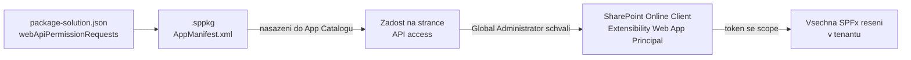

# API oprávnění, admin consent a fallback

> Typ: povinný · Den: 3 · Odhad: 75 min
> Tenant: `cloudedu.cz` · Režim: hands-on, **zásah do celého tenantu** (výslovně označené kroky)
> Prostředí: [`../../environment.md`](../../environment.md) · Názvosloví: [`../../GLOSSARY.md`](../../GLOSSARY.md)

Adresář potřebuje oprávnění k Microsoft Graph, které musí schválit admin tenantu. Blok projde
celou cestu: žádost v balíčku → první nasazení do tenantového App Catalogu → schválení →
a web part, který přežije, když schválení nepřijde.

## Cíle

- Deklarovat oprávnění v `webApiPermissionRequests` a ověřit je v `.sppkg`.
- Nasadit řešení do tenantového App Catalogu a najít žádost na stránce **API access**.
- Vysvětlit, proč schválení platí pro celý tenant a proč ho smazání řešení neodvolá.
- Napsat web part, který s neschváleným oprávněním **degraduje**, ale nespadne.

## Výklad

### Od žádosti ke schválení



Podle dokumentace:

- Žádost vznikne **nasazením balíčku** do App Catalogu; jinak ji nelze podat.
- Schválená oprávnění typu delegated se přidají aplikaci *SharePoint Online Client
  Extensibility Web Application Principal* — **jedné pro celý tenant**.
- *„All permissions are granted to the whole tenant and not to a specific application that
  has requested them."* Schválení využije jakékoli SPFx řešení v tenantu.
- **Smazání řešení oprávnění neodvolá.** Odvolává se zvlášť (*Remove access*).
- Schválit oprávnění k Microsoft Graph smí jen **Global Administrator**.
- Řešení jde nasadit a používat i se **zamítnutou** žádostí — kód s tím musí počítat.

Zdroje: [Connect to Entra ID-secured APIs](https://learn.microsoft.com/en-us/sharepoint/dev/spfx/use-aadhttpclient),
[Manage access to Entra ID-secured APIs](https://learn.microsoft.com/en-us/sharepoint/api-access)
(updated 2026-07-01).

> [!IMPORTANT] Na kurzovním tenantu je Global Administrator každý student
> Každý student by tedy technicky mohl schválit cokoli — pro všechny. V kurzu **schvaluje jen
> lektor**, na projektoru, a jen `User.Read.All`. Žádost o `Presence.Read.All` zůstane
> neschválená celý týden: na ní se ověřuje fallback.

### Co Adresář žádá a proč

```json
"webApiPermissionRequests": [
  { "resource": "Microsoft Graph", "scope": "User.Read.All" },
  { "resource": "Microsoft Graph", "scope": "Presence.Read.All" }
]
```

| Scope | Pro co | Nejmenší možné? |
|---|---|---|
| `User.Read.All` | oddělení a telefon kolegů | `User.ReadBasic.All` dává jen `displayName`, `givenName`, `id`, `mail`, `photo`, `securityIdentifier`, `surname`, `userPrincipalName` — bez `department` a `businessPhones` ([permissions reference](https://learn.microsoft.com/en-us/graph/permissions-reference)) |
| `Presence.Read.All` | dostupnost (Teams presence) | ano, pro čtení presence jiných uživatelů |

`resource` je **zobrazovaný název** aplikace (`Microsoft Graph`), ne její ID — název je stejný
ve všech tenantech, ID ne.

### Fallback: degradovat, ne spadnout

`useEmployees` volá presence zvlášť a chybu zachytí: Adresář zobrazí lidi a místo barevné
tečky dostupnosti informační pruh *„Dostupnost se nezobrazuje: správce neschválil
oprávnění."* Vzor platí obecně: **každá funkce závislá na volitelném oprávnění má vlastní
cestu bez něj.**

## Klíčové rozlišení

- **Žádost vs. schválení** — vývojář žádá v balíčku, admin schvaluje v admin centru. Nasazení
  balíčku není schválení.
- **Oprávnění řešení vs. oprávnění tenantu** — neexistuje „oprávnění mého web partu"; je jen
  oprávnění SPFx v tenantu.
- **Odebrání řešení vs. odvolání oprávnění** — dvě různé akce na dvou různých místech.

## Naše prostředí

- Tenantový App Catalog existuje (go/no-go). Každý student do něj nahraje **svoje** řešení
  `vltava-portal-<ini>` — vlastní `solution.id` z pondělí.
- Při nahrání volit **jen povolení aplikace**, ne nasazení na všechny weby; aplikaci pak
  přidat jen na vlastní web.
- API access: schvaluje lektor. Studenti stránku jen **čtou**.

## Lab

Viz [`lab-schvaleni-opravneni.md`](lab-schvaleni-opravneni.md).

## Nosná linka

Řešení je poprvé **nasazené** — běží z App Catalogu tenantu, ne z `localhost`. Adresář ukazuje
oddělení a telefony; dostupnost chybí a web part to srozumitelně říká. Podmínka scénáře „každé
oprávnění k API musí být vědomě schválené" je splněná doslova.

## Zdroje (Microsoft)

- [Connect to Entra ID-secured APIs in SharePoint Framework solutions](https://learn.microsoft.com/en-us/sharepoint/dev/spfx/use-aadhttpclient)
- [Manage access to Entra ID-secured APIs](https://learn.microsoft.com/en-us/sharepoint/api-access)
- [Microsoft Graph permissions reference](https://learn.microsoft.com/en-us/graph/permissions-reference)
- [Microsoft Graph — get presence of multiple users](https://learn.microsoft.com/en-us/graph/api/cloudcommunications-getpresencesbyuserid?view=graph-rest-1.0)

## Stav produktu / delta

> [!WARNING] Ověřit k datu běhu — stav k 2026-10.
> Popisky v dialogu App Catalogu při nahrání balíčku a umístění stránky API access v SharePoint
> admin centru se mění s redesignem admin centra. Ověřit den předem a případně upravit kroky
> labu.
