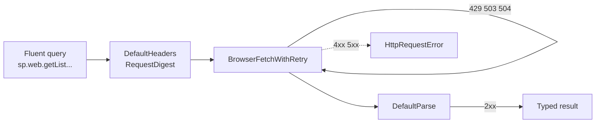
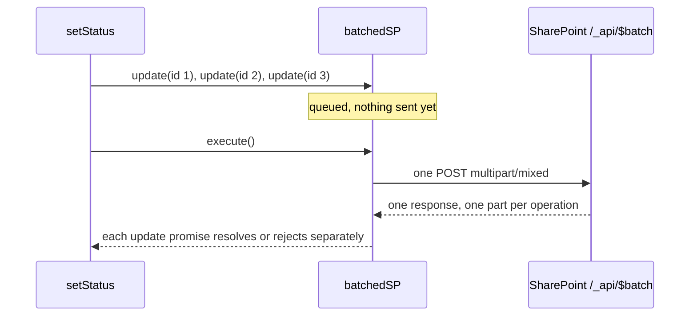

# PnPjs — CRUD, projekce, batching, chyby

> Typ: povinný · Den: 3 · Odhad: 90 min
> Tenant: `cloudedu.cz` · Režim: hands-on, vlastní web
> Prostředí: [`../../environment.md`](../../environment.md) · Názvosloví: [`../../GLOSSARY.md`](../../GLOSSARY.md)

Třetí web part řešení — **Evidence vybavení** — čte a zapisuje seznam SharePointu. Místo
ručního skládání URL `/_api/…` přes `SPHttpClient` používá PnPjs.

## Cíle

- Nastavit PnPjs v SPFx jednou pro celé řešení.
- Číst položky seznamu s výběrem polí, rozbalením osoby a filtrem.
- Přidávat položky a měnit jich víc najednou jedním dávkovým požadavkem.
- Rozlišit chyby podle stavového kódu a pro chybějící seznam ukázat srozumitelnou zprávu.

## Výklad

### Proč PnPjs

| | `SPHttpClient` | PnPjs (`@pnp/sp`) |
|---|---|---|
| Dotaz | ruční URL `/_api/web/lists/...?$select=...` | `sp.web.getList(url).items.select(...).filter(...)()` |
| Typy | ručně | výsledky typované podle volání |
| Dávky | ručně složený `$batch` | `sp.batched()` |
| Chyby | `response.ok`, ruční čtení těla | `HttpRequestError` se `status`; opakování u 429/503/504 |

PnPjs je komunitní knihovna (Microsoft 365 & Power Platform Community). Pro SPFx 1.18+ se
používá verze 4; inicializuje se z kontextu SPFx:

```typescript
const sp = spfi().using(SPFx(this.context));
```

Dokumentace doporučuje instanci vytvořit **jednou** (ne v obsluze událostí) — v řešení to
dělá `src/services/pnp.ts`.

Zdroje: [PnPjs — getting started](https://pnp.github.io/pnpjs/getting-started/),
[batching](https://pnp.github.io/pnpjs/concepts/batching/),
[error handling](https://pnp.github.io/pnpjs/concepts/error-handling/).

Microsoft sám PnPjs doporučuje zvážit, jakmile jde o složitější GET, POST nebo dávky — ruční
REST přes `SPHttpClient` je podle dokumentace „cumbersome and error-prone". Zároveň připomíná
cenu: komunitní projekt **bez SLA** a podpory Microsoftu, další závislost k aktualizaci
a další kód v balíčku
([Connect to SharePoint APIs](https://learn.microsoft.com/en-us/sharepoint/dev/spfx/connect-to-sharepoint)).

### Behaviors: co přinese `SPFx(this.context)`

`spfi()` samo o sobě neumí poslat ani jeden požadavek. Všechno — hlavičky, autentizace,
opakování, parsování — dodávají **behaviors** připojené přes `.using()`. `SPFx(context)` je
složený behavior; dokumentace PnPjs vyjmenovává, z čeho se skládá
([PnPjs — SP behaviors](https://pnp.github.io/pnpjs/sp/behaviors/)):

| Behavior | Co dělá |
|---|---|
| `DefaultHeaders` | nastaví hlavičky `Accept`, `Content-Type`, `User-Agent` |
| `DefaultInit` | výchozí nastavení požadavku |
| `BrowserFetchWithRetry` | odešle požadavek přes `fetch`; při 429/503/504 opakuje (výchozí `retries: 3`), čeká podle `Retry-After`, pokud ho server pošle |
| `DefaultParse` | přečte a zpracuje odpověď |
| `RequestDigest` | pro zápisy přidá request digest; nejdřív zkusí `formDigestValue` z `legacyPageContext` stránky |

Navíc relativní URL doplní na absolutní podle `pageContext.web.absoluteUrl`. Detaily
opakování: [PnPjs — queryable behaviors](https://pnp.github.io/pnpjs/queryable/behaviors/).



Dva důsledky pro praxi:

- **Proč instance jen jednou.** Behaviors jsou navázané na instanci. Dokumentace varuje před
  vytvářením instance v obsluze událostí — „common mistake with users of V3"
  ([getting started](https://pnp.github.io/pnpjs/getting-started/)). Řešení proto drží jednu
  instanci v `src/services/pnp.ts`:

  ```typescript
  // One shared PnPjs instance per page, created once from the SPFx context.
  let instance: SPFI | undefined;

  export function initSP(context: Parameters<typeof SPFx>[0]): SPFI {
    if (!instance) {
      instance = spfi().using(SPFx(context));
    }
    return instance;
  }
  ```

- **Další schopnosti se přidávají dalším behaviorem.** Příklad je `Caching()`: GET odpovědi
  uloží do session storage s klíčem podle celé URL a výchozí platností 5 minut
  ([queryable behaviors](https://pnp.github.io/pnpjs/queryable/behaviors/)). V řešení zatím
  není — kdy cache dává smysl a co stojí, řeší čtvrteční
  [`../../day-4/performance-caching/`](../../day-4/performance-caching/).

### Selektivní importy

```typescript
import '@pnp/sp/webs';
import '@pnp/sp/lists';
import '@pnp/sp/items';
import '@pnp/sp/batching';
```

Každý import **přidá** do objektu `sp` jednu oblast API (webs, lists, …). Bez importu
`'@pnp/sp/items'` neexistuje `.items`. Je to záměr: do balíčku jde jen to, co řešení použije.
Má to ale háček, který uvidíme v `bundle-baseline` — import kvůli vedlejšímu efektu nejde
odstranit tree shakingem.

Jak „přidá"? Takový import nic neimportuje do proměnné — **spustí kód modulu**, a ten za běhu
připojí vlastnost k prototypu třídy. Zároveň TypeScriptu rozšíří typ (*module augmentation*).
Ve verzi `@pnp/sp` 4.22.0 vypadá modul `@pnp/sp/items` uvnitř takto (zjištěno v `node_modules`
referenčního projektu, 2026-10-23; zkráceno):

```typescript
// items/list.js -- runtime: attach the 'items' property to the List class
addProp(_List, "items", Items);

// items/list.d.ts -- compile time: tell TypeScript that IList now has 'items'
declare module "../lists/types" {
  interface IList {
    readonly items: IItems;
  }
}
```

Z toho plynou dvě chyby, které se v labu objevují:

- **Chybí import** → TypeScript hlásí, že `items` na `IList` neexistuje. Řešení není
  přetypování na `any`, ale doplnit `import '@pnp/sp/items'`.
- **Import je jinde než použití.** Augmentace platí pro celou aplikaci, jakmile se modul
  jednou načte — kód tedy může náhodou fungovat díky importu v cizím souboru a rozbije se,
  až ten soubor někdo smaže. Proto má `equipmentService.ts` všechny své importy u sebe.

PnPjs uvádí selektivní importy jako cestu ke zmenšení balíčku
([getting started](https://pnp.github.io/pnpjs/getting-started/)) a Microsoft dodává, že
s pečlivým výběrem importů lze dopad na velikost balíčku zmírnit
([Connect to SharePoint APIs](https://learn.microsoft.com/en-us/sharepoint/dev/spfx/connect-to-sharepoint)).

### Seznam `Equipment`

Seznam zřizuje skript [`../../scripts/New-EquipmentList.ps1`](../../scripts/New-EquipmentList.ps1)
(PnP PowerShell), ne web part — **provisioning nepatří do UI kódu**.

| Sloupec (interní název) | Typ | Hodnoty |
|---|---|---|
| `Title` | text | model |
| `AssetTag` | text | inventární číslo |
| `Category` | volba | Laptop, Phone, Monitor, Accessory |
| `Status` | volba | Available, Issued, Repair, Retired (výchozí Available) |
| `AssignedTo` | osoba | komu je vydáno |

Hodnoty voleb jsou **data** (anglicky, stejné ve všech jazycích); web part je pro zobrazení
překládá přes lokalizační soubory.

### Dotaz, který služba posílá

```typescript
sp.web.getList(`${webUrl}/Lists/Equipment`).items
  .select('Id', 'Title', 'AssetTag', 'Category', 'Status', 'AssignedTo/Title', 'AssignedTo/EMail')
  .expand('AssignedTo')
  .filter(`Status eq 'Issued'`)
  .orderBy('Title', true)
  .top(500)();
```

- **`getList(url)` místo `getByTitle(název)`** — název seznamu může někdo přejmenovat nebo
  přeložit, URL ne.
- **Osoba** se čte přes `expand` a výběr podpolí; zapisuje se přes `AssignedToId`.

### Plynulý dotaz je jen stavitel URL

Každá metoda v řetězu (`select`, `expand`, `filter`, …) jen upraví URL a parametry
připravovaného požadavku a vrátí objekt dál. **Síťový požadavek odejde až voláním `()`**
na konci. Služba toho využívá — dotaz skládá postupně a filtr přidá jen tehdy, když je
zadaný stav:

```typescript
let query = sp.web.getList(listUrl).items
  .select('Id', 'Title', 'AssetTag', 'Category', 'Status', 'AssignedTo/Title', 'AssignedTo/EMail')
  .expand('AssignedTo')
  .orderBy('Title', true)
  .top(500);
if (status) {
  query = query.filter(`Status eq '${status}'`);
}
return await query<IEquipmentItem[]>();
```

Výsledkem je obyčejné volání SharePoint REST pod `/_api/web/...` s parametry `$select`,
`$expand`, `$orderby`, `$top` a případně `$filter` — dá se zkontrolovat v záložce Network
nástrojů prohlížeče. PnPjs nepřidává nové API; jen ho skládá typově a bez překlepů
v řetězcích URL.

**Lookup a osoba.** SharePoint REST vrací pole z propojeného seznamu jen tehdy, když je
sloupec uvedený **v `$select` i v `$expand` zároveň**
([Use OData query operations in SharePoint REST requests](https://learn.microsoft.com/en-us/sharepoint/dev/sp-add-ins/use-odata-query-operations-in-sharepoint-rest-requests)).
PnPjs to popisuje stejně a pro zápis používá interní název s příponou `Id`
(`AssignedToId: 9`, u vícehodnotového sloupce pole ID)
([PnPjs — items](https://pnp.github.io/pnpjs/sp/items/)). Odtud `AssignedTo/Title` při čtení
a `AssignedToId: null` při vrácení vybavení.

**Stránkování.** `.top(500)` neznamená „všechno" — znamená „nejvýš prvních 500". Pro seznam
vybavení jedné pobočky to stačí; kdyby seznam rostl, web part by **tiše** zobrazil jen část.
SharePoint REST pro položky seznamu nepodporuje `$skip`; stránkuje se přes `$skiptoken`
a stránkování je ordinální — když mezi dvěma stránkami někdo položky smaže, další stránka
některé přeskočí
([OData query operations](https://learn.microsoft.com/en-us/sharepoint/dev/sp-add-ins/use-odata-query-operations-in-sharepoint-rest-requests)).
PnPjs v4 nabízí pro procházení po stránkách asynchronní iteraci
([PnPjs — items](https://pnp.github.io/pnpjs/sp/items/)):

```typescript
// top() sets the page size; each loop iteration is one HTTP request
for await (const page of sp.web.getList(listUrl).items.top(100)) {
  console.log(page.length);
}
```

`break` v cyklu načítání dalších stránek ukončí. V řešení kurzu se to nepoužívá — ukázka je jen
pro představu, jak by vypadal přechod z „prvních 500" na „všechno".

### Dávka

„Vrátit vybrané" mění stav N položek. Bez dávky N požadavků, s dávkou jeden `$batch`:

```typescript
const [batchedSP, execute] = sp.batched();
const list = batchedSP.web.getList(listUrl);
const updates = ids.map(id => list.items.getById(id).update({ Status: 'Available', AssignedToId: null }));
await execute();
await Promise.all(updates);
```

Dávka smí obsahovat jen požadavky na **jeden web** a po `execute()` je spotřebovaná.

Proč se nečeká uvnitř: volání `update()` na dávkové instanci požadavek **jen zařadí do
fronty** a vrátí promise, který se splní až po `execute()`. Kdo napíše
`await list.items.getById(id).update(...)` před `execute()`, čeká na něco, co nikdy neodejde —
kód se zastaví. Dokumentace proto v dávce používá `.then()` místo `await`
([PnPjs — batching](https://pnp.github.io/pnpjs/concepts/batching/)). Další pravidlo odtud:
jednu instanci dotazu nelze v dávce použít dvakrát (*„This instance is already part of
a batch"*) — proto `list.items.getById(id)` vzniká v `map` pro každé ID znovu.



**Dávka není transakce.** To je nejčastější omyl. SharePoint dokumentace říká výslovně:
API nejsou transakční a nepodporují „všechno, nebo nic" — když jedna operace v dávce selže,
ostatní se **dokončí a nevrátí zpět**
([Make batch requests with the REST APIs](https://learn.microsoft.com/en-us/sharepoint/dev/sp-add-ins/make-batch-requests-with-the-rest-apis)).
Pro „Vrátit vybrané" to znamená:

- `await Promise.all(updates)` vyhodí chybu při **první** neúspěšné položce. Ostatní položky
  už ale mohou být vrácené.
- Po chybě je proto jediný spolehlivý stav ten, který znovu načtete ze seznamu — ne ten, který
  si web part pamatuje. Kdo potřebuje uživateli říct, **které** položky selhaly, sbírá
  výsledky jednotlivých promisů (např. `Promise.allSettled`) místo `Promise.all`.
- Dávka šetří síťové obraty, ne nutně limity. Stránka o throttlingu SharePointu uvádí, že
  požadavky v dávce se hodnotí jednotlivě — ale odkazuje přitom na JSON batching Microsoft
  Graphu
  ([Avoid getting throttled in SharePoint Online](https://learn.microsoft.com/en-us/sharepoint/dev/general-development/how-to-avoid-getting-throttled-or-blocked-in-sharepoint-online)).
  Jak se do limitů počítá SharePoint REST `$batch`, dokumentace výslovně neříká — **neověřeno**.

### Chyby

PnPjs vrací `HttpRequestError` s vlastnostmi `status` a `isHttpRequestError`. Služba převede
404 na vlastní `ListNotFoundError` a web part místo technické chyby ukáže, že seznam chybí
a jak ho vytvořit. U 429, 503 a 504 PnPjs požadavek opakuje sám.

Rozdíl proti `SPHttpClient` z bloku [`../data-access-clients/`](../data-access-clients/):
tam se promise na 404 **vyřeší** a chybu poznáte z `response.ok`; PnPjs promise **zamítne**.
Překlad chyby proto patří do `catch`:

```typescript
function isHttpError(error: unknown): error is HttpRequestError {
  return !!error && (error as HttpRequestError).isHttpRequestError === true;
}

async function translateError<T>(action: () => Promise<T>): Promise<T> {
  try {
    return await action();
  } catch (error) {
    if (isHttpError(error) && error.status === 404) {
      throw new ListNotFoundError();
    }
    throw error;
  }
}
```

Proč `isHttpRequestError` a ne `instanceof HttpRequestError`: dokumentace tu vlastnost uvádí
jako spolehlivý test („always true"). Služba importuje `HttpRequestError` jen jako typ
(`import type`), takže do balíčku kvůli kontrole chyby nejde žádný kód navíc.

Kde hledat podrobnosti chyby: `error.response` je **nepřečtená kopie** odpovědi, takže
`await error.response.json()` vrátí tělo s chybovou zprávou SharePointu
([PnPjs — error handling](https://pnp.github.io/pnpjs/concepts/error-handling/)). Pro
uživatele ji nepřekládat doslova; pro log ano.

## Klíčové rozlišení

- **`getList(url)` vs. `getByTitle(title)`** — stabilní adresa vs. měnitelný název.
- **Interní vs. zobrazovaný název sloupce** — kód používá interní (`AssignedTo`), uživatel vidí
  zobrazovaný; přejmenování sloupce v UI kód nerozbije.
- **Provisioning vs. runtime** — skript zakládá seznam jednou; web part ho jen používá
  a s jeho absencí počítá.
- **Dávka vs. transakce** — jeden HTTP požadavek, ale každá operace uspěje nebo selže
  samostatně; nic se nevrací zpět.
- **Sestavení dotazu vs. odeslání** — řetěz metod jen skládá URL; požadavek odejde voláním `()`.
- **`top(n)` vs. všechny položky** — `top` je strop, ne záruka úplnosti; všechno = iterace
  po stránkách.
- **Import kvůli typu vs. kvůli vedlejšímu efektu** — `import type` do balíčku nic nepřidá,
  `import '@pnp/sp/items'` spustí kód a rozšíří `sp`.

## Naše prostředí

- Skript potřebuje modul `PnP.PowerShell` a **Client ID** aplikace pro interaktivní přihlášení
  v `cloudedu.cz` — sdělí lektor (není v repu).
- Seznam vzniká na vlastním webu `spodev-<ini>`; data jsou fiktivní.

## Lab

Viz [`lab-evidence-vybaveni.md`](lab-evidence-vybaveni.md).

## Nosná linka

Řešení má třetí web part — **Evidence vybavení** — a poprvé **zapisuje** data. Vrácení
vybavení je jedna dávka. Ve čtvrtek přibude akce „Vydat zařízení" přímo v seznamu.

## Zdroje (Microsoft)

- [Working with lists and list items with REST](https://learn.microsoft.com/en-us/sharepoint/dev/sp-add-ins/working-with-lists-and-list-items-with-rest)
- [Make batch requests with the REST APIs](https://learn.microsoft.com/en-us/sharepoint/dev/sp-add-ins/make-batch-requests-with-the-rest-apis)
- [Use OData query operations in SharePoint REST requests](https://learn.microsoft.com/en-us/sharepoint/dev/sp-add-ins/use-odata-query-operations-in-sharepoint-rest-requests)
- [Connect to SharePoint APIs](https://learn.microsoft.com/en-us/sharepoint/dev/spfx/connect-to-sharepoint)
- [Avoid getting throttled or blocked in SharePoint Online](https://learn.microsoft.com/en-us/sharepoint/dev/general-development/how-to-avoid-getting-throttled-or-blocked-in-sharepoint-online)

## Zdroje (třetí strana — PnPjs, PnP PowerShell)

> [!IMPORTANT] Proč odkaz mimo Learn
> PnPjs a PnP PowerShell jsou komunitní projekty; referenci API a cmdletů Learn nemá.

- [PnPjs — getting started](https://pnp.github.io/pnpjs/getting-started/)
- [PnPjs — batching](https://pnp.github.io/pnpjs/concepts/batching/)
- [PnPjs — error handling](https://pnp.github.io/pnpjs/concepts/error-handling/)
- [PnPjs — SP behaviors](https://pnp.github.io/pnpjs/sp/behaviors/)
- [PnPjs — queryable behaviors](https://pnp.github.io/pnpjs/queryable/behaviors/)
- [PnPjs — items](https://pnp.github.io/pnpjs/sp/items/)
- [PnP PowerShell — Connect-PnPOnline](https://pnp.github.io/powershell/cmdlets/Connect-PnPOnline.html)

## Stav produktu / delta

> [!WARNING] Ověřit k datu běhu — stav k 2026-10.
> PnPjs 4.22.0 (npm `latest` k 2026-10-16). `Connect-PnPOnline -Interactive` vyžaduje od
> 2024-09-09 parametr `-ClientId` — bez vlastní registrace aplikace se nepřipojí.
