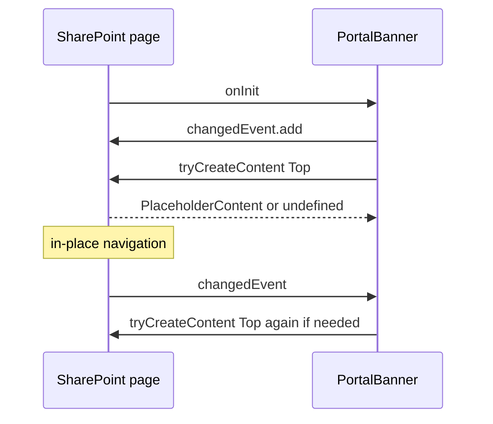
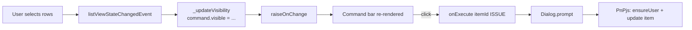
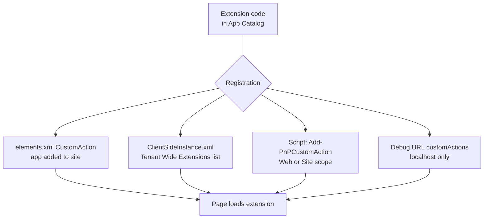

# Extensions — Application Customizer, Command Set, Field Customizer

> Typ: povinný · Den: 4 · Odhad: 120 min
> Tenant: `cloudedu.cz` · Režim: hands-on, vlastní web
> Prostředí: [`../../environment.md`](../../environment.md) · Názvosloví: [`../../GLOSSARY.md`](../../GLOSSARY.md)

Web party žijí tam, kam je editor vloží. Extensions běží **všude**: na každé stránce webu,
v každém seznamu. Řešení dostane banner oznámení a akci „Vydat zařízení" přímo v seznamu
vybavení.

## Cíle

- Rozlišit tři typy extensions podle toho, kde a kdy běží.
- Vykreslit obsah do placeholderu stránky bez závislosti na DOM SharePointu.
- Přidat příkaz do seznamu, který se zobrazí jen tehdy, kdy dává smysl.
- Rozhodnout mezi Field Customizerem a JSON formátováním — a zvolit levnější cestu.

## Výklad

### Tři typy

| Typ | Kde běží | V řešení |
|---|---|---|
| **Application Customizer** | na každé stránce webu; placeholdery `Top` a `Bottom` | `PortalBanner` — oznámení |
| **ListView Command Set** | panel příkazů a kontextové menu seznamu | `IssueEquipment` — Vydat zařízení |
| **Field Customizer** | vykreslení buňky jednoho sloupce | **ne** — JSON formátování stačí |
| Form Customizer | nový / edit / zobrazovací formulář | zmínka (SPFx 1.23.2: příprava na panel v seznamu) |

Extensions se testují **jen na skutečné stránce** — hosted workbench je nenačte
([Debug on modern pages](https://learn.microsoft.com/en-us/sharepoint/dev/spfx/debug-modern-pages)).
Pondělní Debug Toolbar je tu jediná cesta.

### Placeholdery, ne DOM

Application Customizer nesmí hledat prvky stránky selektorem — DOM SharePointu není API a mění
se. Dostane **placeholder** (`this.context.placeholderProvider.tryCreateContent(PlaceholderName.Top)`)
a kreslí jen do jeho `domElement`. Podle dokumentace extension:

- **nesmí předpokládat, že placeholder existuje** (`tryCreateContent` může vrátit `undefined`),
- reaguje na `placeholderProvider.changedEvent` — placeholdery vznikají a zanikají při
  navigaci.

Zdroj: [Use page placeholders from Application Customizer](https://learn.microsoft.com/en-us/sharepoint/dev/spfx/extensions/get-started/using-page-placeholder-with-extensions).

### Životní cyklus placeholderu

Placeholder nepatří extension, ale stránce. Reference API to říká přímo: placeholdery se
mohou objevit a zmizet, jak uživatel se stránkou pracuje — **například při navigaci na místě**
(in-place navigation, stránka se nepřenačte celá). `changedEvent` se vyvolá pokaždé, když se
změní seznam dostupných placeholderů; existující placeholder přitom může zaniknout a nový
vzniknout ([PlaceholderProvider](https://learn.microsoft.com/en-us/javascript/api/sp-application-base/placeholderprovider)).

Co z toho plyne pro kód:

| Prvek API | Co dělá | Důsledek |
|---|---|---|
| `tryCreateContent(name, options)` | vrátí `PlaceholderContent`, nebo `undefined`, když placeholder na stránce není | vždy testovat výsledek |
| `PlaceholderContent.domElement` | `div`, do kterého extension kreslí | kreslit jen sem |
| `options.onDispose` | callback, když SharePoint obsah zlikviduje | místo pro úklid a zapomenutí reference |
| `PlaceholderContent.isDisposed` | obsah už byl zlikvidován | stará reference je k ničemu |
| `PlaceholderContent.dispose()` | odstraní DOM element hned; jinak ho zlikviduje aplikace se zánikem placeholderu | ruční odstranění banneru |

Zdroj: [PlaceholderContent](https://learn.microsoft.com/en-us/javascript/api/sp-application-base/placeholdercontent).

`PortalBanner` kreslí dvakrát „pro jistotu" — hned v `onInit` a při každé změně placeholderů:

```typescript
public onInit(): Promise<void> {
  // Placeholders are created and re-created during navigation; react to every change.
  this.context.placeholderProvider.changedEvent.add(this, this._render);
  this._render();
  return Promise.resolve();
}

private _render(): void {
  const message: string = (this.properties.message || '').trim();
  if (!message || this._isDismissed(message) || this._topPlaceholder) {
    return; // nothing to show, dismissed, or already rendered
  }
  this._topPlaceholder = this.context.placeholderProvider.tryCreateContent(PlaceholderName.Top);
  if (!this._topPlaceholder) {
    return; // this page type has no Top placeholder
  }
  // ... createElement + textContent, then append to this._topPlaceholder.domElement
}
```



Typické chyby a jak je poznat:

- **Kreslení jen v `onInit`** bez `changedEvent` — banner občas chybí (placeholder ještě
  neexistoval), po F5 se „zázračně" objeví.
- **Chybí podmínka „už nakresleno"** — každý `changedEvent` přidá další pruh; na stránce
  jsou dva tři stejné bannery pod sebou.
- **Reference na zlikvidovaný obsah.** Podmínka `this._topPlaceholder` v řešení kontroluje
  jen to, že reference existuje, ne `isDisposed`. Kdyby SharePoint Top placeholder při
  navigaci na místě zlikvidoval, banner by se do nového už nevrátil. Robustnější tvar podle
  kontraktu API:

  ```typescript
  // Re-create the content when SharePoint disposed the previous one.
  if (this._topPlaceholder && !this._topPlaceholder.isDisposed) {
    return;
  }
  this._topPlaceholder = this.context.placeholderProvider.tryCreateContent(
    PlaceholderName.Top,
    { onDispose: () => { this._topPlaceholder = undefined; } }
  );
  ```

  Zda Top placeholder na kurzovním tenantu při přechodu odkazem mezi stránkami webu skutečně
  zaniká, je **neověřeno**. Ověření: přejdi z Home odkazem na jinou stránku webu (bez F5)
  a sleduj, jestli banner zůstane.

### Banner běží na každé stránce — a to stojí

> [!IMPORTANT] Banner s Reactem a Fluent UI by byl 34× větší — změřeno (2026-10-16)
>
> | Varianta `PortalBanner` | Bundle |
> |---|---|
> | DOM API (`createElement`, `textContent`), CSS modul | **5 499 B** |
> | React + `MessageBar` z Fluent UI | 188 628 B |
>
> Lektorský stroj, SPFx 1.23.2, `npm run build`. Data:
> [`../performance-caching/mereni-den-4.md`](../performance-caching/mereni-den-4.md).
>
> **Kód, který běží na každé stránce, platí každá stránka — v extensions šetři víc než ve web
> partech.**

Text oznámení se vkládá přes `textContent`, ne `innerHTML`: pochází z konfigurace a nesmí
do stránky vložit HTML ani skript.

### Command Set: viditelnost podle kontextu

Generátor SPFx 1.23 už používá událost `this.context.listView.listViewStateChangedEvent`
(starší návody: `onListViewUpdated`). Příkaz *Vydat zařízení* je viditelný, jen když:

1. seznam je `Lists/Equipment` (registrace v `elements.xml` platí pro všechny seznamy typu
   100 na webu — filtr je v kódu),
2. je vybraná **právě jedna** položka,
3. její `Status` je `Available`.

Akce se zeptá na e-mail (`Dialog.prompt` z `@microsoft/sp-dialog`), přes PnPjs zavolá
`ensureUser` a zapíše `Status = Issued` a `AssignedToId`.

Zdroj: [Build your first ListView Command Set](https://learn.microsoft.com/en-us/sharepoint/dev/spfx/extensions/get-started/building-simple-cmdset-with-dialog-api).

### Jak Command Set rozhoduje o viditelnosti

Příkaz je deklarovaný v manifestu (`items`, klíč `ISSUE`) — tím SharePoint ví, **že** tlačítko
existuje. Kód rozhoduje jen **kdy** je vidět. Mechanismus má tři části:

1. `tryGetCommand('ISSUE')` vrátí objekt `Command`. Jeho `visible` a `title` čte SharePoint při
   překreslení panelu. Objekt si **drží stav z posledního vykreslení** — co jednou nastavíš na
   `false`, zůstane skryté, dokud to nevrátíš na `true`.
2. Změnu stavu seznamu (výběr řádků, přepnutí pohledu) ohlásí událost
   `context.listView.listViewStateChangedEvent`. Metoda `onListViewUpdated` ze starších
   návodů je v referenci označená jako **deprecated**.
3. `raiseOnChange()` podle reference vyvolá událost OnChange a spustí nové vykreslení
   (reflow) ListView — řešení ji volá po každém přepočtu viditelnosti.

```typescript
public onInit(): Promise<void> {
  this._updateVisibility(); // initial state, before the first change event
  this.context.listView.listViewStateChangedEvent.add(this, this._onListViewStateChanged);
  return Promise.resolve();
}

private _onListViewStateChanged = (args: ListViewStateChangedEventArgs): void => {
  this._updateVisibility();
  this.raiseOnChange();
};
```



Zdroj: [BaseListViewCommandSet](https://learn.microsoft.com/en-us/javascript/api/sp-listview-extensibility/baselistviewcommandset).

Typické chyby:

- **Viditelnost nastavená jen v jedné větvi** (`if (ok) { command.visible = true; }`). Protože
  `Command` drží stav, po prvním „ano" zůstane příkaz vidět navždy. Řešení proto přiřazuje
  vždy celý logický výraz.
- **Jiný klíč v kódu a v manifestu** — `tryGetCommand` vrátí `undefined`, příkaz se nikdy
  neskryje, `onExecute` hodí `Unknown command`.
- **Lokace.** `elements.xml` řešení používá `ClientSideExtension.ListViewCommandSet` = panel
  příkazů **i** kontextové menu; `...CommandBar` jen panel, `...ContextMenu` jen menu.
- **Knihovna vs. seznam.** Z `localhost` běží příkaz v seznamech i knihovnách; po nasazení
  platí jen `RegistrationId` z `elements.xml` — `100` seznamy, `101` knihovny dokumentů. Pro
  obojí jsou potřeba dvě `CustomAction`. Symptom: „při ladění to šlo, po nasazení v knihovně
  příkaz chybí".

### Field Customizer: vykreslení po buňkách

Field Customizer nemá jeden `render`, ale tři háčky
([Build your first Field Customizer](https://learn.microsoft.com/en-us/sharepoint/dev/spfx/extensions/get-started/building-simple-field-customizer)):

| Metoda | Kdy | K čemu |
|---|---|---|
| `onInit()` | jednou, před vykreslením; vrací Promise | příprava; `onRenderCell` se nevolá, dokud Promise nedoběhne |
| `onRenderCell(event)` | pro **každou** vykreslenou buňku sloupce | zapsat obsah do `event.domElement` |
| `onDisposeCell(event)` | těsně před smazáním buňky | uvolnit, co `onRenderCell` alokoval — jinak únik paměti |

```typescript
public onRenderCell(event: IFieldCustomizerCellEventParameters): void {
  // Called once per rendered cell: keep it cheap, no HTTP call per cell.
  event.domElement.textContent = String(event.fieldValue);
}

public onDisposeCell(event: IFieldCustomizerCellEventParameters): void {
  // Free what onRenderCell allocated (React roots, event listeners).
  super.onDisposeCell(event);
}
```

Dokumentace výslovně uvádí: když `onRenderCell` připojí React element, `onDisposeCell` ho
**musí** uvolnit. K poli se customizer váže vlastností `ClientSideComponentId` (a volitelně
`ClientSideComponentProperties`) na objektu pole — přes `elements.xml` (`<Field ...
ClientSideComponentId="...">`), REST/CSOM nebo `Set-PnPField`.

Proč se v řešení nepoužívá: seznam s 30 řádky = 30 volání `onRenderCell`, každé s kódem
z bundlu, který se musí stáhnout. JSON formátování stejný štítek nakreslí bez vlastního kódu.

### Field Customizer vs. JSON formátování

Barevný štítek stavu ve sloupci `Status` jde udělat Field Customizerem (kód, build, nasazení,
údržba) — nebo JSON formátováním sloupce (nastavení v seznamu, bez kódu). Pro „jinak zobrazit
hodnotu, kterou seznam má" je správně JSON — stejná osa jako v pondělí
([`../../day-1/platform-positioning/`](../../day-1/platform-positioning/)). Field Customizer
dává smysl, až když vykreslení potřebuje data, která v řádku nejsou, nebo vlastní logiku.
Druhý legitimní důvod uvádí dokumentace Field Customizeru: Field Customizer koncový uživatel
nemůže změnit z uživatelského rozhraní, což otevírá další scénáře použití.

Zdroj: [Use column formatting](https://learn.microsoft.com/en-us/sharepoint/dev/declarative-customization/column-formatting).

### Registrace: `elements.xml`, ne `ClientSideInstance.xml`

Generátor při první extension přidá dva soubory:

| Soubor | Co dělá | V kurzu |
|---|---|---|
| `sharepoint/assets/elements.xml` | `CustomAction` na webu, kam se aplikace přidá | **ano** |
| `sharepoint/assets/ClientSideInstance.xml` | registrace extension **pro celý tenant** při nasazení „na všechny weby" | **odstraněno** |

Na sdíleném tenantu by `ClientSideInstance.xml` při nesprávné volbě v dialogu nasazení dal
banner jednoho studenta na weby všech. Řešení ho proto nemá.

Zdroj: [Tenant wide deployment of extensions](https://learn.microsoft.com/en-us/sharepoint/dev/spfx/extensions/basics/tenant-wide-deployment-extensions).

### Čtyři cesty, jak se extension dostane na stránku

Kód extension je v App Catalogu, ale **sám nic nespustí**. Na stránce běží, jen když na ni
ukazuje nějaká registrace s jejím `ClientSideComponentId`:



| Cesta | Rozsah | V kurzu |
|---|---|---|
| `elements.xml` (Feature framework) | web nebo seznam — Application Customizer přes Feature XML jen na úrovni webu nebo seznamu | **ano**, řešení `vltava-portal` |
| `ClientSideInstance.xml` → seznam *Tenant Wide Extensions* | celý tenant, filtr podle šablony webu / typu seznamu | **ne** (sdílený tenant) |
| skript (`Add-PnPCustomAction`, REST/CSOM) | web, nebo celá site collection (`-Scope Site`) | jen výklad |
| ladicí parametr `customActions` v URL | jedno načtení stránky, kód z `localhost` | **ano**, lab |

Podrobnosti, sloupce seznamu *Tenant Wide Extensions* a příklad skriptu:
[`explainer-extension-registration.md`](explainer-extension-registration.md).

## Klíčové rozlišení

- **Placeholder vs. DOM stránky** — placeholder je API, selektor na DOM je tichá chyba za půl roku.
- **`textContent` vs. `innerHTML`** — text vs. kód.
- **Registrace vs. viditelnost** — `elements.xml` určuje, kde se extension načte; kód, kdy je
  příkaz vidět.
- **Field Customizer vs. JSON formátování** — kód a nasazení vs. nastavení sloupce.
- **Existence reference vs. živý placeholder** — `this._topPlaceholder` může ukazovat na
  obsah, který SharePoint už zlikvidoval (`isDisposed`).
- **Manifest `items` vs. `command.visible`** — manifest říká, že příkaz existuje; kód při
  každé změně stavu seznamu, jestli je vidět.
- **Sloupec vs. buňka** — Field Customizer se volá (`onRenderCell`) a uklízí
  (`onDisposeCell`) pro každou buňku, ne jednou za sloupec.

## Naše prostředí

- Seznam `Equipment` z dne 3 na webu `spodev-<ini>`; test na moderní stránce s debug
  parametry (stránka Home webu).
- Při testu z `localhost` extension nikde neregistrujeme — žije jen v URL.

## Lab

Viz [`lab-banner-a-prikaz.md`](lab-banner-a-prikaz.md).

## Nosná linka

Řešení dostane **banner oznámení** (Application Customizer, 5,5 KB) a akci **Vydat zařízení**
v seznamu (Command Set). Štítky stavů ve sloupci řeší JSON formátování, ne kód.

## Zdroje (Microsoft)

- [Use page placeholders from Application Customizer](https://learn.microsoft.com/en-us/sharepoint/dev/spfx/extensions/get-started/using-page-placeholder-with-extensions)
- [Build your first ListView Command Set extension](https://learn.microsoft.com/en-us/sharepoint/dev/spfx/extensions/get-started/building-simple-cmdset-with-dialog-api)
- [Debug SharePoint Framework solutions on modern pages](https://learn.microsoft.com/en-us/sharepoint/dev/spfx/debug-modern-pages)
- [Use column formatting](https://learn.microsoft.com/en-us/sharepoint/dev/declarative-customization/column-formatting)
- [Tenant wide deployment of extensions](https://learn.microsoft.com/en-us/sharepoint/dev/spfx/extensions/basics/tenant-wide-deployment-extensions)
- [Build your first Field Customizer extension](https://learn.microsoft.com/en-us/sharepoint/dev/spfx/extensions/get-started/building-simple-field-customizer)
- [PlaceholderProvider class](https://learn.microsoft.com/en-us/javascript/api/sp-application-base/placeholderprovider)
- [PlaceholderContent class](https://learn.microsoft.com/en-us/javascript/api/sp-application-base/placeholdercontent)
- [BaseListViewCommandSet class](https://learn.microsoft.com/en-us/javascript/api/sp-listview-extensibility/baselistviewcommandset)
- [Tenant-scoped solution deployment for SharePoint Framework solutions](https://learn.microsoft.com/en-us/sharepoint/dev/spfx/tenant-scoped-deployment)

## Zdroje (třetí strana — PnP PowerShell)

- [Add-PnPCustomAction](https://pnp.github.io/powershell/cmdlets/Add-PnPCustomAction.html)

## Stav produktu / delta

> [!WARNING] Ověřit k datu běhu — stav k 2026-10.
> SPFx 1.23 ohlásila vylepšení Command Setů (seskupování); SPFx 1.25 má přinést navigation
> customizers. Přidání extension do React projektu generátorem 1.23.2 vyžaduje
> `--framework none` (jinak chyba šablony — viz lab).
