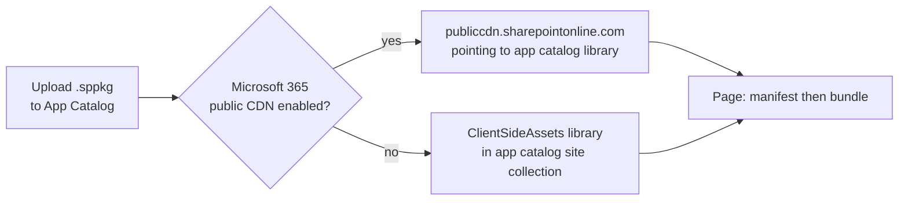
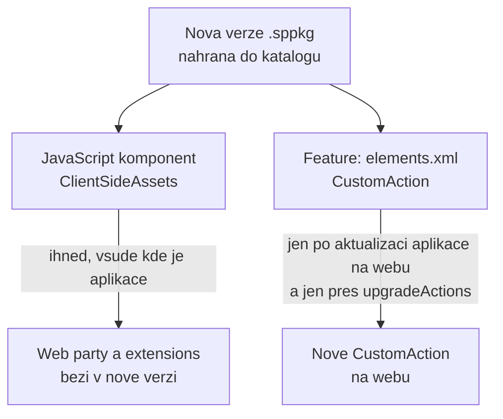
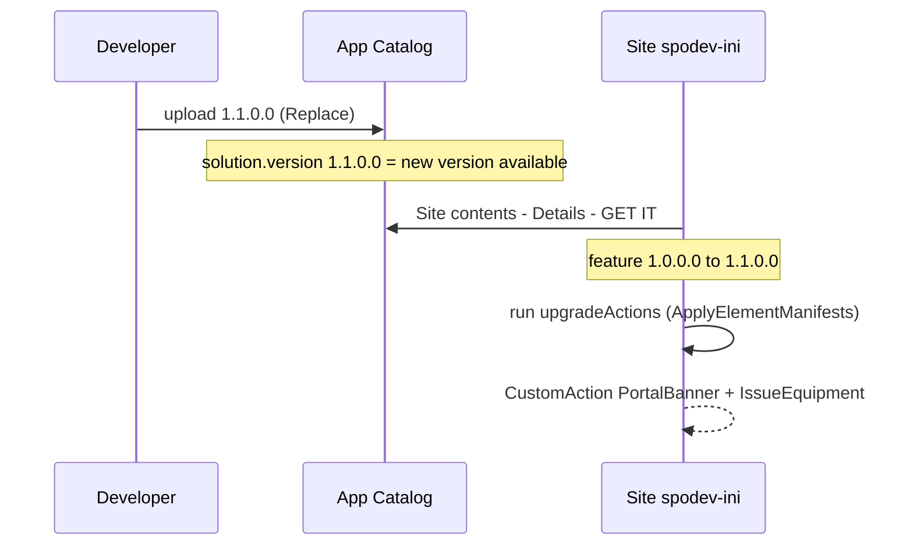

# Balení a App Catalog — verze, upgrade, tenant vs. site

> Typ: povinný · Den: 4 · Odhad: 90 min
> Tenant: `cloudedu.cz` · Režim: hands-on; nahrání do App Catalogu **mění celý tenant**
> Prostředí: [`../../environment.md`](../../environment.md) · Názvosloví: [`../../GLOSSARY.md`](../../GLOSSARY.md)

Ve středu se nasadila verze 1.0.0.0 — tři web party. Dnes vznikla verze 1.1.0.0 s bannerem
a příkazem v seznamu. Blok projde skutečný upgrade: co se aktualizuje samo, co ne a proč.

## Cíle

- Rozlišit verzi řešení, feature, komponent a dat web partu.
- Připravit upgrade, který na existujícím webu doplní nové `CustomAction` (upgrade actions).
- Nahrát novou verzi do App Catalogu a aktualizovat aplikaci na webu.
- Rozhodnout mezi tenantovým a site collection katalogem a nasazením „na všechny weby".

## Výklad

### Čtyři čísla verze

| Kde | Příklad | Co řídí |
|---|---|---|
| `package-solution.json` → `solution.version` | `1.1.0.0` | SharePoint pozná, že v katalogu je nová verze aplikace |
| `package-solution.json` → `features[].version` | `1.1.0.0` | spustí upgrade actions na webech, kde je aplikace přidaná |
| `package.json` → `version` | `1.1.0` | verze komponent — manifesty mají `"version": "*"` a berou ji odsud |
| web part → `dataVersion` | `1.0` | verze **uložených vlastností** web partu; mění se jen při změně jejich struktury |

Dokumentace: *„The solution version indicates for SharePoint that there's a new version …
The feature version ensures that the upgrade actions are executed accordingly."*

### Co je uvnitř `.sppkg`

`npm run build` (`heft test --clean --production && heft package-solution --production`)
vytvoří `sharepoint/solution/vltava-portal.sppkg`. Je to ZIP — obsah se dá vypsat. Výpis balíčku dne 4 (build 2026-10-16, lektorský stroj; GUID nahrazeny
zástupci):

```text
AppManifest.xml
[Content_Types].xml
_rels/...
feature_<feature-guid>.xml
<feature-guid>/
  elements.xml                     <- CustomAction for banner + command
  upgrade-actions-v1.1.xml         <- ApplyElementManifests
  WebPart_<component-id>.xml       x3 (component manifests)
  Extension_<component-id>.xml     x2
ClientSideAssets.xml
ClientSideAssets/
  portal-web-part_<hash>.js                 206 519 B
  PortalWebPartStrings_cs-cz_<hash>.js        1 945 B
  ... (bundle + 2 strings files per component, icons)
```

Tři vrstvy v jednom souboru:

| Vrstva | V balíčku | Co je vidět ve výpisu |
|---|---|---|
| **Kód** | `ClientSideAssets/` — bundly a jazykové soubory | názvy s hashem, velikosti = [`../performance-caching/mereni-den-4.md`](../performance-caching/mereni-den-4.md) |
| **Komponenty** | `WebPart_*.xml`, `Extension_*.xml` | element `ClientSideComponent` s celým manifestem komponenty včetně `"version":"1.1.0"` z `package.json` |
| **Feature framework** | `elements.xml`, `upgrade-actions-*.xml` | přesně soubory ze `sharepoint/assets/` |

`AppManifest.xml` nese `Version="1.1.0.0"` (verze řešení) a `SkipFeatureDeployment="true"`
— hodnoty z `package-solution.json`.

Pozor na cestu v upgrade action: `Location="<feature-guid>\elements.xml"` míří přesně do
složky `<feature-guid>/` v balíčku. Dokumentace upozorňuje, že GUID odpovídá složce
vytvořené pod `sharepoint/solution/debug` a GUID feature z `package-solution.json`
([Provision SharePoint assets](https://learn.microsoft.com/en-us/sharepoint/dev/spfx/web-parts/get-started/provision-sp-assets-from-package)).
Složka `debug` obsahuje rozbalené XML, které jde do balíčku — tam se chyba v GUID najde bez
nahrávání do tenantu. Plný výpis a výklad: [`explainer-sppkg-anatomy.md`](explainer-sppkg-anatomy.md).

### Kde se hostuje JavaScript: `includeClientSideAssets`

`includeClientSideAssets: true` (výchozí hodnota) znamená, že statické soubory jsou uvnitř
`.sppkg` a hostuje je tenant sám; jinou hostingovou infrastrukturu není třeba
([Host your client-side web part from Microsoft 365 CDN](https://learn.microsoft.com/en-us/sharepoint/dev/spfx/web-parts/get-started/hosting-webpart-from-office-365-cdn)):



- Volba je **automatická podle nastavení tenantu**, balíček se kvůli ní nemění. Produkční
  build používá jako adresu assetů dynamický štítek, který se doplní podle nastavení CDN
  tenantu — v manifestech našeho balíčku je to `HTTPS://SPCLIENTSIDEASSETLIBRARY/`. Proto
  dialog důvěry při nahrání ukazuje doménu *SharePoint Online*.
- Site collection App Catalog: soubory jdou do knihovny v **téže site collection**; s Public
  CDN se servírují přes CDN, jinak přímo z knihovny
  ([Use the site collection app catalog](https://learn.microsoft.com/en-us/sharepoint/dev/general-development/site-collection-app-catalog)).
- `includeClientSideAssets: false` = soubory v balíčku nejsou a hostuješ je sám (Azure CDN,
  jiné CDN, knihovna SharePointu). Adresa se zadá do `config/write-manifests.json`
  (`cdnBasePath`), soubory z `release/assets` se nahrají např. `heft deploy-azure-storage
  --production` podle `config/deploy-azure-storage.json`
  ([Deploy your web part to Azure CDN](https://learn.microsoft.com/en-us/sharepoint/dev/spfx/web-parts/get-started/deploy-web-part-to-cdn)).
  Řešení má oba konfigurační soubory z generátoru jen se zástupnými hodnotami — kurz je
  nepoužívá.

Typická chyba starších projektů: balíček s `includeClientSideAssets: false` nahraný do
katalogu, ale JavaScript na CDN nenahraný. V balíčku kód není, takže ho stránka nemá odkud
vzít. Očekávaný symptom v F12: požadavek na bundle na adrese z `cdnBasePath` neuspěje.

### Co se aktualizuje samo a co ne



- **Kód** (`ClientSideAssets`) se po nahrání nové verze použije hned všude.
- **Feature framework** (`elements.xml`) se na webu, kde už feature běží, **nespustí znovu**.
  Nové elementy se dostanou na web jen přes `upgradeActions` s `ApplyElementManifests`
  a aktualizaci aplikace na webu (*Site contents* → aplikace → *Details* → **GET IT**).
- Nové elementy patří **zároveň** do `elementManifests` — jinak by čistá instalace verze 1.1
  dopadla jinak než upgrade z 1.0.

Zdroj: [Provision SharePoint assets from your SharePoint client-side web part](https://learn.microsoft.com/en-us/sharepoint/dev/spfx/web-parts/get-started/provision-sp-assets-from-package)
(sekce *Define upgrade actions for new version*).

Ve `vltava-portal`:

```json
"features": [{
  "id": "<feature-guid>",
  "version": "1.1.0.0",
  "assets": {
    "elementManifests": [ "elements.xml" ],
    "upgradeActions": [ "upgrade-actions-v1.1.xml" ]
  }
}]
```

```xml
<ApplyElementManifests>
  <ElementManifest Location="<feature-guid>\elements.xml" />
</ApplyElementManifests>
```

### Upgrade actions: co umí a kdy proběhnou

Upgrade actions jsou Feature framework, ne SPFx. SPFx řešení podporují jen dvě definice
([Provision SharePoint assets](https://learn.microsoft.com/en-us/sharepoint/dev/spfx/web-parts/get-started/provision-sp-assets-from-package),
sekce *Define upgrade actions for new version*):

| Akce | Co udělá na webu | Typické použití |
|---|---|---|
| `ApplyElementManifest(s)` | aplikuje uvedený `elements*.xml` | nový seznam, pole, v našem případě nové `CustomAction` |
| `AddContentTypeField` | přidá pole do existujícího typu obsahu | rozšíření typu obsahu z verze 1.0 |

Jak to do sebe zapadá:



Typické chyby a jak je poznat:

- **Zvýšená jen verze řešení.** Katalog ukazuje 1.1.0.0, na webu je nabídka aktualizace,
  ale po *GET IT* se nové `CustomAction` neobjeví — feature zůstala na 1.0.0.0, upgrade
  actions neměly proč běžet.
- **GUID řešení místo GUID feature** v `Location`. Soubor v balíčku neexistuje; kontrola
  bez tenantu: složka `sharepoint/solution/debug` musí obsahovat podsložku s tímto GUID.
- **Nový element jen v upgrade action.** Čistá instalace 1.1 na nový web ho nedostane —
  dokumentace proto přidává nový manifest **i** do `elementManifests`.
- **Více features v jednom řešení.** Technicky jde (pole `features`), dokumentace to
  nedoporučuje; víc `elements.xml` v jedné feature se aplikuje v pořadí, v jakém jsou
  uvedené.

Že `ApplyElementManifests` doplní na existující web `CustomAction` (ne seznam jako v příkladu
dokumentace), je na kurzovním tenantu **neověřeno** — viz go/no-go v instructor notes.

### Tenantový vs. site collection katalog

| | Tenantový App Catalog | Site collection App Catalog |
|---|---|---|
| Kdo spravuje | admin tenantu | vlastník webu (zakládá ho admin) |
| Kde je aplikace k dispozici | na všech webech (po přidání, nebo hned při nasazení na všechny weby) | jen na tom webu |
| Žádosti o API oprávnění | ano (den 3) | viz otevřená otázka v `permissions-consent` |
| SharePoint assety (pole, typy obsahu, seznamy) | ne při nasazení na všechny weby | **nelze** |

Dokumentace k assetům: *„\*.sppkg packages that contain SharePoint assets cannot be tenant
deployed from the tenant application catalog, and cannot be used in a site application
catalog."* Řešení `vltava-portal` assety nemá — jen `CustomAction` — ale stejná otázka padne
u každého řešení s `elements.xml`.

Zdroje: [Use the site collection app catalog](https://learn.microsoft.com/en-us/sharepoint/dev/general-development/site-collection-app-catalog),
[Tenant wide deployment of extensions](https://learn.microsoft.com/en-us/sharepoint/dev/spfx/extensions/basics/tenant-wide-deployment-extensions).

### `skipFeatureDeployment` a „všechny weby"

`skipFeatureDeployment: true` (zvoleno generátorem v pondělí) umožní při nahrání zvolit
zpřístupnění na všech webech: web party jsou pak v toolboxu všude bez přidání aplikace.
Feature (`elements.xml`) se přitom **nenasadí** — extensions by potřebovaly tenant-wide
registraci (`ClientSideInstance.xml`), kterou řešení záměrně nemá. Kurz proto nahrává **jen
s povolením** a aplikaci přidává na vlastní web.

Co přesně se stane podle volby při nahrání
([Tenant-scoped solution deployment](https://learn.microsoft.com/en-us/sharepoint/dev/spfx/tenant-scoped-deployment)):

| | Bez zaškrtnutí „Enable this app and add it to all sites" | Se zaškrtnutím |
|---|---|---|
| Web party | v toolboxu až po přidání aplikace na web | ihned v toolboxu na všech webech |
| Feature framework (`elements.xml`) | aktivuje se při přidání aplikace na web | **ignoruje se** |
| Upgrade actions | běží při aktualizaci aplikace na webu | žádné — aktualizace = nový balíček v katalogu |
| *Add an app* na webu | aplikace je nabízena | aplikace se nenabízí |
| `ClientSideInstance.xml` (kdyby byl) | nic | záznam v *Tenant Wide Extensions* |

Dvě pasti z dokumentace:

- Při **aktualizaci** balíčku s extensions může opětovné zaškrtnutí vytvořit **duplicitní**
  záznamy v seznamu *Tenant Wide Extensions*; zaškrtnutí je potřeba jen poprvé.
- V **site collection** App Catalogu znamená stejná volba „na všechny weby" jen weby **té
  jedné site collection** — jiné site collection řešení nevidí
  ([Use the site collection app catalog](https://learn.microsoft.com/en-us/sharepoint/dev/general-development/site-collection-app-catalog)).

### Upgrade SPFx projektu

Přechod na novější verzi SPFx (např. 1.23 → 1.24) je změna závislostí, konfigurace
a toolchainu najednou. Release notes doporučují CLI for Microsoft 365:

```powershell
m365 spfx project upgrade --toVersion 1.23.2 --output md
```

Příkaz projekt **analyzuje** a vypíše seznam změn — nic sám neprovede. CLI je nainstalované
globálně od pondělí (`dev-environment`); příkaz se spouští ve složce projektu a pracuje se
soubory na disku, ne s tenantem.
Zdroj: [SPFx v1.23.2 release notes](https://learn.microsoft.com/en-us/sharepoint/dev/spfx/release-1.23.2).

> [!WARNING] `npm-check-updates` (`ncu -u`) ani `npm update` v SPFx projektu ne
> Zvednou závislosti plošně na nejnovější verze — mimo sadu, kterou Microsoft pro danou verzi
> SPFx testuje (React, TypeScript, rig, `@microsoft/sp-*`). Výsledkem je rozbitý build nebo
> chyba až za běhu. Verze v SPFx projektu se mění jen upgradem celé verze SPFx podle výstupu
> `m365 spfx project upgrade`. Ze stejného důvodu se nespouští `npm audit fix` (pátek,
> `diagnostics-hardening`).

## Klíčové rozlišení

- **Verze řešení vs. verze feature** — první říká „je nová verze", druhá „spusť upgrade".
- **Kód vs. feature framework** — kód se aktualizuje sám, `CustomAction` ne.
- **Nahrání do katalogu vs. aktualizace na webu** — dva kroky, často dvě různé role.
- **Client-side assety vs. SharePoint assety** — JS a jazykové soubory (`ClientSideAssets/`)
  site collection App Catalog hostuje bez problému; *SharePoint* assety (pole, typy obsahu,
  seznamy v `elements.xml`) v site collection katalogu použít nelze. Dokumentace používá pro
  obojí slovo „assets".
- **„Na všechny weby" v tenantovém vs. site collection katalogu** — celý tenant vs. jen jedna
  site collection.
- **Public CDN vs. `ClientSideAssets`** — stejný balíček, jiná doména v F12; rozhoduje
  nastavení tenantu, ne řešení.

## Naše prostředí

- Tenantový App Catalog, řešení `vltava-portal-<ini>` verze 1.0.0.0 ze středy.
- Site collection App Catalog na webu studenta: **instruktorské demo** (zakládá ho admin
  cmdletem `Add-SPOSiteCollectionAppCatalog`; viz go/no-go).

## Lab

Viz [`lab-verze-a-upgrade.md`](lab-verze-a-upgrade.md).

## Nosná linka

Řešení **verze 1.1.0.0** běží z katalogu: banner na stránkách webu `spodev-<ini>`, příkaz
*Vydat zařízení* v seznamu. Upgrade z 1.0 proběhl bez odinstalace a bez ztráty nastavení web
partů na stránkách.

Stav po dni 4: [`solution/vltava-portal/`](solution/vltava-portal/).

## Zdroje (Microsoft)

- [Provision SharePoint assets from your SharePoint client-side web part](https://learn.microsoft.com/en-us/sharepoint/dev/spfx/web-parts/get-started/provision-sp-assets-from-package)
- [Use the site collection app catalog](https://learn.microsoft.com/en-us/sharepoint/dev/general-development/site-collection-app-catalog)
- [Tenant wide deployment of extensions](https://learn.microsoft.com/en-us/sharepoint/dev/spfx/extensions/basics/tenant-wide-deployment-extensions)
- [SharePoint Framework v1.23.2 release notes](https://learn.microsoft.com/en-us/sharepoint/dev/spfx/release-1.23.2)
- [Host your client-side web part from Microsoft 365 CDN](https://learn.microsoft.com/en-us/sharepoint/dev/spfx/web-parts/get-started/hosting-webpart-from-office-365-cdn)
- [Tenant-scoped solution deployment for SharePoint Framework solutions](https://learn.microsoft.com/en-us/sharepoint/dev/spfx/tenant-scoped-deployment)
- [Deploy your SharePoint client-side web part to Azure CDN](https://learn.microsoft.com/en-us/sharepoint/dev/spfx/web-parts/get-started/deploy-web-part-to-cdn)

## Zdroje (třetí strana — CLI for Microsoft 365)

- [m365 spfx project upgrade](https://pnp.github.io/cli-microsoft365/cmd/spfx/project/project-upgrade/)

## Stav produktu / delta

> [!WARNING] Ověřit k datu běhu — stav k 2026-10.
> Popisky App Catalogu (*Replace*, *Enable app*) a stránky *Details* aplikace na webu
> (*GET IT*) podle dokumentace; moderní App Catalog je mění. Ověřit den předem.
