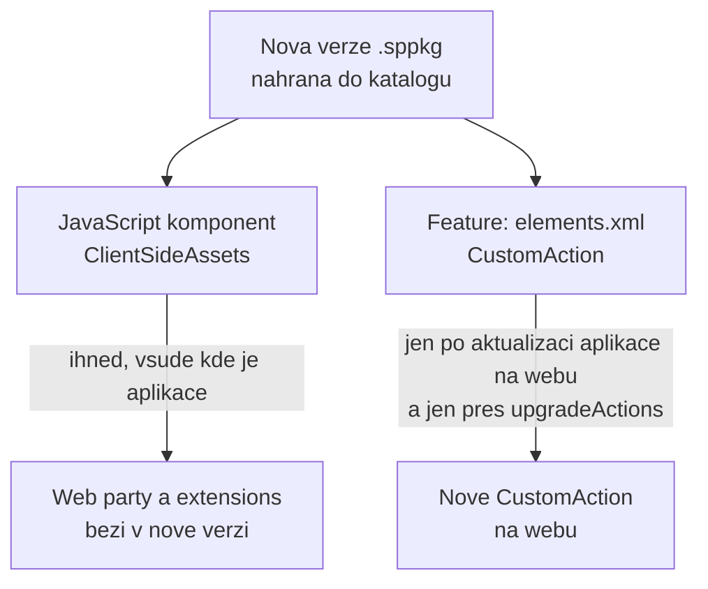

# Balení a App Catalog — verze, upgrade, tenant vs. site

> Typ: povinný · Den: 4 · Odhad: 90 min
> Tenant: `cloudedu.cz` · Režim: hands-on; nahrání do App Catalogu **mění celý tenant**
> Prostředí: [`../../environment.md`](../../environment.md) · Názvosloví: [`../../GLOSSARY.md`](../../GLOSSARY.md)

Ve středu se nasadila verze 1.0.0.0 — tři web party. Dnes vznikla verze 1.1.0.0 s bannerem
a příkazem v seznamu. Blok projde skutečný upgrade: co se aktualizuje samo, co ne a proč.

## Cíle

- Rozlišit verzi řešení, feature, komponent a dat web partu.
- Připravit upgrade, který na existujícím webu doplní nové `CustomAction` (upgrade actions).
- Nahrát novou verzi do App Catalogu a aktualizovat aplikaci na webu.
- Rozhodnout mezi tenantovým a site collection katalogem a nasazením „na všechny weby".

## Výklad

### Čtyři čísla verze

| Kde | Příklad | Co řídí |
|---|---|---|
| `package-solution.json` → `solution.version` | `1.1.0.0` | SharePoint pozná, že v katalogu je nová verze aplikace |
| `package-solution.json` → `features[].version` | `1.1.0.0` | spustí upgrade actions na webech, kde je aplikace přidaná |
| `package.json` → `version` | `1.1.0` | verze komponent — manifesty mají `"version": "*"` a berou ji odsud |
| web part → `dataVersion` | `1.0` | verze **uložených vlastností** web partu; mění se jen při změně jejich struktury |

Dokumentace: *„The solution version indicates for SharePoint that there's a new version …
The feature version ensures that the upgrade actions are executed accordingly."*

### Co se aktualizuje samo a co ne



- **Kód** (`ClientSideAssets`) se po nahrání nové verze použije hned všude.
- **Feature framework** (`elements.xml`) se na webu, kde už feature běží, **nespustí znovu**.
  Nové elementy se dostanou na web jen přes `upgradeActions` s `ApplyElementManifests`
  a aktualizaci aplikace na webu (*Site contents* → aplikace → *Details* → **GET IT**).
- Nové elementy patří **zároveň** do `elementManifests` — jinak by čistá instalace verze 1.1
  dopadla jinak než upgrade z 1.0.

Zdroj: [Provision SharePoint assets from your SharePoint client-side web part](https://learn.microsoft.com/en-us/sharepoint/dev/spfx/web-parts/get-started/provision-sp-assets-from-package)
(sekce *Define upgrade actions for new version*).

Ve `vltava-portal`:

```json
"features": [{
  "id": "<feature-guid>",
  "version": "1.1.0.0",
  "assets": {
    "elementManifests": [ "elements.xml" ],
    "upgradeActions": [ "upgrade-actions-v1.1.xml" ]
  }
}]
```

```xml
<ApplyElementManifests>
  <ElementManifest Location="<feature-guid>\elements.xml" />
</ApplyElementManifests>
```

### Tenantový vs. site collection katalog

| | Tenantový App Catalog | Site collection App Catalog |
|---|---|---|
| Kdo spravuje | admin tenantu | vlastník webu (zakládá ho admin) |
| Kde je aplikace k dispozici | na všech webech (po přidání, nebo hned při nasazení na všechny weby) | jen na tom webu |
| Žádosti o API oprávnění | ano (den 3) | viz otevřená otázka v `permissions-consent` |
| SharePoint assety (pole, typy obsahu, seznamy) | ne při nasazení na všechny weby | **nelze** |

Dokumentace k assetům: *„\*.sppkg packages that contain SharePoint assets cannot be tenant
deployed from the tenant application catalog, and cannot be used in a site application
catalog."* Řešení `vltava-portal` assety nemá — jen `CustomAction` — ale stejná otázka padne
u každého řešení s `elements.xml`.

Zdroje: [Use the site collection app catalog](https://learn.microsoft.com/en-us/sharepoint/dev/general-development/site-collection-app-catalog),
[Tenant wide deployment of extensions](https://learn.microsoft.com/en-us/sharepoint/dev/spfx/extensions/basics/tenant-wide-deployment-extensions).

### `skipFeatureDeployment` a „všechny weby"

`skipFeatureDeployment: true` (zvoleno generátorem v pondělí) umožní při nahrání zvolit
zpřístupnění na všech webech: web party jsou pak v toolboxu všude bez přidání aplikace.
Feature (`elements.xml`) se přitom **nenasadí** — extensions by potřebovaly tenant-wide
registraci (`ClientSideInstance.xml`), kterou řešení záměrně nemá. Kurz proto nahrává **jen
s povolením** a aplikaci přidává na vlastní web.

### Upgrade SPFx projektu

Přechod na novější verzi SPFx (např. 1.23 → 1.24) je změna závislostí, konfigurace
a toolchainu najednou. Release notes doporučují CLI for Microsoft 365:

```powershell
npx -p @pnp/cli-microsoft365@latest m365 spfx project upgrade --toVersion 1.23.2 --output md
```

Příkaz projekt **analyzuje** a vypíše seznam změn — nic sám neprovede.
Zdroj: [SPFx v1.23.2 release notes](https://learn.microsoft.com/en-us/sharepoint/dev/spfx/release-1.23.2).

## Klíčové rozlišení

- **Verze řešení vs. verze feature** — první říká „je nová verze", druhá „spusť upgrade".
- **Kód vs. feature framework** — kód se aktualizuje sám, `CustomAction` ne.
- **Nahrání do katalogu vs. aktualizace na webu** — dva kroky, často dvě různé role.

## Naše prostředí

- Tenantový App Catalog, řešení `vltava-portal-<ini>` verze 1.0.0.0 ze středy.
- Site collection App Catalog na webu studenta: **instruktorské demo** (zakládá ho admin
  cmdletem `Add-SPOSiteCollectionAppCatalog`; viz go/no-go).

## Lab

Viz [`lab-verze-a-upgrade.md`](lab-verze-a-upgrade.md).

## Nosná linka

Řešení **verze 1.1.0.0** běží z katalogu: banner na stránkách webu `spodev-<ini>`, příkaz
*Vydat zařízení* v seznamu. Upgrade z 1.0 proběhl bez odinstalace a bez ztráty nastavení web
partů na stránkách.

Stav po dni 4: [`solution/vltava-portal/`](solution/vltava-portal/).

## Zdroje (Microsoft)

- [Provision SharePoint assets from your SharePoint client-side web part](https://learn.microsoft.com/en-us/sharepoint/dev/spfx/web-parts/get-started/provision-sp-assets-from-package)
- [Use the site collection app catalog](https://learn.microsoft.com/en-us/sharepoint/dev/general-development/site-collection-app-catalog)
- [Tenant wide deployment of extensions](https://learn.microsoft.com/en-us/sharepoint/dev/spfx/extensions/basics/tenant-wide-deployment-extensions)
- [SharePoint Framework v1.23.2 release notes](https://learn.microsoft.com/en-us/sharepoint/dev/spfx/release-1.23.2)

## Zdroje (třetí strana — CLI for Microsoft 365)

- [m365 spfx project upgrade](https://pnp.github.io/cli-microsoft365/cmd/spfx/project/project-upgrade/)

## Stav produktu / delta

> [!WARNING] Ověřit k datu běhu — stav k 2026-10.
> Popisky App Catalogu (*Replace*, *Enable app*) a stránky *Details* aplikace na webu
> (*GET IT*) podle dokumentace; moderní App Catalog je mění. Ověřit den předem.
