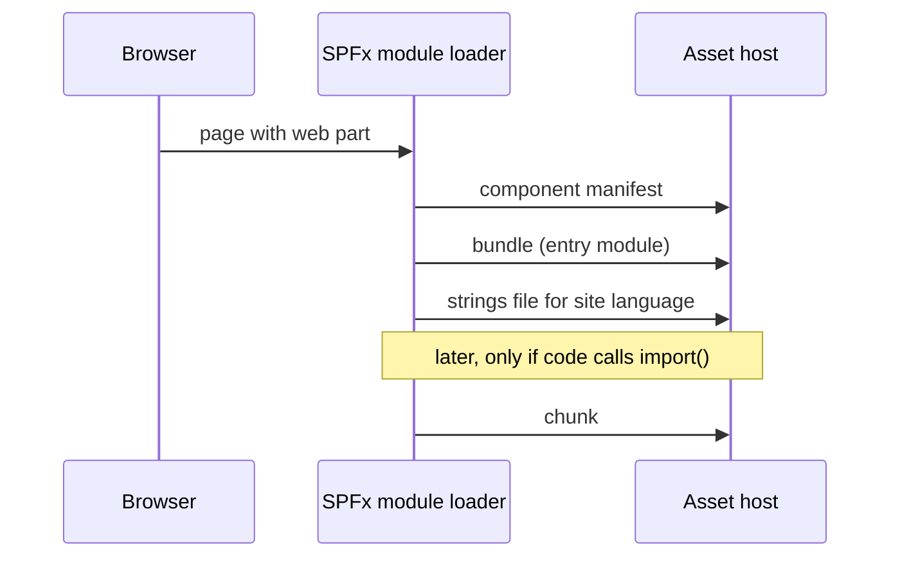
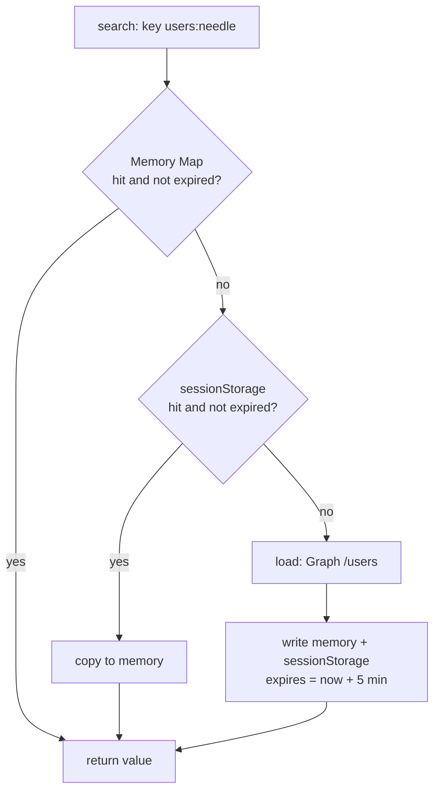

# Výkon II — code splitting, lazy loading, cache

> Typ: povinný · Den: 4 · Odhad: 90 min
> Tenant: `cloudedu.cz` · Režim: hands-on, vlastní web
> Prostředí: [`../../environment.md`](../../environment.md) · Názvosloví: [`../../GLOSSARY.md`](../../GLOSSARY.md)

Středa skončila otázkou: proč Rozcestník platí za PnPjs, které nepoužívá? Dnes se to opraví —
a změří se i dvě rady z internetu, které tak samozřejmé nejsou.

## Cíle

- Opravit import, který táhne do balíčku nepoužitou knihovnu, a změřit úsporu.
- Vyzkoušet lazy loading (`React.lazy` + `import()`) a **rozhodnout podle čísel**, jestli ho
  ponechat.
- Zavést cache výsledků Graphu a zvolit úložiště podle toho, kde smí data zůstat.

## Výklad

### Co prohlížeč stahuje, když je na stránce web part

Velikost bundlu je důležitá proto, že každý web part na stránce znamená řetěz požadavků.
Podle dokumentace k lokalizaci obsahuje **manifest** komponenty v `loaderConfig.scriptResources`
cestu k bundlu a ke každému jazykovému souboru; v produkčním buildu má každý jazyk **vlastní
soubor** a SharePoint stáhne jen ten, který odpovídá jazyku webu (jinak `defaultPath`)
([Localize SPFx web parts](https://learn.microsoft.com/en-us/sharepoint/dev/spfx/web-parts/guidance/localize-web-parts),
sekce *Localization files in the release build*).



Jak to vypadá ve `vltava-portal` — výpis obsahu `.sppkg` dne 4 (build 2026-10-16, lektorský
stroj; velikosti sedí s [`mereni-den-4.md`](mereni-den-4.md)):

| Soubor v `ClientSideAssets/` | Bajty |
|---|---|
| `equipment-web-part_<hash>.js` | 454 270 |
| `EquipmentWebPartStrings_cs-cz_<hash>.js` | 930 |
| `EquipmentWebPartStrings_en-us_<hash>.js` | 896 |
| `portal-banner-application-customizer_<hash>.js` | 5 499 |
| `PortalBannerApplicationCustomizerStrings_cs-cz_<hash>.js` | 80 |

Dvě věci z toho plynou:

- **Jazykový soubor je zanedbatelný, bundle ne.** Optimalizovat má smysl bundle.
- **Knihovny se nesdílejí mezi komponentami.** Dokumentace: knihovny třetích stran SPFx
  standardně vloží do bundlu **každé** komponenty, která je importuje, takže je uživatel
  stahuje opakovaně
  ([Optimize builds for production](https://learn.microsoft.com/en-us/sharepoint/dev/spfx/toolchain/optimize-builds-for-production)).
  Evidence (454 KB) a Adresář (235 KB) na jedné stránce = dvě kopie Fluent UI. Naopak
  `@microsoft/sp-lodash-subset` je podle téže stránky na každé stránce SharePointu už načtený
  a do bundlu se nepřidává.

HTTP cache prohlížeče pomáhá jen s opakovaným načtením: když je stejná knihovna ze stejné
URL, prohlížeč při dalším požadavku použije uloženou kopii (tamtéž). První návštěvu to
nezrychlí. Podrobnosti a jak to ověřit v F12:
[`explainer-page-loading.md`](explainer-page-loading.md).

### Oprava, která funguje: přímý import

```typescript
// before: the barrel also exports useEquipment -> equipmentService -> @pnp/sp side effects
import { useFilteredLinks } from '../../../hooks';
// after
import { useFilteredLinks } from '../../../hooks/useFilteredLinks';
```

> [!IMPORTANT] Jeden řádek importu ušetřil 32 KB — změřeno (2026-10-16)
> Rozcestník: středa 238 632 B → čtvrtek **206 519 B** (gzip 73 108 → 62 958 B). Kód
> komponenty se nezměnil, jen cesta importu. Data: [`mereni-den-4.md`](mereni-den-4.md).
>
> **Barrel soubory používej pro typy a čisté funkce, ne pro moduly s vedlejšími efekty.**

### Lazy loading: dvě rady, které změřením neprošly

`React.lazy(() => import(/* webpackChunkName: '...' */ './X'))` vyčlení komponentu do
samostatného souboru, který se stáhne až při prvním vykreslení. Zní to jako jistá výhra.

> [!IMPORTANT] Lazy loading v obou zkoušených místech zvětšil celkový balíček — změřeno (2026-10-16)
>
> | Experiment | Výsledek |
> |---|---|
> | Panel „Přidat vybavení" (otevírá se jen na klik) jako lazy chunk | hlavní bundle **+9 892 B**, chunk 16 831 B — Panel sdílí jádro Fluent UI s tabulkou, není co oddělit |
> | Celá komponenta Evidence jako lazy chunk | počáteční bundle 50 872 B místo 454 270 B, ale celkem **+33 986 B** — a UI se stejně stáhne hned |
>
> **Lazy loading pomáhá jen u velkého kódu s vlastními závislostmi, který většina návštěv
> nepotřebuje. U web partu, který se hned vykreslí, jen přidá režii.**

Oba experimenty jsou v řešení **vrácené** — rozhodlo číslo, ne doporučení.

### Jak `import()` dělí bundle — a proč tady nepomohl

Statický `import` na začátku souboru webpack zabalí do bundlu komponenty. Volání `import()`
uprostřed kódu je pro webpack **bod rozdělení**: modul a jeho závislosti dá do samostatného
souboru (chunku), který se stáhne až ve chvíli, kdy kód `import()` opravdu zavolá. Komentář
`webpackChunkName` dá chunku čitelné jméno
([SPFx guidance on dynamic loading](https://learn.microsoft.com/en-us/sharepoint/dev/spfx/dynamic-loading));
chunk, který webpack vyčlení sám, má jméno číslo (`chunk.741` v [`mereni-den-4.md`](mereni-den-4.md)).

```typescript
// Pattern from the Microsoft guidance: code used only in the property pane.
protected loadPropertyPaneResources(): Promise<void> {
  return import(
    /* webpackChunkName: 'portal-property-pane' */
    './PortalPropertyPane'
  ).then(module => {
    this._propertyPane = new module.PortalPropertyPane(this);
  });
}
```

`loadPropertyPaneResources()` se podle téže stránky spustí před zobrazením panelu vlastností
— kód panelu tak stahuje jen editor stránky, ne každý čtenář. (Ukázka ilustruje vzor;
v řešení `vltava-portal` není.)

Dokumentace sama dodává: **ne každý soubor či knihovnu má smysl načítat dynamicky**;
lepší je seskupit kód jedné schopnosti do jednoho chunku. Naše měření ukazují proč:

| Podmínka, aby se chunk vyplatil | Panel „Přidat vybavení" | Celá Evidence |
|---|---|---|
| Kód v chunku má **vlastní** velké závislosti | ne — Panel, TextField, Dropdown sdílí jádro Fluent UI s `DetailsList` | ano, ale… |
| Většina návštěv kód **nepotřebuje** | ano | **ne** — web part se kreslí hned |
| Výsledek | hlavní bundle +9 892 B | celkem +33 986 B, webpack sám vyčlenil `chunk.741` (432 113 B) |

Jak poznat zbytečný chunk bez buildu navíc: v F12 → *Network* se chunk stáhne **hned při
načtení stránky** (pak jen přidal požadavek), nebo je hlavní bundle po rozdělení skoro stejně
velký (chunk neodnesl závislosti, jen kód komponenty).

### Cache: kam s daty tenantu

Adresář hledá v Graphu při každém dopsání hledaného textu. Stejné hledání během 5 minut teď
obslouží cache (`src/utils/sessionCache.ts`): nejdřív paměť, pak `sessionStorage`, teprve
pak Graph. Dostupnost (presence) se necachuje — mění se každou minutu.

| Úložiště | Vydrží | Data zaměstnanců po zavření karty | V řešení |
|---|---|---|---|
| paměť (`Map`) | do obnovení stránky | zmizí | ano (1. úroveň) |
| `sessionStorage` | do zavření karty | zmizí | ano (2. úroveň) |
| `localStorage` | navždy | **zůstanou na zařízení** | ne |
| IndexedDB (např. Dexie v learn-spfx-growth 3-Plant) | navždy, velké objemy | **zůstanou na zařízení** | ne |
| PnPjs `Caching` behavior | podle nastavení (`session` / `local`) | podle úložiště | alternativa pro SharePoint data |

Volba úložiště je rozhodnutí o **datech tenantu na zařízení uživatele**, ne jen o výkonu.
Adresář zaměstnanců s telefony v `localStorage` sdíleného počítače je únik dat.

Zdroj PnPjs: [Caching behavior](https://pnp.github.io/pnpjs/queryable/behaviors/#caching).

### Read-through cache krok za krokem

`src/utils/sessionCache.ts` má 42 řádků a jednu exportovanou funkci `cached(key, ttlMs, load)`.
Služba adresáře ji obaluje kolem volání Graphu:

```typescript
search(query: string): Promise<IEmployee[]> {
  const needle: string = query.replace(/"/g, '').trim();
  // The same search within 5 minutes is served from the cache, not from Graph.
  return cached(`users:${needle.toLocaleLowerCase()}`, SEARCH_CACHE_MS, () => searchGraph(needle));
},
```



Rozhodnutí v kódu a proč:

- **Klíč je normalizovaný** (`toLocaleLowerCase`, bez uvozovek a mezer na krajích). Bez toho
  jsou „Novak" a „novak" dva záznamy a cache se míjí. Symptom: v *Network* jde druhé hledání
  do Graphu, i když výsledky jsou stejné.
- **Expirace se ukládá s hodnotou** (`expires`), ne jako časovač. Záznam ze `sessionStorage`
  přežije F5 a jeho platnost se po načtení znovu porovná s `Date.now()`.
- **Každý přístup ke storage je v `try/catch`.** Úložiště může zakázat politika prohlížeče
  nebo může dojít kvóta; cache pak tiše spadne na paměť, Graph funguje dál.
- **Chyba se necachuje.** Když `load()` vyhodí výjimku, nic se nezapíše — další pokus jde
  znovu do Graphu.
- **Dvě souběžná stejná hledání cache nesloučí** — obě se minou a obě zavolají Graph.
  Proti tomu chrání debounce psaní (`useDebounce`, 400 ms), ne cache.
- **Presence se necachuje vůbec** — mění se v řádu minut a 5 minut stará „dostupnost" je
  horší než žádná.

Proč vlastní util a ne PnPjs `Caching`: adresář volá Graph přes `MSGraphClientV3`, ne přes
PnPjs, takže behavior PnPjs se ho netýká. Pro data ze SharePointu přes PnPjs je `Caching`
hotová alternativa: výchozí úložiště `session`, výchozí expirace 5 minut, klíč a expiraci lze
přizpůsobit (`keyFactory`, `expireFunc`); podle ukázkového kódu cachuje jen GET, pokud
požadavek nemá hlavičku `CacheAlways`
([PnPjs behaviors](https://pnp.github.io/pnpjs/queryable/behaviors/#caching)).

### Hranice dat: co do cache nepatří

Výkonová cache je kopie dat tenantu **mimo tenant** — v prohlížeči uživatele. Před každou
cache se proto ptej na tři věci:

1. **Kde kopie skončí** — paměť a `sessionStorage` zmizí se stránkou, resp. kartou;
   `localStorage` a IndexedDB zůstávají na zařízení (tabulka výše).
2. **Jak rychle data stárnou** — presence ne, seznam lidí na 5 minut ano.
3. **Co když se změní oprávnění** — cache vrací, co uživatel viděl **při zápisu**. Po odebrání
   práv vidí uložený výsledek až do expirace. TTL je tedy i bezpečnostní parametr, ne jen
   výkonový.

## Klíčové rozlišení

- **Velikost počátečního bundlu vs. celková velikost** — lazy loading mění první, často
  zhorší druhou.
- **Cache výkonu vs. uložení dat** — `sessionStorage` vs. `localStorage` je rozhodnutí o tom,
  co zůstane na zařízení.
- **Rada vs. měření** — obojí z tohoto bloku se dá najít jako „best practice"; jedno platí,
  dvě ne.
- **Bundle vs. jazykový soubor** — bundle stovky KB, strings stovky bajtů; optimalizuje se
  bundle.
- **Statický `import` vs. `import()`** — první jde do bundlu vždy, druhý vytvoří chunk
  stažený až při volání.
- **TTL jako výkon vs. TTL jako bezpečnost** — po odebrání oprávnění cache vrací stará data
  až do expirace.

## Naše prostředí

Měření lokálně (build), ověření cache na workbenchi vlastního webu (Network v F12).

## Lab

Viz [`lab-optimalizace-a-cache.md`](lab-optimalizace-a-cache.md).

## Nosná linka

Řešení má **změřenou deltu proti středě**: Rozcestník −32 113 B, ostatní web party +0,5 až
+1,6 KB za nové funkce. Adresář opakované hledání neposílá do Graphu. Tuhle deltu student
v pátek obhajuje.

## Zdroje (Microsoft)

- [Customize webpack with the Heft Webpack Patch plugin](https://learn.microsoft.com/en-us/sharepoint/dev/spfx/toolchain/customize-heft-toolchain-customize-webpack-config)
- [Debug SharePoint Framework solutions on modern pages](https://learn.microsoft.com/en-us/sharepoint/dev/spfx/debug-modern-pages)
- [SharePoint Framework guidance on dynamic loading of packages](https://learn.microsoft.com/en-us/sharepoint/dev/spfx/dynamic-loading)
- [Optimize SharePoint Framework builds for production](https://learn.microsoft.com/en-us/sharepoint/dev/spfx/toolchain/optimize-builds-for-production)
- [Localize SharePoint Framework client-side web parts](https://learn.microsoft.com/en-us/sharepoint/dev/spfx/web-parts/guidance/localize-web-parts)
- [Host your client-side web part from Microsoft 365 CDN](https://learn.microsoft.com/en-us/sharepoint/dev/spfx/web-parts/get-started/hosting-webpart-from-office-365-cdn)

## Zdroje (třetí strana — React, PnPjs)

> [!IMPORTANT] Proč odkaz mimo Learn
> `React.lazy` a cache PnPjs dokumentují jejich projekty.

- [React — lazy](https://react.dev/reference/react/lazy)
- [PnPjs — Caching behavior](https://pnp.github.io/pnpjs/queryable/behaviors/#caching)

## Stav produktu / delta

> [!WARNING] Ověřit k datu běhu — stav k 2026-10.
> Čísla platí pro SPFx 1.23.2 a `@fluentui/react` 8.x. Se SPFx 1.24 (React 18) a jiným
> rozdělením chunků ve webpacku experimenty zopakovat.
