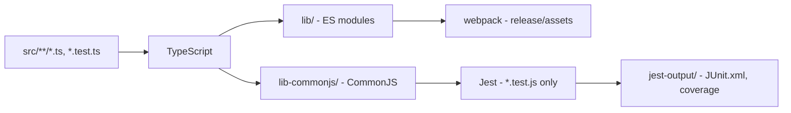
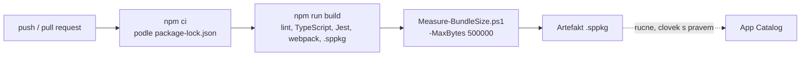

# CI/CD a quality gates

> Typ: povinný · Den: 5 · Odhad: 45 min
> Tenant: — · Režim: hands-on, lokálně + GitHub
> Prostředí: [`../../environment.md`](../../environment.md) · Názvosloví: [`../../GLOSSARY.md`](../../GLOSSARY.md)

Všechno, co týden hlídal student ručně — lint, chybějící překlad, velikost balíčku — teď hlídá
pipeline při každém pushi. Build, který brána zastaví, se nedostane do App Catalogu.

## Cíle

- Napsat unit testy, které spustí `heft test` v rámci `npm run build`.
- Převést ruční kontroly týdne (parita lokalizace, limit velikosti) na automatické brány.
- Postavit GitHub Actions pipeline: install, build s testy, brána velikosti, artefakt `.sppkg`.
- Vysvětlit, proč pipeline v kurzu **nenasazuje** do tenantu.

## Výklad

### Co už build umí

`npm run build` = `heft test --clean --production && heft package-solution --production`.
Heft přitom spustí lint (ESLint 9), TypeScript, Jest a webpack. Jest běží nad zkompilovanými
testy `src/**/*.test.ts`:

| Test | Co hlídá | Vazba na týden |
|---|---|---|
| `src/utils/links.test.ts` | `parseLinks` a `validateLinks` (5 testů) | den 2, property pane |
| `src/loc.test.ts` | každý klíč z `mystrings.d.ts` je ve všech `loc/*.js` (10 testů) | den 1–2: chybějící klíč je `undefined` |

> [!IMPORTANT] Chybějící překlad teď zastaví build — změřeno (2026-10-16)
> Referenční řešení: 15 testů, 15 úspěšných. Po smazání klíče `Greeting` z `cs-cz.js`:
> `FAIL lib-commonjs\loc.test.js (9 passed, 1 failed)`, výstup ukáže chybějící `"Greeting"`,
> `npm run build` skončí kódem 1.
>
> **Co lze zkontrolovat strojem, nepatří do code review ani do ručního testu.**

Test lokalizace čte soubory z disku (`fs`) — běží v Node.js, ne v prohlížeči. Rig SPFx ale
kompiluje i testy jako kód pro prohlížeč (ES5, bez typů Node.js), proto test potřebuje
`@types/node` v `devDependencies` a `/// <reference types="node" />`.

### Co přesně dělá `heft test`

Heft netestuje TypeScript přímo. Nejdřív proběhne **běžný build** a Jest se pustí až nad jeho
výstupem — Heft k tomu nepoužívá `ts-jest` ani `babel-jest`
([Heft — Jest plugin](https://heft.rushstack.io/pages/plugins/jest/)). V projektu SPFx to
zařizuje rig `@microsoft/spfx-web-build-rig`, na který ukazuje `config/rig.json`
([Heft-based toolchain](https://learn.microsoft.com/en-us/sharepoint/dev/spfx/toolchain/sharepoint-framework-toolchain-rushstack-heft)).
V rigu 1.23.2 (soubory v `node_modules/@microsoft/spfx-web-build-rig/profiles/default/config/`,
přečteno 2026-10-23):

| Soubor rigu | Co určuje |
|---|---|
| `heft.json` | fáze `test` má `phaseDependencies: ["build"]` — `heft test` vždy nejdřív sestaví projekt (Sass, TypeScript, lint, webpack) |
| `typescript.json` | kromě `lib/` (ES moduly pro webpack) vypíše TypeScript i **`lib-commonjs/`** (CommonJS pro Jest) |
| `jest.config.json` | `testMatch: <rootDir>/lib-commonjs/**/*.test.js`, `testEnvironment: jest-environment-jsdom`, pokrytí kódu a JUnit report do `jest-output/` |



Odtud plynou tři chyby, které se dají poznat podle výstupu:

- **Test se nespustí a nic nehlásí.** Soubor se jmenuje `*.spec.ts` nebo leží mimo `src/` —
  `testMatch` rigu hledá jen `*.test.js` v `lib-commonjs/`. Počet `Successes` ve výstupu buildu
  se nezvýší.
- **Chyba typu v testu zastaví build dřív než Jest.** Test je normální zdrojový soubor, prochází
  TypeScriptem i ESLintem jako zbytek `src/`. Proto `Cannot find module 'fs'` hlásí kompilátor,
  ne Jest.
- **Test prochází proti starému kódu.** Jest čte `lib-commonjs/`, ne `src/`. `npm run build`
  volá `heft test --clean`, takže výstup je vždy čerstvý; ruční spouštění Jestu mimo Heft tuto
  jistotu nemá.

### Co testovat: čistá funkce, služba, komponenta

Learn k unit testům SPFx doporučuje „testovat přinejmenším obchodní logiku"
([CI/CD with Azure DevOps](https://learn.microsoft.com/en-us/sharepoint/dev/spfx/toolchain/implement-ci-cd-with-azure-devops)).
V `vltava-portal` to znamená tři úrovně s různou cenou:

| Co | Příklad v řešení | Co test potřebuje |
|---|---|---|
| **čistá funkce** — vstup → výstup, bez SharePointu | `parseLinks`, `validateLinks` v `src/utils/links.ts` | nic, jen volání a `expect` |
| **služba** — logika nad PnPjs | `createLoanService(sp, url)` | podvržený objekt `sp` — služba ho dostává parametrem, ne z `this.context` |
| **komponenta** — vykreslení a interakce | `EquipmentDesk.tsx` | knihovnu pro vykreslení v jsdom; v projektu **není** |

Čistá funkce je nejlevnější test a nejvíc odhalí — proto je validace odkazů vytažená z property
pane do `links.ts` (den 2), kde ji jde testovat bez SharePointu:

```typescript
it('rejects http addresses', () => {
  expect(validateLinks('Wiki|http://example.com/wiki')).toEqual({ line: 1, reason: 'url' });
});
```

Služby jsou napsané tak, aby šly testovat (dostávají `SPFI` parametrem), ale kurz testy služeb
nepíše. Test komponent by vyžadoval další vývojové závislosti — rozhodnutí na projekt, ne
na kurz.

### Brána velikosti

Skript [`Measure-BundleSize.ps1`](../../scripts/Measure-BundleSize.ps1) z bloku
`bundle-baseline` umí `-MaxBytes`: když je kterýkoli bundle (web part, extension, chunk) větší,
skončí kódem 1 a pipeline spadne. Limit 500 000 B v referenčním řešení propustí Evidenci
(455 475 B); limit 400 000 B ji zastaví.

### Pipeline



`.github/workflows/build.yml` v řešení používá `actions/checkout@v7`, `actions/setup-node@v7`
(Node.js 22, cache npm) a `actions/upload-artifact@v7` (verze k 2026-10-16). `npm ci` vyžaduje
commitnutý `package-lock.json` — a díky němu má pipeline přesně stejné verze balíčků jako
vývojář.

### Lockfile a `npm ci`: stejný build na každém stroji

`package.json` říká, **jaké rozsahy** verzí projekt snese (`"@fluentui/react": "^8.106.4"`).
`package-lock.json` říká, **které přesné verze** se nainstalovaly — včetně stovek tranzitivních
závislostí. Pipeline, která instaluje podle rozsahů, může dostat jiný strom než vývojář, a pak
„u mě to funguje" přestane být argument.

`npm ci` se od `npm install` liší přesně v tom, co CI potřebuje
([npm ci](https://docs.npmjs.com/cli/v10/commands/npm-ci)):

- bez `package-lock.json` (nebo `npm-shrinkwrap.json`) skončí chybou,
- když lockfile nesedí s `package.json`, skončí chybou — lockfile neopravuje,
- existující `node_modules` nejdřív smaže,
- **nikdy nezapisuje** do `package.json` ani do lockfile.

Jak chybu poznat: `npm ci` v pipeline hlásí, že lockfile chybí (je v `.gitignore` — viz lab,
krok 5), nebo že `package.json` a lockfile nejsou v souladu (někdo změnil `package.json` ručně
a nespustil `npm install`). Oprava je vždy lokálně: `npm install`, build, commit **obou** souborů.

> [!IMPORTANT] Lockfile je součást zdrojového kódu
> **Změna verze balíčku se do repozitáře dostane jen jako změna `package-lock.json`. Když se
> lockfile necommituje, pipeline staví něco jiného, než se testovalo.**

### Proč pipeline nenasazuje

Automatické nasazení do App Catalogu znamená, že pipeline má **oprávnění měnit tenant
zákazníka** — typicky registraci aplikace s certifikátem v tenantu a tajemství v CI. To je
rozhodnutí o bezpečnosti, ne o pohodlí: kdo ovládne pipeline, nasadí kód do tenantu. V kurzu
pipeline končí artefaktem a nasazuje člověk (den 3–4). Automatické nasazení se dělá CLI for
Microsoft 365 nebo PnP PowerShell s app-only přihlášením — až po dohodě se správcem tenantu.

Jak velké oprávnění to je, ukazuje přímo vzor z Learn: nasazovací fáze se přihlašuje
**uživatelským jménem a heslem správce tenantu** uloženými ve skupině proměnných pipeline
a pak volá `m365 spo app add` a `m365 spo app deploy`
([CI/CD using Azure Pipelines](https://learn.microsoft.com/en-us/sharepoint/dev/spfx/toolchain/implement-ci-cd-with-azure-pipelines)).
Learn sám píše, že tajemství nepatří do repozitáře a hodnoty se mají označit jako citlivé — ale
i tak je v CI uložený přístup, který smí nasadit kód na všechny weby tenantu. Kurz ten vzor
nepřebírá.

| | Artefakt (kurz) | Nasazení z pipeline |
|---|---|---|
| Co pipeline vyrobí | soubor `.sppkg` ke stažení | nová verze aplikace v App Catalogu |
| Co pipeline potřebuje | nic z tenantu | identitu s právem nahrávat do App Catalogu |
| Kdo rozhoduje o nasazení | člověk, který `.sppkg` nahraje | kdokoli, kdo smí pushnout do větve |
| Dopad kompromitace pipeline | podvržený soubor, který ještě někdo musí nasadit | podvržený kód rovnou u uživatelů |

### Azure DevOps

Pro projekty na Heftu odkazuje Learn na **multi-stage YAML pipeline**; starší článek o *Builds
and Releases* platí podle vlastní poznámky jen pro gulp (SPFx 1.0–1.21)
([CI/CD using Azure Pipelines](https://learn.microsoft.com/en-us/sharepoint/dev/spfx/toolchain/implement-ci-cd-with-azure-pipelines)).

| | GitHub Actions (řešení kurzu) | Azure Pipelines (vzor z Learn) |
|---|---|---|
| Definice | `.github/workflows/build.yml` | `azure-pipelines.yml` + šablony `azure-pipelines-build-template.yml`, `azure-pipelines-deploy-template.yml` |
| Node.js | `actions/setup-node`, `node-version: 22` | `NodeTool@0`, `versionSpec: 22.x` |
| Instalace | `npm ci` | `npm ci` (s cache podle `package-lock.json`) |
| Build a testy | `npm run build` (testy uvnitř) | `heft build --clean --production`, `npm test`, `heft package-solution --production` |
| Výsledky testů | jen výstup v logu | `PublishTestResults@2` (JUnit), `PublishCodeCoverageResults@1` (Cobertura) |
| Artefakt | `actions/upload-artifact` | `CopyFiles@2` + `PublishBuildArtifacts@1` |
| Nasazení | žádné | samostatná fáze s CLI for Microsoft 365 |

Při převzetí vzoru z Learn do `vltava-portal` dvě úpravy:

- **`npm test` selže** — `package.json` řešení skript `test` nemá, testy běží uvnitř
  `npm run build` (`heft test`). Stačí jeden krok `npm run build` jako v GitHub Actions.
- **Cesty k reportům** — rig zapisuje JUnit do `jest-output/JUnit.xml` a pokrytí do
  `jest-output/coverage/cobertura/cobertura-coverage.xml` (rig 1.23.2, `jest.config.json`).
  Vzor z Learn hledá `**/junit.xml` a `**/*coverage.xml`; zda vzor najde soubor `JUnit.xml`
  na agentovi `ubuntu-latest`, je **neověřeno** — při převzetí zkontrolovat v logu úlohy.

## Klíčové rozlišení

- **`npm install` vs. `npm ci`** — první může změnit lockfile, druhý ho jen čte.
- **Brána vs. report** — brána build zastaví (exit kód), report jen informuje.
- **Build v pipeline vs. nasazení z pipeline** — artefakt nic nemění; nasazení mění tenant.
- **`src/` vs. `lib-commonjs/`** — píšeš testy v TypeScriptu, Jest spouští zkompilovaný
  CommonJS výstup; test, který neprojde TypeScriptem, se k Jestu nedostane.
- **Test čisté funkce vs. test komponenty** — první nepotřebuje nic, druhý knihovnu pro
  vykreslení a víc údržby; logiku proto drž mimo komponenty.

## Naše prostředí

- Lab je lokální (kroky 1–5), pipeline na GitHubu je **demo lektora**. GitHub účet studenta
  se nevyžaduje — vlastní běh je volitelný, aby nikdo nemusel publikovat své jméno nebo
  e-mail v commitech.
- Na `ubuntu-latest` je PowerShell 7 předinstalovaný — skript běží beze změny.

## Lab

Viz [`lab-pipeline.md`](lab-pipeline.md).

## Nosná linka

Řešení má **automatické brány**: unit testy logiky odkazů, test parity překladů a limit
velikosti balíčku. Ruční kontroly z dnů 1–4 se staly kódem.

## Zdroje (Microsoft)

- [Heft-based toolchain](https://learn.microsoft.com/en-us/sharepoint/dev/spfx/toolchain/sharepoint-framework-toolchain-rushstack-heft)
- [Implement CI/CD using Azure Pipelines (Heft, SPFx 1.22+)](https://learn.microsoft.com/en-us/sharepoint/dev/spfx/toolchain/implement-ci-cd-with-azure-pipelines)
- [Implement CI/CD with Azure DevOps — Builds and Releases (gulp, SPFx 1.0–1.21)](https://learn.microsoft.com/en-us/sharepoint/dev/spfx/toolchain/implement-ci-cd-with-azure-devops)
- [Understanding npm audit vulnerabilities in SPFx projects](https://learn.microsoft.com/en-us/sharepoint/dev/spfx/npm-vulnerabilities)

## Zdroje (třetí strana — GitHub Actions, Heft, npm)

> [!IMPORTANT] Proč odkaz mimo Learn
> GitHub Actions dokumentuje GitHub, Jest v Heftu dokumentuje Rush Stack, `npm ci` dokumentuje npm.

- [GitHub Actions — workflow syntax](https://docs.github.com/en/actions/writing-workflows/workflow-syntax-for-github-actions)
- [Heft — Jest plugin](https://heft.rushstack.io/pages/plugins/jest/)
- [npm ci](https://docs.npmjs.com/cli/v10/commands/npm-ci)

## Stav produktu / delta

> [!WARNING] Ověřit k datu běhu — stav k 2026-10.
> Hlavní verze akcí (`@v7` k 2026-10-16) a dostupnost PowerShell 7 na `ubuntu-latest`.
> Pipeline **neověřena na GitHubu** — lokálně ověřeny všechny její kroky.
