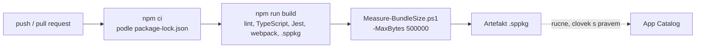

# CI/CD a quality gates

> Typ: povinný · Den: 5 · Odhad: 75 min
> Tenant: — · Režim: hands-on, lokálně + GitHub
> Prostředí: [`../../environment.md`](../../environment.md) · Názvosloví: [`../../GLOSSARY.md`](../../GLOSSARY.md)

Všechno, co týden hlídal student ručně — lint, chybějící překlad, velikost balíčku — teď hlídá
pipeline při každém pushi. Build, který brána zastaví, se nedostane do App Catalogu.

## Cíle

- Napsat unit testy, které spustí `heft test` v rámci `npm run build`.
- Převést ruční kontroly týdne (parita lokalizace, limit velikosti) na automatické brány.
- Postavit GitHub Actions pipeline: install, build s testy, brána velikosti, artefakt `.sppkg`.
- Vysvětlit, proč pipeline v kurzu **nenasazuje** do tenantu.

## Výklad

### Co už build umí

`npm run build` = `heft test --clean --production && heft package-solution --production`.
Heft přitom spustí lint (ESLint 9), TypeScript, Jest a webpack. Jest běží nad zkompilovanými
testy `src/**/*.test.ts`:

| Test | Co hlídá | Vazba na týden |
|---|---|---|
| `src/utils/links.test.ts` | `parseLinks` a `validateLinks` (5 testů) | den 2, property pane |
| `src/loc.test.ts` | každý klíč z `mystrings.d.ts` je ve všech `loc/*.js` (10 testů) | den 1–2: chybějící klíč je `undefined` |

> [!IMPORTANT] Chybějící překlad teď zastaví build — změřeno (2026-10-16)
> Referenční řešení: 15 testů, 15 úspěšných. Po smazání klíče `Greeting` z `cs-cz.js`:
> `FAIL lib-commonjs\loc.test.js (9 passed, 1 failed)`, výstup ukáže chybějící `"Greeting"`,
> `npm run build` skončí kódem 1.
>
> **Co lze zkontrolovat strojem, nepatří do code review ani do ručního testu.**

Test lokalizace čte soubory z disku (`fs`) — běží v Node.js, ne v prohlížeči. Rig SPFx ale
kompiluje i testy jako kód pro prohlížeč (ES5, bez typů Node.js), proto test potřebuje
`@types/node` v `devDependencies` a `/// <reference types="node" />`.

### Brána velikosti

Skript [`Measure-BundleSize.ps1`](../../scripts/Measure-BundleSize.ps1) z bloku
`bundle-baseline` umí `-MaxBytes`: když je kterýkoli bundle (web part, extension, chunk) větší,
skončí kódem 1 a pipeline spadne. Limit 500 000 B v referenčním řešení propustí Evidenci
(455 475 B); limit 400 000 B ji zastaví.

### Pipeline

`.github/workflows/build.yml` v řešení používá `actions/checkout@v7`, `actions/setup-node@v7`
(Node.js 22, cache npm) a `actions/upload-artifact@v7` (verze k 2026-10-16). `npm ci` vyžaduje
commitnutý `package-lock.json` — a díky němu má pipeline přesně stejné verze balíčků jako
vývojář.

### Proč pipeline nenasazuje

Automatické nasazení do App Catalogu znamená, že pipeline má **oprávnění měnit tenant
zákazníka** — typicky registraci aplikace s certifikátem v tenantu a tajemství v CI. To je
rozhodnutí o bezpečnosti, ne o pohodlí: kdo ovládne pipeline, nasadí kód do tenantu. V kurzu
pipeline končí artefaktem a nasazuje člověk (den 3–4). Automatické nasazení se dělá CLI for
Microsoft 365 nebo PnP PowerShell s app-only přihlášením — až po dohodě se správcem tenantu.

### Azure DevOps

| | GitHub Actions | Azure DevOps Pipelines |
|---|---|---|
| Definice | `.github/workflows/*.yml` | `azure-pipelines.yml` |
| Node.js | `actions/setup-node` | úloha `NodeTool` / `UseNode` |
| Artefakt | `actions/upload-artifact` | `PublishPipelineArtifact` |
| Kroky buildu | stejné (`npm ci`, `npm run build`, skript) | stejné |

Zdroj: [Build pipelines for SPFx with Azure DevOps](https://learn.microsoft.com/en-us/sharepoint/dev/spfx/toolchain/implement-ci-cd-with-azure-devops).

## Klíčové rozlišení

- **`npm install` vs. `npm ci`** — první může změnit lockfile, druhý ho jen čte.
- **Brána vs. report** — brána build zastaví (exit kód), report jen informuje.
- **Build v pipeline vs. nasazení z pipeline** — artefakt nic nemění; nasazení mění tenant.

## Naše prostředí

- GitHub účet studenta (otevřená položka v [`../../environment.md`](../../environment.md)).
  Bez něj: celý lab lokálně (kroky 1–4), pipeline jako demo lektora.
- Na `ubuntu-latest` je PowerShell 7 předinstalovaný — skript běží beze změny.

## Lab

Viz [`lab-pipeline.md`](lab-pipeline.md).

## Nosná linka

Řešení má **automatické brány**: unit testy logiky odkazů, test parity překladů a limit
velikosti balíčku. Ruční kontroly z dnů 1–4 se staly kódem.

## Zdroje (Microsoft)

- [Heft-based toolchain](https://learn.microsoft.com/en-us/sharepoint/dev/spfx/toolchain/sharepoint-framework-toolchain-rushstack-heft)
- [Implement CI/CD with Azure DevOps](https://learn.microsoft.com/en-us/sharepoint/dev/spfx/toolchain/implement-ci-cd-with-azure-devops)
- [Understanding npm audit vulnerabilities in SPFx projects](https://learn.microsoft.com/en-us/sharepoint/dev/spfx/npm-vulnerabilities)

## Zdroje (třetí strana — GitHub Actions)

> [!IMPORTANT] Proč odkaz mimo Learn
> GitHub Actions dokumentuje GitHub.

- [GitHub Actions — workflow syntax](https://docs.github.com/en/actions/writing-workflows/workflow-syntax-for-github-actions)

## Stav produktu / delta

> [!WARNING] Ověřit k datu běhu — stav k 2026-10.
> Hlavní verze akcí (`@v7` k 2026-10-16) a dostupnost PowerShell 7 na `ubuntu-latest`.
> Pipeline **neověřena na GitHubu** — lokálně ověřeny všechny její kroky.
