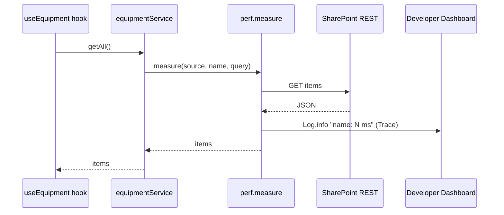
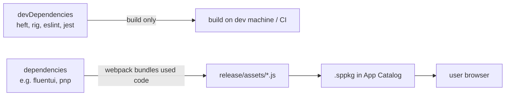

# Diagnostika a hardening

> Typ: povinný · Den: 5 · Odhad: 45 min
> Tenant: `cloudedu.cz` · Režim: hands-on, vlastní web
> Prostředí: [`../../environment.md`](../../environment.md) · Názvosloví: [`../../GLOSSARY.md`](../../GLOSSARY.md)

Řešení funguje. Teď musí být provozovatelné: když se něco pokazí, chceme to vidět, a jedna
chyba nesmí shodit stránku. A než ho dostane zákazník, projde kontrolou: závislosti, licence,
co je v kódu vidět a kam tečou data.

## Cíle

- Logovat přes `Log` z SPFx a číst výstup v Developer Dashboardu.
- Měřit dobu volání API přes performance marks.
- Zabránit tomu, aby chyba vykreslení jednoho web partu rozbila stránku (error boundary).
- Zkontrolovat závislosti (`npm audit`, licence) a výstup buildu (adresy mimo tenant,
  tajemství) a umět výsledek obhájit.

## Výklad

### Logování a Developer Dashboard

`Log.verbose/info/warn/error(source, message)` z `@microsoft/sp-core-library` zapisuje do
záložky **Trace** v Developer Dashboardu (**Ctrl+F12** na moderní stránce i ve workbenchi).
Dashboard má i záložku **Performance** (čas načtení, inicializace a vykreslení každé
komponenty) a **Manifests** (verze a URL načtených komponent).

Dvě omezení z dokumentace:

- zprávy existují **jen v dashboardu a jen do obnovení stránky** — pro produkci je potřeba
  jiné řešení (dokumentace jmenuje Azure Application Insights),
- `source` se ořízne na 20 znaků (proto `VltavaDirectory`, ne `EmployeeDirectoryWebPart`).

Zdroje: [Use the developer dashboard](https://learn.microsoft.com/en-us/sharepoint/dev/spfx/use-developer-dashboard),
[Log class](https://learn.microsoft.com/en-us/javascript/api/sp-core-library/log?view=sp-typescript-latest).

### Log: úrovně, zdroj a co se ořízne

`Log` je podle reference „jednoduchý přesměrovatelný logovací systém" se čtyřmi úrovněmi;
zdroj a úroveň pomáhají zprávy rozlišit a filtrovat. V SPFx aplikaci všechny čtyři skončí na
záložce **Trace** ([Log class](https://learn.microsoft.com/en-us/javascript/api/sp-core-library/log?view=sp-typescript-latest)):

| Metoda | Kdy ji použít | V `vltava-portal` |
|---|---|---|
| `Log.verbose(source, message, scope?)` | podrobnosti jen pro ladění | — |
| `Log.info(source, message, scope?)` | běžná událost | doba volání API v `src/utils/perf.ts` |
| `Log.warn(source, message, scope?)` | něco nečekaného, ale funkce běží dál | — |
| `Log.error(source, error, scope?)` | chyba; druhý parametr je objekt `Error`, ne text | `componentDidCatch` v `ErrorBoundary` |

Dvě ořezání z reference:

- `source` delší než **20 znaků** se zkrátí na prvních 20,
- `message` delší než **100 znaků** se zkrátí na prvních 100.

Proto `perf.ts` zapisuje jen `název: N ms` a ne celou odpověď API. Volitelný `scope`
(`ServiceScope`) přidá kontext komponenty — řešení ho nepředává, zdroj stačí k rozlišení
web partů.

Typické chyby:

- **Zpráva bez konce.** Dlouhý text nebo JSON se ořízne na 100 znaků; podstatné patří na
  začátek.
- **Osobní data v logu.** Dnes se log zobrazí jen v dashboardu, ale jakmile se `Log` přesměruje
  do telemetrie, odchází všechno, co se loguje. Jméno, e-mail ani obsah položky do zprávy
  nepatří ani teď.
- **Hledání logu po obnovení stránky.** Zprávy žijí jen do obnovení — zopakuj akci s otevřeným
  dashboardem.

> [!IMPORTANT] Produkční telemetrie = data mimo tenant
> Application Insights nebo jakákoli jiná telemetrie posílá data z prohlížeče uživatele do
> služby mimo SharePoint. Čí je to služba, kde fyzicky běží a co se do ní posílá (jména, URL
> stránek, chyby s daty), je rozhodnutí zákazníka — ne vývojáře. Řešení `vltava-portal`
> produkční telemetrii nemá.

### Performance marks

`src/utils/perf.ts` obalí volání API dvojicí `performance.mark` a `performance.measure`. Měření
je vidět v prohlížeči (F12 → **Performance** → *Timings*) a doba se zapíše přes `Log.info`
do dashboardu. Měří se volání Graphu (`vltava-graph-users`) a načtení seznamu
(`vltava-equipment-load`) — ne cache, ta do měřené funkce nedojde.

Jak to v kódu teče — služba obalí jen samotný dotaz, ne mapování ani vykreslení:

```typescript
// src/services/equipmentService.ts
return await measure('VltavaEquipment', 'vltava-equipment-load', () => query<IEquipmentItem[]>());
```

```typescript
// src/utils/perf.ts (shortened)
performance.mark(start);
try {
  return await action();
} finally {
  // runs on success AND on failure: a failed call is measured too
  performance.mark(end);
  performance.measure(name, start, end);
  Log.info(source, `${name}: ${Math.round(duration)} ms`);
}
```



Dvě různá měření, která se snadno pletou:

| | Záložka **Performance** v Developer Dashboardu | `measure()` z `perf.ts` |
|---|---|---|
| Kdo měří | SPFx, pro každou komponentu na stránce | náš kód, jen kde ho zavoláme |
| Co měří | čekání na server, načtení modulu, inicializaci, načtení dat, vykreslení | jedno konkrétní volání API |
| Kde to vidím | dashboard → Performance | dashboard → Trace a F12 → Performance → *Timings* |

Fáze životního cyklu komponenty podle
[Use the developer dashboard](https://learn.microsoft.com/en-us/sharepoint/dev/spfx/use-developer-dashboard).
Záložka Performance odpoví „který web part zdržuje stránku", `measure()` odpoví „které volání
uvnitř web partu".

Jedno číslo není měření: doba volání API se mezi pokusy liší (síť, cache serveru, první volání
po přihlášení). Do `HARDENING.md` nebo do obhajoby patří několik opakování, datum a kde se
měřilo — viz [`../../CONVENTIONS.md`](../../CONVENTIONS.md#nic-netvrdit-bez-měření).

### Error boundary

`src/components/ErrorBoundary.tsx` je třídní komponenta s `getDerivedStateFromError`
a `componentDidCatch`. Obaluje komponentu každého web partu: když vykreslení vyhodí výjimku,
uživatel uvidí srozumitelnou hlášku místo prázdného místa a chyba jde do `Log.error`.

Error boundary **nechytá** chyby v obsluze událostí a v `Promise` — ty řeší služby a hooky
(`useEquipment`, `useEmployees`), které mají vlastní chybové stavy.

### Kam v řešení dopadne která chyba

Princip: React bez error boundary při chybě **vykreslení** odstraní celé UI pod kořenem.
Boundary zachytí chybu vzniklou při vykreslování svých **potomků** a ukáže náhradní obsah.
React výslovně uvádí, co boundary **nechytá**
([react.dev — Component](https://react.dev/reference/react/Component#catching-rendering-errors-with-an-error-boundary)):

- obsluhu událostí (`onClick`, `onChange`),
- asynchronní kód (`setTimeout`, `requestAnimationFrame` — a stejně tak pokračování `Promise`),
- vykreslování na serveru,
- chybu v boundary samotné.

Funkční komponentou boundary napsat nejde — proto je `ErrorBoundary.tsx` jediná třídní
komponenta v řešení. `getDerivedStateFromError` má být čistá funkce (jen vrátí nový stav);
vedlejší efekt jako `Log.error` patří do `componentDidCatch`.

| Kde chyba vznikne | Příklad ve Výdejně | Kdo ji zachytí | Co uživatel uvidí |
|---|---|---|---|
| při vykreslení komponenty | výjimka v `render` (lab, krok 3: `boom`) | `ErrorBoundary` | hlášku `RenderError` místo web partu, ostatní web party běží |
| v načítání dat | seznam `EquipmentLoans` chybí (404) | `useLoans` → `error` / `listMissing` | `MessageBar` s odkazem na seznam |
| v obsluze kliknutí | **Vrátit** selže na síti | `onReturn` v `EquipmentDesk.tsx` → `actionError` | `MessageBar` nad záložkami |
| v `onInit` web partu | `getClient('3')` selže | nikdo z našeho kódu | chování určuje SPFx — **neověřeno** |

Jak chybu v návrhu poznat: obsluha události nebo `Promise` bez `catch`, která počítá s tím, že
„to chytí boundary". Nechytí. V development buildu Reactu se navíc chyby zachycené
`componentDidCatch` dostanou až do `window.onerror`, v produkčním ne (react.dev, tamtéž). Který
build Reactu SPFx na stránce načítá při ladění a který v provozu, je pro kurz **neověřeno**.

> [!IMPORTANT] Hláška přes Fluent `MessageBar` by Rozcestníku přidala 8 KB — změřeno (2026-10-16)
> Rozcestník s error boundary: s `MessageBar` +8 346 B, s prostým `<div role="alert">` a CSS
> modulem **+647 B**. Data: [`mereni-hardening.md`](mereni-hardening.md).
>
> **I kód pro chybový stav je kód v balíčku — sdílené komponenty piš bez těžkých závislostí.**

### Hardening: čtyři kontroly před předáním

| Kontrola | Jak | Výsledek referenčního řešení (2026-10-16) |
|---|---|---|
| Zranitelnosti | `npm audit` a `npm audit --omit=dev` | 54 (33 moderate, 21 high) — **všechny ve vývojových závislostech**; produkční 0 |
| Licence produkčních závislostí | `npm sbom --sbom-format cyclonedx --omit dev` | 171 komponent: 138 MIT, 6 0BSD, 2 Apache-2.0, 1 BSD-2-Clause; 24 bez SPDX — balíčky SPFx (Microsoft EULA) a `raw-loader` |
| Adresy v bundlu | hledání `https://` v `release/assets/*.js` | `res-1.cdn.office.net` (výchozí adresa fontů Fluent UI), `pnp.github.io` a `github.com` jen v textech chybových hlášek |
| Tajemství v kódu | hledání klíčů, tokenů, hesel v `src` a bundlu | žádná |

K zranitelnostem toolchainu dokumentace SPFx říká, že balíčky pro build a ladění **nejsou
součástí `.sppkg`**, takže se nedostanou k uživatelům
([npm audit vulnerabilities in SPFx](https://learn.microsoft.com/en-us/sharepoint/dev/spfx/npm-vulnerabilities)).
`npm audit fix` v SPFx projektu se nespouští — aktualizuje balíčky mimo testovanou sadu.

### Jak číst `npm audit` v SPFx projektu

`npm audit` porovná **celý** strom závislostí — včetně tranzitivních — s databází známých
zranitelností a u každého nálezu ukáže balíček, závažnost a cestu, kudy se do projektu dostal
([npm audit vulnerabilities in SPFx](https://learn.microsoft.com/en-us/sharepoint/dev/spfx/npm-vulnerabilities)).
Learn k tomu dodává fakt o architektuře: `node_modules` zůstává na vývojářském stroji a do
`.sppkg` jdou jen zabalené bundly, manifest a assety.

Z toho plyne rozdělení, které dělá `--omit=dev`:



- Nález **jen ve vývojových** závislostech (referenční řešení: všech 54) ohrožuje stroj, na
  kterém běží build — ne uživatele. Řeší ho nová verze SPFx, ne ruční zásah.
- Nález v **produkčních** závislostech (`npm audit --omit=dev`) je jiná kategorie: kód
  produkčních závislostí, který webpack zabalí (u `vltava-portal` např. Fluent UI a PnPjs),
  běží v prohlížeči uživatele. Tohle číslo patří do zápisu pro
  zákazníka — v referenčním řešení 0.

Kdy podle Learn nález zkoumat: když projekt přidal balíčky **nad rámec** výchozích závislostí
SPFx, když je zranitelný balíček přímá závislost pod kontrolou projektu, nebo když to vyžaduje
bezpečnostní politika organizace. Opravu tranzitivních závislostí SPFx doručí až další verze
SPFx — proto je odpověď na nález v toolchainu „počkat na release a zdokumentovat", ne `overrides`
na vlastní pěst. (`overrides` v `package.json` generátoru dělá Microsoft — viz `spfx-whats-next`.)

### Content Security Policy: co prohlížeč smí načíst

CSP je hlavička, kterou SharePoint Online posílá prohlížeči: seznam míst, odkud stránka smí
načítat skripty. Skript z jiného místa prohlížeč nenačte a chybu zapíše do konzole; SharePoint
porušení zapisuje také do auditu v Microsoft Purview (aktivita *Violated Content Security
Policy*) ([Support for CSP in SharePoint Online](https://learn.microsoft.com/en-us/sharepoint/dev/spfx/content-securty-policy-trusted-script-sources)).

| Jak řešení načítá skript | Dopad CSP podle Learn | `vltava-portal` |
|---|---|---|
| bundly uvnitř `.sppkg` (`includeClientSideAssets: true`, výchozí) | žádný — SharePoint je povolený zdroj | **ano** |
| vlastní CDN (`cdnBasePath`) nebo `externals` | SharePoint přidá adresu do *Trusted script sources* při instalaci | ne |
| `SPComponentLoader.loadScript` z cizí adresy | nutná ruční položka v *Trusted script sources* | ne |
| inline skript (`<script>`, `onclick="..."`, `innerHTML` se `<script>`) | **zablokuje se**; řešení je přesunout kód do souboru | ne |

Kontrola v kódu (stav 2026-10-23, `equipment-desk/solution`): `src/` neobsahuje
`SPComponentLoader`, `dangerouslySetInnerHTML` ani `innerHTML` — banner výslovně používá
`textContent`. Ověřit na stránce jde parametrem `?csp=enforce` v URL: stránka se chová, jako by
CSP blokoval, a porušení jsou v konzoli.

> [!WARNING] Ověřit k datu běhu — stav k 2026-10.
> Stránka Learn (ms.date 2026-05-08) uvádí začátek vynucení CSP **1. března 2026** (odklad
> nejdéle do 1. června 2026), na jiném místě ale „zatím se nic neblokuje". Skutečný stav na
> kurzovním tenantu **neověřen** — zkontrolovat konzoli na stránce s Výdejnou.

> [!IMPORTANT] Všechno v `.sppkg` si může přečíst každý uživatel
> Bundle je JavaScript, který si stáhne prohlížeč. Klíč k API, heslo nebo connection string
> v kódu SPFx řešení **není tajemství** — je to veřejný text. Tajemství patří na server
> (Azure Function za AadHttpClient), ne do web partu.

### Runtime baseline místo polyfillů

Rig SPFx kompiluje **náš** kód do ES5 (`"target": "es5"` v `tsconfig-base.json` rigu).
Webpack ale **nepřekládá závislosti** — PnPjs 4 přichází jako moderní JavaScript (`async`,
`Reflect`) a v bundlu tak zůstane. Skutečné minimum prohlížeče tedy určují závislosti, ne
`tsconfig`. SharePoint Online sám vyžaduje moderní prohlížeč — IE 11 je blokovaný
([self-study](../../self-study.md)) — takže polyfilly nemají cíl.

## Klíčové rozlišení

- **Log vs. telemetrie** — `Log` je ladicí nástroj na jednu stránku; telemetrie je služba
  s daty mimo tenant.
- **Chyba vykreslení vs. chyba volání** — první chytí error boundary, druhou hook/služba.
- **Vývojová vs. produkční zranitelnost** — `npm audit --omit=dev` říká, co jde k uživateli.
- **Konfigurace vs. tajemství** — URL a text oznámení smí být v balíčku, klíč nikdy.
- **Performance v dashboardu vs. `measure()`** — první měří životní cyklus komponent, druhé
  jedno konkrétní volání.
- **Skript z `.sppkg` vs. skript odjinud** — první CSP propustí, druhý potřebuje povolený
  zdroj, inline skript neprojde vůbec.

## Naše prostředí

Diagnostika na workbenchi/stránce vlastního webu; hardening lokálně nad buildem.

## Lab

Viz [`lab-diagnostika.md`](lab-diagnostika.md).

## Nosná linka

Řešení je **provozovatelné**: loguje do dashboardu, měří volání API, jedna chyba nerozbije
stránku a existuje zápis kontroly závislostí a toku dat, který lze předat zákazníkovi.

Stav po dni 5: [`solution/vltava-portal/`](solution/vltava-portal/).

## Zdroje (Microsoft)

- [Use the developer dashboard](https://learn.microsoft.com/en-us/sharepoint/dev/spfx/use-developer-dashboard)
- [Log class (sp-core-library)](https://learn.microsoft.com/en-us/javascript/api/sp-core-library/log?view=sp-typescript-latest)
- [Understanding npm audit vulnerabilities in SPFx projects](https://learn.microsoft.com/en-us/sharepoint/dev/spfx/npm-vulnerabilities)
- [Support for Content Security Policy (CSP) in SharePoint Online](https://learn.microsoft.com/en-us/sharepoint/dev/spfx/content-securty-policy-trusted-script-sources)

## Zdroje (třetí strana — React, npm)

> [!IMPORTANT] Proč odkaz mimo Learn
> Error boundaries dokumentuje React, `npm sbom` dokumentuje npm.

- [React — catching rendering errors with an error boundary](https://react.dev/reference/react/Component#catching-rendering-errors-with-an-error-boundary)
- [npm sbom](https://docs.npmjs.com/cli/v10/commands/npm-sbom)

## Stav produktu / delta

> [!WARNING] Ověřit k datu běhu — stav k 2026-10.
> Výsledky `npm audit` se mění s každým novým advisory — zopakovat v den běhu. Release notes
> 1.23.2 (2026-06-30) uváděly opravené critical a high zranitelnosti; k 2026-10-16 audit hlásí
> 21 high v nástrojích buildu.
