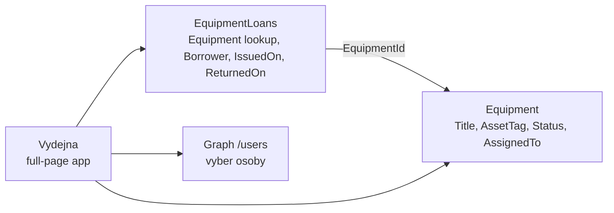

# Výdejna vybavení — samostatný lab

> Typ: povinný · Den: 5 · Odhad: 120 min
> Tenant: `cloudedu.cz` · Režim: hands-on, vlastní web, **samostatně podle kroků**
> Prostředí: [`../../environment.md`](../../environment.md) · Názvosloví: [`../../GLOSSARY.md`](../../GLOSSARY.md)

Nejdelší blok dne a jediný, kde lektor nepředvádí. Student sám postaví aplikaci, kterou si
IT Vltava Servis otevře jako samostatnou stránku: vydá notebook kolegovi z adresáře, vidí, kdo
co má, a vrácení zapíše do historie. Lab skládá dohromady to, co týden naučil — PnPjs (D3),
Graph a `useEmployees` (D3), Fluent UI (D2), nasazení a upgrade verze (D4) — a přidává jednu
novou věc: **dva seznamy spojené lookupem**.

Předloha: krok 4 (*Tree*) z [learn-spfx-growth](https://github.com/MalasekPetr/learn-spfx-growth),
přenesený do scénáře kurzu a opravený (viz *Klíčové rozlišení*).

## Cíle

- Vytvořit druhý seznam s lookup sloupcem skriptem a číst ho přes PnPjs s `expand`.
- Rozlišit, co se u lookupu čte (`Equipment/Title`) a co se zapisuje (`EquipmentId`).
- Postavit full-page aplikaci s Pivot záložkami, `DetailsList` a formulářem v `Panel`.
- Zapsat jednu obchodní operaci (výdej, vrácení) do dvou seznamů a vědět, proč to není transakce.
- Změřit, kolik nová aplikace přidala do balíčku, a nasadit ji jako verzi 1.2.0.0.

## Výklad

### Dva seznamy, jedna vazba

`Equipment` říká **stav teď** (kdo má notebook). `EquipmentLoans` říká **historii** (kdo ho měl
od kdy do kdy). Výpůjčka bez `ReturnedOn` je otevřená. Lookup sloupec `Equipment` ukládá ID
položky ze seznamu `Equipment` a zobrazuje její `Title`.

### Lookup: čte se objekt, zapisuje se číslo

| | REST / PnPjs | v kódu |
|---|---|---|
| čtení | `.select('EquipmentId', 'Equipment/Title').expand('Equipment')` | `loan.Equipment?.Title` |
| zápis | `{ EquipmentId: 7 }` | jen ID, `Title` se nezapisuje |

Stejný vzor znáte z `AssignedTo` (osoba je lookup na seznam uživatelů webu): čte se
`AssignedTo/Title`, zapisuje `AssignedToId`
([Working with lists and list items with REST](https://learn.microsoft.com/en-us/sharepoint/dev/sp-add-ins/working-with-lists-and-list-items-with-rest)).

### Výdej = dva zápisy, ne transakce

Výdej přidá řádek do `EquipmentLoans` **a** změní `Status` v `Equipment`. Oba zápisy jdou jedním
`$batch` požadavkem (stejně jako `setStatus` v D3), ale **batch není transakce**: každá operace
v něm uspěje nebo selže sama. Když jedna selže, data jsou napůl. Lab to neřeší — capstone
se na to ptá (jak byste to řešili: kontrola a oprava, Power Automate, vlastní API?).

### Full-page aplikace

Manifest s `"supportedHosts": [..., "SharePointFullPage"]` umožní vytvořit stránku, která
obsahuje **jen** tento web part — bez sekcí a bez editace
([Single part app pages](https://learn.microsoft.com/en-us/sharepoint/dev/spfx/web-parts/single-part-app-pages)).
Pro aplikaci typu „výdejna" je to přirozenější než web part na stránce.

## Klíčové rozlišení

- **Lookup vs. kopie textu** — lookup drží ID; přejmenování notebooku se projeví v historii.
  Kopie názvu by v historii zůstala stará.
- **Filtr vs. oprávnění** — filtr „jen moje oddělení" (bonus) je pohodlí v UI, ne bezpečnost:
  kdo má k seznamu přístup, přečte ho přímo přes REST. Hranici dělají jen oprávnění seznamu.
  Předloha learn-spfx-growth to vydává za security trimming — chybně.
- **`$batch` vs. transakce** — jeden HTTP požadavek, ne „všechno, nebo nic".

## Naše prostředí

- Seznam `EquipmentLoans` vzniká skriptem `scripts/New-EquipmentLoansList.ps1` na **vlastním**
  webu `spodev-<ini>`, vedle `Equipment` z dne 3. Bez `Equipment` skript skončí chybou.
- Výběr osoby používá Graph `/users` a schválené `User.Read.All` z dne 3 — nic nového se
  neschvaluje.
- Nasazení: verze **1.2.0.0** do tenantového App Catalogu, upgrade aplikace na vlastním webu
  (postup z `packaging-deployment`, D4).

## Lab

Viz [`lab-vydejna-vybaveni.md`](lab-vydejna-vybaveni.md). Hotové soubory:
[`solution/vltava-portal/`](solution/vltava-portal/) (verze 1.2.0.0, 17 testů,
`equipment-desk-web-part` 469 664 B, změřeno 2026-10-23, MALACH-PC04).

## Nosná linka

Řešení dostane šestou komponentu — web part **EquipmentDesk**, nasazený jako full-page
aplikace — a druhý seznam `EquipmentLoans`. Command Set **Vydat zařízení** z dne 4 začne
zapisovat výpůjčku také, takže historie sedí, ať se vydává odkudkoli.

## Zdroje (Microsoft)

- [Working with lists and list items with REST](https://learn.microsoft.com/en-us/sharepoint/dev/sp-add-ins/working-with-lists-and-list-items-with-rest)
- [Single part app pages](https://learn.microsoft.com/en-us/sharepoint/dev/spfx/web-parts/single-part-app-pages)
- [Use @pnp/sp (PnPjs) with SPFx web parts](https://learn.microsoft.com/en-us/sharepoint/dev/spfx/web-parts/guidance/use-sp-pnp-js-with-spfx-web-parts)

## Stav produktu / delta

> [!WARNING] Ověřit k datu běhu — stav k 2026-10.
> Referenční řešení prochází `npm run build` (SPFx 1.23.2). Na tenantu **neověřeno**: lookup
> přes skript, full-page aplikace, Teams tab (bonus).
