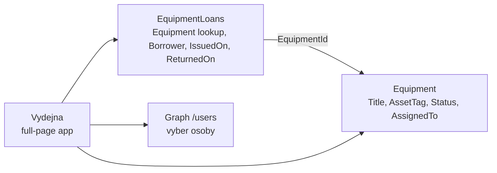
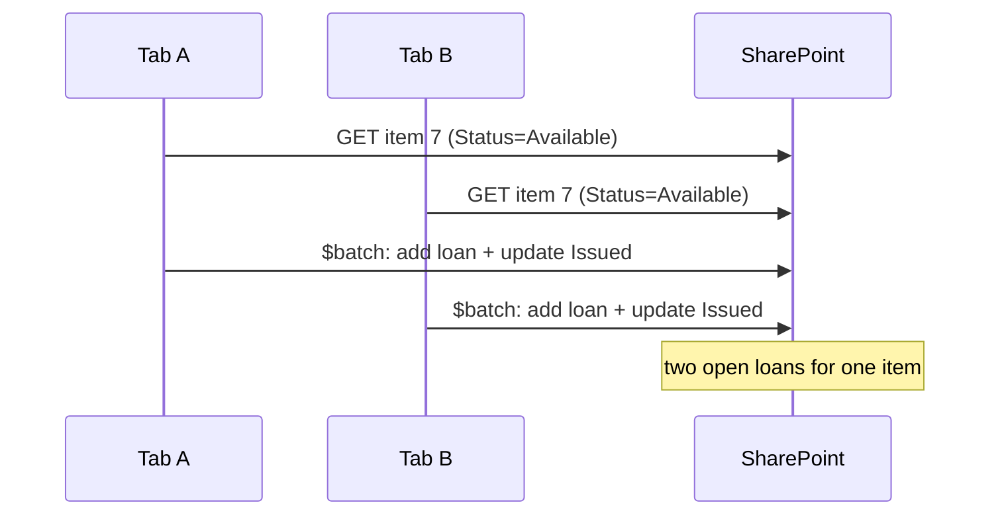

# Výdejna vybavení — samostatný lab

> Typ: povinný · Den: 5 · Odhad: 120 min
> Tenant: `cloudedu.cz` · Režim: hands-on, vlastní web, **samostatně podle kroků**
> Prostředí: [`../../environment.md`](../../environment.md) · Názvosloví: [`../../GLOSSARY.md`](../../GLOSSARY.md)

Nejdelší blok dne a jediný, kde lektor nepředvádí. Student sám postaví aplikaci, kterou si
IT Vltava Servis otevře jako samostatnou stránku: vydá notebook kolegovi z adresáře, vidí, kdo
co má, a vrácení zapíše do historie. Lab skládá dohromady to, co týden naučil — PnPjs (D3),
Graph a `useEmployees` (D3), Fluent UI (D2), nasazení a upgrade verze (D4) — a přidává jednu
novou věc: **dva seznamy spojené lookupem**.

Předloha: krok 4 (*Tree*) z [learn-spfx-growth](https://github.com/MalasekPetr/learn-spfx-growth),
přenesený do scénáře kurzu a opravený (viz *Klíčové rozlišení*).

## Cíle

- Vytvořit druhý seznam s lookup sloupcem skriptem a číst ho přes PnPjs s `expand`.
- Rozlišit, co se u lookupu čte (`Equipment/Title`) a co se zapisuje (`EquipmentId`).
- Postavit full-page aplikaci s Pivot záložkami, `DetailsList` a formulářem v `Panel`.
- Zapsat jednu obchodní operaci (výdej, vrácení) do dvou seznamů a vědět, proč to není transakce.
- Změřit, kolik nová aplikace přidala do balíčku, a nasadit ji jako verzi 1.2.0.0.

## Výklad

### Dva seznamy, jedna vazba

`Equipment` říká **stav teď** (kdo má notebook). `EquipmentLoans` říká **historii** (kdo ho měl
od kdy do kdy). Výpůjčka bez `ReturnedOn` je otevřená. Lookup sloupec `Equipment` ukládá ID
položky ze seznamu `Equipment` a zobrazuje její `Title`.

### Lookup: čte se objekt, zapisuje se číslo

| | REST / PnPjs | v kódu |
|---|---|---|
| čtení | `.select('EquipmentId', 'Equipment/Title').expand('Equipment')` | `loan.Equipment?.Title` |
| zápis | `{ EquipmentId: 7 }` | jen ID, `Title` se nezapisuje |

Stejný vzor znáte z `AssignedTo` (osoba je lookup na seznam uživatelů webu): čte se
`AssignedTo/Title`, zapisuje `AssignedToId`
([Working with lists and list items with REST](https://learn.microsoft.com/en-us/sharepoint/dev/sp-add-ins/working-with-lists-and-list-items-with-rest)).

### Výdej = dva zápisy, ne transakce

Výdej přidá řádek do `EquipmentLoans` **a** změní `Status` v `Equipment`. Oba zápisy jdou jedním
`$batch` požadavkem (stejně jako `setStatus` v D3), ale **batch není transakce**: každá operace
v něm uspěje nebo selže sama. Když jedna selže, data jsou napůl. Lab to neřeší — capstone
se na to ptá (jak byste to řešili: kontrola a oprava, Power Automate, vlastní API?).

Learn to říká bez výjimky: REST API SharePointu **nejsou transakční** a nepodporují „všechno,
nebo nic" ani pro ChangeSet s více operacemi — když jedna operace selže, ostatní se dokončí
a nevrátí se zpět
([Make batch requests with the REST APIs](https://learn.microsoft.com/en-us/sharepoint/dev/sp-add-ins/make-batch-requests-with-the-rest-apis)).
Proto `useLoans` načítá data znovu i po neúspěchu (`setVersion` ve `finally`): napůl provedený
výdej musí být vidět, ne schovaný za chybovou hláškou.

### Souběžný výdej: znovu přečíst nestačí

`issue()` v `loanService` nejdřív znovu přečte stav kusu a teprve pak zapisuje. To odhalí
starou stránku (lab, krok 10 — druhá záložka klikne **po** dokončení první). Neodhalí ale dva
výdeje, které se **překryjí**: obě záložky přečtou `Available` dřív, než kterákoli zapíše, a obě
pak zapíšou výpůjčku.

Správný nástroj je **optimistická souběžnost**: zápis s hlavičkou `If-Match` a hodnotou ETag
z přečtené verze. Když se položka mezitím změnila, SharePoint vrátí **412** a nezapíše nic;
bez ETag nebo s `"*"` přepíše položku bez ohledu na verzi
([Working with lists and list items with REST](https://learn.microsoft.com/en-us/sharepoint/dev/sp-add-ins/working-with-lists-and-list-items-with-rest)).
PnPjs to umí druhým parametrem `update(properties, eTag)` — výchozí hodnota je `"*"`, takže
kód řešení dnes kontrolu verze **vypíná**. Podrobný rozbor, proč podmíněný zápis nesmí být
uvnitř stejného `$batch` a v jakém pořadí zápisy dělat:
[`explainer-concurrency-etag.md`](explainer-concurrency-etag.md).

### Oprávnění: jediná hranice, která platí

SPFx kód běží **v kontextu přihlášeného uživatele** a jeho připojení v prohlížeči, bez iframe
([Overview of the SharePoint Framework](https://learn.microsoft.com/en-us/sharepoint/dev/spfx/sharepoint-framework-overview)).
Každý požadavek Výdejny je tedy požadavek uživatele s jeho oprávněními. Z toho plynou tři
pravidla:

- Co web part **neukáže** (filtr, skrytá záložka, vypnuté tlačítko), uživatel pořád může
  udělat přímo přes REST — stačí mu adresa z lab kroku 2. UI není bezpečnost.
- Co uživatel **nesmí**, mu musí zakázat SharePoint: oprávnění webu, seznamu nebo položky.
  Kdo smí vydávat, je otázka oprávnění k zápisu do `Equipment` a `EquipmentLoans`, ne kódu.
- Jemnější oprávnění mají cenu. Podporovaný limit unikátních oprávnění položek v jednom seznamu
  je 50 000, doporučený obecný limit 5 000; v seznamu nad 100 000 položek už nejde přerušit
  dědičnost na seznamu ani složce
  ([SharePoint limits](https://learn.microsoft.com/en-us/office365/servicedescriptions/sharepoint-online-service-description/sharepoint-online-limits)).
  Oprávnění „každá výpůjčka zvlášť" tedy není zadarmo — skupina na úrovni seznamu je levnější.

Jak chybu poznat v návrhu: věta „uživatel to nevidí, takže to nemůže změnit". Ověření: otevři
`_api/web/getList('.../Lists/EquipmentLoans')/items` přihlášený jako uživatel, kterému filtr
data skrývá.

### Limity seznamu, se kterými služba počítá

- **List view threshold** je ve výchozím stavu **5 000 položek**; operace, které zatěžují server
  nad tímto limitem, SharePoint Online odmítne
  ([list view threshold](https://learn.microsoft.com/en-us/troubleshoot/sharepoint/lists-and-libraries/items-exceeds-list-view-threshold)).
  Historie výpůjček roste každým výdejem — za rok provozu v reálné firmě se k limitu dostat
  může. Služba proto čte omezeně: `getOpen()` filtruje `ReturnedOn eq null` na serveru a bere
  `top(500)`, `getHistory()` jen posledních `top(100)`. Jak se filtr na neindexovaném sloupci
  chová nad 5 000 položkami a zda `ReturnedOn` potřebuje index, je pro tento kurz **neověřeno**.
- **Lookup ukazuje na seznam, ne na název.** Sloupec `Equipment` drží ID položky a cílový seznam
  musí existovat na stejném webu dřív než lookup (proto skript nejdřív kontroluje `Equipment`).
  Přesměrovat hotový lookup na jiný seznam nejde — postup je smazat a vytvořit znovu (lab,
  Fallback).
- **Počet lookupů v jednom dotazu — neověřeno.** Komunitní zdroje uvádějí limit počtu lookup
  sloupců (včetně osob) v jednom dotazu; existenci limitu ani jeho hodnotu pro SharePoint Online
  jsme na Learn neověřili. `LOAN_FIELDS` každopádně vybírá jen to, co UI potřebuje — dva
  rozbalené lookupy (`Equipment`, `Borrower`), ne `*`.

### Full-page aplikace

Manifest s `"supportedHosts": [..., "SharePointFullPage"]` umožní vytvořit stránku, která
obsahuje **jen** tento web part — bez sekcí a bez editace
([Single part app pages](https://learn.microsoft.com/en-us/sharepoint/dev/spfx/web-parts/single-part-app-pages)).
Pro aplikaci typu „výdejna" je to přirozenější než web part na stránce.

Jak to funguje podle Learn:

- `supportedHosts` s hodnotou `SharePointFullPage` zařadí web part do nabídky **Apps** při
  vytváření stránky (**New** → **Page**). Bez té hodnoty v nabídce není — první věc ke kontrole,
  když šablona chybí.
- Stránka má **zamčené rozvržení**: koncový uživatel ji v prohlížeči neupraví a hostuje jen
  jeden web part (nebo aplikaci Teams).
- Existující stránku jde přepnout i skriptem — PnP PowerShell `Set-PnPPage -LayoutType
  SingleWebPartAppPage` nebo CLI for Microsoft 365. V kurzu vždy s vlastním `-ClientId`, viz
  Fallback labu.

Podle Learn koncový uživatel stránku s tímto rozvržením nemůže upravit **ani konfigurovat** —
proto `EquipmentDesk` nemá žádné konfigurovatelné vlastnosti a oba seznamy hledá pevně
podle URL. Zamčené rozvržení je
ochrana **stránky** před úpravou, ne ochrana **dat**: data hlídají oprávnění seznamu (viz výše).

## Klíčové rozlišení

- **Lookup vs. kopie textu** — lookup drží ID; přejmenování notebooku se projeví v historii.
  Kopie názvu by v historii zůstala stará.
- **Filtr vs. oprávnění** — filtr „jen moje oddělení" (bonus) je pohodlí v UI, ne bezpečnost:
  kdo má k seznamu přístup, přečte ho přímo přes REST. Hranici dělají jen oprávnění seznamu.
  Předloha learn-spfx-growth to vydává za security trimming — chybně.
- **`$batch` vs. transakce** — jeden HTTP požadavek, ne „všechno, nebo nic".
- **Znovu přečíst vs. podmíněný zápis** — opakované čtení zmenší okno souběhu, `If-Match`
  s ETag ho zavře: zápis staré verze skončí 412.
- **Zamčená stránka vs. zamčená data** — full-page aplikace nejde editovat, ale seznam za ní
  je dostupný každému, kdo k němu má oprávnění.

## Naše prostředí

- Seznam `EquipmentLoans` vzniká skriptem `scripts/New-EquipmentLoansList.ps1` na **vlastním**
  webu `spodev-<ini>`, vedle `Equipment` z dne 3. Bez `Equipment` skript skončí chybou.
- Výběr osoby používá Graph `/users` a schválené `User.Read.All` z dne 3 — nic nového se
  neschvaluje.
- Nasazení: verze **1.2.0.0** do tenantového App Catalogu, upgrade aplikace na vlastním webu
  (postup z `packaging-deployment`, D4).

## Lab

Viz [`lab-vydejna-vybaveni.md`](lab-vydejna-vybaveni.md). Hotové soubory:
[`solution/vltava-portal/`](solution/vltava-portal/) (verze 1.2.0.0, 17 testů,
`equipment-desk-web-part` 469 664 B, změřeno 2026-10-23, MALACH-PC04).

## Nosná linka

Řešení dostane šestou komponentu — web part **EquipmentDesk**, nasazený jako full-page
aplikace — a druhý seznam `EquipmentLoans`. Command Set **Vydat zařízení** z dne 4 začne
zapisovat výpůjčku také, takže historie sedí, ať se vydává odkudkoli.

## Zdroje (Microsoft)

- [Working with lists and list items with REST](https://learn.microsoft.com/en-us/sharepoint/dev/sp-add-ins/working-with-lists-and-list-items-with-rest)
- [Single part app pages](https://learn.microsoft.com/en-us/sharepoint/dev/spfx/web-parts/single-part-app-pages)
- [Use @pnp/sp (PnPjs) with SPFx web parts](https://learn.microsoft.com/en-us/sharepoint/dev/spfx/web-parts/guidance/use-sp-pnp-js-with-spfx-web-parts)
- [Make batch requests with the REST APIs](https://learn.microsoft.com/en-us/sharepoint/dev/sp-add-ins/make-batch-requests-with-the-rest-apis)
- [Overview of the SharePoint Framework](https://learn.microsoft.com/en-us/sharepoint/dev/spfx/sharepoint-framework-overview)
- [SharePoint limits](https://learn.microsoft.com/en-us/office365/servicedescriptions/sharepoint-online-service-description/sharepoint-online-limits)
- [The number of items in this list exceeds the list view threshold](https://learn.microsoft.com/en-us/troubleshoot/sharepoint/lists-and-libraries/items-exceeds-list-view-threshold)

## Stav produktu / delta

> [!WARNING] Ověřit k datu běhu — stav k 2026-10.
> Referenční řešení prochází `npm run build` (SPFx 1.23.2). Na tenantu **neověřeno**: lookup
> přes skript, full-page aplikace, Teams tab (bonus).
