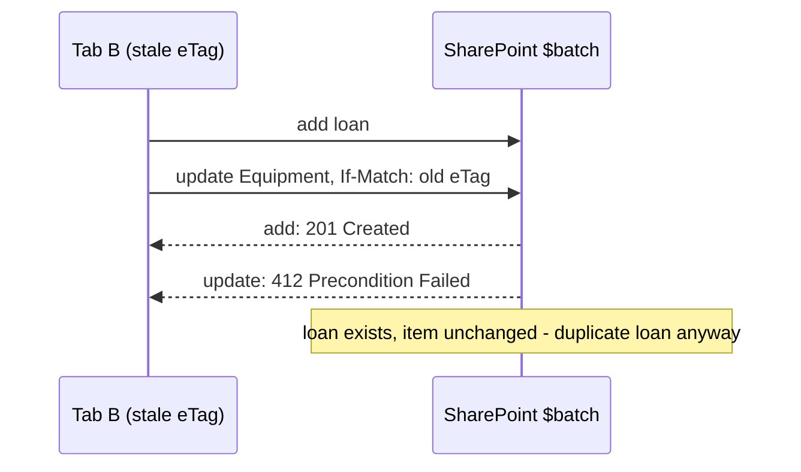

# Souběžný výdej a ETag

Deep-dive k [`README.md`](README.md), sekce *Souběžný výdej*. Rozbor jednoho mechanismu:
jak zabránit tomu, aby dva lidé vydali stejný kus. Kód níže je **návrh, není v `solution/`**
a na tenantu **neověřený** — referenční řešení zůstává u opětovného čtení.

## Co dnes dělá `issue()`

```typescript
// solution/vltava-portal/src/services/loanService.ts (shortened)
const item = await sp.web.getList(equipmentUrl).items.getById(equipmentId)
  .select('Id', 'Title', 'Status')<IEquipmentItem>();
if (item.Status !== 'Available') {
  throw new NotAvailableError(item.Title);
}
const user = await sp.web.ensureUser(email);

const [batchedSP, execute] = sp.batched();
const writes = [
  batchedSP.web.getList(loansUrl).items.add({ /* loan */ }),
  batchedSP.web.getList(equipmentUrl).items.getById(equipmentId)
    .update({ Status: 'Issued', AssignedToId: user.Id })   // no eTag -> "*"
];
await execute();
await Promise.all(writes);
```

Mezi čtením a zápisem leží okno: `ensureUser` (další HTTP požadavek) a odeslání `$batch`.
Kdo v tom okně zapíše stejný kus, toho kód nepozná — `update` bez ETag přepíše cokoli.

## Mechanismus: optimistická souběžnost

SharePoint REST používá u položek seznamu **ETag** — značku verze položky. Pravidla z Learn
([Working with lists and list items with REST](https://learn.microsoft.com/en-us/sharepoint/dev/sp-add-ins/working-with-lists-and-list-items-with-rest)):

| Hlavička `If-Match` při `MERGE`/`PUT`/`DELETE` | Výsledek |
|---|---|
| ETag, který odpovídá verzi na serveru | zápis proběhne |
| ETag, který neodpovídá (někdo mezitím zapsal) | **412**, nic se nezapíše |
| `"*"` | zápis proběhne bez ohledu na verzi |
| bez hlavičky | zápis proběhne bez ohledu na verzi |

„Optimistická" proto, že nic nezamyká: předpokládá, že kolize je vzácná, a když nastane,
odmítne druhý zápis místo toho, aby čekala.

V PnPjs 4.22.0 má `IItem` signaturu `update(properties, eTag?)`; komentář v typech balíčku
(`node_modules/@pnp/sp/items/types.d.ts`) říká: „Value used in the IF-Match header, by default
`"*"`". Řešení druhý parametr nepředává — kontrolu verze tedy nepoužívá.

## Past: podmíněný zápis uvnitř stejného `$batch`

Nabízí se přidat ETag do `update` v dávce a hotovo. Nefunguje to:



Operace v dávce **nejsou transakce**: když jedna selže, ostatní se dokončí a nevrátí se zpět
([Make batch requests with the REST APIs](https://learn.microsoft.com/en-us/sharepoint/dev/sp-add-ins/make-batch-requests-with-the-rest-apis)).
Výpůjčka tedy vznikne, i když podmíněný zápis do `Equipment` skončí 412.

## Správné pořadí: nejdřív podmíněný zápis, pak výpůjčka

Zápis do `Equipment` s ETag funguje jako **zámek**: projde jen jeden ze souběžných výdejů.
Výpůjčka se zapíše až po něm a jen když prošel.

```typescript
// PROPOSAL -- not in solution/, not verified on a tenant.
// readEtag(): where the ETag is available depends on the OData metadata level of the
// response -- check the GET in F12 Network before relying on it.
const item = await equipment.items.getById(equipmentId).select('Id', 'Title', 'Status')();
if (item.Status !== 'Available') {
  throw new NotAvailableError(item.Title);
}
const user = await sp.web.ensureUser(email);
try {
  // 1. The lock: only one concurrent writer gets past this line.
  await equipment.items.getById(equipmentId)
    .update({ Status: 'Issued', AssignedToId: user.Id }, readEtag(item));
} catch (e) {
  if (isHttpError(e) && e.status === 412) {
    throw new NotAvailableError(item.Title);   // someone else was faster
  }
  throw e;
}
// 2. Only the winner writes the loan.
await loans.items.add({ Title: item.Title, EquipmentId: equipmentId, BorrowerId: user.Id,
  IssuedOn: new Date().toISOString() });
```

Co se změnilo proti řešení:

| | Řešení kurzu (`$batch`) | Návrh (podmíněný zápis, pak výpůjčka) |
|---|---|---|
| HTTP požadavků na zápis | 1 | 2 |
| Dvě otevřené výpůjčky téhož kusu | možné při souběhu | vyloučené — druhý zápis dostane 412 |
| Co zbude po selhání druhého kroku | výpůjčka bez změny stavu, nebo naopak | kus *Issued* **bez** otevřené výpůjčky |

Napůl hotový stav nezmizel — žádné pořadí dvou netransakčních zápisů ho neodstraní. Změnilo
se, **jaký** napůl hotový stav může vzniknout: jen jeden, přesně ten, který hledá bonus B3 labu
(„`Equipment` je *Issued*, ale žádná otevřená výpůjčka neexistuje"). Jeden známý druh
nesouladu se dá hlídat; dva opačné druhy hůř.

## Jak chybu poznat

- **Příznak:** v záložce *Vydáno* je stejný kus dvakrát, v `Equipment` jednou *Issued*.
  Příčina: dva výdeje v okně mezi čtením a zápisem.
- **Příznak:** po zavedení ETag každý výdej končí chybou 412. Příčina: ETag pochází z jiného
  čtení než z položky, kterou zapisuješ (např. ze seznamu načteného při otevření stránky, ne
  z čerstvého `getById`), nebo se položka mezitím změnila jinou akcí (Command Set, ruční
  úprava) — pak je 412 správně.
- **Příznak:** ETag v dávce „nefunguje". Příčina: viz *Past* výše — 412 v dávce nevrátí ostatní
  operace.

## Kdy to celé nestačí

Pokud musí být výdej opravdu „všechno, nebo nic", klientský kód SPFx to nezajistí: REST API
SharePointu transakce nemají. Varianty jsou mimo rozsah kurzu — server, který zápisy
koordinuje a nesoulad opravuje, nebo pravidelná kontrola a oprava nesouladu. Obojí je položka
do backlogu v [`../capstone/`](../capstone/), ne do labu.
