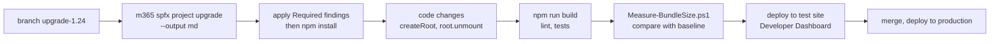

# Co přináší SPFx 1.24 a 1.25

> Typ: povinný · Den: 5 · Odhad: 20 min
> Tenant: — · Režim: výklad + návrh (odhad dopadu na vlastní řešení)
> Prostředí: [`../../environment.md`](../../environment.md) · Názvosloví: [`../../GLOSSARY.md`](../../GLOSSARY.md)

Kurz stojí na SPFx 1.23.2. Verze 1.24 byla v týdnu kurzu ve stavu release candidate s GA
ohlášenou na říjen 2026. Blok neříká „co je nového", ale **co by upgrade stál řešení
`vltava-portal`**.

## Cíle

- Pojmenovat změny SPFx 1.24 a plán 1.25 podle dokumentace a podle skutečného výstupu
  generátoru.
- Odhadnout pro vlastní řešení, které soubory a rozhodnutí upgrade změní.
- Rozlišit, co je ověřené (RC, release notes) a co jen ohlášené (roadmapa).

## Výklad

### SPFx 1.24 — co říká generátor RC

> [!IMPORTANT] Generátor 1.24.0-rc.0 vygeneroval React 18 a `createRoot` — ověřeno (2026-10-16)
> Projekt vygenerovaný `@microsoft/generator-sharepoint@1.24.0-rc.0` (web part, React):
>
> | | 1.23.2 (kurz) | 1.24.0-rc.0 |
> |---|---|---|
> | `react` / `react-dom` | 17.0.1 | **18.3.1** |
> | `@types/react` | 17.0.45 | 18.2.79 |
> | vykreslení web partu | `ReactDom.render(...)` | **`createRoot(this.domElement)`** z `react-dom/client` |
> | Node.js (`engines`) | `>=22.14.0 <23` | **22, 24 nebo 26** |
> | `@rushstack/heft` | 1.2.17 | 1.3.2 |
> | `@fluentui/react` | ^8.106.4 | ^8.106.4 (beze změny) |
> | TypeScript | ~5.8 | ~5.8 (beze změny) |
> | `overrides` | `@rushstack/heft` | navíc `qs`, `uuid` (opravy auditu) |
>
> **Release candidate není GA — kurz na něj nepřechází, ale víme přesně, co přijde.**

Podle roadmapy (září 2026) má 1.24 GA přinést také **Copilot UX components** jako GA:
SPFx komponenty vykreslené uvnitř Microsoft 365 Copilot, zabalené s deklarativním agentem do
stejného `.sppkg`. Licencování po GA nebylo potvrzené.

Zdroje: [SPFx roadmap](https://learn.microsoft.com/en-us/sharepoint/dev/spfx/roadmap),
[Overview of Copilot UX components](https://learn.microsoft.com/en-us/sharepoint/dev/spfx/copilot/overview-copilot-apps),
[roadmap update září 2026](https://devblogs.microsoft.com/microsoft365dev/sharepoint-framework-spfx-roadmap-update-september-2026/).

### Další změny, které se týkají každého

| Co | Kdy | Dopad |
|---|---|---|
| Gulp toolchain | od 1.24 **bez podpory** | staré projekty migrovat na Heft |
| Hosted workbench | deprecated od 1.23.0 (2026-05-13); **1.23 je poslední verze s podporou**, retirement **2026-12-01** | upgrade na 1.24 = konec workbenche i před retirementem; ladit na moderní stránce s Debug Toolbarem (den 1) — [release notes 1.23.0](https://learn.microsoft.com/en-us/sharepoint/dev/spfx/release-1.23.0#deprecations) |
| SPFx CLI (náhrada Yeoman generátoru) | GA plánované v 1.25 | `yo @microsoft/sharepoint` v návodech zastará |
| Navigation customizers | plánované v 1.25 | nový typ extension pro navigaci |

Zdroje: [Heft-based toolchain](https://learn.microsoft.com/en-us/sharepoint/dev/spfx/toolchain/sharepoint-framework-toolchain-rushstack-heft),
[Build your first web part](https://learn.microsoft.com/en-us/sharepoint/dev/spfx/web-parts/get-started/build-a-hello-world-web-part).

### Co by upgrade udělal s `vltava-portal`

| Místo v řešení | Co se změní |
|---|---|
| `render()` a `onDispose()` čtyř web partů (Rozcestník, Adresář, Evidence, Výdejna — `ReactDom.render`, `unmountComponentAtNode`) | přechod na `createRoot` / `root.unmount()` |
| `ErrorBoundary` | beze změny — třídní komponenta platí i v Reactu 18 |
| funkční komponenty a hooks | beze změny; `getId` z Fluent UI může nahradit `useId` z Reactu 18 |
| `opt-kendo-react` | lze přejít na aktuální KendoReact (14+ vyžaduje React 18) |
| balíček | velikosti znovu změřit — React se nebalí, ale typy a Fluent UI se mohou posunout |
| CI | `node-version` může zůstat 22; Node.js 24 je volitelný |

Postup analýzy: `m365 spfx project upgrade --toVersion <verze> --output md` (viz
[`../../day-4/packaging-deployment/`](../../day-4/packaging-deployment/)).

Stav podkladů k 2026-10-23: tabulka kompatibility na Learn (aktualizovaná 2026-10-19) už
uvádí **SPFx 1.24 s Node.js v22, v24, v26, TypeScriptem v2.9–v5.8 a Reactem v18.3.1**
([SPFx compatibility](https://learn.microsoft.com/en-us/sharepoint/dev/spfx/compatibility)).
Release notes 1.24 jsou ale stále *preview release notes* — rc.0 vyšel 2026-10-02, GA je
cílené na říjen ([SPFx v1.24 preview release notes](https://learn.microsoft.com/en-us/sharepoint/dev/spfx/release-1.24.0)).
Na npm je k témuž dni `latest` = 1.23.2 a `next` = 1.24.0-rc.0. Kurz proto zůstává na 1.23.2.

### React 18: `createRoot` a automatické dávkování

Upgrade na React 18 má dvě vrstvy. **Povinná** je výměna API kořene: `ReactDOM.render` je
v Reactu 18 deprecated, vypíše varování a aplikace s ním běží „jako v Reactu 17"; náhradou je
`createRoot(container)` a místo `unmountComponentAtNode(container)` se volá `root.unmount()`
([React 18 upgrade guide](https://react.dev/blog/2022/03/08/react-18-upgrade-guide)).
Bez `createRoot` nové funkce Reactu 18 nefungují
([React v18.0](https://react.dev/blog/2022/03/29/react-v18)).

Pro web part to znamená držet kořen v poli třídy: `render()` web partu neběží jen jednou
(u Rozcestníku ho reaktivní property pane z dne 2 volá při každé změně vlastnosti) a kořen se
má vytvořit jen jednou, pak se do něj jen znovu vykresluje. Náčrt pro
`EquipmentDeskWebPart` — **návrh, neověřeno buildem na 1.24**; přesný tvar ukáže generátor GA:

```typescript
// SPFx 1.23.2 (today)
ReactDom.render(element, this.domElement);
// ...
ReactDom.unmountComponentAtNode(this.domElement);

// React 18 (sketch)
import { createRoot, type Root } from 'react-dom/client';

private _root: Root | undefined;

public render(): void {
  if (!this._root) {
    this._root = createRoot(this.domElement);
  }
  this._root.render(element);
}

protected onDispose(): void {
  this._root?.unmount();
  this._root = undefined;
}
```

**Druhá vrstva** je změna chování, kterou `createRoot` zapne: **automatické dávkování**.
Do Reactu 17 se do jednoho překreslení slučovaly jen změny stavu uvnitř obsluhy událostí
Reactu. Změny v `Promise`, `setTimeout` nebo nativních událostech se nedávkovaly — každý
`setState` mohl znamenat vlastní překreslení. S `createRoot` se dávkují všechny, odkudkoli
přijdou (react.dev, tamtéž).

V řešení je na to přesný příklad — `useLoans` nastavuje pět stavů v `.then` po načtení dat:

```typescript
Promise.all([service.getOpen(), service.getHistory(), service.getAvailable()]).then(
  ([openLoans, allLoans, availableItems]) => {
    if (!cancelled) {
      setOpen(openLoans);        // React 17: updates in a promise are not batched
      setHistory(allLoans);      // React 18 + createRoot: one batched re-render
      setAvailable(availableItems);
      setListMissing(false);
      setLoading(false);
    }
  });
```

V Reactu 17 se mohou mezi jednotlivými `set*` objevit mezistavy (např. nová data a ještě
`loading`); kód je na to napsaný tak, aby nevadily. Kolik překreslení skutečně proběhne, jsme
**neměřili** — pokud na tom něco stojí, změřit (React DevTools Profiler) před upgradem i po něm.
Pro backlog: chování se může změnit u kódu, který spoléhá na to, že se stav propíše hned po
`setState` mimo obsluhu události; pro odhlášení z dávkování v jednom místě uvádí upgrade guide
Reactu `flushSync` — jako výjimku, ne pravidlo.

### Node.js: proč kurz nepřepíná na 24 nebo 26

Node.js má pevný cyklus: každá hlavní verze je šest měsíců *Current*; sudé verze (do Node.js 26
včetně) pak přecházejí do *LTS*, které typicky dostává opravy kritických chyb celkem 30 měsíců.
Produkční aplikace mají používat jen *Active LTS* nebo *Maintenance LTS*
([Node.js releases](https://nodejs.org/en/about/previous-releases)). Stav na téže stránce
k 2026-10-23:

| Node.js | Stav | SPFx 1.23.2 | SPFx 1.24 (Learn) |
|---|---|---|---|
| 22 | LTS | ano | ano |
| 24 | LTS | ne | ano |
| 26 | **Current** (vydán 2026-05-05) | ne | ano |

Co z toho plyne pro projekt:

- Build potřebuje Node.js, který podporuje **verze SPFx v projektu** — `engines` v
  `package.json` (`>=22.14.0 <23` v 1.23.2). Novější Node.js na stroji neznamená novější SPFx.
- Node.js 26 podporovaný v 1.24 je k datu kurzu ve fázi *Current*, ne LTS — pro CI a sdílené
  stroje zatím ne. Node.js 22 zůstává společný jmenovatel 1.23.2 i 1.24.
- Přepnutí verze Node.js na stroji s více projekty řeší správce verzí (fnm, den 1), ne
  přeinstalace.

### Workflow upgradu: analýza, změna, důkaz

`m365 spfx project upgrade` **nemění soubory projektu** — vypíše report s kroky. Každé zjištění
má ID, soubor a místo, řešení (příkaz `npm` nebo úpravu JSON) a závažnost *Required* nebo
*Recommended*. `--toVersion` bez hodnoty míří na nejnovější verzi, kterou CLI podporuje (na
stránce příkazu k 2026-10-23: 1.23.2); `--preview` cílí na nejnovější preview
([spfx project upgrade](https://pnp.github.io/cli-microsoft365/cmd/spfx/project/project-upgrade/)).
Zda aktuální CLI umí analyzovat přechod na **1.24.0-rc.0**, je **neověřeno**.



Proč takhle:

- **Report místo ručního zvedání verzí.** Balíčky SPFx jsou testované s konkrétními verzemi
  závislostí a změna těchto verzí může rozbít build nebo běh
  ([npm audit vulnerabilities in SPFx](https://learn.microsoft.com/en-us/sharepoint/dev/spfx/npm-vulnerabilities));
  plošné zvednutí závislostí (ncu, `npm update`) přesně tohle dělá. Report říká, které balíčky,
  na jakou verzi a co dalšího změnit.
- **`npm install` po změně `package.json`** — upgrade mění lockfile; commituje se oba soubory
  (viz `ci-cd-quality`), jinak `npm ci` v pipeline selže.
- **Brány z týdne jsou důkaz.** Testy, lint, test lokalizace a brána velikosti z
  [`../ci-cd-quality/`](../ci-cd-quality/) běží beze změny i po upgradu — co projde, je doložené,
  ne odhadnuté.
- **Měření před a po.** Baseline velikostí z `bundle-baseline` je srovnávací bod. React se do
  bundlu nebalí, ale typy, Fluent UI a PnPjs se při upgradu mohou posunout — číslo rozhodne.

### AI asistovaný vývoj SPFx — v praxi, ne v kurzu

V kurzu AI asistenta nepoužíváme: cílem je rozumět toolchainu a kódu, ne ho nechat napsat.
V praxi ho lektor doporučuje — s podmínkou, že model dostane aktuální fakta.

**Zkušenost lektora** (dlouhodobé sledování vlastních projektů, 2026, subjektivní): SPFx
aplikace od analýzy po nasazení a dokumentaci vznikají zhruba **dvakrát rychleji** než bez AI.
Největší zrychlení je ve scaffoldu a opakujících se vzorech; jinde je asistenta nutné vést
a každou změnu schválit a místy zdržuje. Platí to pro zkušeného vývojáře — u juniorů je
zrychlení podle stejné zkušenosti minimální. Proto se v kurzu nejdřív učí toolchain bez AI:
kdo ho nezná, nepozná, kdy mu model radí špatně.

**Co říkají měření:** randomizovaná studie METR (16 zkušených vývojářů, 246 úkolů, nástroje
z počátku 2025) naměřila **zpomalení o 19 %** — a vývojáři si přitom mysleli, že byli o 20 %
rychlejší. Opakování s nástroji z konce 2025 (57 vývojářů, 800+ úkolů) ukazuje zrychlení
o 4–18 %, autoři ho ale sami označují za nespolehlivý signál. Pointa: **měř vlastní čas,
pocit klame.**

Co AI potřebuje, aby zrychlovala, a ne generovala rychle špatný kód:

- **rozhodnutou architekturu** — agent dostane zadání a hotový návrh, ne „udělej web part",
- **instrukční soubor v repu** s fakty o projektu (viz níže),
- **silné typy** — TypeScript drží agenta v mantinelech,
- **testy, lint a brány v buildu** — agent si výsledek ověří sám a chyba neprojde.

Přesně tyhle mantinely kurz staví celý týden: typované služby, ESLint, Jest testy a brána
velikosti v `ci-cd-quality`. Projekt z kurzu je tak dobrý výchozí bod i pro práci s AI.

| Nástroj | Co dělá |
|---|---|
| **GitHub Copilot** ve VS Code (agent mode) | píše a upravuje kód v projektu, spouští build |
| **Claude Code** (terminál, VS Code) | agent nad celým projektem; instrukce čte z `CLAUDE.md` v repu |
| **SharePoint Framework Toolkit** | chat participant `@spfx` v Copilot Chatu; v agent mode nástroje jako `SharePointFrameworkProjectUpgrade` nebo `SharePointAppInstall` |
| **Microsoft Learn MCP Server** | `https://learn.microsoft.com/api/mcp` — model čte aktuální dokumentaci Microsoftu místo toho, co si pamatuje; zdarma, bez přihlášení |

Proč u SPFx zvlášť opatrně:

- **Modely znají hlavně gulp éru.** Navrhnou `gulp serve`, plošné zvedání závislostí nebo
  `npm audit fix` — přesně to, co kurz zakazuje. Pomáhá instrukční soubor v repu projektu
  (`.github/copilot-instructions.md` pro GitHub Copilot, `CLAUDE.md` pro Claude Code), který
  zafixuje fakta: Heft, Node.js 22, React 17, verze jen přes `m365 spfx project upgrade`.
- **Nástroje v agent mode mění tenant.** Nástroje SPFx Toolkitu zakládají a mažou weby,
  seznamy a aplikace v tenantu, ke kterému je Toolkit přihlášený. Před každým během ověř,
  o který tenant jde.
- **Do chatu nepatří identifikátory a tajemství** — tenant ID, Client ID, klíče k API.
  Stejné pravidlo jako pro bundle (`diagnostics-hardening`).

Zdroje: [SharePoint Framework Toolkit](https://github.com/pnp/vscode-viva),
[Microsoft Learn MCP Server](https://learn.microsoft.com/en-us/training/support/mcp),
[METR — Early-2025 AI and experienced OS developers (2025-07-10)](https://metr.org/blog/2025-07-10-early-2025-ai-experienced-os-dev-study/),
[METR — Uplift update (2026-02-24)](https://metr.org/blog/2026-02-24-uplift-update/).

## Klíčové rozlišení

- **RC vs. GA vs. roadmapa** — RC jde vygenerovat a změřit; roadmapa je záměr.
- **Změna toolchainu vs. změna runtime** — Node.js a Heft mění build; React 18 mění kód.
- **`createRoot` vs. `ReactDOM.render` v Reactu 18** — první zapne nové chování (včetně
  automatického dávkování), druhý funguje dál, ale s varováním a v režimu Reactu 17.
- **Node.js LTS vs. Current** — podporovaná verze SPFx ještě neznamená verzi vhodnou pro
  produkci; pro CI a sdílené stroje jen LTS.
- **Report upgradu vs. upgrade** — `m365 spfx project upgrade` nic nemění; změnu dělá člověk
  a dokládá ji build a měření.

## Naše prostředí

Výklad a návrh; nic se neinstaluje (RC se na učebních strojích **neinstaluje**).

## Lab

Viz [`lab-odhad-upgradu.md`](lab-odhad-upgradu.md).

## Nosná linka

Student ví, co by jeho řešení stál přechod na SPFx 1.24 — a umí to v capstonu říct jako
položku backlogu s odhadem.

## Zdroje (Microsoft)

- [SharePoint Framework roadmap](https://learn.microsoft.com/en-us/sharepoint/dev/spfx/roadmap)
- [Overview of Copilot UX components](https://learn.microsoft.com/en-us/sharepoint/dev/spfx/copilot/overview-copilot-apps)
- [Heft-based toolchain](https://learn.microsoft.com/en-us/sharepoint/dev/spfx/toolchain/sharepoint-framework-toolchain-rushstack-heft)
- [SPFx roadmap update — září 2026 (Microsoft 365 Developer Blog)](https://devblogs.microsoft.com/microsoft365dev/sharepoint-framework-spfx-roadmap-update-september-2026/)
- [SharePoint Framework compatibility reference](https://learn.microsoft.com/en-us/sharepoint/dev/spfx/compatibility) (aktualizováno 2026-10-19)
- [SharePoint Framework v1.24 preview release notes](https://learn.microsoft.com/en-us/sharepoint/dev/spfx/release-1.24.0) (rc.0, 2026-10-02)

## Zdroje (třetí strana — React, Node.js, CLI for Microsoft 365)

> [!IMPORTANT] Proč odkaz mimo Learn
> React dokumentuje React, LTS harmonogram Node.js dokumentuje nodejs.org, příkazy CLI for
> Microsoft 365 dokumentuje PnP.

- [React v18.0](https://react.dev/blog/2022/03/29/react-v18)
- [How to upgrade to React 18](https://react.dev/blog/2022/03/08/react-18-upgrade-guide)
- [Node.js — previous releases](https://nodejs.org/en/about/previous-releases)
- [CLI for Microsoft 365 — spfx project upgrade](https://pnp.github.io/cli-microsoft365/cmd/spfx/project/project-upgrade/)

## Stav produktu / delta

> [!WARNING] Ověřit k datu běhu — stav k 2026-10.
> K 2026-10-16: npm `latest` = 1.23.2, `next` = 1.24.0-rc.0. Pokud 1.24 vyjde GA během
> kurzu, aktualizovat tabulku podle release notes 1.24 a vygenerovat znovu.
