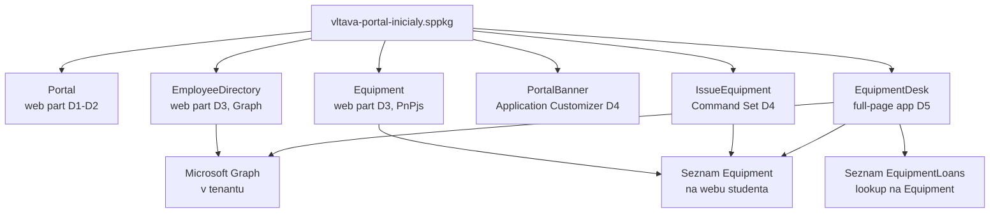

# Scénář — portál Vltava Servis

Nosná linka celého týdne. Každý modul na tento soubor odkazuje: co do řešení přidává
a co se tím změnilo.

## Zadání

**Vltava Servis s.r.o.** je fiktivní servisní firma s 240 zaměstnanci v 6 odděleních. Intranet
běží na SharePoint Online. IT chce na intranetu tři věci, které standardní webparty neumí:

1. **Rozcestník** — uvítací web part s odkazy na systémy firmy, který si každé oddělení
   nastaví samo (bez zásahu vývojáře) a který mluví česky i anglicky.
2. **Adresář zaměstnanců** — vyhledávání kolegů podle jména a oddělení nad Microsoft Graph.
3. **Evidence vybavení** — kdo má jaký notebook a telefon, nad seznamem SharePointu, s akcí
   „Vydat zařízení" přímo v seznamu. K tomu **Výdejna** — aplikace pro IT, která výdej
   a vrácení zapisuje do historie výpůjček.

Firma má jednu podmínku, která se táhne celým týdnem: **data zůstávají v tenantu firmy.**
Řešení nesmí posílat data zaměstnanců do služby mimo Microsoft 365 a každé oprávnění k API
musí být vědomě schválené.

## Co student staví

Jedno SPFx řešení `vltava-portal-<iniciály>`, které každý den roste o jednu vrstvu:

| Den | Co přibude | Moduly |
|---|---|---|
| 1 | kostra řešení, web part **Rozcestník** (`Portal`) běží na vlastním webu | `dev-environment`, `project-anatomy`, `first-webpart` |
| 2 | konfigurace oddělením přes property pane, čeština + angličtina, funkční komponenty a Fluent UI, struktura `components/` `hooks/` `models/` | `property-pane`, `localization`, `react-fluent-ui` |
| 3 | web part **Adresář zaměstnanců** (Graph), web part **Evidence vybavení** (PnPjs), schválená API oprávnění, první změřená velikost balíčku | `data-access-clients`, `permissions-consent`, `pnpjs`, `bundle-baseline` |
| 4 | banner oznámení (Application Customizer), akce **Vydat zařízení** (Command Set), změřená optimalizace balíčku a cache hledání, upgrade na verzi 1.1.0.0 | `extensions`, `performance-caching`, `packaging-deployment` |
| 5 | pipeline s lintem, testy a limitem velikosti balíčku, logování, performance marks a error boundary, kontrola závislostí; samostatně full-page aplikace **Výdejna vybavení** nad seznamem `EquipmentLoans` (lookup na `Equipment`), upgrade na 1.2.0.0; ukázka a backlog | `ci-cd-quality`, `diagnostics-hardening`, `equipment-desk`, `spfx-whats-next`, `capstone` |



## Pravidla, která drží linku pohromadě

- **Jedno řešení na studenta.** Student si ho v pondělí vygeneruje sám a hned mu dá svou
  identitu skriptem `Set-StudentIdentity.ps1` (viz níže). Celý tenant je sdílený a ID se na
  něm nesmí potkat.
- **Jeden web na studenta:** `/sites/spodev-<iniciály>`. Na něm je testovací stránka, seznam
  `Equipment` (od dne 3) a od dne 3 i aplikace z tenantového App Catalogu. Druhý web
  `spodev-<iniciály>-cs` v češtině slouží k testu lokalizace a jako web **bez** aplikace.
- **Každý kódový lab má startovní a cílový kód.** Start = `solution/` předchozího modulu,
  cíl = `solution/` tohoto modulu. Lab mezi nimi vede rozdílovými kroky. Slouží ke srovnání
  (`diff`) a k dohnání skluzu, ne k odevzdání.

## Identita řešení na sdíleném tenantu

Všichni nasazují do **jednoho** tenantového App Catalogu. Koliduje všechno, co nese ID nebo
jméno:

| Co | Kde | Co se stane při shodě |
|---|---|---|
| ID řešení | `config/package-solution.json`, `.yo-rc.json` | druhé nahrání přepíše řešení kolegy |
| ID feature | `package-solution.json`, cesta v `upgrade-actions-*.xml` | upgrade běží nad cizím řešením |
| ID komponent | `*.manifest.json`, `elements.xml`, `serve.json`, `teams/<id>_*.png` | student testuje cizí kód |
| název řešení a balíčku | `package-solution.json`, `package.json` | v katalogu nejde poznat, čí co je |
| titulek web partu | `preconfiguredEntries` v manifestu | v toolboxu patnáct stejných web partů |

Řeší to jeden příkaz:

```powershell
& "$HOME\gopas-spo_dev_1\scripts\Set-StudentIdentity.ps1" -Initials <ini> -ProjectPath <projekt>
```

- ID **nejsou náhodná**: jsou odvozená z iniciál, názvu projektu (`vltava-portal`,
  `kendo-sandbox`) a aliasu komponenty (UUID v5). Stejný
  student dostane vždy stejná ID — ve vlastním projektu i v kódu převzatém ze `solution/`
  kteréhokoli modulu. App Catalog proto vidí pořád **totéž** řešení a upgrade funguje.
- Dva studenti s různými iniciálami nemají žádné ID společné. **Stejné iniciály** rozliší
  lektor ráno číslicí (`pm`, `pm2`) — skript stejné iniciály rozlišit neumí.
- Druhé spuštění nic nezmění; spuštění s jinými iniciálami na stejném projektu skript odmítne
  (soubor `.student-identity`).
- Doplní `-<ini>` do názvu řešení a `.sppkg` a ` (<ini>)` do titulků web partů.
- `solution/` v repu nesou šablonová ID kurzu a **nikdy** se nenasazují bez tohoto skriptu.
  Lektor to kontroluje skriptem `scripts/Find-CatalogCollisions.ps1` (ráno dne 3).

## Jak převzít startovní kód ze `solution/`

Když student nestihne lab nebo se mu projekt rozbije, převezme **celý** stav ze `solution/`
předchozího modulu (Startovní čára každého labu říká kterého):

```powershell
$from = "$HOME\gopas-spo_dev_1\<den>\<modul>\solution\vltava-portal"
$to = "$HOME\spodev\vltava-portal-<ini>"
robocopy $from $to /E /XD node_modules     # copies and overwrites, deletes nothing
Set-Location $to
npm install
& "$HOME\gopas-spo_dev_1\scripts\Set-StudentIdentity.ps1" -Initials <ini> -ProjectPath $to
npm run build
```

- `robocopy` končí kódem 1–7 při úspěchu (0 = nic ke kopírování); 8 a víc je chyba.
- `/E` nic nemaže — vlastní soubory (`measurements/`, `HARDENING.md`, `.student-identity`)
  zůstanou.
- **Bez `Set-StudentIdentity.ps1` nikdy nenasazovat.** Převzatý kód má šablonová ID kurzu;
  nasazení by přepsalo řešení kohokoli dalšího, kdo udělal totéž.

## Co se tento týden **nestaví**

- **Vlastní backend API.** AadHttpClient se ukazuje proti Microsoft Graph; stavba vlastního
  API v Azure je kvůli času mimo rozsah kurzu. Jako architektura je doporučená — v Azure
  subscription zákazníka podmínku „data zůstávají v tenantu" splňuje (viz
  [`platform-positioning`](day-1/platform-positioning/README.md)).
- **Copilot UX components.** Preview funkce SPFx 1.24 — jen ukázka v `spfx-whats-next`.
- **Řešení pro SharePoint Server.** Kurz cílí na SharePoint Online; on-premises podporuje jen
  starší verze SPFx (viz [`day-1/platform-positioning/`](./day-1/platform-positioning/)).
