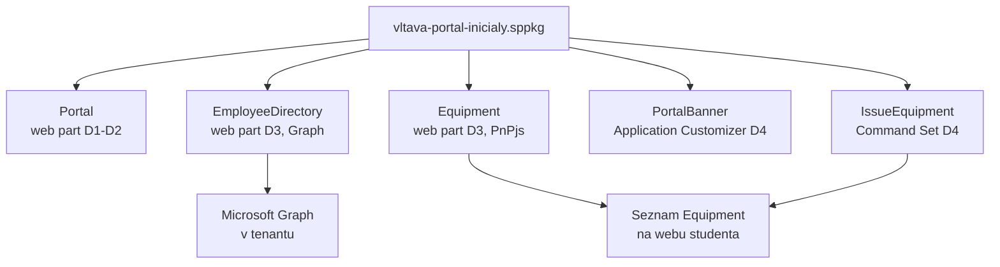

# Scénář — portál Vltava Servis

Nosná linka celého týdne. Každý modul na tento soubor odkazuje: co do řešení přidává
a co se tím změnilo.

## Zadání

**Vltava Servis s.r.o.** je fiktivní servisní firma s 240 zaměstnanci v 6 odděleních. Intranet
běží na SharePoint Online. IT chce na intranetu tři věci, které standardní webparty neumí:

1. **Rozcestník** — uvítací web part s odkazy na systémy firmy, který si každé oddělení
   nastaví samo (bez zásahu vývojáře) a který mluví česky i anglicky.
2. **Adresář zaměstnanců** — vyhledávání kolegů podle jména a oddělení nad Microsoft Graph.
3. **Evidence vybavení** — kdo má jaký notebook a telefon, nad seznamem SharePointu, s akcí
   „Vydat zařízení" přímo v seznamu.

Firma má jednu podmínku, která se táhne celým týdnem: **data zůstávají v tenantu firmy.**
Řešení nesmí posílat data zaměstnanců do služby mimo Microsoft 365 a každé oprávnění k API
musí být vědomě schválené.

## Co student staví

Jedno SPFx řešení `vltava-portal-<iniciály>`, které každý den roste o jednu vrstvu:

| Den | Co přibude | Moduly |
|---|---|---|
| 1 | kostra řešení, web part **Rozcestník** (`Portal`) běží na vlastním webu | `dev-environment`, `project-anatomy`, `first-webpart` |
| 2 | konfigurace oddělením přes property pane, čeština + angličtina, funkční komponenty a Fluent UI, struktura `components/` `hooks/` `models/` | `property-pane`, `localization`, `react-fluent-ui` |
| 3 | web part **Adresář zaměstnanců** (Graph), web part **Evidence vybavení** (PnPjs), schválená API oprávnění, první změřená velikost balíčku | `data-access-clients`, `permissions-consent`, `pnpjs`, `bundle-baseline` |
| 4 | banner oznámení (Application Customizer), akce **Vydat zařízení** (Command Set), změřená optimalizace balíčku a cache hledání, upgrade na verzi 1.1.0.0 | `extensions`, `performance-caching`, `packaging-deployment` |
| 5 | pipeline s lintem, testy a limitem velikosti balíčku, logování, performance marks a error boundary, kontrola závislostí, obhajoba | `ci-cd-quality`, `diagnostics-hardening`, `spfx-whats-next`, `capstone` |



## Pravidla, která drží linku pohromadě

- **Jedno řešení na studenta.** Student si ho v pondělí vygeneruje sám — tím dostane vlastní
  `solution.id` a vlastní ID komponent. Celý tenant je sdílený a ID se na něm nesmí potkat.
- **Jeden web na studenta:** `/sites/spodev-<iniciály>`. Na něm je testovací stránka, seznam
  `Equipment` (od dne 3) a od dne 3 i aplikace z tenantového App Catalogu. Druhý web
  `spodev-<iniciály>-cs` v češtině slouží k testu lokalizace a jako web **bez** aplikace.
- **Každý den končí `solution/`.** Modul, kterým den končí, má ve složce `solution/` stav
  řešení **po** dni. Slouží ke srovnání (`diff`) a k dohnání skluzu, ne k odevzdání.

## Jak dohnat skluz ze `solution/`

Když student nestihne lab, převezme stav ze `solution/` posledního modulu dne. Kopíruje
**jen zdrojáky**, ne identitu řešení:

1. Zkopírovat složku `src/` ze `solution/vltava-portal/` do vlastního projektu (přepsat).
2. Porovnat `dependencies` v `package.json` a doinstalovat, co chybí (`npm install <balíček>`
   s verzí ze `solution/`).
3. **Vygenerovat nová ID komponent.** V každém `*.manifest.json` pod `src/` nahradit hodnotu
   `"id"` novým GUIDem:

   ```powershell
   [guid]::NewGuid().ToString()
   ```

4. **Neměnit** vlastní `config/package-solution.json` a `.yo-rc.json` — nesou ID řešení.
5. Od dne 4: ID extensions v `sharepoint/assets/elements.xml` (`ClientSideComponentId`) musí
   odpovídat novým ID z kroku 3 a GUID v `upgrade-actions-v1.1.xml` GUIDu feature z **vlastního**
   `package-solution.json`.

> [!WARNING] Proč krok 3 nevynechat
> Řešení ze `solution/` má pevná ID komponent. Pokud by dva studenti nasadili do tenantového
> App Catalogu (den 3) komponentu se stejným ID, druhé nasazení koliduje s prvním a jeden
> z nich bude testovat cizí kód. Na sdíleném tenantu je to chyba, kterou nikdo nevidí, dokud
> se nezačne divit.

## Co se tento týden **nestaví**

- **Vlastní backend API.** AadHttpClient se ukazuje proti Microsoft Graph; vlastní API
  v Azure je mimo rozsah kurzu (a mimo podmínku „data zůstávají v tenantu").
- **Copilot UX components.** Preview funkce SPFx 1.24 — jen ukázka v `spfx-whats-next`.
- **Řešení pro SharePoint Server.** Kurz cílí na SharePoint Online; on-premises podporuje jen
  starší verze SPFx (viz [`day-1/platform-positioning/`](./day-1/platform-positioning/)).
